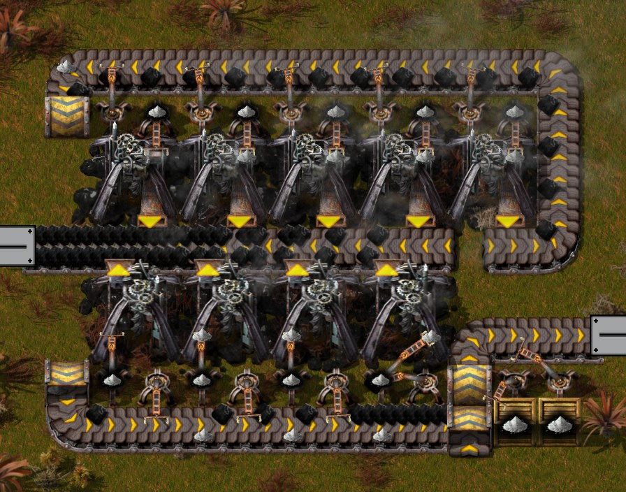
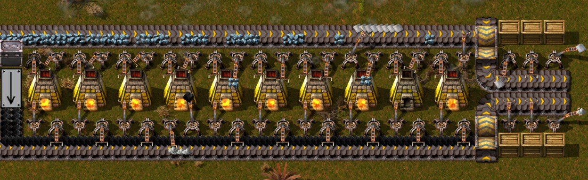

# Blueprints

[中文版](README.zh-CN.md)

The author's blueprint book for the tutorial so far. Import a file's content with the in-game
"Import string" button; `book.txt` holds all of them as one blueprint book (order and label in
`book.json`). Explanations: [chapter 1](../chapters/01-landing-to-red-science.md),
[chapter 2](../chapters/02-coke-steel-crushed-iron.md),
[chapter 3](../chapters/03-ash-separation-raw-coal-power.md),
[chapter 4](../chapters/04-aluminium-glass-logs.md),
[chapter 5](../chapters/05-tin-zinc-smelting.md),
[chapter 6](../chapters/06-simple-circuit-boards.md),
[chapter 7](../chapters/07-copper-screening-titanium-duralumin.md),
[chapter 9](../chapters/09-py-science-pack-1.md), chapters 11 to 14 and
[chapter 15](../chapters/15-train-preparation-1.md) (the railway).

Where the numbers come from: the two burner designs of chapter 1 were built and run in the engine
by `tools/design-lab` (5 minutes of game time, rates measured after the first minute), in the
versions shown in the lab pictures below; the files now hold the author's current versions,
turned round but otherwise the same (noted per design). The chapter 2 designs were measured where
they stand in the author's game: the recorder's production statistics (10-minute windows) and one
minute of the save of 3:37 run by `tools/inspect-save.ps1 -Ticks 3700`; they have not been run in
the design lab. The chapter 3 designs likewise, in the save of 6:13 (one more minute) and, for
the steel site, in engine tests on a copy of that save (`tools/save-probe.ps1`). From chapter 4 on,
designs are also run on the blueprint bench (`tools/bp-bench.ps1`): the blueprint alone on an empty
map, unlimited power, full input belts, emptied output belts, crafts counted against each
machine's full speed.

| File | In game | What it is | Measured |
|---|---|---|---|
| `burner-mall.txt` | 初期超市-0 | The author's first mall: 6 Burner assembling machines, no belts, making Small parts and Air-core inductors | Not measured |
| `smelting-column.txt` | 0.9375 [Iron plate]/[Copper plate] | The author's smelting column: 10 Stone furnaces on half a belt of ore, for iron or copper | Earlier version, iron and copper each: 0.91 plates/s, 0.60 Ash/s, no mixed items, 0 ore left after the supply stops. Two current ones on copper: 1.85 plates/s together |
| `raw-coal-module.txt` | 15 [Raw coal] | The author's raw coal module: 9 Burner mining drills filling one belt | Earlier version: 15.00 Raw coal/s, 1.40 Ash/s into chests |
| `raw-coal-power.txt` | 初期满带原煤发电（不清灰） | 12 Boilers and 6 Steam engines on one belt of Raw coal, no Ash inserters | 49–52 Steam/s (12.1–12.8 MW) at the load of 2:00–2:30; full output 22.2 MW from data |
| `coke-distillation.txt` | 2.7 [Coke] | 3 + 2 Destructive distillation columns, Raw coal to Coal to Coke; since chapter 5 a sixth column turns surplus Coke into Coal gas and Tar (its inserters run while the belt end holds 4 Coke or more), and no Exhaust pipe | Chapter 2 version: 2.71 Coke/s (2:00–2:10), about 88 Coal gas/s vented. Bench of the chapter 5 version: 2.70 Coke/s with the Coal gas taken; Coke not taken: all of it into Tar (70.2 Tar/s); Coal gas taken at only 20/s: 18 % (0.5 Coke, 12.5 Tar/s); Coal gas not taken: stops ([chapter 5](../chapters/05-tin-zinc-smelting.md#6-aromatics-from-tar-and-where-the-rest-goes)) |
| `steel-foundries.txt` | 0.533 [Steel plate] | 8 Advanced foundries, each under its own Soil extractor (runs while the foundry holds under 10 Limestone); Steel into a chest limited to 500 | Engine tests on copies of the saves: 0.533 Steel/s with < 10 (the file), 0.493 with < 8, 0.440 and 0.435 with < 5 (chapter 2's version, 0.43–0.44 in play) ([chapter 3](../chapters/03-ash-separation-raw-coal-power.md#9-steel-limestone--8)) |
| `crushed-iron.txt` | 3 [Iron plate] | 6 Jaw crushers, 18 iron furnaces and 5 brick furnaces on a full belt of Iron ore | 3.02 Iron plate/s and 1.52 Stone brick/s; two copies (one more Small electric pole since chapter 5): 6.1 Iron plates/s |
| `burner-belt-mall.txt` | 初期超市-1 | The author's second mall: 7 Burner assembling machines making Mechanical inserters, Transport belts and Small parts from the bus's plates | Not measured (stocked its chests and stopped) |
| `raw-coal-power-two-belts.txt` | 两满带原煤发电 | 24 Boilers and 12 Steam engines on two belts of Raw coal, Ash to 3 Solid separators on top | 44.4 MW and 29.6 Raw coal/s from data. At 6:13 only the east half had water (22.2 MW at most; 49.5 Steam/s, 12.2 MW with the Coal dust Boilers, in the minute after); the author has since piped it across, all engines running at 6:14 |
| `ash-separation.txt` | 灰烬分离 | 3 Solid separators between two Ash belts, 13 inserters each; Coal dust, Soot and Iron oxide out through buffer chests. In the author's base only the belt above is fed | Bench: 50 % with the belt above full (15 Ash/s), 100 % with both (29.9 Ash/s); 20–32 Ash/s separated by both separator groups together in play (5:20–6:10) |
| `soot-separation.txt` | 烟煤分离 | 1 Solid separator on Soot; each ore into its own chest and Stone furnace (Coal dust as fuel) | 0.5–1.3 Soot/s used (5:50–6:13); Zinc and Lead ore wait in the chests |
| `iron-oxide-smelting.txt` | 氧化铁处理 | 2 Stone furnaces, Iron oxide to Iron plates (2 : 1), one input inserter each | Bench: 1.717 Iron oxide/s, 0.85 Iron plates/s, furnaces at 15 % (the inserters set the pace); 0.7–0.9 Iron oxide/s in play (6:00–6:13). The chapter 9 export, input and output inserters swapped, measures the same (1.713 and 0.857) |
| `coal-dust-power.txt` | 煤粉处理 | 2 Boilers on Coal dust and 2 Steam engines (one more than the steam needs, so Coal dust burns first) | 2.03 Coal dust/s burnt in the minute after 6:13, about the two-engine share computed from data |
| `log-production.txt` | 2.348 [Log] | Logs: 10 Moss farms, 8 Botanical nurseries, 16 Fastwood forestries, a Wood processing unit for the Tree seeds; Ash, Stone bricks and Coke in, Logs out | Bench: 2.336 Logs/s (nurseries and forestries at 100 %), Ash 12, Stone bricks 1.25, Coke 0.31 a second ([chapter 4](../chapters/04-aluminium-glass-logs.md#6-the-log-block)). The author's note: the High pressure furnace can become a Moondrop greenhouse (9 × 9 against 7 × 7, so a little rebuilding; [chapter 5](../chapters/05-tin-zinc-smelting.md#8-iron-copper-a-mall-that-burns-wood-and-the-coke-columns)); done in the author's base at 15:00–15:05 ([chapter 6](../chapters/06-simple-circuit-boards.md#2-moondrop-for-the-substrates-methane)), the file still has the furnace |
| `red-science.txt` | 0.2 [Automation science pack] | Red science for six labs: 8 Burner assembling machines, a Soil extractor and a Wood processing unit; Native flora, plates, Ash, Logs and Stone bricks in | Bench: 0.200/s (the author's update after 9:37; 0.196 with one Wood inserter) ([chapter 4](../chapters/04-aluminium-glass-logs.md#8-red-science-at-02-a-second)) |
| `wood-mall.txt` | 初期超市-2 | The author's third mall, beside red science: 10 Burner assembling machines make Transport belts, Underground belts, Mechanical inserters, Pipes and Pipes to ground; a Wood processing unit turns Logs into Wood, the fuel, carried with the Iron plates; since the export of chapter 15 one product chest holds 10 slots instead of 5 | Not measured (a mall makes what is taken); fuel from data: 0.375 Wood/s at full work ([chapter 5](../chapters/05-tin-zinc-smelting.md#8-iron-copper-a-mall-that-burns-wood-and-the-coke-columns)) |
| `acetylene.txt` | 50 [Acetylene] | Acetylene for the lead drills: 2 Soil extractors into a Lime furnace, 2 Calcium carbide furnaces, 4 Gasifiers; an Evaporator dries the Slaked lime back into Lime, a Washer turns its Gravel into Saline water for a Sinkhole; 2 Offshore pumps. Coke in from the west (left lane), Acetylene out by one pipe east. Since chapter 9 a corner makes Concrete from the block's Lime and Gravel (a Jaw crusher for Sand, an Offshore pump, a chest); the author's note: "额外产一点标准混凝土" (a little Standard concrete besides) | Bench of the chapter 9 version: 49.92 Acetylene/s; no Concrete in its 30 minutes, 0.02–0.05 Concrete/s in the author's game after 23:10 ([chapter 9](../chapters/09-py-science-pack-1.md#9-the-blueprints)). Before: 49.75 Acetylene/s, every machine at 100 %: the author's corrected version (2026-10-14; [chapter 6](../chapters/06-simple-circuit-boards.md#9-other-changes)). The chapter 5 version made 43.2/s (86 %): one input inserter of the second carbide furnace reached for the pole where the Coke belt ended ([chapter 5](../chapters/05-tin-zinc-smelting.md#7-lead-acetylene-as-the-mining-fluid)) |
| `simple-circuit-board.txt` | 0.1 [Simple circuit board] | Simple circuit boards: Chipshooter machine, PCB factory, Pulp mill, 4 Electronics factories, 4 Moondrop greenhouses (Methane, Carbon dioxide, two growing Moondrop) and a nursery, 14 Sap extractors, Burner assembling machines for Copper cable, Solder and the CuZn Battery, Clay pit, Washers, Glassworks. Plates, Coke, Stone bricks and Logs in by belt from the west; Creosote, Molten glass, Gasoline and Steam by pipe; boards into a chest, and since chapter 9 Air-core inductors into a second one; since the export of chapter 15 two more chests take Glass and Ceramic out; the export of chapter 17 has one Pipe to ground fewer and three Small electric poles more | Set by its one Methane greenhouse (4 Methane/s at speed 1.5, the save's Carbon capture upgrade): 0.1 boards/s, every other machine below 100 % (Sap extractors 95 %). Measured where it stands: 0.120/s for 35 minutes on stored parts, then down with the Zinc plates on the bus. Not run on the bench: the greenhouses' speed and Carbon dioxide recipe come from the upgrade chosen in the save ([chapter 6](../chapters/06-simple-circuit-boards.md#3-the-block)) |
| `copper-screening.txt` | 3 [Copper plate] | Copper screening: one belt of Copper ore (15/s, from the drill field to the east) into 9 Automated screeners; 5 Jaw crushers crush the Copper (grade 1), 10 Stone furnaces smelt the grade 2, 5 more make Stone bricks from the crushers' Stone; plates and bricks go onto the bus and into chests; Raw coal as fuel | Measured where it stands: 3.01 Copper plates/s from 15.1 ore/s, screeners 99 %, crushers 89 %, copper furnaces 30 % ([chapter 7](../chapters/07-copper-screening-titanium-duralumin.md#2-copper-screening)) |
| `py-science-pack-1.txt` | 0.1 [pY science pack 1] | The whole pY science pack 1 line: the Vrauk line (8 paddocks, 2 Reproductive complexes, a Water barrel loop), the Moss block, Petri dishes and Basic substrate, the latex chain (Seaweed, Sodium alginate, Creamy latex, Latex slabs, Latex), the Slaughterhouse and Caged vrauks, Rubber stoppers with Coal from Wood, Glassware, the Research center and 5 labs, a Burner for the by-products. Logs, Stone bricks, Native flora and red science by belt; Molten glass, Naphthalene oil and Steam by pipe | Set by the Vrauks: 3 a minute, half a Vrauk per pack. Measured where it stands: the first export (save of 23:31) had the substrate belt end one tile before the Research center (6 packs, then stop); the file is the author's second export with that inserter, and the line makes 0.100 packs/s until the base's power fails from Ash at 40 to 60 minutes (the Ash loop, not the line). Not run on the bench: the Vrauk line needs 100 minutes to fill its slots, and the Moondrop greenhouse's speed comes from the save's Carbon capture upgrade ([chapter 9](../chapters/09-py-science-pack-1.md#7-two-hours-after-the-save)) |
| `lead-screening.txt` | 7.5 [Lead plate] | Lead screening: 9 Automated screeners MK 01 and 30 Stone furnaces, 2 Lead ore a plate (6 before) | Measured where it stands (every block of chapters 11 to 14 below matched its block in the chapter's save, entity for entity): 2.9 Lead plates/s when they are taken. Its drills share the Acetylene block with titanium, lead first ([chapter 11](../chapters/11-lead-titanium-tin-smelting.md)) |
| `titanium-screening.txt` | 2.875 [Titanium plate] | Titanium screening: 13 screeners, 5 Jaw crushers, 2 Secondary crushers, 11 Stone furnaces, a Burner; 5.2 ore a plate (10 before); store chests | 1.15 Titanium plates/s from 6 ore/s; both blocks run full while lead takes at most 1.8 plates/s ([chapter 11](../chapters/11-lead-titanium-tin-smelting.md)). The file still has the store chests' inserters the author removed in chapter 13 |
| `tin-screening.txt` | 2.5 [Tin plate] | Tin screening: 9 screeners, 6 Jaw crushers, 16 Stone furnaces; 6 ore a plate (10 before) | 2.23 Tin plates/s from 13.5 ore/s, about all its drills bring on one belt lane ([chapter 11](../chapters/11-lead-titanium-tin-smelting.md)). The block in the game gained a splitter in chapter 14 |
| `nexelit-smelting.txt` | 0.3 [Nexelit plate] | A Washer cleans the Dig site's Raw nexelit (3 Raw to 1 Clean, its Muddy sludge into a Sinkhole), a Stone furnace makes the plates; an Offshore pump | Set by the Dig-o-sauruses' food: about 0.09 plates/s with three ([chapter 12](../chapters/12-nexelit-nickel.md)) |
| `nickel-smelting.txt` | 3 [Nickel plate] | Nickel: 9 Jaw crushers and 30 Stone furnaces built for a full belt (15 ore/s), 3 more furnaces for bricks | 0.96 Nickel plates/s from 4.8 ore/s, held by its 8 drills ([chapter 12](../chapters/12-nexelit-nickel.md)) |
| `geothermal.txt` | 地热发电 | A geothermal site for one fissure: Geothermal plant, Pressure pump MK 01 and an Offshore pump, 2 Regenerative heat exchangers, 10 Steam engines; burns nothing | 76.4 MW, 74.9 net, in a load test ([chapter 13](../chapters/13-geothermal-antimony-oxide.md)). The author's note: "需要采矿产能2，继续升级可按比例增加蒸汽机" (it needs Mining productivity 2; with further upgrades add Steam engines in proportion) |
| `antimony-oxide.txt` | 0.4 [Antimony oxide] | Antimony oxide: screeners and crushers for grades 1 to 4, 4 Basic oxygen furnaces with two Ash inserters each, Plastic from Aromatics in a Biofactory, 2 Electrolyzers for the Oxygen | 0.39/s in its first full window ([chapter 13](../chapters/13-geothermal-antimony-oxide.md)); 0.23/s in the save of 34:59 while Syngas ran short, 0.39 with a Tailings pond on the Tar pipe ([chapter 14](../chapters/14-intermetallics-trains.md)) |
| `intermetallics.txt` | 0.167 [Intermetallics] | Intermetallics, a supermarket: Smelters for Duralumin, Vitreloy and the alloy (2), 3 Advanced foundries; the products wait in chests | 0.167/s in the plan and in its first window; it needs 1 Aluminium plate a second, so 100 Coal gas, which the base gives only with a Tailings pond on the Tar pipe ([chapter 14](../chapters/14-intermetallics-trains.md)) |
| `gearbox-fish.txt` | 变速箱临时生产 | Fish oil for Gearboxes MK 01, temporary: Fish farms for eggs and for fish, plankton, Saline water, an Electrolyzer for the Oxygen (its Hydrogen needs an outlet), Composters for Skin and Bones and for Wood, a Slaughterhouse, the gearbox assembler fed from chests | After the author's fix: 0.067 Fish and 0.42 Fish oil/s ([chapter 14](../chapters/14-intermetallics-trains.md)) |
| `rail-making.txt` | 0.4 [Rail] | Rails: 2 Thermal assemblers MK 02 for Solder, assemblers for Bolts, Iron sticks and Rails, a Tar processing unit for Treated wood, a Wood processing unit, a Jaw crusher for Stone | 0.400 Rails/s, held by Solder ([chapter 14](../chapters/14-intermetallics-trains.md)); 6,174 made during chapter 15 |
| `coke-boilers.txt` | 焦炭销毁 | 20 Boilers in two rows and an Offshore pump: they burn the surplus Coke into Steam for the Tar line | Not measured on its own. From data a Boiler takes up to 3.7 MW (0.74 Coke/s) for 7.5 Steam/s at 250 C, and burns only what the Steam users take ([chapter 6](../chapters/06-simple-circuit-boards.md); the second row in [chapter 9](../chapters/09-py-science-pack-1.md); moved 8 tiles west in chapter 13) |
| `hot-air.txt` | 11.25 [Hot air] | Hot air: 3 High pressure furnaces make Coke from Raw coal (4 Electric mining drills), their Coke oven gas heats Stone bricks in 3 Regenerative heat exchangers, a fourth heats Pressurized air with them; the bricks go round. The author's notes: "启动后把木箱拆除" (take the wooden chest away once it runs); it takes 50 Stone bricks to start, twice the machines' recipes | With a taker: 9.3 Hot air/s and 5 Coke/s more for the base ([chapter 16](../chapters/16-auogs.md)) |
| `battery.txt` | 0.1 [Battery] | Batteries: 4 Auog paddocks (4 Auogs each) fed by a Water barrel loop, with 4 Moss farms (their Stone from a Jaw crusher with two Mechanical inserters, moved by a two-tile lane change onto the lane the Moss belt's end holds back), a Washer, a Soil extractor and Moondrop greenhouses for their Moss; Bioreactors for Liquid manure and Urea (with the Zogna bacteria line), Urea decomposition, a Quenching tower that turns the spare Ammonia into Cyanic acid (Methane from a Moondrop greenhouse, Coal from Wood), a Fluidised bed reactor for Melamine with an Exhaust pipe and a Sinkhole, Graphite, Lead antimony alloy and Bolts; a Chemical plant and its chest. Plates, Coke, Antimony oxide, Stone bricks, Native flora and Wood by belt from the west; Gasoline, Molten glass and Steam by pipe; Hydrogen, Coal gas and Tar back to the bus | The author's final version, in the save of 45:52 with 69 Water barrels in the loop: 6 Batteries a minute for three hours, the paddocks working 94 to 99 % (the first version at 45:20: 6 for 40 minutes, then 5.3 for want of Water barrels) ([chapter 17](../chapters/17-batteries.md)) |

## Railway

The author's rail network for the chapters to come (export of 2026-10-24 20:03): four tracks, two
lanes each way, right-hand traffic, junctions on a 240-tile grid; an early two-track version on
the outer lanes of the same road, so the inner lanes can be added later. All measured with
`tools/junction-bench` (trains of one Locomotive and two Cargo wagons arriving at 200 km/h, every
entrance fed, mixed traffic); how the design came about, the faults found on the way and the
signal rules: [Rail junctions at grade](../research/rail-junctions.md).

| File | In game | What it is | Measured |
|---|---|---|---|
| `rail-lane-change.txt` | 换道结构 | A lane change between the two lanes of one direction: chain signals before the X on both lanes and on the two branches next to the inner lane, rail signals after it | 20.7 trains a minute with half of them changing lanes; without the two entrance chain signals it locks |
| `rail-junction.txt` | 十字路口 | Four-track junction: lane change just outside each entrance and at each exit, rail signals where trains come in and leave, chain signals inside; 120 × 120 | 36.8, 38.5 and 38.3 trains a minute, no deadlock (the junction the author first drew: about 30) |
| `rail-junction-early.txt` | 十字路口-初期 | Two-track junction on the outer lanes: each entrance splits after a chain signal onto the right-turn ramp and the inner approach, each exit merges; 120 × 120 | 32.2, 33.0 and 32.5 trains a minute, no deadlock |
| `rail-grid-edge.txt` | 棋盘格-边 | Grid piece (snaps to 240): two four-track junctions and the 120-tile stretch between them, a rail signal in the middle of each lane | Junctions identical to `rail-junction.txt` |
| `rail-grid-edge-early.txt` | 棋盘格-边-初期 | The same, two-track | Junctions identical to `rail-junction-early.txt` |
| `rail-grid.txt` | 棋盘格-铁轨 | Grid piece: four four-track junctions in a square | As a whole 66.1 and 70.8 trains a minute, no deadlock |
| `rail-grid-early.txt` | 棋盘格-铁轨-初期 | The same, two-track | As a whole 57.8 and 58.5 trains a minute, no deadlock; with one more rail signal on each exit track 25 tiles after the junction's exit signal, 64.3 and 62.5 (the four-track grid gains nothing from it) |
| `rail-grid-edge-poles.txt` | 棋盘格-边-小型电线杆 | Small electric poles for a grid edge, laid over either version: 36 poles 7 tiles apart beside the road's centre line (export of 2026-10-25 13:41, like the next two) | Built with both grid edges: no pole touches a rail |
| `rail-grid-edge-big-poles.txt` | 棋盘格-边-远程输电塔 | 16 Big electric poles along a grid edge, either version | Builds on both grid edges |
| `rail-refuel-ash.txt` | 加油站-1-灰烬 | Cybersyn refueler with its own main-line piece (outer lane, snap 240), the form of all stations below: fuel in, Ash out, train limit 4 | 22.6 s a train, Raw coal 70 → 150, Ash 80 → 0; the loop holds 4 |
| `rail-depot.txt` | 车库-1 | Cybersyn depot, own main-line piece: 8 tracks, chain signal in, rail signal out, limit 1 each (chapter 15 describes the first version, in git history) | 8 trains parked, the last after 36.4 s, each in its block; a train going past 43.1 s |
| `rail-depot-module.txt` | 车库-1-扩展模块 | One more track, 4 tiles above the top track; repeatable | 9, 10, 12 tracks: last 39.0, 41.7, 47.2 s; going past 45.7, 48.3, 53.8 s |
| `rail-requester-1.txt` … `-4.txt` | 物品卸货站-1-1 … -4 | Cybersyn requester, own main-line piece: 1 to 4 platforms, limit 2, 24 inserters and 24 chests each. Parameters item and 单列火车格数 (40, also the threshold); Stack thresholds ticked; the request is a formula, −2 x slots x stack. 1-1 to 1-3 are cut from 1-4 the way the author cut them before | Formula amounts under Cybersyn with stacks 10 to 1000: 400, 2,000, 4,000, 8,000, 40,000 a train; at 5 items/s the chests empty only before the first train; no train on the main line |
| `rail-requester-module.txt` | 物品卸货站-1-扩展模块 | One more platform, on the 4-platform version only, 12 tiles above the top one; repeatable | 5 and 6 platforms all served; on 1-1, 1-2, 1-3 the train finds no path |
| `rail-provider-1.txt` … `-4.txt` | 物品供货站-1-1 … -4 | Cybersyn provider, the same form; parameter item | Loading 4,000 takes 211 s; as above |
| `rail-provider-module.txt` | 物品供货站-1-扩展模块 | One more platform, on the 4-platform version only | As above |
| `rail-fluid-requester-1.txt` … `-4.txt` | 流体卸货站-1-1 … -4 | Fluid requester for 1+2 on Fluid wagons, the item stations' rails: 1 to 4 platforms, limit 2, two Pumps and two 储液罐 100k piped together each; parameters fluid and amount (−200,000), Fluid request threshold 50,000 | Under Cybersyn: 50,000 a train, about 3 s to unload; factory on one tank at 500/s, 15 minutes: 12 orders a platform at every size; no train on the main line |
| `rail-fluid-provider-1.txt` … `-4.txt` | 流体供货站-1-1 … -4 | Fluid provider, the same form; parameter fluid | About 3 s to load; only one tank fed, 10 minutes: 26-30 orders a platform |
| `rail-fluid-requester-module.txt`, `rail-fluid-provider-module.txt` | 流体卸货站-1-扩展模块, 流体供货站-1-扩展模块 | One more platform, on the 4-platform versions only, 12 tiles above the top one; repeatable | 6 platforms at each end, 8 trains: 11-12 orders a platform (one tank drained, 15 minutes), 14-21 (one tank fed, 10 minutes), all 50,000 |
| `rail-grid-edge-stations.txt` | 棋盘格-边-车站定位 | `rail-grid-edge-early.txt` plus station stubs: on each side of the stretch an entrance and an exit stub 6 tiles apart. The main-line signal before each diverge is a chain signal, so a train finding the station full waits on the main line: a station on these stubs needs a train limit no larger than the trains it holds | With `rail-refuel.txt`: a fourth train waited on the main line (a train going past took 66.7 s instead of 24.9) |
| `rail-refuel.txt` | 加油站-1 | Refuel station for 1+2 trains (Cybersyn refueler) on those stubs: a one-way turnaround loop, 22-tile platform, 5 inserters fuelling from one-slot chests on a belt, 5 taking the Ash out; train limit 3 (one refuelling, two waiting inside the loop) | Every train 70 → 150 Raw coal and all Ash out in 22.6 s, 1.7 trains a minute; combinator powered; see [Railways under Pyanodons](../research/py-railway.md) |
| `rail-depot-extension.txt` | 车库扩展模块 | One more track for the first 车库-1 (chapter 15, in git history), a copy of its bottom track: lay it 4 tiles below it | 10 and 27 tracks: every train parked; 27 tracks build on the grid piece without touching anything |

## How the blueprints are labelled

- **Name:** the theoretical output per second (from the recipe and belt numbers, not the
  measurement) followed by the main product's icon, written as rich text, e.g.
  `15[item=raw-coal]`. Blocks without one product, like the mall and the power block, are named
  by what they are.
- **Icons:** chosen by what the design does (the product, or the products it can make).
- **Description:** what goes in and comes out, how to start it, and the measured numbers, in
  English and Chinese. The game keeps only the first **500 bytes** of a blueprint description
  (Chinese characters take 3 bytes each), so `tools/bp-sync.js push` refuses longer ones.

## Raw coal module

- Two drill rows face one output belt; each row fills one lane.
- One drill feeds only the service belt, which runs behind both rows and tunnels under the
  output belt. Fuel travels on the inner lane; Ash-filtered inserters put Ash on the outer lane;
  at the end an underground belt lets only the Ash lane through into two chests.
- To start it, put a few Raw coal into the fuel drill. Needs Raw coal under every drill. Near the
  edge of a field the full module may not fit; the author's first run used a 7-drill cut of it
  there.

## Smelting column

- Ten Stone furnaces in a row between two belts flowing the same way. One belt: ore on the lane
  next to the furnaces, plates come back on the outer lane. The other: Raw coal next to the
  furnaces, Ash on the outer lane.
- Plate-side inserters take **everything but Ash** (blacklist filter): nothing else can come out
  of a furnace on that side, so the same blueprint smelts iron or copper. Ash-side inserters are
  filtered to Ash.
- Feed ore by side-loading onto the ore belt's furnace-side lane (half a belt, 7.5 ore/s) and
  Raw coal the same way onto the other belt (0.67/s; one tap from a passing Raw coal belt is
  enough).
- At the end, a pair of underground belts on each belt lets only the outer lane through, into the
  chests (one Mechanical inserter moves 0.811–0.857 items/s from the end of a belt, depending on
  the lane; the current version uses two per belt).
- On Aluminium ore (chapter 4) each furnace runs at half speed: it could take 1.667 ore/s, its one
  ore inserter brings 0.833. On the bench a full ore lane (7.5/s) feeds nine furnaces and gives
  0.75 Aluminium plates/s.

## Chapter 2 to 9 blocks

Pictures and explanations are in [chapter 2](../chapters/02-coke-steel-crushed-iron.md):
`raw-coal-power` (section 3), `coke-distillation` (4), `steel-foundries` (5, and chapter 3
section 9), `crushed-iron` (6); and in [chapter 3](../chapters/03-ash-separation-raw-coal-power.md):
`burner-belt-mall` (section 2), `ash-separation` (4), `raw-coal-power-two-belts` (5),
`coal-dust-power` (6), `soot-separation` and `iron-oxide-smelting` (7); and in
[chapter 4](../chapters/04-aluminium-glass-logs.md): `log-production` (sections 5 and 6),
`red-science` (8), and the bench test of `ash-separation` (7); and in
[chapter 5](../chapters/05-tin-zinc-smelting.md): the new `coke-distillation` (section 6), `acetylene` (section 7), `wood-mall` and the second `crushed-iron` (section 8); and in
[chapter 6](../chapters/06-simple-circuit-boards.md): `simple-circuit-board` (section 3) and the corrected `acetylene` (section 7); and in
[chapter 7](../chapters/07-copper-screening-titanium-duralumin.md): `copper-screening` (section 2); and in
[chapter 9](../chapters/09-py-science-pack-1.md): `py-science-pack-1` (sections 1 to 7) and the
other changed designs (section 9).
The burner mall is in [chapter 1](../chapters/01-landing-to-red-science.md#5-the-first-mall-035040).

## Syncing with a running game

`tools/companion` is a small mod (no prototypes besides two shortcut buttons) that moves this
folder in and out of the game:

1. `node tools/bp-sync.js push` rebuilds `book.txt` and the mod's `book.lua` from these files.
2. In game, the "Tutorial blueprint book" shortcut (or `/pt-book`) puts the book into your
   cursor. In single player it first reloads the mod scripts from disk (`game.reload_mods()`),
   so a push made while the game runs is picked up without reloading the save.
3. Hold the book (from the inventory or the blueprint library) and press "Export held
   blueprint" (or `/pt-export`); it writes `script-output/py-tutorial-companion/export.txt`.
4. `node tools/bp-sync.js pull` matches the exported blueprints to these files by label,
   rewrites only those whose content changed, adds new ones, reports missing ones (never deletes)
   and pushes again. `--dry` only reports. A changed design has to be measured again before its
   numbers above are trusted.

`tools/check-companion.ps1` checks the round trip in the engine: the book imports cleanly (every
blueprint with its label, entity count and full description), an unchanged export pulls as
"unchanged", and an edited one shows exactly the edits (one changed, one relabelled as new plus
missing).
