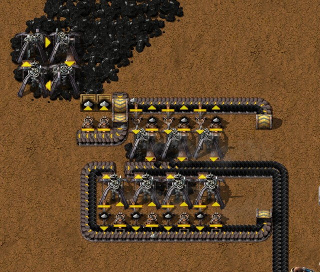

# Chapter 1 — Landing to red science

[中文版](01-landing-to-red-science.zh-CN.md) · [Index](../README.md)

This chapter follows the author's recorded run from an empty map to the first three red
technologies and the start of a mall: 1 hour 17 minutes of game time. Times like "0:35" are game
time in that run, read from the companion mod's recorder; numbers about machines come from the
game's data or from engine measurements, and every mechanic is also listed, with its source, in
[Techniques and mechanics](../research/techniques.md).

The plan in one sentence: handcraft red science, and spend the automation on fuel and plates —
first Raw coal and iron and copper smelting, then the building materials you keep handcrafting.

## The run at a glance

| Game time | What happened |
|---|---|
| 0:00–0:05 | Wreckage looted; the starting kit's robots cleared 122 trees and 19 rocks |
| 0:05–0:10 | Burner mining drills and Stone furnaces by hand, ore dropped straight into furnaces; Steam power (0:05) and the red science technology (0:09) completed by themselves |
| 0:10 | Assembly queued; it waits for a lab |
| 0:15–0:30 | First smelting unit from the blueprint book, fuelled by hand through chests; the first drill-and-furnace pairs removed |
| 0:30–0:35 | Copper smelting unit |
| 0:35–0:40 | Raw coal module from the book; Offshore pump, Boiler and Steam engine; Soil extractor |
| 0:40–0:50 | Second iron unit; a Raw coal belt across the base feeding every unit |
| 0:55–1:00 | Flora collector on Native flora |
| 1:00–1:10 | Two labs, red science by hand; Assembly done at 1:08 |
| 1:11 | Coal processing 1 done; Steel processing started (89 % when the run stopped at 1:17) |
| 1:10–1:17 | First mall: five Burner assembling machines making Small parts |

Plates per second over the run (10-minute averages, from the recorder):

| Window ending | Iron plate | Copper plate | Raw coal mined | Ash |
|---|---|---|---|---|
| 0:10 | 0.43 | 0.02 | 2.36 | 1.28 |
| 0:20 | 1.54 | 0.31 | 6.14 | 4.47 |
| 0:30 | 0.93 | 0.41 | 3.86 | 3.10 |
| 0:40 | 0.85 | 0.32 | 4.21 | 2.76 |
| 0:50 | 0.91 | 0.77 | 3.25 | 3.83 |
| 1:00 | 1.58 | 0.94 | 5.76 | 5.58 |
| 1:10 | 1.70 | 0.94 | 6.32 | 5.97 |

The dip between 0:20 and 0:50 is the rebuild: the first drill-and-furnace pairs came down before
the smelting units were all running.


## 1. Before you land

### What you start with

| Source | Items |
|---|---|
| Freeplay start | 8 Iron plate, 1 Wood, Pistol, 500 Firearm magazine, 10 Burner mining drill, 1 Stone furnace |
| Crashed-ship wreckage | 100 Iron plate, 50 Copper plate |
| Crashed ship | 8 Firearm magazine, 5 Iron chest |
| `py_quick_start` (not Py) | 100 Construction pynobot MK 04, Power armor MK2 with 4 personal roboports MK2, 55 portable solar panels, 2 exoskeletons, night vision, belt immunity |

With `py_quick_start` robots build from minute one, which is how the author placed every
blueprint below; without it, place them by hand.

Fifteen recipes are available at the start:

| Recipe | Ingredients → result | Made in |
|---|---|---|
| Iron plate | 8 Iron ore → 1 (10 s) | Stone furnace |
| Copper plate | 8 Copper ore → 1 (10 s) | Stone furnace |
| Stone brick | 2 Stone → 1 (3.2 s) | Stone furnace |
| Wood | 4 Log → 20 (4 s) | Hand |
| Stone furnace | 5 Stone | Hand |
| Iron stick | 1 Iron plate → 2 | Hand |
| Bolts | 2 Iron stick → 2 | Hand |
| Iron gear wheel | 2 Iron plate | Hand |
| Copper cable | 1 Copper plate → 2 | Hand |
| Small parts | 1 Iron gear wheel + 3 Copper cable + 3 Bolts → 2 | Hand |
| Mechanical inserter | 5 Iron plate + 2 Small parts | Hand |
| Burner mining drill | 3 Small parts + 1 Stone furnace + 3 Iron plate | Hand |
| Transport belt | 1 Iron plate + 1 Small parts → 2 | Hand |
| Underground belt | 10 Iron plate + 10 Transport belt → 2 | Hand |
| Wooden chest | 2 Wood | Hand |

Smelting cannot be done by hand, and Small parts sit inside almost everything.

### What works differently from vanilla

| Topic | Py behaviour | Source |
|---|---|---|
| Smelting | 8 ore per plate, 10 s per plate: a Stone furnace makes 0.1 plate/s | Verified |
| Stone furnace | 200 kW | From data |
| Burner mining drill | Mining speed 1 at 500 kW: 1 ore/s, 2 Raw coal/s (Raw coal mines twice as fast); burns 0.17 Raw coal/s | Verified |
| Burner mining drill, blocked | A drill that cannot drop its ore burns nothing: 0.01 MJ in a minute, against 14.5 MJ for a working one | Verified |
| Mechanical inserter | Needs no fuel and no power at all; has 1 filter slot | Verified |
| Ash | Burning coal-type fuel leaves 1 Ash per item in a burnt-result slot; the machine stops when that slot is full | Verified |
| Boiler | 3.7 MW, makes 7.5 Steam/s at 250 °C, burns 1.23 Raw coal/s at full load | Verified |
| Steam engine | Uses 15 Steam/s for 3.7 MW: at full power **one engine needs two boilers** (vanilla is the other way round) | Verified |
| Offshore pump | Needs no power; with `pump-anywhere-fork` it also works on dry land | Verified |
| Lab | 5×5, 60 kW, electric | From data |

**Ash.** Raw coal, Coal, Coke and the other coal-type fuels leave 1 Ash per item burnt; Logs and
Wood leave nothing. The burnt-result slot holds 1000 Ash, which fills in 13.5 minutes in a Boiler
at full load, 100 minutes in a Burner mining drill and about 4 hours in a Stone furnace. Getting
it out (all verified):

- An inserter taking from a **Stone furnace or Boiler** takes the product *and* the Ash, never the
  fuel. Two filtered Mechanical inserters, one per item, separate them.
- An **unfiltered** inserter taking from a **Burner mining drill** also pulls the drill's fuel out
  and starves it. Filter it to Ash.

Ash is not waste: every red science pack needs 6 of it (section 5).

## 2. Landing (0:00–0:10)

1. **Loot the wreckage** for its plates and chests, and let the kit's robots clear trees and rocks
   where you will build (122 trees and 19 rocks in the first five minutes). Large sandstone rocks
   give 19–25 Stone each, the Stone for your first furnaces.
2. **Handcraft Stone furnaces and Burner mining drills.** The author made 101 Stone furnaces
   between 0:05 and 0:10.
3. **Drop ore straight into furnaces.** A Burner mining drill facing a Stone furnace drops its
   ore into it: no belts, no inserters. The first block was 16 such pairs on iron and 2 on copper,
   fuelled by hand.
4. **Make a Raw coal pinwheel.** Four drills on Raw coal in a square, each dropping into the next
   one's fuel slot, keep each other running and stop when the slots are full (their status then
   reads "waiting for space"). Take the surplus Raw coal by hand as fuel for everything else.

The first two technologies are *trigger* technologies and complete by themselves when you
produce something:

| Technology | Trigger | Unlocks |
|---|---|---|
| Steam power | Make 10 Iron plate | Pipe, Pipe to ground, Offshore pump, Boiler, Steam engine, Small electric pole, Air-core inductors |
| Automation science pack (needs Steam power) | Make 10 Copper plate | Automation science pack, Lab, Flora collector MK 01, Soil extractor MK 01, Soil, Planter box, Empty planter box, Wood processing unit MK 01 |

Plates from furnaces count, across all your furnaces, and Copper plates made *before* Steam power
completes still count (verified). In the run they completed at 0:05 and 0:09. Queue **Assembly**
right away (0:10 in the run); it starts as soon as a lab has power.

## 3. The smelting unit (0:15–0:30)

The author's smelting unit puts the ore drills and a column of 10 Stone furnaces on one fuel
loop. This is the copper unit as it stood at the end of the run:


- **Drill rows.** Two rows of drills face the ore belt between them, one lane each, and the belt
  turns up to run past the furnaces. The rows cover the whole ore strip and hold more drills than
  the furnaces need: when the upstream drills mine out, the downstream ones take over. The spare
  drills cost no fuel — a drill that cannot drop its ore burns nothing (verified: 0.01 MJ in a
  minute against 14.5 MJ for a working drill). The author's iron unit runs 18 drills for 10
  furnaces this way. Uneven rows later in the game are mined-out spots, not missing drills.
- **Fuel loop.** Raw coal enters on the inner lane at the top, runs down the side, under the lower
  drill row and the furnaces. Every drill and furnace has a fuel inserter and an Ash inserter
  filtered to Ash, which drops onto the outer lane. An underground belt at the end lets only the
  Ash lane through, into three chests.
- **The column** is the author's blueprint, measured on iron and on copper at **0.91 plates/s
  and 0.60 Ash/s** each, with no mixed items:
  - Half a belt of ore is 7.5/s and a Stone furnace eats 0.8 ore/s, so 10 furnaces take half a
    belt (theoretical 0.94 plates/s).
  - Each belt carries one input on the lane next to the machines and one output on the far lane;
    inserters drop onto the far lane by themselves.
  - The input inserter takes the downstream tile of each machine, and the underground separator
    follows the last machine directly, so nothing is stranded when supply stops: after the ore ran
    out, 0 ore was left on the belt, against 4 with the inserters swapped. Throughput is the same
    either way.
  - The plate-side inserters are filtered to **everything but Ash** (blacklist). An inserter never
    takes fuel out of a furnace (verified), so this leaves only the plate — and the same blueprint
    smelts iron or copper.
  - Plates leave into chests through two or more inserters, because one moves only 0.82 items/s
    into a chest.
- **Fuel need.** At full output a unit burns about **2.0 Raw coal/s**: 10 furnaces × 0.067 plus
  about 8 working drills × 0.167 (the spare ones burn nothing).


**Before Raw coal comes by belt**, the first unit took its fuel from three chests at the start of
the loop, filled by hand. At 2.0 Raw coal/s, the 942 Raw coal the author carried would have lasted
about 8 minutes, and at 0:25 all 62 inserters of the unit stood waiting for items.
That is the reason for section 4. Once the unit ran, the robots removed the first drill-and-furnace
pairs (0:25–0:30), and the copper unit followed at 0:30–0:35.

Blueprint: [`smelting-column.txt`](../blueprints/smelting-column.txt), the author's column for
iron or copper (in game "0.94" with the two plate icons). The drill rows depend on your ore
patch, so they are not part of it.

## 4. Raw coal on a belt (0:35–0:50)

### The Raw coal module

Blueprint: [`blueprints/raw-coal-module.txt`](../blueprints/raw-coal-module.txt) (the author's
design). Measured: **15.0 Raw coal/s, a full belt**, plus 1.40 Ash/s collected in chests.

- Two rows of Burner mining drills face one output belt; each row fills one lane (8 drills, 16/s
  capacity for 15/s).
- The ninth drill, at the upstream end of one row, drops only onto the **service belt**. That belt
  runs behind the first row, tunnels under the output belt and runs behind the second row. Each
  drill has one inserter feeding it fuel from the service belt and one Ash-filtered inserter
  putting its Ash on the belt's outer lane.
- At the end of the service belt an underground belt lets only the Ash lane through, into two
  chests (1.40 Ash/s is more than one inserter's 0.82/s). The fuel lane backs up as a buffer.
- To start it, put a few Raw coal into the fuel drill; it feeds itself and everyone else.

Why not 8 drills: 8 drills mine 16/s but burn 1.33/s themselves, so at most 14.67/s leaves. With
Mining productivity 1 (+10 %, which adds output without adding fuel use, verified) 8 would be
enough, but then fuel has to be tapped off the output belt mid-way, which costs more parts than
the drill it saves.

In the run the module went down from the blueprint book at 0:35–0:40, at the edge of the coal
field: the author wanted the edge mined out first, and there the full module did not fit. A
7-drill version — one fuel drill and six on the output belt, at most about 10.8 Raw coal/s
(6 × 2 minus what the 7 drills burn) — was plenty for a base that burned about 6 Raw coal/s by
1:10. The four-drill
pinwheel from the landing stayed as a hand-picked reserve.



### One belt for the whole base

The module's output became a Raw coal belt along the base (the robots laid 179 belts at
0:45–0:50). Each smelting unit takes its fuel from it with **three inserters** dropping onto the
start of its fuel loop (the three inserters under the Raw coal belt in the copper unit picture): 3 × 0.83 items/s (the measured rate from a
moving full belt onto another belt) = 2.5/s for a need of 2.0/s. A furnace-only column needs a
single tap (0.67/s; verified, all 10 furnaces kept working).

By 1:10 the base ran three units — two on iron, one on copper — and a small stone-brick corner
(two drills dropping into two furnaces, inserters into chests): 1.70 Iron plate/s and 0.94
Copper plate/s.

## 5. Power, labs and red science (0:35–1:17)

### Steam

One Offshore pump, one Boiler and one Steam engine (0:35–0:40 in the run), with an Ash inserter
on the Boiler. One Boiler is enough while the load stays under its 3.7 MW: at 1:10 the base used
1.15 Steam/s, about 0.28 MW. The two-Boilers-per-engine ratio only matters near full power.

### Soil and Native flora

- **Soil extractor MK 01** (0:35–0:40), next to the power: Water in, Soil out.
- **Flora collector MK 01** (0:55–1:00) on a Native flora patch; in the run that patch was more
  than 70 tiles from the power, reached with a line of Small electric poles. A collector reaches 4.5 tiles
  around its centre and gathers 1 Native flora/s (from data). Watch what is left under it: at the
  end of the run only 219 were, so it needed moving soon (`tools/inspect-save.ps1` reports the
  amount under every drill and collector).

### Red science by hand

```
Automation science pack  (5 s, handcraftable)
├─ 2 Planter box  (2 s, handcraftable)
│  ├─ 1 Empty planter box  (1 s, handcraftable)
│  │  ├─ 4 Stone brick        ← Stone furnace ← 2 Stone each
│  │  ├─ 2 Wood               ← 4 Log → 20 Wood (hand or Wood processing unit)
│  │  └─ 1 Iron plate         ← Stone furnace ← 8 Iron ore
│  ├─ 5 Soil                  ← Soil extractor MK 01: 800 Water → 16 Soil (8 s)
│  └─ 3 Ash                   ← burnt coal-type fuel
├─ 10 Native flora            ← Flora collector MK 01 on a Native flora patch
└─ 2 Small parts  (handcraftable)
   ├─ 1 Iron gear wheel, 3 Copper cable, 3 Bolts
```

Raw materials per pack: **44 Iron ore**, 12 Copper ore, 16 Stone, 10 Native flora, 6 Ash,
500 Water, 0.8 Log. Handcrafting one pack with its Planter boxes, Small parts and Wood takes
**14.3 s** of recipe time. Ash is never short: the units' Ash chests gave the author 5,668 Ash by
the end of the run.

The labs went down at 1:00–1:10, and the author handcrafted 45 packs from then on. **Assembly**
finished at 1:08, **Coal processing 1** at 1:11, and **Steel processing** stood at 89 % when the
run stopped at 1:17. Red science stays handcrafted until Wood is mass-produced (a later chapter).

### Buildings

| Building | Size | Power | Rate at speed 1 | Build cost |
|---|---|---|---|---|
| Offshore pump | 2×2 | none | 1200 Water/s | 3 Pipe, 2 Small parts |
| Boiler | 3×2 | burns fuel | 7.5 Steam/s | 1 Stone furnace, 4 Pipe |
| Steam engine | 3×5 | makes 3.7 MW | uses 15 Steam/s | 8 Small parts, 5 Pipe, 10 Iron plate |
| Soil extractor MK 01 | 7×7 | 400 kW | 2 Soil/s, 100 Water/s | 2 Burner mining drill, 10 Air-core inductors, 30 Iron plate, 15 Small parts |
| Flora collector MK 01 | 7×7 | 100 kW | 1 Native flora/s | 2 Burner mining drill, 1 Soil extractor MK 01, 5 Air-core inductors, 10 Small parts, 20 Iron plate, 1 Steam engine |
| Lab | 5×5 | 60 kW | 1 red per 30 s | 10 Small parts, 4 Transport belt |
| Wood processing unit MK 01 (optional) | 6×6 | 500 kW | Logs → Wood | 5 Log, 20 Iron plate, 1 Steam engine, 15 Small parts, 2 Burner mining drill, 50 Copper cable |

Air-core inductors: 1 Iron stick + 8 Copper cable. Pipe: 1 Iron plate. Small electric pole:
1 Log + 2 Copper cable. The Flora collector costs a whole Soil extractor and a Steam engine, so
it came after the smelting units.

For later, when red science is automated: one pack every 10 s keeps three labs busy and takes
0.55 Iron plate/s, 0.15 Copper plate/s, 0.8 Stone brick/s, 1 Soil/s, 1 Native flora/s and
0.6 Ash/s, with about 0.5–0.7 MW of electricity.

## 6. The first mall (1:10–1:17)

By 1:10 handcrafting was the slowest part of the base. The recorder counted 1,278 Small parts,
686 Transport belts and 304 Mechanical inserters crafted by hand in the run: **48 minutes of
recipe time in a 77-minute game**, 28.5 of them in the recipes behind Small parts (Copper cable
9.7, Iron stick 8.2, Iron gear wheel 5.3, Bolts 3.2, Small parts 2.1). (The author's
`DoingThingsByHand` speeds handcrafting up with practice, so the real time was shorter.)

The answer is a **mall** (Chinese players say 超市; English players also say *hub*): a few
assemblers that make the building materials you keep handcrafting, each into a chest. In the
author's words, a mall is **not balanced** — every machine just produces, and the slowest step
sets the pace. What is needed in very large numbers, Transport belts and Mechanical inserters,
comes first, and its bottlenecks are raised later.

The first version went down at 1:10–1:17 next to the plate chests of an iron unit: five
Burner assembling machines MK 01 (from Assembly; 3×3, 75 kW, 0.025 Raw coal/s each) making Iron
stick, Bolts, Iron gear wheel, Copper cable and Small parts, passing items from machine to
machine with inserters. Iron plates arrive on a short belt from the unit's plate chests; Copper
plates come from a chest refilled by hand for now (the mall uses little copper; automating it
comes later); Small parts go into a chest. Next: two more machines for Transport
belts and Mechanical inserters.


Planning numbers, from data: 1 Small part/s takes 1.75 Iron plate/s and 0.75 Copper plate/s, and
only 1.25 machines' worth of time (Iron stick 0.375, Copper cable 0.375, Iron gear wheel 0.25,
Bolts 0.15, Small parts 0.1). One machine per recipe is mostly idle; the inserters set the pace —
the Small parts machine alone needs 1.5 Copper cable and 1.5 Bolts per second for one part a
second, against 0.83 items/s per Mechanical inserter (measured belt to belt).

## 7. Belt tricks you will use

No splitters early on, so lanes do the sorting (all verified in the engine):

- A mining drill drops onto the lane **nearest** to it; an inserter drops onto the lane
  **farthest** from it; side-loading puts everything onto the target lane nearest the feeding
  belt.
- A belt running into the side of an underground belt lets only one lane through. For a belt
  flowing north: into an entrance whose tunnel goes east, the west lane passes; tunnel west, the
  east lane; into the back of an exit pointing east, the east lane; pointing west, the west lane.
  (An entrance passes the lane away from its tunnel; an exit passes the lane on the side it
  points to.)
- A Mechanical inserter moves 0.82 items/s from a belt into a chest and 0.83 items/s from a
  moving full belt onto another belt.

## 8. What to research next

| Technology | Cost | Unlocks |
|---|---|---|
| Assembly | 12 red | Burner assembling machine MK 01 (burns fuel, 75 kW), Iron chest |
| Coal processing 1 | 12 red | Destructive distillation column MK 01, High pressure furnace MK 01, Iron plate from iron oxide, Coal gas (from coal, wood or coke), Coal, Limestone, Carbon dioxide, Carbolic oil, Tailings pond, Exhaust pipe |
| Steel processing (after Coal processing 1) | 18 red | Steel plate, Steel chest, Advanced foundry MK 01, Sinkhole, Multiblade "fish" turbine |
| Soil washing | 18 red | Washer MK 01, Muddy sludge, Sand |
| Crusher (after Steel processing and Soil washing) | 24 red | Jaw crusher MK 01, Gravel, Sand, Stone, Processed iron ore, another Iron plate recipe, Saline water |
| Gun turret, Stone wall, Repair pack | 60 red each | Only needed on maps with enemies |

The author's order: Assembly → Coal processing 1 → Steel processing → Soil washing → Crusher.
Coal processing 1 opens the better iron route and is the subject of the next chapter.

## 9. Checklist

- Raw coal by belt to every smelting unit; three taps per unit with drills, one per furnace-only
  column.
- Drill rows may be longer than needed: spare drills burn nothing and take over when the
  upstream ones mine out. Check the ore left under drills before calling a row broken.
- Every output inserter is filtered (plate side: everything but Ash); every belt that carries an
  input and an output ends in an underground separator right after the last machine; input
  inserters sit on the downstream tile.
- Inserters taking Ash from Burner mining drills are filtered to Ash; the Boiler has an Ash
  inserter.
- Assembly queued early; labs as soon as there is power.
- Once handcrafting holds you up, start the mall with Small parts, then Transport belts and
  Mechanical inserters.

## 10. How these facts were checked

- The run: recorded by the companion mod's recorder (`tools/companion`), read with
  `tools/recorder-summary.js` and `tools/recorder-phases.js` (timeline in 5-minute slices,
  production every 10 minutes, handcrafting); the final save (`Py-exploration`) read with
  `tools/inspect-save.ps1` (consistency check passed; structures drawn with
  `tools/render-area.js`, including inserter filter modes and the ore left under drills).
- Pictures: in-game screenshots taken in the author's game with the companion's `/pt-shots`
  (areas listed by `tools/shots.js plan`, collected by `tools/shots.js pull`).
- Prototype values (sizes, power, recipes, technology costs and triggers, rock yields):
  `tools/dump-data.ps1` dumps `data.raw` for the exact mod set; `tools/recipe-tree.js` expands
  recipe trees; handcrafting recipe time is the sum of recipe times over the recorded crafts.
- Starting items and recipes: `tools/newgame-observer` inside a fresh map.
- Verified in the engine by `tools/ch1-probe`: furnace and drill rates, Ash stopping machines,
  which inserters take Ash or fuel, filtered furnace output, boiler steam and fuel, steam engine
  power, trigger technology behaviour, offshore pump on land. `tools/drill-probe`: a blocked
  Burner mining drill burns 0.01 MJ in a minute, a working one 14.5 MJ.
- Belt lanes, underground lane filtering and inserter rates: `tools/belt-lab`.
- The Raw coal module was read from the author's earlier save, copied with
  `tools/extract-design.js` and run with the smelting columns, the fuel tap and the drain test in
  `tools/design-lab`, which also exported the blueprints. The author then trimmed the module's
  blueprint in game (the 8 tiles of trunk belt cut out with it are gone) and it came back through
  `tools/bp-sync.js pull`; the trimmed blueprint was measured again straight from the file
  (`extract-design.js --blueprint`): unchanged, 15.00 Raw coal/s and 1.40 Ash/s, all 9 drills
  working.
- The author's smelting column blueprint was copied from the file (`extract-design.js
  --blueprint`) and run in `tools/design-lab` on iron and on copper: 0.908 plates/s and 0.604
  Ash/s each, no mixed items, 0 ore left on the belts 120 s after the supply stopped.
- Mining productivity adding output without fuel: a one-off engine probe.
- Computed from measured rates, not measured as a whole: a unit's 2.0 Raw coal/s, the 7-drill
  module's 10.8 Raw coal/s, three taps' 2.5/s, the Boiler's 0.28 MW load.
- From data only, not yet measured: Flora collector and Soil extractor rates, lab consumption,
  handcrafting time, the mall's planning numbers.
