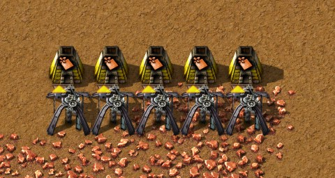
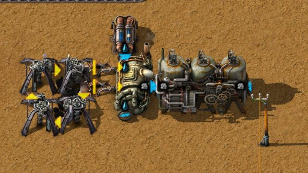
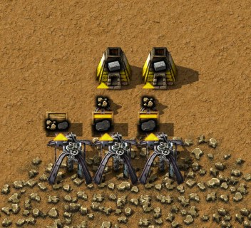
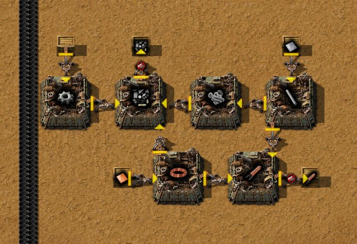
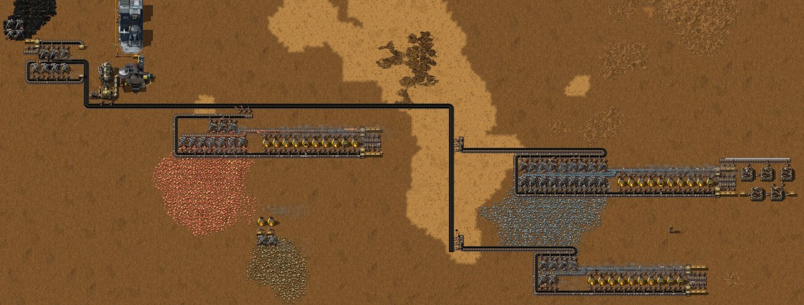
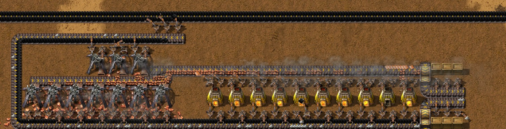
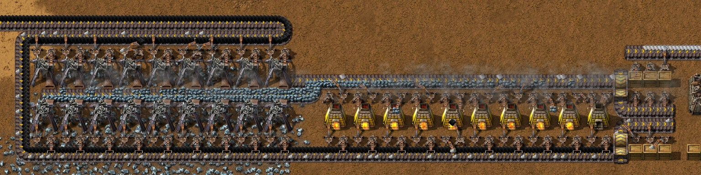
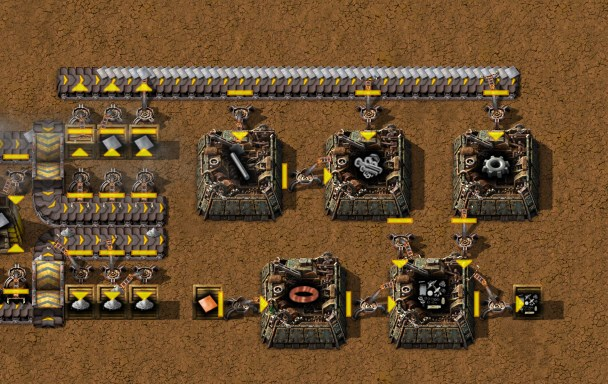

# Chapter 1 — Landing to red science

[中文版](01-landing-to-red-science.zh-CN.md) · [Index](../README.md)

This chapter follows the author's second recorded run, on the Py-Exploration map (seed
2652821414, [map settings](../research/map-settings.md)) in Factorio 2.1.21, from an empty map to
the first four technologies researched with red science, the last two being Steel processing
(0:48) and Soil washing (0:58), when Crusher was queued. Times like "0:35" are game time in that run, read from the companion mod's recorder;
numbers about machines come from the game's data or from engine measurements, and every mechanic
is also listed, with its source, in [Techniques and mechanics](../research/techniques.md).

The plan in one sentence: handcraft red science, turn the first plates into Burner mining drills
that drop their ore straight into Stone furnaces, leave belts and inserters for later, and
automate smelting once the Crusher technology brings the better iron recipe.

The author's first run (Factorio 2.1.20) automated fuel and smelting with belts from the start. It
got going more slowly but kept running without its player; it is kept in
[section 7](#7-the-other-route-belts-first-the-authors-first-run) as the other route.

## The run at a glance

| Game time | What happened |
|---|---|
| 0:00–0:05 | Wreckage looted; the first drills and furnaces by hand, ore dropped straight into furnaces; a Raw coal pinwheel; Steam power completed by itself (0:02) |
| 0:05–0:10 | More drill-and-furnace pairs on iron and copper, some placed by the starting kit's robots; the red science technology completed by itself (0:06) |
| 0:10–0:20 | More pairs; a stone-brick corner; Soil extractor, Flora collector and poles handcrafted |
| 0:20–0:25 | Assembly queued (0:22); a Boiler fed by a Raw coal pinwheel, Offshore pump and Steam engine; Soil extractor and Flora collector at a Native flora patch, reached by a pole line |
| 0:25–0:30 | One lab; red science by hand |
| 0:30–0:40 | Assembly done (0:33), Coal processing 1 done (0:39); the first mall: six Burner assembling machines passing items to each other by inserters |
| 0:40–0:50 | Steel processing done (0:48), Soil washing started (0:49); the first belts, for the coke chain of the next chapter |
| 0:58 | Soil washing done; Crusher queued |

Against the first run (10-minute averages from the recorder, plates per second):

| Window ending | Iron plate, first run | Iron plate, second run | Copper plate, first run | Copper plate, second run |
|---|---|---|---|---|
| 0:10 | 0.43 | 0.72 | 0.02 | 0.18 |
| 0:20 | 1.54 | 2.11 | 0.31 | 0.72 |
| 0:30 | 0.93 | 2.74 | 0.41 | 0.89 |
| 0:40 | 0.85 | 2.66 | 0.32 | 1.04 |
| 0:50 | 0.91 | 2.65 | 0.77 | 1.00 |

| Technology | First run | Second run |
|---|---|---|
| Steam power | 0:05 | 0:02 |
| Automation science pack | 0:09 | 0:06 |
| Assembly | 1:08 | 0:33 |
| Coal processing 1 | 1:11 | 0:39 |
| Steel processing | 89 % when the run stopped at 1:17 | 0:48 |
| Soil washing | — | 0:58 |

In its first 50 minutes the second run made 6,525 Iron plates and 2,293 Copper plates, the first
about 2,800 and 1,100. The author also knew Py better the second time, so not all of the
difference is the method.

## 1. Before you land

### What you start with

| Source | Items |
|---|---|
| Freeplay start | 8 Iron plate, 1 Wood, Pistol, 500 Firearm magazine, 10 Burner mining drill, 1 Stone furnace |
| Crashed-ship wreckage | 100 Iron plate, 50 Copper plate |
| Crashed ship | 8 Firearm magazine, 5 Iron chest |
| `py_quick_start` (not Py) | 100 Construction pynobot MK 04, Power armor MK2 with 4 personal roboports MK2, 55 portable solar panels, 2 exoskeletons, night vision, belt immunity |

With `py_quick_start` robots build from minute one; without it, place everything by hand.

Fifteen recipes are available at the start:

| Recipe | Ingredients → result | Made in |
|---|---|---|
| Iron plate | 8 Iron ore → 1 (10 s) | Stone furnace |
| Copper plate | 8 Copper ore → 1 (10 s) | Stone furnace |
| Stone brick | 2 Stone → 1 (3.2 s) | Stone furnace |
| Wood | 4 Log → 20 (4 s) | Hand |
| Stone furnace | 5 Stone | Hand |
| Iron stick | 1 Iron plate → 2 | Hand |
| Bolts | 2 Iron stick → 2 | Hand |
| Iron gear wheel | 2 Iron plate | Hand |
| Copper cable | 1 Copper plate → 2 | Hand |
| Small parts | 1 Iron gear wheel + 3 Copper cable + 3 Bolts → 2 | Hand |
| Mechanical inserter | 5 Iron plate + 2 Small parts | Hand |
| Burner mining drill | 3 Small parts + 1 Stone furnace + 3 Iron plate | Hand |
| Transport belt | 1 Iron plate + 1 Small parts → 2 | Hand |
| Underground belt | 10 Iron plate + 10 Transport belt → 2 | Hand |
| Wooden chest | 2 Wood | Hand |

Smelting cannot be done by hand, and Small parts sit inside almost everything.

### What works differently from vanilla

| Topic | Py behaviour | Source |
|---|---|---|
| Smelting | 8 ore per plate, 10 s per plate: a Stone furnace makes 0.1 plate/s | Verified |
| Stone furnace | 200 kW | From data |
| Burner mining drill | Mining speed 1 at 500 kW: 1 ore/s, 2 Raw coal/s (Raw coal mines twice as fast); burns 0.17 Raw coal/s | Verified |
| Burner mining drill, blocked | A drill that cannot drop its ore burns nothing: 0.01 MJ in a minute, against 14.5 MJ for a working one | Verified |
| Fuel slot | Burner mining drill, Stone furnace and Boiler have one fuel slot, which holds one stack: 50 Raw coal, 150 MJ | From data |
| Stone | Every Stone mined comes with 1 Kerogen (a 2 MJ fuel) | From data |
| Mechanical inserter | Needs no fuel and no power at all; has 1 filter slot | Verified |
| Ash | Burning coal-type fuel leaves 1 Ash per item in a burnt-result slot; the machine stops when that slot is full | Verified |
| Boiler | 3.7 MW, makes 7.5 Steam/s at 250 °C, burns 1.23 Raw coal/s at full load | Verified |
| Steam engine | Uses 15 Steam/s for 3.7 MW: at full power **one engine needs two boilers** (vanilla is the other way round) | Verified |
| Offshore pump | Needs no power; with `pump-anywhere-fork` it also works on dry land | Verified |
| Lab | 5×5, 60 kW, electric | From data |

**Ash.** Raw coal, Coal, Coke and the other coal-type fuels leave 1 Ash per item burnt; Logs and
Wood leave nothing. The burnt-result slot holds 1000 Ash, which fills in 13.5 minutes in a Boiler
at full load, 100 minutes in a Burner mining drill and about 4 hours in a Stone furnace. Getting
it out (all verified):

- An inserter taking from a **Stone furnace or Boiler** takes the product *and* the Ash, never the
  fuel. Two filtered Mechanical inserters, one per item, separate them.
- An **unfiltered** inserter taking from a **Burner mining drill** also pulls the drill's fuel out
  and starves it. Filter it to Ash. (Section 3 puts this to use.)

Ash is not waste: every red science pack needs 6 of it (section 4).

## 2. Landing (0:00–0:10)

1. **Loot the wreckage** for its plates and chests, and let the kit's robots clear trees and rocks
   where you will build (56 trees and 11 rocks in the first ten minutes). Large sandstone rocks
   give 19–25 Stone each, the Stone for your first furnaces.
2. **Handcraft Stone furnaces and Burner mining drills.** In the first ten minutes the author
   made 45 Stone furnaces and 25 Burner mining drills by hand, on top of the 10 drills of the
   start.
3. **Drop ore straight into furnaces.** A Burner mining drill facing a Stone furnace drops its
   ore into it: no belts, no inserters. The first iron pairs went down at 0:00–0:05, the first
   copper pairs at 0:05–0:10. Section 3 is about these pairs.
4. **Make a Raw coal pinwheel.** Four drills on Raw coal in a square, each dropping into the next
   one's fuel slot, keep each other running and stop when the slots are full (their status then
   reads "waiting for space"). Take the surplus Raw coal by hand as fuel for everything else. The
   author built two in the first ten minutes.

The first two technologies are *trigger* technologies and complete by themselves when you
produce something:

| Technology | Trigger | Unlocks |
|---|---|---|
| Steam power | Make 10 Iron plate | Pipe, Pipe to ground, Offshore pump, Boiler, Steam engine, Small electric pole, Air-core inductors |
| Automation science pack (needs Steam power) | Make 10 Copper plate | Automation science pack, Lab, Flora collector MK 01, Soil extractor MK 01, Soil, Planter box, Empty planter box, Wood processing unit MK 01 |

Plates from furnaces count, across all your furnaces, and Copper plates made *before* Steam power
completes still count (verified). In the run they completed at 0:02 and 0:06. Queue **Assembly**
early; it starts as soon as a lab has power and packs.

## 3. Drills before belts (0:05–0:50)

### Why drills first

What the early buildings cost in ore (from data; a plate is 8 ore):

| Building | Iron ore | Copper ore | Stone |
|---|---|---|---|
| Transport belt, one tile | 11 | 3 | — |
| Mechanical inserter | 68 | 12 | — |
| Burner mining drill | 66 | 18 | 5 |
| Stone furnace | — | — | 5 |

A Burner mining drill costs about as much as a Mechanical inserter, and on an iron patch it mines
its own iron back in about a minute (66 ore at 1 ore/s). The belt-fed smelting unit of the first
run had 62 inserters; their iron would have built 64 drills. So in the second run the first
plates went into drills and furnaces only, and every new pair started paying back at once.

### The pair

- **Rate.** A drill mines 1 ore/s and the furnace in front of it smelts 0.8 ore/s, so the drill
  fills the furnace's ore slot (one stack, 50 ore) and then works 80 % of the time: **0.1 plate/s
  per pair**.
- **Fuel.** A pair burns 0.6 MW (the drill 0.4 MW on average, the furnace 0.2 MW): 0.2 Raw coal/s,
  12 a minute.
- **How long a pair runs on its own** (from data):

  | What runs out | After |
  |---|---|
  | The drill's fuel (one stack, 50 Raw coal) | about 6 minutes |
  | The furnace's fuel | about 12.5 minutes |
  | Room for plates (the output slot holds one stack, 100 plates) | about 17 minutes |
  | The drill's Ash slot (1000 Ash) | about 2 hours |

  So the pairs want a round every few minutes: Raw coal into the drills, plates out of the
  furnaces. The drill always runs dry first. The author's save at 2:01 shows it: all ten copper
  drills stood without fuel while their furnaces still held 12–13 Raw coal.
- **Rows.** The author lays the pairs out in rows, the drills on one line and their furnaces on
  the next, so one walk along a row refuels and empties all of it.
- **How many.** Judging by the plates, about 27 furnaces smelted iron and 10 copper from 0:20 to
  0:50 (2.7 and 1.0 plates/s). The whole base burnt 7.5–8.7 Raw coal/s then (it made that much
  Ash).



### Raw coal without belts

The pinwheels give Raw coal to take by hand. For the power (0:20–0:25) the author built a third
pinwheel right beside the Boiler, with **two inserters taking Raw coal out of the two drills next
to it and putting it into the Boiler**. An unfiltered inserter takes a drill's fuel (section 1);
here that is the point, since in a pinwheel every fuel slot is full of the Raw coal the
neighbouring drill mines. The Boiler never needed fuel by hand: at 2:01 it was still burning Raw
coal from that pinwheel (read from the save, not measured). Its Ash still has to come out; at
this stage's load (at most 0.56 MW, see section 4) the 1000-Ash slot takes at least 90 minutes to
fill.



### Stone bricks

Every Stone comes with a Kerogen, so the author's stone corner (0:10–0:15) drops into chests: three
drills into three Wooden chests, and two inserters filtered to Stone take Stone from two of them
into two Stone furnaces making bricks. The Kerogen stays in the chests; it is a fuel (2 MJ).



## 4. Power, lab and red science (0:20–0:58)

### Steam

One Offshore pump, the Boiler on its pinwheel and one Steam engine (0:20–0:25). One Boiler is
enough while the load stays under its 3.7 MW, and this stage draws at most 0.56 MW: Lab 60 kW,
Soil extractor 400 kW, Flora collector 100 kW. The base ran on that single Boiler until 1:30. The
two-Boilers-per-engine ratio only matters near full power.

### The red science corner

The author put the electric part of red science at a Native flora patch about 120 tiles from the
Boiler and ran a line of 16 Small electric poles to it (0:20–0:30):

- **Flora collector MK 01** on the patch. It reaches 4.5 tiles around its centre and gathers
  1 Native flora/s (from data). Watch what is left under it (7,400 at 2:01 in this run;
  `tools/inspect-save.ps1` reports the amount under every drill and collector).
- **Soil extractor MK 01** beside it, with its own Offshore pump on dry land: Water in, Soil out.
- Both drop their product straight into a Wooden chest; they need no output inserter
  ([techniques](../research/techniques.md), "Some machines drop their products themselves").
- **One lab** next to them.


### Red science by hand

```
Automation science pack  (5 s, handcraftable)
├─ 2 Planter box  (2 s, handcraftable)
│  ├─ 1 Empty planter box  (1 s, handcraftable)
│  │  ├─ 4 Stone brick        ← Stone furnace ← 2 Stone each
│  │  ├─ 2 Wood               ← 4 Log → 20 Wood (hand or Wood processing unit)
│  │  └─ 1 Iron plate         ← Stone furnace ← 8 Iron ore
│  ├─ 5 Soil                  ← Soil extractor MK 01: 800 Water → 16 Soil (8 s)
│  └─ 3 Ash                   ← burnt coal-type fuel
├─ 10 Native flora            ← Flora collector MK 01 on a Native flora patch
└─ 2 Small parts  (handcraftable)
   ├─ 1 Iron gear wheel, 3 Copper cable, 3 Bolts
```

Raw materials per pack: **44 Iron ore**, 12 Copper ore, 16 Stone, 10 Native flora, 6 Ash,
500 Water, 0.8 Log. Handcrafting one pack with its Planter boxes, Small parts and Wood takes
**14.3 s** of recipe time. Ash is never short; with no Ash inserters on the pairs it comes out of
their Ash slots by hand (the author carried 27,789 at 2:01).

One lab researches these technologies at one pack per 30 s, two packs a minute, and that set
the pace:

| Technology | Packs | Researched |
|---|---|---|
| Assembly | 12 | 0:22–0:33 (the lab went down at 0:25–0:30) |
| Coal processing 1 | 12 | 0:33–0:39 |
| Steel processing | 18 | 0:39–0:48 |
| Soil washing | 18 | 0:49–0:58 |
| Crusher | 24 | queued at 0:58 |

The lab never waited from 0:33 to 0:58, on 60 packs handcrafted between 0:25 and 0:45. Then the
packs ran out: Crusher was still at 0 % at 2:01, while the author built the coke chain of the
next chapter. A second lab would have halved those times; red science stays handcrafted until
Wood is mass-produced (a later chapter).

Handcrafting took about **34 minutes of recipe time in the first 50 minutes** (the author's
`DoingThingsByHand` speeds it up with practice, so the real time was shorter): Copper cable 5.5,
the packs themselves 5.0, Planter boxes 4.0, Iron sticks 3.4, Iron gear wheels 2.1, Pipes 2.0,
Empty planter boxes 2.0, Stone furnaces 1.7, Burner mining drills 1.6 minutes.

### Buildings

| Building | Size | Power | Rate at speed 1 | Build cost |
|---|---|---|---|---|
| Offshore pump | 2×2 | none | 1200 Water/s | 3 Pipe, 2 Small parts |
| Boiler | 3×2 | burns fuel | 7.5 Steam/s | 1 Stone furnace, 4 Pipe |
| Steam engine | 3×5 | makes 3.7 MW | uses 15 Steam/s | 8 Small parts, 5 Pipe, 10 Iron plate |
| Soil extractor MK 01 | 7×7 | 400 kW | 2 Soil/s, 100 Water/s | 2 Burner mining drill, 10 Air-core inductors, 30 Iron plate, 15 Small parts |
| Flora collector MK 01 | 7×7 | 100 kW | 1 Native flora/s | 2 Burner mining drill, 1 Soil extractor MK 01, 5 Air-core inductors, 10 Small parts, 20 Iron plate, 1 Steam engine |
| Lab | 5×5 | 60 kW | 1 red per 30 s | 10 Small parts, 4 Transport belt |
| Wood processing unit MK 01 (optional) | 6×6 | 500 kW | Logs → Wood | 5 Log, 20 Iron plate, 1 Steam engine, 15 Small parts, 2 Burner mining drill, 50 Copper cable |

Air-core inductors: 1 Iron stick + 8 Copper cable. Pipe: 1 Iron plate. Small electric pole:
1 Log + 2 Copper cable.

For later, when red science is automated: one pack every 10 s keeps three labs busy and takes
0.55 Iron plate/s, 0.15 Copper plate/s, 0.8 Stone brick/s, 1 Soil/s, 1 Native flora/s and
0.6 Ash/s, with about 0.5–0.7 MW of electricity.

## 5. The first mall (0:35–0:40)

Assembly brings the Burner assembling machine MK 01 (3×3, 75 kW, 0.025 Raw coal/s, so one stack
of Raw coal lasts 33 minutes). Right after it, the author built six of them into a mall for the
two items behind most buildings of this stage: **Small parts** (in almost everything) and
**Air-core inductors** (10 in a Soil extractor, 5 in a Flora collector, 3 in a Burner assembling
machine). A mall (Chinese players say 超市; English players also say *hub*) is not balanced: every
machine just produces, and the slowest step sets the pace.

This one uses no belts at all. Inserters pass the items from machine to machine:

- Top row: Iron gear wheel, Small parts, Bolts, Iron stick. Bottom row: Copper cable, Air-core
  inductors.
- Iron plates come from two chests (at the gear and the stick machine) and Copper plates from a
  third, all filled by hand.
- Iron sticks go to Bolts and to the inductors; gears, Bolts and Copper cable to Small parts;
  Copper cable also to the inductors.
- Small parts and inductors leave into chests through inserters filtered to everything but Ash,
  as on furnaces.



Planning numbers, from data: 1 Small part/s takes 1.75 Iron plate/s and 0.75 Copper plate/s, and
only 1.25 machines' worth of time (Iron stick 0.375, Copper cable 0.375, Iron gear wheel 0.25,
Bolts 0.15, Small parts 0.1). One machine per recipe is mostly idle; the inserters set the pace —
the Small parts machine alone needs 1.5 Copper cable and 1.5 Bolts per second for one part a
second, against 0.83 items/s per Mechanical inserter (measured belt to belt).

## 6. Where drills first stops, and what comes next

### The pairs need you

From 0:50 to 1:10 the author was mostly up to 130 tiles west of the pairs, building the coke chain:

| Window ending | Iron ore mined per second | Ash made per second |
|---|---|---|
| 0:50 | 20.1 | 7.5 |
| 1:00 | 3.1 | 1.8 |
| 1:10 | 2.3 | 1.2 |
| 1:20 (author back) | 13.0 | 5.4 |

With nobody doing the rounds, drills run dry after about 6 minutes and full furnaces stop after
about 17. (The recorder does not log machine states, so that is the likely cause, not an observed
one.) Drills first trades belts for your time: it is the fastest start, and it lasts as long as
you keep walking the rounds.

### Next: coke, steel and crushing

The run went on to steel: distillation columns for Coke, Advanced foundries with Limestone,
more power and a Raw coal belt, and the first Steel plates between 1:50 and 2:00. That is the
next chapter; until it is written, see
[Coke, steel, crushing and Ash separation](../research/coke-and-steel.md).

For smelting the author's plan is to keep the pairs until Crusher is researched and the first
Jaw crushers stand, then automate iron straight away with the crushed recipe, skipping the
belt-fed direct smelting of the first run. From data:

| Per Iron plate | Smelted directly | Crushed first |
|---|---|---|
| Iron ore | 8 | 5 |
| Raw coal (drills, furnace and, for the crusher, the Boilers' share) | 2 | 2.57 |
| Also made | — | 1 Stone |

- One **Jaw crusher MK 01** (7×7, 1 MW; 25 Iron plate, 4 Steam engine, 30 Steel plate,
  10 Small parts) turns 2.5 Iron ore/s into 1.5 Processed iron ore/s and 0.5 Stone/s
  (5 → 3 + 1 in 2 s).
- That feeds **three Stone furnaces** (3 Processed iron ore → 1 Iron plate in 6 s): 0.5 Iron
  plate/s. A fourth furnace turns the Stone into bricks (it takes 0.625 Stone/s).
- Crushing saves ore, not fuel: the crusher's 2 MJ per plate of electricity costs 4 MJ of Boiler
  fuel, more than the 3 ore saved cost to mine and the shorter smelt saves.
- **Copper cannot be crushed yet.** Its recipes come with Copper processing - Stage 1 (65 red),
  which needs Electronics - Stage 1, the Simple circuit board technology, and its Automated
  screener MK 01 costs 20 Simple circuit boards, 60 Steel plate and a Fluid mining drill MK 01.
  Until then copper is smelted directly, 8 ore per plate.

### The technologies of this stage

| Technology | Cost | Unlocks |
|---|---|---|
| Assembly | 12 red | Burner assembling machine MK 01 (burns fuel, 75 kW), Iron chest |
| Coal processing 1 | 12 red | Destructive distillation column MK 01, High pressure furnace MK 01, Iron plate from iron oxide, Coal gas (from coal, wood or coke), Coal, Limestone, Carbon dioxide, Carbolic oil, Ash (from burning Coal gas), Tailings pond, Exhaust pipe |
| Steel processing (after Coal processing 1) | 18 red | Steel plate, Steel chest, Advanced foundry MK 01, Sinkhole, Multiblade "fish" turbine |
| Soil washing | 18 red | Washer MK 01, Muddy sludge, Sand |
| Crusher (after Steel processing and Soil washing) | 24 red | Jaw crusher MK 01, Processed iron ore and Iron plate from it, Gravel, Sand, Stone from bricks, Saline water |
| Gun turret, Stone wall, Repair pack | 60 red each | Only needed on maps with enemies |

The author's order, both runs: Assembly → Coal processing 1 → Steel processing → Soil washing →
Crusher. Steel axe completes by itself once 50 Steel plates are made (2:01 in this run).

## 7. The other route: belts first (the author's first run)

In the first run (Factorio 2.1.20 with older Py versions, 1:17 of game time) the author automated
fuel and smelting with belts from 0:15: smelting units fed by a Raw coal belt, then a mall. It
made fewer plates early (see the tables at the top), because the inserters and belts ate the first
plates and the first drill-and-furnace pairs came down before the units all ran, but from 0:50 on
its smelting needed no hand. Take this route if you would rather build once than walk rounds; the
designs below were measured in the engine.



### The smelting unit

The author's smelting unit puts the ore drills and a column of 10 Stone furnaces on one fuel
loop. This is the copper unit as it stood at the end of the first run:



- **Drill rows.** Two rows of drills face the ore belt between them, one lane each, and the belt
  turns up to run past the furnaces. The rows cover the whole ore strip and hold more drills than
  the furnaces need: when the upstream drills mine out, the downstream ones take over. The spare
  drills cost no fuel — a drill that cannot drop its ore burns nothing. The author's iron unit
  runs 18 drills for 10 furnaces this way. Uneven rows later in the game are mined-out spots, not
  missing drills.
- **Fuel loop.** Raw coal enters on the inner lane at the top, runs down the side, under the lower
  drill row and the furnaces. Every drill and furnace has a fuel inserter and an Ash inserter
  filtered to Ash, which drops onto the outer lane. An underground belt at the end lets only the
  Ash lane through, into three chests.
- **The column** is the author's blueprint, measured on iron and on copper at **0.91 plates/s
  and 0.60 Ash/s** each, with no mixed items:
  - Half a belt of ore is 7.5/s and a Stone furnace eats 0.8 ore/s, so 10 furnaces take half a
    belt (theoretical 0.94 plates/s).
  - Each belt carries one input on the lane next to the machines and one output on the far lane;
    inserters drop onto the far lane by themselves.
  - The input inserter takes the downstream tile of each machine, and the underground separator
    follows the last machine directly, so nothing is stranded when supply stops: after the ore ran
    out, 0 ore was left on the belt, against 4 with the inserters swapped. Throughput is the same
    either way.
  - The plate-side inserters are filtered to **everything but Ash** (blacklist). An inserter never
    takes fuel out of a furnace (verified), so this leaves only the plate — and the same blueprint
    smelts iron or copper.
  - Plates leave into chests through two or more inserters, because one moves only 0.82 items/s
    into a chest.
- **Fuel need.** At full output a unit burns about **2.0 Raw coal/s**: 10 furnaces × 0.067 plus
  about 8 working drills × 0.167 (the spare ones burn nothing).



**Before Raw coal comes by belt**, the first unit took its fuel from three chests at the start of
the loop, filled by hand. At 2.0 Raw coal/s, the 942 Raw coal the author carried would have lasted
about 8 minutes, and at 0:25 all 62 inserters of the unit stood waiting for items. Hence the Raw
coal module.

Blueprint: [`smelting-column.txt`](../blueprints/smelting-column.txt), the author's column for
iron or copper (in game "0.94" with the two plate icons). The drill rows depend on your ore
patch, so they are not part of it.

### The Raw coal module

Blueprint: [`blueprints/raw-coal-module.txt`](../blueprints/raw-coal-module.txt) (the author's
design, also used in the second run from 1:40 on). Measured: **15.0 Raw coal/s, a full belt**,
plus 1.40 Ash/s collected in chests.

- Two rows of Burner mining drills face one output belt; each row fills one lane (8 drills, 16/s
  capacity for 15/s).
- The ninth drill, at the upstream end of one row, drops only onto the **service belt**. That belt
  runs behind the first row, tunnels under the output belt and runs behind the second row. Each
  drill has one inserter feeding it fuel from the service belt and one Ash-filtered inserter
  putting its Ash on the belt's outer lane.
- At the end of the service belt an underground belt lets only the Ash lane through, into two
  chests (1.40 Ash/s is more than one inserter's 0.82/s). The fuel lane backs up as a buffer.
- To start it, put a few Raw coal into the fuel drill; it feeds itself and everyone else.

Why not 8 drills: 8 drills mine 16/s but burn 1.33/s themselves, so at most 14.67/s leaves. With
Mining productivity 1 (+10 %, which adds output without adding fuel use, verified) 8 would be
enough, but then fuel has to be tapped off the output belt mid-way, which costs more parts than
the drill it saves.

In the first run the module went down at the edge of the coal field, where the full module did
not fit: a 7-drill version — one fuel drill and six on the output belt, at most about 10.8 Raw
coal/s (6 × 2 minus what the 7 drills burn) — was plenty for a base that burned about 6 Raw
coal/s by 1:10. The landing pinwheel stayed as a hand-picked reserve.


### One belt for the whole base

The module's output became a Raw coal belt along the base. Each smelting unit takes its fuel from
it with **three inserters** dropping onto the start of its fuel loop (the three inserters under
the Raw coal belt in the copper unit picture): 3 × 0.83 items/s (the measured rate from a moving
full belt onto another belt) = 2.5/s for a need of 2.0/s. A furnace-only column needs a single
tap (0.67/s; verified, all 10 furnaces kept working). By 1:10 the first run had three units — two
on iron, one on copper — and made 1.70 Iron plate/s and 0.94 Copper plate/s.

### Its mall

The first run's mall (1:10–1:17) stood next to the plate chests of an iron unit: five Burner
assembling machines making Iron stick, Bolts, Iron gear wheel, Copper cable and Small parts, the
Iron plates arriving on a short belt from the unit's chests. By then the recorder had counted
**48 minutes of handcrafting recipe time in 77 minutes of game**, 28.5 of them in the recipes
behind Small parts.



### Belt tricks you will use

No splitters early on, so lanes do the sorting (all verified in the engine):

- A mining drill drops onto the lane **nearest** to it; an inserter drops onto the lane
  **farthest** from it; side-loading puts everything onto the target lane nearest the feeding
  belt.
- A belt running into the side of an underground belt lets only one lane through. For a belt
  flowing north: into an entrance whose tunnel goes east, the west lane passes; tunnel west, the
  east lane; into the back of an exit pointing east, the east lane; pointing west, the west lane.
  (An entrance passes the lane away from its tunnel; an exit passes the lane on the side it
  points to.)
- A Mechanical inserter moves 0.82 items/s from a belt into a chest and 0.83 items/s from a
  moving full belt onto another belt.

## 8. Checklist

Drills first (the second run):

- Pairs in rows, a drill dropping into each furnace. A round every few minutes: Raw coal into the
  drills (they run dry first, after about 6 minutes), plates out of the furnaces (full after about
  17).
- Raw coal pinwheels for hand fuel; a pinwheel with two inserters into the Boiler runs the power
  by itself.
- Stone drills drop into chests (every Stone comes with a Kerogen); Stone-filtered inserters feed
  the brick furnaces.
- Queue Assembly early and keep the lab in packs: one lab takes two a minute.
- After Assembly, a burner mall for Small parts and Air-core inductors, machine to machine by
  inserters.
- Do not leave the pairs alone for long; automate smelting with Crusher: crushed iron, copper
  smelted directly.

Belts first (the first run):

- Raw coal by belt to every smelting unit; three taps per unit with drills, one per furnace-only
  column.
- Drill rows may be longer than needed: spare drills burn nothing and take over when the
  upstream ones mine out. Check the ore left under drills before calling a row broken.
- Every output inserter is filtered (plate side: everything but Ash); every belt that carries an
  input and an output ends in an underground separator right after the last machine; input
  inserters sit on the downstream tile.
- Inserters taking Ash from Burner mining drills are filtered to Ash; the Boiler has an Ash
  inserter.

## 9. How these facts were checked

- The second run: recorded by the companion mod's recorder (`tools/companion`, run
  `2652821414-0`), read with `tools/recorder-phases.js` (timeline in 5- and 10-minute slices,
  production every 10 minutes, handcrafting) and `tools/recorder-log.js`; its save at 2:01
  (`Py-Exploration`) read with `tools/inspect-save.ps1` (consistency check passed) and
  `tools/summarize-save.js`; structures drawn with `tools/render-area.js` and traced with
  `tools/trace-layout.js` (inserter filters, what feeds what, fuel and Ash in every burner).
  Handcrafting recipe time is the sum of recipe times over the recorded crafts.
- The first run: recorded the same way (run `1972190704-0`, Factorio 2.1.20); its final save at
  1:17 read with `tools/inspect-save.ps1`.
- Pictures: in-game screenshots with entity info (alt view), taken in the author's game with the
  companion's `/pt-shots` (areas listed by `tools/shots.js plan`, collected by `tools/shots.js pull`).
  The second run's pictures were taken after its 2:01 save, when the iron pairs had already been
  taken down, so they have none; the author rebuilt the stone corner for its picture, two tiles
  west of the original.
- Prototype values (sizes, power, recipes, stack and slot sizes, technology costs and triggers,
  mining results, rock yields): `data.raw` of the second run's exact mod set, dumped with
  `--dump-data` in the save setup (`tools/save-env.ps1`); the first run's values came from
  `tools/dump-data.ps1` on its mods, and the recipes and buildings of this chapter are the same in
  both. `tools/recipe-tree.js` expands recipe trees.
- Starting items and recipes: `tools/newgame-observer` inside a fresh map (2.1.20).
- Verified in the engine (2.1.20) by `tools/ch1-probe`: furnace and drill rates, Ash stopping
  machines, which inserters take Ash or fuel, filtered furnace output, boiler steam and fuel, steam
  engine power, trigger technology behaviour, offshore pump on land. `tools/drill-probe`: a blocked
  Burner mining drill burns 0.01 MJ in a minute, a working one 14.5 MJ.
- Belt lanes, underground lane filtering and inserter rates: `tools/belt-lab`.
- The Raw coal module was read from the author's earlier save, copied with
  `tools/extract-design.js` and run with the smelting columns, the fuel tap and the drain test in
  `tools/design-lab`, which also exported the blueprints. The author then trimmed the module's
  blueprint in game and it came back through `tools/bp-sync.js pull`; the trimmed blueprint was
  measured again straight from the file (`extract-design.js --blueprint`): unchanged, 15.00 Raw
  coal/s and 1.40 Ash/s, all 9 drills working.
- The author's smelting column blueprint was copied from the file (`extract-design.js
  --blueprint`) and run in `tools/design-lab` on iron and on copper: 0.908 plates/s and 0.604
  Ash/s each, no mixed items, 0 ore left on the belts 120 s after the supply stopped.
- Mining productivity adding output without fuel: a one-off engine probe.
- Computed from data or measured rates, not measured as a whole: a pair's rate, fuel and the
  times in its table; the counts of furnaces from the plates made; the Boiler pinwheel's supply;
  a unit's 2.0 Raw coal/s, the 7-drill module's 10.8 Raw coal/s, three taps' 2.5/s; the crusher
  numbers and the fuel per plate.
- From data only, not yet measured: Flora collector and Soil extractor rates, lab consumption,
  handcrafting time, the mall's planning numbers, the Jaw crusher.
