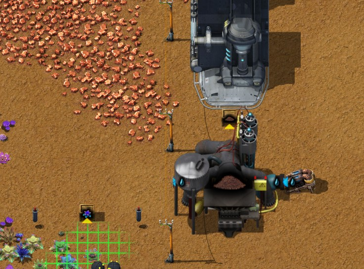

# 第一章：开局到红瓶

[English](01-landing-to-red-science.md) · [目录](../README.zh-CN.md) · 下一章：[第二章](02-coke-steel-crushed-iron.zh-CN.md)

本章跟随作者有完整记录的第二局游戏：Py-Exploration 地图（种子 2652821414，[地图设置](../research/map-settings.zh-CN.md)），Factorio 2.1.21，从空地图开始，到用红瓶研究完前四项科技为止——最后两项是炼钢技术（0:48）和土壤清洗（0:58），这时碎矿技术排进了队列。文中"0:35"这样的时间都是那局的游戏时间，读自助手模组的记录器；关于机器的数字来自游戏数据或引擎实测，每一条机制也连同来源一起列在[技巧与机制](../research/techniques.zh-CN.md)里。

一句话概括思路：红瓶手搓；最早的板材全部做成热能采矿机，让它们把矿直接吐进石炉；传送带和机械臂留到以后；等碎矿技术带来更好的炼铁配方，再把冶炼自动化。

作者的第一局（Factorio 2.1.20）从一开始就用传送带把燃料和冶炼自动化。那一局起步慢，但不用人照看也能一直运转；它作为另一条路线保留在[第 7 节](#7-另一条路线先上传送带作者的第一局)。

## 这一局的概览

| 游戏时间 | 发生了什么 |
|---|---|
| 0:00–0:05 | 搜刮飞船残骸；手放第一批采矿机和石炉，矿直接落进石炉；一个原煤风车；蒸汽动力自动完成（0:02） |
| 0:05–0:10 | 在铁矿和铜矿上加放采矿机加石炉组合，部分由开局套装的机器人放置；红瓶科技自动完成（0:06） |
| 0:10–0:20 | 继续加组合；一个石砖角；手搓土壤挖掘机、植被采集器和电线杆 |
| 0:20–0:25 | 组装排进队列（0:22）；由原煤风车供燃料的锅炉、抽取泵和蒸汽机；土壤挖掘机和植被采集器放在一片原生植被矿区旁，用一排电线杆接过去 |
| 0:25–0:30 | 一台研究中心；手搓红瓶 |
| 0:30–0:40 | 完成组装（0:33）和煤炭加工 1（0:39）；第一个超市：六台热能组装机，用机械臂互相传递物品 |
| 0:40–0:50 | 完成炼钢技术（0:48），开始土壤清洗（0:49）；第一批传送带，用于下一章的焦炭链 |
| 0:58 | 完成土壤清洗；碎矿技术排进队列 |

与第一局对比（记录器每 10 分钟的平均值，每秒板数）：

| 截至 | 铁板，第一局 | 铁板，第二局 | 铜板，第一局 | 铜板，第二局 |
|---|---|---|---|---|
| 0:10 | 0.43 | 0.72 | 0.02 | 0.18 |
| 0:20 | 1.54 | 2.11 | 0.31 | 0.72 |
| 0:30 | 0.93 | 2.74 | 0.41 | 0.89 |
| 0:40 | 0.85 | 2.66 | 0.32 | 1.04 |
| 0:50 | 0.91 | 2.65 | 0.77 | 1.00 |

| 科技 | 第一局 | 第二局 |
|---|---|---|
| 蒸汽动力 | 0:05 | 0:02 |
| 机自科技包（红瓶） | 0:09 | 0:06 |
| 组装 | 1:08 | 0:33 |
| 煤炭加工 1 | 1:11 | 0:39 |
| 炼钢技术 | 1:17 停止游戏时为 89% | 0:48 |
| 土壤清洗 | — | 0:58 |

前 50 分钟里，第二局炼出 6,525 块铁板、2,293 块铜板，第一局约 2,800 块和 1,100 块。第二次玩 Py 时作者也更熟练了，所以差距不全来自打法。

## 1. 开局之前

### 开局有什么

| 来源 | 物品 |
|---|---|
| 自由模式开局 | 铁板×8、木材×1、手枪、标准弹匣×500、热能采矿机×10、石炉×1 |
| 坠毁飞船残骸 | 铁板×100、铜板×50 |
| 坠毁飞船 | 标准弹匣×8、铁箱×5 |
| `py_quick_start`（非 Py 本体） | pY建设机器人 MK4×100、能量装甲 MK2（含机器人指令模块 MK2×4、太阳能模块×55、外骨骼模块×2、夜视模块、锚定模块） |

有 `py_quick_start` 时从第一分钟起就能让机器人建造；没有的话就全部手动摆放。

开局可用的配方有 15 个：

| 配方 | 原料 → 产物 | 制作方式 |
|---|---|---|
| 铁板 | 铁矿×8 → 1（10 秒） | 石炉 |
| 铜板 | 铜矿×8 → 1（10 秒） | 石炉 |
| 石砖 | 石矿×2 → 1（3.2 秒） | 石炉 |
| 木材 | 原木×4 → 20（4 秒） | 手搓 |
| 石炉 | 石矿×5 | 手搓 |
| 铁棒 | 铁板×1 → 2 | 手搓 |
| 螺栓 | 铁棒×2 → 2 | 手搓 |
| 铁齿轮 | 铁板×2 | 手搓 |
| 铜缆 | 铜板×1 → 2 | 手搓 |
| 小部件 | 铁齿轮×1 + 铜缆×3 + 螺栓×3 → 2 | 手搓 |
| 工业机械臂 | 铁板×5 + 小部件×2 | 手搓 |
| 热能采矿机 | 小部件×3 + 石炉×1 + 铁板×3 | 手搓 |
| 基础传送带 | 铁板×1 + 小部件×1 → 2 | 手搓 |
| 基础地下传送带 | 铁板×10 + 基础传送带×10 → 2 | 手搓 |
| 木箱 | 木材×2 | 手搓 |

冶炼不能手搓，而小部件几乎出现在所有东西里。

### 和原版不同的地方

| 项目 | Py 中的表现 | 来源 |
|---|---|---|
| 冶炼 | 8 个矿出 1 块板，每块 10 秒：一台石炉每秒 0.1 块 | 实测 |
| 石炉 | 200 kW | 数据推算 |
| 热能采矿机 | 采矿速度 1，功率 500 kW：每秒 1 个矿、2 个原煤（原煤采得快一倍）；每秒烧 0.17 个原煤 | 实测 |
| 热能采矿机（堵住时） | 产物放不出去的采矿机什么也不烧：一分钟 0.01 兆焦，正常工作的是 14.5 兆焦 | 实测 |
| 燃料槽 | 热能采矿机、石炉和锅炉都只有一个燃料槽，装一组：50 个原煤，150 兆焦 | 数据推算 |
| 石矿 | 每采 1 个石矿同时得到 1 个干酪根（一种 2 兆焦的燃料） | 数据推算 |
| 工业机械臂 | 完全不需要燃料和电；有 1 个过滤槽 | 实测 |
| 灰烬 | 烧煤类燃料每烧 1 个留下 1 个灰烬，放在废料槽里；废料槽满了机器就停 | 实测 |
| 锅炉 | 3.7 MW，每秒产 7.5 蒸汽（250 °C），满负荷每秒烧 1.23 个原煤 | 实测 |
| 蒸汽机 | 每秒用 15 蒸汽发 3.7 MW：满功率时**一台蒸汽机需要两台锅炉**（原版正好相反） | 实测 |
| 抽取泵 | 不需要电；装了 `pump-anywhere-fork` 时在陆地上也能用 | 实测 |
| 研究中心 | 5×5，60 kW，用电 | 数据推算 |

**灰烬。** 原煤、煤矿、焦炭等煤类燃料每烧 1 个留下 1 个灰烬；原木和木材什么也不留。废料槽能装 1000 个灰烬，满负荷烧原煤时，锅炉 13.5 分钟装满，热能采矿机 100 分钟，石炉约 4 小时。取出方法（均为实测）：

- 从**石炉或锅炉**取货的机械臂会取出产物和灰烬，但绝不会取燃料。放两个设了过滤的工业机械臂，一种物品一个，就能分开。
- 从**热能采矿机**取货的机械臂如果**不设过滤**，会把采矿机的燃料也取走，让它断燃料停机。要把过滤设为灰烬。（第 3 节会反过来利用这一点。）

灰烬不是垃圾：每个红瓶要 6 个灰烬（见第 4 节）。

## 2. 落地（0:00–0:10）

1. **搜刮飞船残骸**，拿到板材和箱子；让开局套装的机器人清掉要建造的地方的树和岩石（前十分钟清了 56 棵树、11 块岩石）。每块大型沙岩给 19–25 个石矿，正好用来做第一批石炉。
2. **手搓石炉和热能采矿机。** 前十分钟作者手搓了 45 台石炉和 25 台热能采矿机，另有开局自带的 10 台采矿机。
3. **让矿直接落进石炉。** 热能采矿机对着石炉放，矿会直接落进去：不用传送带，也不用机械臂。第一批铁矿组合在 0:00–0:05 放下，第一批铜矿组合在 0:05–0:10。第 3 节专门讲这种组合。
4. **摆原煤风车。** 四台采矿机在原煤上围成一圈，每台把原煤放进下一台的燃料槽，互相供燃料；燃料槽满了就停下（状态显示"等待输出空间"）。多出来的原煤用手取走，给其他所有东西当燃料。作者前十分钟摆了两个。

前两项科技是**触发式**科技，生产出指定物品时自动完成：

| 科技 | 触发条件 | 解锁 |
|---|---|---|
| 蒸汽动力 | 生产 10 块铁板 | 管道、地下管道、抽取泵、锅炉、蒸汽机、小型电线杆、空心电感器 |
| 机自科技包（红瓶）（前置：蒸汽动力） | 生产 10 块铜板 | 机自科技包（红瓶）、研究中心、植被采集器 MK1、土壤挖掘机 MK1、泥土、种植箱、空种植箱、木材工坊 MK1 |

石炉炼出的板也算，并且是所有石炉合计；在蒸汽动力完成**之前**炼出的铜板同样算数（实测）。这局里两项分别在 0:02 和 0:06 完成。早点把**组装**排进研究队列，研究中心一通电、一有红瓶它就开始。

## 3. 先铺采矿机，后上传送带（0:05–0:50）

### 为什么先铺采矿机

前期建筑折合成矿的造价（数据推算；1 块板 = 8 个矿）：

| 建筑 | 铁矿 | 铜矿 | 石矿 |
|---|---|---|---|
| 基础传送带，每格 | 11 | 3 | — |
| 工业机械臂 | 68 | 12 | — |
| 热能采矿机 | 66 | 18 | 5 |
| 石炉 | — | — | 5 |

一台热能采矿机和一个工业机械臂差不多贵，而放在铁矿上，它大约一分钟就能把自己用的铁采回来（66 个矿，每秒 1 个）。第一局那个靠传送带供料的冶炼单元有 62 个机械臂，这些铁够造 64 台采矿机。所以第二局最早的板材只用来做采矿机和石炉，每多放一组就立刻开始回本。

### 采矿机加石炉组合

- **产量。** 采矿机每秒采 1 个矿，它面前的石炉每秒只炼 0.8 个，所以采矿机先把石炉的矿槽（一组，50 个矿）填满，之后有 80% 的时间在工作：**每组每秒 0.1 块板**。
- **燃料。** 一组烧 0.6 MW（采矿机平均 0.4 MW，石炉 0.2 MW）：每秒 0.2 个原煤，每分钟 12 个。
- **一组能自己撑多久**（数据推算）：

  | 先用完的是 | 时间 |
  |---|---|
  | 采矿机的燃料（一组，50 个原煤） | 约 6 分钟 |
  | 石炉的燃料 | 约 12.5 分钟 |
  | 放板的空间（产物槽装一组，100 块） | 约 17 分钟 |
  | 采矿机的废料槽（1000 个灰烬） | 约 2 小时 |

  所以这些组合每隔几分钟就要巡一遍：往采矿机里加原煤，从石炉里取板。总是采矿机先断燃料。作者 2:01 的存档正好说明这一点：十台铜矿采矿机全都断了燃料，而它们对面的石炉里还剩 12–13 个原煤。
- **排成行。** 作者把组合排成行，采矿机一排、对应的石炉紧挨着一排，沿着一行走一趟就能全部加好燃料、取完板。
- **有多少组。** 按炼出的板推算，0:20 到 0:50 之间约有 27 台石炉炼铁、10 台炼铜（每秒 2.7 块和 1.0 块）。当时全基地每秒烧 7.5–8.7 个原煤（产出的灰烬就是这么多）。


### 不用传送带的原煤

风车出的原煤用手取。供电时（0:20–0:25），作者在锅炉旁边又摆了一个风车，用**两个机械臂从靠近锅炉的两台采矿机里取出原煤，放进锅炉**。不设过滤的机械臂会取走采矿机的燃料（第 1 节），在这里正好派上用场：风车里每台采矿机的燃料槽都装满了邻居采出来的原煤。锅炉从来不用手加燃料：到 2:01 它仍在烧这个风车送来的原煤（读自存档，未实测）。灰烬还是得取出来；按这一阶段的负载（最多 0.56 MW，见第 4 节），能装 1000 个灰烬的废料槽至少要 90 分钟才装满。


### 石砖

每个石矿都带一个干酪根，所以作者的石砖角（0:10–0:15）让采矿机吐进箱子：三台采矿机对着三个木箱，两个过滤为石矿的机械臂从其中两个箱子取石矿，送进两台炼石砖的石炉。干酪根留在箱子里；它可以当燃料（2 兆焦）。


## 4. 电力、研究中心与红瓶（0:20–0:58）

### 蒸汽

一台抽取泵、风车供燃料的锅炉、一台蒸汽机（0:20–0:25）。只要负载低于锅炉的 3.7 MW，一台锅炉就够，而这一阶段最多只用 0.56 MW：研究中心 60 kW、土壤挖掘机 400 kW、植被采集器 100 kW。基地靠这一台锅炉一直撑到 1:30。两台锅炉配一台蒸汽机的比例只在接近满功率时才有意义。

### 红瓶角

作者把红瓶里用电的部分放在一片原生植被矿区旁，离锅炉约 120 格，拉了一排 16 根小型电线杆过去（0:20–0:30）：

- **植被采集器 MK1** 放在矿区上。覆盖范围是中心周围 4.5 格，每秒采 1 个原生植被（数据推算）。注意它下面还剩多少（这局 2:01 时剩 7,400；`tools/inspect-save.ps1` 会报告每台采矿机和采集器下方的剩余量）。
- **土壤挖掘机 MK1** 放在旁边，配一台放在陆地上的抽取泵：进水，出泥土。
- 两者都把产物直接放进木箱，不需要出料机械臂（见[技巧与机制](../research/techniques.zh-CN.md)里"有些机器像采矿机一样自己把产物放出来"那条）。
- 旁边是**一台研究中心**。



### 手搓红瓶

```
机自科技包（红瓶）（5 秒，可手搓）
├─ 种植箱×2（2 秒，可手搓）
│  ├─ 空种植箱×1（1 秒，可手搓）
│  │  ├─ 石砖×4        ← 石炉 ← 每块 2 石矿
│  │  ├─ 木材×2        ← 原木×4 → 木材×20（手搓或木材工坊）
│  │  └─ 铁板×1        ← 石炉 ← 8 铁矿
│  ├─ 泥土×5           ← 土壤挖掘机 MK1：水×800 → 泥土×16（8 秒）
│  └─ 灰烬×3           ← 烧煤类燃料的废料
├─ 原生植被×10         ← 植被采集器 MK1 开采原生植被矿区
└─ 小部件×2（可手搓）
   ├─ 铁齿轮×1、铜缆×3、螺栓×3
```

每个红瓶的基础原料：**铁矿 44**、铜矿 12、石矿 16、原生植被 10、灰烬 6、水 500、原木 0.8。手搓一个红瓶（连同它的种植箱、小部件和木材）的配方时间是 **14.3 秒**。灰烬从不缺；这些组合没有取灰烬的机械臂，灰烬要从废料槽里手取（作者 2:01 时身上带着 27,789 个）。

研究这几项科技时，一台研究中心每 30 秒用一个红瓶，每分钟两个，研究速度就由它决定：

| 科技 | 红瓶 | 研究时间 |
|---|---|---|
| 组装 | 12 | 0:22–0:33（研究中心在 0:25–0:30 放下） |
| 煤炭加工 1 | 12 | 0:33–0:39 |
| 炼钢技术 | 18 | 0:39–0:48 |
| 土壤清洗 | 18 | 0:49–0:58 |
| 碎矿技术 | 24 | 0:58 排进队列 |

从 0:33 到 0:58 研究中心一刻没停，用的是 0:25 到 0:45 之间手搓的 60 个红瓶。之后红瓶用完了：作者忙着建下一章的焦炭链，碎矿技术到 2:01 还是 0%。第二台研究中心能把这些时间减半；在木材量产（后面的章节）之前，红瓶一直手搓。

前 50 分钟的手搓约有 **34 分钟的配方时间**（作者装了 `DoingThingsByHand`，手搓越多越快，所以实际用时更短）：铜缆 5.5 分钟，红瓶本身 5.0，种植箱 4.0，铁棒 3.4，铁齿轮 2.1，管道 2.0，空种植箱 2.0，石炉 1.7，热能采矿机 1.6。

### 建筑

| 建筑 | 尺寸 | 电力 | 速度 1 时的产率 | 造价 |
|---|---|---|---|---|
| 抽取泵 | 2×2 | 不需要 | 每秒 1200 水 | 管道×3、小部件×2 |
| 锅炉 | 3×2 | 烧燃料 | 每秒 7.5 蒸汽 | 石炉×1、管道×4 |
| 蒸汽机 | 3×5 | 发电 3.7 MW | 每秒用 15 蒸汽 | 小部件×8、管道×5、铁板×10 |
| 土壤挖掘机 MK1 | 7×7 | 400 kW | 每秒 2 泥土、用 100 水 | 热能采矿机×2、空心电感器×10、铁板×30、小部件×15 |
| 植被采集器 MK1 | 7×7 | 100 kW | 每秒 1 原生植被 | 热能采矿机×2、土壤挖掘机 MK1×1、空心电感器×5、小部件×10、铁板×20、蒸汽机×1 |
| 研究中心 | 5×5 | 60 kW | 每 30 秒 1 个红瓶 | 小部件×10、基础传送带×4 |
| 木材工坊 MK1（可选） | 6×6 | 500 kW | 原木 → 木材 | 原木×5、铁板×20、蒸汽机×1、小部件×15、热能采矿机×2、铜缆×50 |

空心电感器：铁棒×1 + 铜缆×8。管道：铁板×1。小型电线杆：原木×1 + 铜缆×2。

留待以后红瓶自动化时：每 10 秒一个红瓶正好够三台研究中心，需要每秒铁板 0.55、铜板 0.15、石砖 0.8、泥土 1、原生植被 1、灰烬 0.6，用电约 0.5–0.7 MW。

## 5. 第一个超市（0:35–0:40）

组装科技解锁热能组装机 MK1（3×3，75 kW，每秒烧 0.025 个原煤，一组原煤能烧 33 分钟）。作者紧接着造了六台，组成一个超市，专做这一阶段大多数建筑都要的两样东西：**小部件**（几乎所有东西里都有）和**空心电感器**（土壤挖掘机要 10 个，植被采集器 5 个，热能组装机 3 个）。超市（英文社区叫 mall，也叫 hub）不配平：每台机器只管生产，最慢的那一步决定速度。

蓝图：[`burner-mall.txt`](../blueprints/burner-mall.txt)，作者命名为"初期超市"。它完全没用传送带，机器之间靠机械臂直接传递：

- 上排：铁齿轮、小部件、螺栓、铁棒。下排：铜缆、空心电感器。
- 铁板来自两个箱子（在铁齿轮机和铁棒机旁），铜板来自第三个箱子，都靠手补。
- 铁棒送去螺栓机和电感器机；铁齿轮、螺栓和铜缆送去小部件机；铜缆也送去电感器机。
- 小部件和空心电感器经过滤为"除灰烬外全部"的机械臂进箱子，和石炉的做法一样。


规划用的数字（数据推算）：每秒 1 个小部件需要每秒铁板 1.75、铜板 0.75，而机器时间只要 1.25 台（铁棒 0.375、铜缆 0.375、铁齿轮 0.25、螺栓 0.15、小部件 0.1）。每种配方一台机器，大部分时间都闲着；真正决定速度的是机械臂——小部件机器每秒做 1 个就要进 1.5 个铜缆和 1.5 个螺栓，而一个工业机械臂每秒约搬 0.83 个（带到带实测）。

## 6. 先铺采矿机的极限，以及下一步

### 这些组合离不开人

0:50 到 1:10 之间，作者大多在组合以西最远约 130 格的地方建焦炭链：

| 截至 | 每秒采铁矿 | 每秒产灰烬 |
|---|---|---|
| 0:50 | 20.1 | 7.5 |
| 1:00 | 3.1 | 1.8 |
| 1:10 | 2.3 | 1.2 |
| 1:20（作者回来） | 13.0 | 5.4 |

没人巡的时候，采矿机约 6 分钟断燃料，石炉约 17 分钟装满停机。（记录器不记录机器状态，所以这是最可能的原因，不是观察到的。）先铺采矿机是用你的时间换传送带：起步最快，但只有你一直巡下去，它才一直转。

### 下一步：焦炭、钢材与碎矿

这一局接着走到了钢材：用蒸馏塔做焦炭，高级铸造厂配石灰石，扩建电站，铺一条原煤带，1:50 到 2:00 之间炼出了第一批钢。这是[第二章](02-coke-steel-crushed-iron.zh-CN.md)的内容。

冶炼方面，作者的计划是：组合一直用到研究完碎矿技术、造出第一批颚式破碎机，然后直接用破碎后的配方把炼铁自动化，跳过第一局那种用传送带供料、直接冶炼的单元。数据推算：

| 每块铁板 | 直接冶炼 | 先破碎 |
|---|---|---|
| 铁矿 | 8 | 5 |
| 原煤（采矿机、石炉，以及破碎机所用电在锅炉里的份额） | 2 | 2.57 |
| 另外得到 | — | 1 个石矿 |

- 一台**颚式破碎机 MK1**（7×7，1 MW；铁板×25、蒸汽机×4、钢材×30、小部件×10）每秒把 2.5 个铁矿变成 1.5 个加工铁矿和 0.5 个石矿（5 → 3 + 1，2 秒）。
- 这正好喂**三台石炉**（加工铁矿×3 → 铁板×1，6 秒）：每秒 0.5 块铁板。再加一台石炉把石矿炼成石砖（它每秒吃 0.625 个石矿）。
- 碎矿省的是矿，不是燃料：破碎机每块板用 2 兆焦电，要锅炉烧 4 兆焦燃料，比省下 3 个矿的采矿燃料和缩短的冶炼时间省下的还多。
- **铜暂时还不能破碎。** 铜的破碎配方由"铜处理：阶段 1"（65 红瓶）解锁，它的前置是"电子学：阶段 1"，也就是简易电路板那项科技；配套的自动筛选机 MK1 要 20 块简易电路板、60 块钢材和一台液压采矿机 MK1。在那之前，铜板只能直接冶炼，8 个矿出 1 块。

### 这一阶段的科技

| 科技 | 花费 | 解锁 |
|---|---|---|
| 组装 | 12 红瓶 | 热能组装机 MK1（烧燃料，75 kW）、铁箱 |
| 煤炭加工 1 | 12 红瓶 | 破坏性蒸馏塔 MK1、高压炉 MK1、铁板（由氧化铁冶炼）、煤气（由煤、木材或焦炭制取）、煤矿、石灰石、二氧化碳、酚油、灰烬（烧掉煤气）、尾矿池、排气管 |
| 炼钢技术（前置：煤炭加工 1） | 18 红瓶 | 钢材、钢箱、高级铸造厂 MK1、渗水坑、多叶片鱼式涡轮机 |
| 土壤清洗 | 18 红瓶 | 洗涤机 MK1、泥浆、沙子 |
| 碎矿技术（前置：炼钢技术、土壤清洗） | 24 红瓶 | 颚式破碎机 MK1、加工铁矿及其炼铁板配方、碎石、沙子、砖还原石矿、盐水 |
| 机枪炮塔、石墙、修理包 | 各 60 红瓶 | 只在有敌人的地图上需要 |

两局里作者的研究顺序都是：组装 → 煤炭加工 1 → 炼钢技术 → 土壤清洗 → 碎矿技术。钢斧镐在造出 50 块钢材时自动完成（这局是 2:01）。

## 7. 另一条路线：先上传送带（作者的第一局）

第一局（Factorio 2.1.20，Py 版本较旧，1 小时 17 分钟游戏时间）里，作者从 0:15 起就用传送带把燃料和冶炼自动化：冶炼单元由一条原煤带供燃料，然后建超市。这一局前期的板更少（见开头的表），因为最早的板被机械臂和传送带吃掉了，而且最早的采矿机加石炉组合在冶炼单元全部运转之前就拆了；但从 0:50 起，它的冶炼不再需要人手。如果你宁愿一次建好也不想来回巡，就走这条路；下面的设计都在引擎里实测过。


### 冶炼单元

作者的冶炼单元把采矿机和一列 10 台石炉放在同一个燃料环上。下面是第一局结束时的铜冶炼单元：


- **采矿机排。** 两排采矿机面对中间的矿带，各负责一道，矿带随后拐上去，从石炉旁经过。采矿机排铺满整条矿带，台数比石炉需要的多：上游的采完了，下游的自动顶上。多出来的采矿机不耗燃料——产物放不出去的采矿机什么也不烧。作者的铁冶炼单元就是这样用 18 台采矿机供 10 台石炉。游戏后期看到采矿机排不齐，是那几处矿采完了，不是少放了。
- **燃料环。** 原煤从顶部进入内道，沿侧边下行，经过下排采矿机和石炉的下方。每台采矿机和石炉都有一个送燃料的机械臂和一个过滤为灰烬的机械臂，后者把灰烬放到外道。环的尽头用地下传送带只放灰烬那一道通过，进三个箱子。
- **冶炼列**是作者的蓝图，分别在铁和铜上实测，各为**每秒 0.91 块板、0.60 个灰烬**，没有串货：
  - 半带矿是每秒 7.5 个，一台石炉每秒吃 0.8 个矿，所以 10 台石炉正好吃半带（理论每秒 0.94 块）。
  - 每条带在靠近机器的那一道走一种原料，远离机器的那一道收一种产物；机械臂本来就会放到远道。
  - 每台机器的入货臂占下游那一格，地下传送带分道口紧接在最后一台之后，这样停止供料后不会有料困在带上：矿用完后带上剩 0 个矿，把机械臂对调则剩 4 个。产量两者相同。
  - 出板一侧的机械臂过滤设为**除灰烬外全部**（黑名单）。机械臂从石炉里永远不会取燃料（实测），所以剩下的只有板——同一张蓝图炼铁炼铜都能用。
  - 板通过两个或更多机械臂进箱子，因为一个机械臂从带子末端每秒最多只能搬 0.81–0.86 个（第四章第 9 节精确到小数点后三位）。
- **燃料需求。** 满产时一个单元每秒约烧 **2.0 个原煤**：10 台石炉各 0.067，加上约 8 台在工作的采矿机各 0.167（多余的不烧）。


**原煤上带之前**，第一个单元的燃料来自燃料环起点的三个箱子，靠手往里放。按每秒 2.0 个计算，作者身上的 942 个原煤只够烧约 8 分钟；0:25 时这个单元的 62 个机械臂全部停着等物品。于是有了原煤模块。

蓝图：[`smelting-column.txt`](../blueprints/smelting-column.txt)，作者的铁铜通用冶炼列（游戏里名为"0.9375"加两个板材图标）。文件里是作者现在用的版本，第二局用它炼铜（见[第二章](02-coke-steel-crushed-iron.zh-CN.md)）：它是实测版本转了半圈，从右往左流，两端各两个箱子而不是三个。采矿机排要按你的矿区来摆，所以不在蓝图里。

### 原煤模块

蓝图：[`blueprints/raw-coal-module.txt`](../blueprints/raw-coal-module.txt)（作者的设计，第二局从 1:40 起也在用）。实测：**原煤每秒 15.0 个，满满一带**，另有每秒 1.40 个灰烬收进箱子。文件里是作者现在用的版本：实测版本上下翻转，少一格传送带。

- 两排热能采矿机面对同一条输出带，每排负责一道（8 台，产能每秒 16 个，满带需要 15 个）。
- 第 9 台位于其中一排的上游端，只往**服务带**上放原煤。服务带沿第一排背后走，用地下传送带从输出带下方穿过，再沿第二排背后走。每台采矿机配两个机械臂：一个从服务带给它送燃料，一个设了灰烬过滤，把它的灰烬放到服务带外道。
- 服务带尽头用地下传送带只放灰烬那一道通过，进两个箱子（每秒 1.40 个灰烬，超过一个机械臂最多每秒 0.86 个）。燃料那一道会堵住，正好当缓存。
- 启动方法：往供燃料的那台采矿机里放几个原煤，它会给自己和其他所有采矿机供上燃料。

为什么不能用 8 台：8 台每秒采 16 个，但自己要烧每秒 1.33 个，最多只能送出每秒 14.67 个。研究采矿产能 1（+10%，增加产出但不增加燃料消耗，已实测）之后 8 台就够了，但那时必须在输出带中段抽燃料，多出来的零件比省下的那台采矿机还多。

第一局里，原煤模块放在原煤矿区的边缘，那里放不下完整的模块，于是用了 7 台的版本——1 台供燃料，6 台往输出带出煤，每秒最多约 10.8 个原煤（6 × 2 减去 7 台自己烧的）——对一个到 1:10 每秒烧约 6 个原煤的基地完全够用。落地时的风车留作手取的备用。


### 一条带供全基地

原煤模块的输出变成一条贯穿基地的原煤带。每个冶炼单元用**三个机械臂**从它上面取燃料，放到自己燃料环的起点（铜冶炼单元截图中原煤带下方的三个机械臂）：3 × 0.83（从流动满带搬到另一条带的实测速度）= 每秒 2.5 个，需求是 2.0 个。只有石炉的冶炼列一个取燃料臂就够了（每秒 0.67 个；实测 10 台石炉始终在工作）。到 1:10，第一局有三个冶炼单元（两个铁、一个铜），铁板每秒 1.70 块，铜板每秒 0.94 块。

### 第一局的超市

第一局的超市（1:10–1:17）建在一个铁冶炼单元的出板箱旁：五台热能组装机，分别做铁棒、螺栓、铁齿轮、铜缆和小部件，铁板从单元的出板箱经一小段传送带送来。到那时记录器统计到：**77 分钟的游戏里有 48 分钟的手搓配方时间**，其中 28.5 分钟花在小部件背后的配方上。


### 会用到的传送带技巧

前期没有分流器，只能靠分道来分拣（均为实测）：

- 采矿机把产物放在**靠近自己**的那一道；机械臂把物品放在**远离自己**的那一道；侧向并入时，全部物品都落到目标带上靠近来料一侧的那一道。
- 一条传送带从侧面并入地下传送带所在的格子时只有一道能通过。以向北流动的带子为例：并入隧道向东的入口，西道通过；隧道向西，东道通过；并入朝东的出口背面，东道通过；朝西，西道通过。（口诀：入口放行背离隧道那一侧的道；出口放行它所朝方向那一侧的道。）
- 一个工业机械臂从静止的满带上每秒搬 0.857 个（只有远道有货时 0.811 个），从流动的满带上 0.833 个，从箱子或机器里 0.789 个，放到哪里都一样（[第四章](04-aluminium-glass-logs.zh-CN.md#9-机械臂决定速度)精确测到小数点后三位）。

## 8. 检查清单

先铺采矿机（第二局）：

- 组合排成行，每台采矿机吐进一台石炉。每隔几分钟巡一遍：给采矿机加原煤（它们先断，约 6 分钟），从石炉取板（约 17 分钟装满）。
- 用原煤风车提供手放的燃料；风车加两个机械臂接锅炉，电站就能自己运转。
- 石矿采矿机吐进箱子（每个石矿都带一个干酪根），过滤为石矿的机械臂给石砖炉供料。
- 早早把组装排进队列，并让研究中心一直有红瓶：一台研究中心每分钟用两个。
- 组装之后建热能组装机超市，做小部件和空心电感器，机器之间用机械臂直接传递。
- 别让组合长时间没人管；有了碎矿技术就把冶炼自动化：铁先破碎，铜直接冶炼。

先上传送带（第一局）：

- 原煤用传送带送到每个冶炼单元；带采矿机的单元三个取燃料臂，只有石炉的冶炼列一个。
- 采矿机排可以比需要的长：多出来的不耗燃料，上游采完后自动顶上。判断一排采矿机"坏了"之前，先看看下方还剩多少矿。
- 所有输出机械臂都设了过滤（出板一侧：除灰烬外全部）；每条同时走原料和产物的带子，都在最后一台机器之后紧接地下传送带分道口；入货臂都在下游那一格。
- 从热能采矿机取灰烬的机械臂都设了灰烬过滤；锅炉有取灰烬的机械臂。

## 9. 这些结论是怎么核实的

- 第二局：由助手模组的记录器（`tools/companion`，记录 `2652821414-0`）记录，用 `tools/recorder-phases.js`（每 5 分钟和 10 分钟一段的时间线、每 10 分钟的产量、手搓）和 `tools/recorder-log.js` 读取；它 2:01 的存档（`Py-Exploration`）用 `tools/inspect-save.ps1`（一致性检查通过）和 `tools/summarize-save.js` 读取；结构用 `tools/render-area.js` 画出、用 `tools/trace-layout.js` 追踪（机械臂过滤、谁给谁供料、每台燃烧设备里的燃料和灰烬）。手搓的配方时间是所记录的每次手搓的配方时间之和。
- 第一局：用同样的方式记录（记录 `1972190704-0`，Factorio 2.1.20）；它 1:17 的最终存档用 `tools/inspect-save.ps1` 读取。
- 图片：在作者的游戏中用助手模组的 `/pt-shots` 截取的游戏内画面（Alt 视图，显示实体信息）（区域由 `tools/shots.js plan` 列出，用 `tools/shots.js pull` 取回）。第二局的图片是在 2:01 存档之后拍的，那时铁矿组合已经拆掉，所以没有配图；石砖角是作者为拍照在原位置以西两格照原样重建的。
- 原型数值（尺寸、功率、配方、堆叠和槽位大小、科技花费和触发条件、采矿产物、岩石产出）：第二局所用模组组合的 `data.raw`，在读档环境中用 `--dump-data` 导出（`tools/save-env.ps1`）；第一局的数值来自 `tools/dump-data.ps1` 对当时模组的导出，本章用到的配方和建筑在两者中完全相同。`tools/recipe-tree.js` 展开配方树。
- 开局物品和配方：`tools/newgame-observer` 在新地图中观察（2.1.20）。
- 由 `tools/ch1-probe` 在引擎中实测（2.1.20）：石炉与采矿机速率、灰烬导致停机、哪些机械臂会取走灰烬或燃料、石炉过滤输出、锅炉的蒸汽与燃料、蒸汽机功率、触发式科技的行为、陆地上的抽取泵。`tools/drill-probe`：堵住的热能采矿机一分钟烧 0.01 兆焦，正常工作的烧 14.5 兆焦。
- 传送带分道、地下传送带分道、机械臂搬运速度：`tools/belt-lab`。
- 原煤模块从作者更早的存档中读出，用 `tools/extract-design.js` 复制出来，并与冶炼列、取燃料臂、断料测试一起在 `tools/design-lab` 中运行；蓝图也由它导出。之后作者在游戏里修整了这张蓝图，经 `tools/bp-sync.js pull` 导回；修整后的蓝图又直接从文件重新实测了一次（`extract-design.js --blueprint`）：结果不变，原煤每秒 15.00、灰烬每秒 1.40，9 台采矿机全部在工作。
- 作者的冶炼列蓝图直接从文件复制（`extract-design.js --blueprint`），在 `tools/design-lab` 中分别在铁和铜上运行：各为每秒 0.908 块板、0.604 个灰烬，没有串货，停止供料 120 秒后带上剩 0 个矿。
- 采矿产能只增加产出、不增加燃料：一次性的引擎探针。
- 由数据或实测速率计算、未整体实测：一组采矿机加石炉的产量、燃料和表中的各段时间；由产出的板推算的石炉台数；锅炉风车的供煤；一个单元每秒 2.0 个原煤、7 台版原煤模块每秒 10.8 个、三个取燃料臂每秒 2.5 个；破碎的各项数字和每块板的燃料。
- 仅由数据推算、尚未实测：植被采集器与土壤挖掘机的产率、研究中心的消耗、手搓时间、超市的规划数字、颚式破碎机。
