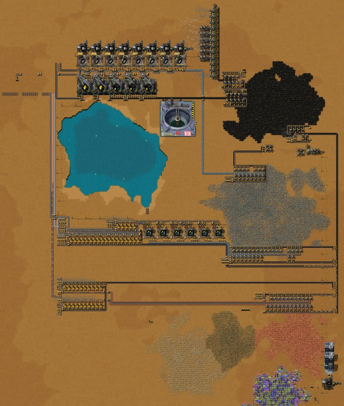
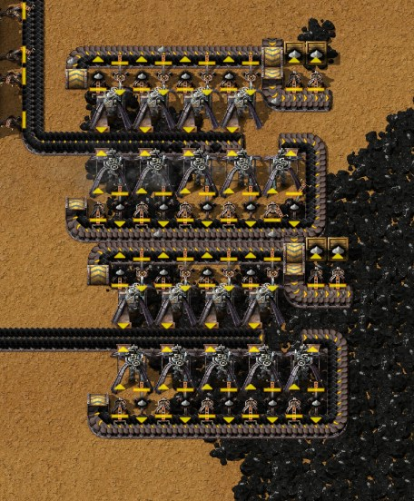
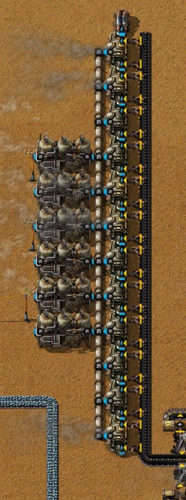
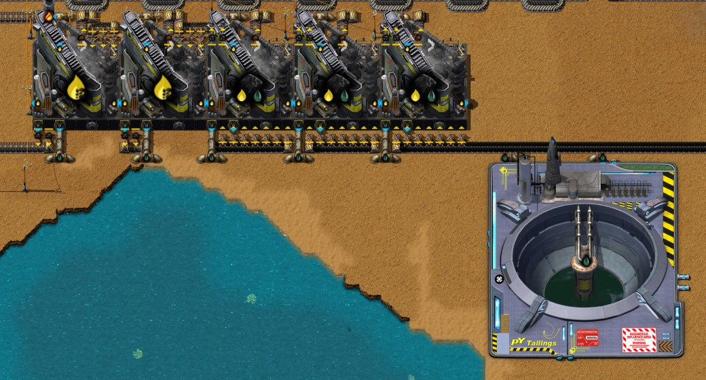
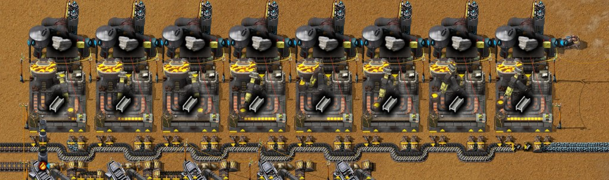
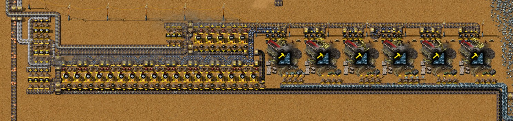
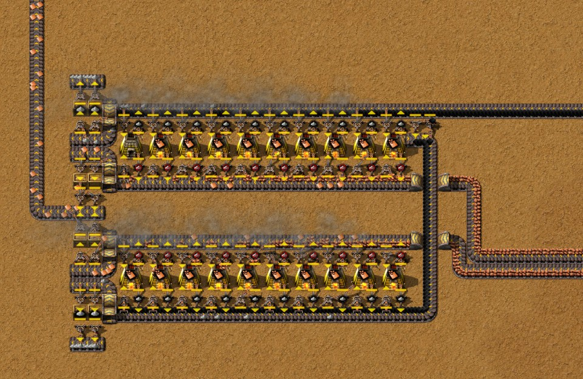

# 第二章：焦炭、钢材与碎矿炼铁

[English](02-coke-steel-crushed-iron.md) · [目录](../README.zh-CN.md) · 上一章：[第一章](01-landing-to-red-science.zh-CN.md)

本章接着第一章那局有记录的游戏，从 0:40 放下第一台蒸馏塔，到 3:37 为止：用原煤做焦炭、炼钢、为两者供电、碎矿技术，以及终于实现的冶炼自动化——铁走颚式破碎机，铜用烧燃料的冶炼列。这一阶段的每个区块都由作者自己的蓝图建成，现在都放在[蓝图](../blueprints/README.zh-CN.md)里。文中时间是游戏时间（作者另有 1.2 小时把游戏停在 Factory Planner 里，不计入游戏时间）。数字来自游戏数据、记录器按每 10 分钟统计的产量，以及把 3:37 的存档再运行一分钟的实测（`tools/inspect-save.ps1 -Ticks 3700`）。

一句话概括思路：一条满带原煤做焦炭，焦炭加铁矿炼钢，十二台锅炉吃第二条满带原煤发电，第一批钢材造成颚式破碎机，把一条满带铁矿变成每秒 3 块铁板。

## 这一局的概览

| 游戏时间 | 发生了什么 |
|---|---|
| 0:40–1:00 | 完成炼钢技术（0:48）和土壤清洗（0:58）；五台破坏性蒸馏塔，摆了两遍 |
| 1:00–1:10 | 尾矿池收焦油，排气管排煤气 |
| 1:10–1:30 | 炼钢区：先试放三台高级铸造厂，再建成八台，每台上方各有一台土壤挖掘机 |
| 1:30–1:50 | 电站：十二台锅炉和六台蒸汽机（放了两遍）；两个原煤模块，一个供电站，一个供焦炭。第一批焦油和焦炭 |
| 1:50–2:00 | 挂在燃料环上的铁矿采矿机排给炼钢区供矿；第一批 28 块钢材 |
| 2:00–2:11 | 造满 50 块钢材时钢斧镐自动完成（2:01）；研究碎矿技术（2:01–2:11）；第二台研究中心（2:10）；给破碎机供矿的采矿区 |
| 2:10–2:30 | 一个 7 台的原煤模块，供一条燃料干线；第一批颚式破碎机，在几个位置试放 |
| 2:40–3:00 | 钢材箱到了 500 的上限，炼钢线停下；碎矿炼铁区块挪到最终位置 |
| 3:00–3:10 | 碎矿炼铁开始运转 |
| 3:10–3:30 | 铜：新铜矿采矿区上的两列冶炼列；拆掉旧的采矿机加石炉组合 |
| 3:30–3:37 | 清理树木；作者往更远处探索 |

每秒产量（记录器每 10 分钟的统计；最后一行是 3:37 之后实测的一分钟）：

| 截至 | 原煤开采 | 焦炭 | 钢材 | 加工铁矿 | 铁板 | 石砖 | 铜板 | 灰烬 | 蒸汽 |
|---|---|---|---|---|---|---|---|---|---|
| 1:50 | 7.83 | 0.06 | 0 | 0 | 1.72 | 0.22 | 0.31 | 6.78 | 12.9 |
| 2:00 | 13.58 | 0.48 | 0.05 | 0 | 0.74 | 0.29 | 0.32 | 5.56 | 9.4 |
| 2:10 | 25.93 | 2.71 | 0.43 | 0 | 0.73 | 0.13 | 0.24 | 14.09 | 50.6 |
| 2:20 | 27.22 | 2.20 | 0.44 | 0 | 0.35 | 0.12 | 0.63 | 13.89 | 49.1 |
| 2:30 | 25.73 | 2.21 | 0.44 | 0 | 0.38 | 0 | 0.38 | 13.60 | 52.0 |
| 2:40 | 21.09 | 1.91 | 0.39 | 0 | 0 | 0 | 0 | 10.17 | 43.5 |
| 2:50 | 8.36 | 0.75 | 0.15 | 0 | 0.41 | 0 | 0 | 4.87 | 17.1 |
| 3:00 | 3.37 | 0.26 | 0.06 | 0 | 0.18 | 0 | 0 | 2.17 | 7.7 |
| 3:10 | 5.43 | 0 | 0 | 5.66 | 1.71 | 1.09 | 0 | 4.91 | 11.7 |
| 3:20 | 11.32 | 0 | 0 | 8.70 | 2.89 | 1.50 | 0 | 10.79 | 36.2 |
| 3:30 | 11.21 | 0 | 0 | 9.00 | 3.00 | 1.50 | 0.30 | 9.82 | 25.9 |
| 3:37 后 1 分钟 | 14.5 | 0 | 0 | 9.05 | 3.02 | 1.52 | 1.85 | 13.5 | 27.4 |

对照时间线来看：焦炭和钢材从 2:00 开始生产，钢材箱满了以后停下（这是作者的说明；3:37 的存档里那个箱子正好 500 块）；拆除采矿机加石炉组合、破碎机又还没运转的那段时间，铁板几乎停产；2:30 到 3:20 铜板完全没有产出，直到冶炼列接手。

## 1. 这一阶段的科技

| 科技 | 花费 | 研究时间 | 本章用到的解锁内容 |
|---|---|---|---|
| 煤炭加工 1（第一章） | 12 红瓶 | 0:33–0:39 | 破坏性蒸馏塔 MK1、原煤制煤矿、煤制煤气（同时出焦炭）、石灰石、尾矿池、排气管 |
| 炼钢技术 | 18 红瓶 | 0:39–0:48 | 高级铸造厂 MK1、钢材 |
| 土壤清洗 | 18 红瓶 | 0:49–0:58 | （碎矿技术的前置） |
| 钢斧镐 | 触发：造出 50 块钢材 | 2:01 | 手动采集快一倍；轻型装甲 |
| 碎矿技术 | 24 红瓶 | 2:01–2:11 | 颚式破碎机 MK1、加工铁矿及其炼铁板配方 |
| 灰烬分离 | 60 红瓶 | 2:11 起，3:37 时 27% | 固体分离机 MK1（下一章） |

碎矿技术 0:58 就排进了队列，但直到 2:01 才有红瓶，中间作者在建焦炭链。早点研究也帮不了多少：一台颚式破碎机要 30 块钢材，而第一批钢材约在 2:00 才出来。

## 2. 三条原煤带

这一阶段烧的原煤比第一章多得多：2:00 到 2:30 每秒 26–27 个，第一章是每秒 4–11 个。原煤来自第一章的原煤模块（[`raw-coal-module.txt`](../blueprints/raw-coal-module.txt)，九台采矿机出满满一带，每秒 15 个）：

- **两个模块并排**放在煤矿区边缘（1:40–1:50）：一条带去锅炉，一条带去蒸馏塔。
- **截掉一部分的 7 台版本**在更东边（2:10–2:20），每秒最多约 10.8 个原煤（第一章第 7 节），供一条沿基地东侧向南的**燃料干线**。机械臂从干线上把原煤搬到向西的几条带上：铁矿和铜矿采矿区的燃料环、碎矿炼铁区块的石炉，以及铜冶炼列。

第一章的风车留作手取的备用。

## 3. 电站：一条带上的十二台锅炉

蓝图：[`raw-coal-power.txt`](../blueprints/raw-coal-power.txt)，作者命名为"初期满带原煤发电（不清灰）"。

- **布局。** 最上方一台抽取泵，十二台锅炉排成一列，旁边是六台蒸汽机，锅炉另一侧是原煤带，**每台锅炉两个机械臂**：满负荷的锅炉每秒烧 1.23 个原煤，超过一个机械臂的每秒 0.83 个。
- **数据推算。** 12 台锅炉每秒产 90 蒸汽，正好是 6 台蒸汽机的用量（两台锅炉配一台蒸汽机）：**22.2 MW**，满负荷时每秒烧 **14.8 个原煤**，也就是一满带。
- **实测。** 2:00 到 2:30 焦炭和钢材在生产时，每秒 49–52 蒸汽，即 12.1–12.8 MW；3:37 之后那一分钟只有破碎机在工作，每秒 27.4 蒸汽（6.8 MW）。
- **不清灰。** 每台锅炉的灰烬都留在自己的废料槽里，1000 个装满就停机：满负荷时 13.5 分钟，按 2:00–2:30 约 58% 的负载约 23 分钟。作者靠手清（3:37 时身上带着 63,680 个灰烬）。3:37 的存档里十二台锅炉有五台灰满停着。当时负载低，所以没有影响；但如果所有机器同时运转——蒸馏塔 2.5 MW、铸造厂 9.6 MW、土壤挖掘机 3.6 MW、破碎机 6 MW，再加研究中心和植被采集器——全基地要 **21.9 MW**，十二台锅炉一台都不能少。重新开动炼钢线之前先把灰清掉。

## 4. 焦炭：五台蒸馏塔

蓝图：[`coke-distillation.txt`](../blueprints/coke-distillation.txt)，"2.7 [焦炭]"。

| 配方（破坏性蒸馏塔 MK1，8×8，500 kW） | 原料 → 产物 |
|---|---|
| 煤矿 | 原煤×10 → 煤矿×3 + 煤气×60 + 焦油×30 + 氧化铁×1（20%），2 秒 |
| 煤制煤气 | 煤矿×10 → 焦炭×6 + 煤气×40 + 焦油×50 + 氧化铁×1（30%），3 秒 |

- **3 比 2。** 一台蒸馏塔每秒吃 5 个原煤，所以三台吃一满带，每秒出 4.5 个煤矿；一台蒸馏塔每秒把 3.33 个煤矿变成 2 个焦炭，所以 1.35 台就够，作者放了两台。整个区块用每秒 15 个原煤做出**每秒 2.7 个焦炭**，同时每秒产出煤气 108、焦油 67.5、氧化铁 0.44。
- **布局。** 五台蒸馏塔排成一行。原煤由一条带沿三台煤矿塔的下方送来，每台七个机械臂（每秒 5 个，六个机械臂搬不动）。它们的煤矿经上方的传送带送到两台焦炭塔，焦炭再经传送带送往炼钢区。氧化铁经传送带进箱子，2 个能炼成 1 块铁板。
- **副产物，作者的做法：** "焦油储存到临时尾矿池，煤气暂时销毁"。任何一种输出满了蒸馏塔就会停，所以从第一分钟起两者都要有去处：
  - **煤气 → 排气管**（蓝图里自带）。它不需要电，排放配方每次消耗 20,000 煤气、速度为 2（数据推算），所以一根排气管实际上没有上限：2:00 到 2:30 这里每秒排掉约 88 煤气（实测）。
  - **焦油 → 尾矿池**（18×18，可存 1,000,000；不在蓝图里）。到 3:37 存了 160,300 焦油，占 16%。渗水坑（炼钢技术解锁）可以把焦油彻底排掉。
- **实测。** 2:00 到 2:10 每秒 2.71 个焦炭（部分来自之前存下的煤矿），之后每秒 2.2 个，正好是炼钢区的速度（每块钢材 5 个焦炭）。2:01 的存档里三台煤矿塔都是输出已满：拖慢炼钢的不是焦炭。

## 5. 炼钢：八台土壤挖掘机下的八台铸造厂

蓝图：[`steel-foundries.txt`](../blueprints/steel-foundries.txt)，"0.53 [钢材]"。

钢材：焦炭×5 + 铁矿×20 + 石灰石×5 → 1，15 秒，在高级铸造厂 MK1 里（6×6，1.2 MW）。石灰石：水×400 → 8，20 秒，在土壤挖掘机 MK1 里（7×7，400 kW）。

- **每台铸造厂有自己的土壤挖掘机**，就在它正上方。土壤挖掘机自己把产物放到中心下方 3.8 格处，正好落进铸造厂（实测，见[技巧与机制](../research/techniques.zh-CN.md)）。一台抽取泵给八台供水。一台挖掘机每秒出 0.4 个石灰石，铸造厂只要 0.33 个，所以完全不用传送带运石灰石。
- **每组一个电路：** 铸造厂把自己的内容物读给它的挖掘机，挖掘机只在铸造厂里的石灰石少于 5 个时才运转（读自蓝图）。
- **两条带。** 一条运铁矿，每台铸造厂两个机械臂取（满速的铸造厂每秒要 1.33 个铁矿）。焦炭和钢材共用另一条：一个机械臂从上面取焦炭，一个把钢材放上去。尽头一个过滤为钢材的机械臂把钢材装进一个**限 500 的箱子**（五格）。
- **箱子满了以后**，钢材留在带上，铸造厂装满后停机，焦炭倒堵回蒸馏塔，挖掘机也停下：整条链都闲着，直到有人把钢材取走。2:40 起发生的就是这个（作者的说明）。
- **数据推算：** 每秒 0.533 块钢材，需要每秒铁矿 10.7、焦炭 2.67、石灰石 2.67。
- **实测：** 2:00 到 2:30 每秒 0.43–0.44 块，是推算值的 83%。
- 作者写在蓝图上的备注："留有空间把钢接入总线（似乎没必要）"。

**卡在 83% 的原因：电路让挖掘机启动得太晚。** 挖掘机要等铸造厂里的石灰石少于 5 个才启动，也就是铸造厂刚取走最后一整批的时候。铸造厂一次 15 秒，挖掘机一次 20 秒，所以铸造厂做完这一块后，大多要再等约 5 秒才拿到下一批 8 个石灰石。在 3:37 存档的副本上用引擎实测（清空钢材箱和带上的钢材，清掉锅炉的灰烬，预热两分钟后测十分钟）：

| 土壤挖掘机的电路条件 | 每秒钢材 | 每台铸造厂 |
|---|---|---|
| 石灰石 < 5（原样） | **0.440** | 每分钟 3.30 块，17% 的采样在缺石灰石 |
| 石灰石 < 10 | **0.533** | 每分钟 4.00 块，从不缺料 |
| 不用电路（挖掘机一直运转） | **0.533** | 每分钟 4.00 块，从不缺料 |

所以这个区块只差一个数字：**把条件改成石灰石 < 10**。这样挖掘机启动时，铸造厂里还留着下一块要用的一整批，挖掘机 20 秒的制作能在铸造厂需要之前完成；它仍有 17% 的时间闲着（石灰石不会越积越多），八台铸造厂达到每秒 0.533 块。这几次测试里铁矿和焦炭都没缺过。

测试还显示了一点：箱子满了以后，共用带上走钢材的那一道也会堵满（这里约 270 块），清空箱子后，这些积压只能经那一个机械臂进箱，每秒最多 0.82 块。在积压排空之前，离箱子最近的几台铸造厂找不到空位放钢材：带上留着积压时，十分钟里原样只有每秒 0.355 块，改成 < 10 也只有 0.418 块。往箱子里再加一个机械臂（或者放两个箱子）能把恢复时间缩短一半（未实测）。

最早的 50 块钢材在 2:01 让钢斧镐自动完成；六台颚式破碎机用掉了其中 180 块。

## 6. 碎矿炼铁：六台颚式破碎机，每秒 3 块铁板

蓝图：[`crushed-iron.txt`](../blueprints/crushed-iron.txt)，"3 [铁板]"。

| 配方 | 机器 | 原料 → 产物 |
|---|---|---|
| 加工铁矿 | 颚式破碎机 MK1（7×7，1 MW） | 铁矿×5 → 加工铁矿×3 + 石矿×1，2 秒 |
| 铁板 | 石炉 | 加工铁矿×3 → 1，6 秒 |
| 石砖 | 石炉 | 石矿×2 → 1，3.2 秒 |

- **配比。** 一台破碎机每秒吃 2.5 个铁矿，所以六台吃一满带。每台破碎机每秒 1.5 个加工铁矿喂三台石炉（每台 0.5 个），所以 18 台石炉每秒出 **3 块铁板**；每秒 3 个石矿进五台石砖炉（每台 0.625 个），每秒 **1.5 块石砖**。
- **布局。** 六台破碎机沿铁矿带排成一行，每台四个机械臂取矿。另一侧每台破碎机有三个过滤为加工铁矿的机械臂和一个过滤为石矿的机械臂，把两者放到不同的带上。加工铁矿送到一行 18 台石炉，石矿送到一行五台。每台石炉都是第一章的配置：产物一侧一个入料臂和一个"除灰烬外全部"的出料臂，燃料一侧一个送原煤的和一个取灰烬的机械臂。铁板、石砖和灰烬最后进箱子，铁板和石砖还会接着送上总线（第 8 节）。
- **实测：** 3:37 之后那一分钟，每秒 3.02 块铁板、1.52 块石砖，用掉每秒 9.05 个加工铁矿、15.1 个铁矿；3:20–3:30 这 10 分钟正好是 3.00 和 1.50。这个区块达到了它的标称产量。
- **运行代价：** 破碎机 6 MW，23 台石炉每秒 1.5 个原煤。折合到每块板，铁矿从 8 个降到 5 个，原煤则从 2 个升到约 2.6 个（把破碎机的电折算回锅炉燃料，见[焦炭、炼钢、碎矿与灰烬分离](../research/coke-and-steel.zh-CN.md)"两个目标带来什么"）：碎矿省的是矿，不是燃料。若用第一章的组合，每秒 3 块板要 30 组、每秒 24 个铁矿。

铁矿来自专属的采矿区：采矿机排在矿带两侧，燃料环从燃料干线取原煤，灰烬进箱子，和第一章的冶炼单元一样。实测那一分钟它送出了一满带，每秒 15.1 个铁矿。

## 7. 铜：两列冶炼列

铜暂时不能破碎（"铜处理：阶段 1"排在简易电路板那项科技之后，见[第一章](01-landing-to-red-science.zh-CN.md#下一步焦炭钢材与碎矿)），所以作者直接冶炼，用的是第一章的冶炼列：[`smelting-column.txt`](../blueprints/smelting-column.txt)，"0.9375 [铁板]/[铜板]"。

- 两列各十台石炉，镜像摆放、由同一条铜矿带供料，各吃半带：理论**每秒 1.875 块铜板**。原煤来自燃料干线。
- 新的铜矿采矿区有 23 台采矿机，出满一带（实测每秒 15.1 个铜矿）。
- **实测：** 3:37 之后那一分钟每秒 1.85 块铜板。
- 作者现在用的冶炼列从右往左流，两端各两个箱子；第一章实测的是把它转了半圈的版本，两端各三个。

## 8. 总线的开头

板材和石砖不只是进箱子。三条带从冶炼区沿基地西侧向北——铁板、铜板、石砖——目前在那里截止并堵满：给下一阶段要建的东西当缓存。旁边第四条带把焦炭从蒸馏塔送到炼钢区。这符合作者的总线规则（[技巧与机制](../research/techniques.zh-CN.md#设计原则作者总结)里的第 11、12 条）：石矿以石砖的形式运输；只要水就能做的东西，比如铸造厂的石灰石，就地生产。

## 9. 灰烬

到 3:37 基地共产出 93,241 个灰烬，实测那一分钟每秒 13.5 个。采矿区和石炉列的灰烬进箱子；锅炉的灰烬留在机器里等手清；作者身上带着 63,680 个。接下来研究的灰烬分离是消化灰烬的办法，而不是金属来源：固体分离机处理 10 个灰烬，一半的次数出煤粉，五分之一出烟煤，二十次里才有一次出氧化铁（见[焦炭、炼钢、碎矿与灰烬分离](../research/coke-and-steel.zh-CN.md)）。

## 10. 检查清单

- 原煤：一满带（九台的模块）供十二台锅炉，一满带供五台蒸馏塔，再加一条燃料干线供采矿区和石炉。
- 没有取灰烬机械臂的锅炉装满 1000 个灰烬就停；最晚在所有机器同时运转之前清掉（22.2 MW 里要用 21.9 MW）。
- 蒸馏 3 比 2（煤矿塔比焦炭塔）；煤气接排气管、焦油接尾矿池，从第一分钟就要接好，否则蒸馏塔会停。
- 每台高级铸造厂上方一台土壤挖掘机；不用石灰石传送带。如果用电路控制挖掘机，条件设成石灰石少于 10 个才启动，而不是 5 个（实测每秒 0.533 块对 0.440 块）。
- 炼钢线尽头放一个限量箱，钢材够了整条链自动停。
- 碎矿炼铁：每满带铁矿六台颚式破碎机，每台破碎机配三台石炉，再配一台石砖炉处理它的石矿。铜继续用直接冶炼的冶炼列。
- 板材和石砖送上总线，不只是进箱子。

## 11. 这些结论是怎么核实的

- 这局游戏：助手模组的记录器（记录 `2652821414-0`），用 `tools/recorder-phases.js`（每 10 分钟一段的时间线）和 `tools/recorder-log.js`（每 10 分钟的物品和流体产量）读取。炼钢为什么停，由作者说明。
- 引擎里的炼钢区测试：`tools/save-probe.ps1` 在存档副本里运行一个测量模组；`tools/steel-probe` 清空钢材箱、带上的钢材和锅炉的灰烬，按测试版本设置挖掘机的电路条件，预热两分钟后每秒采样一次每台铸造厂，共十分钟（产出的钢材、状态、缺哪种原料）。
- 3:37 的存档（`Py-Exploration`，一致性检查通过）：先用 `tools/inspect-save.ps1`，再用 `tools/summarize-save.js`、`tools/render-save-map.js`、`tools/render-area.js` 和 `tools/trace-layout.js` 读取（带上的物品、谁给谁供料、机器状态、锅炉灰烬、钢材箱）；当时蒸馏塔和铸造厂的状态读自 2:01 的存档。
- 3:37 的存档在引擎里再运行一分钟实测：`tools/inspect-save.ps1 -Ticks 3700` 现在还会写出 `production-measure.json`，即那一分钟全基地每秒产出和消耗的全部物品（由 `summarize-save.js` 输出）。
- 蓝图：作者用助手模组导出，拉进 `blueprints/`；布局、配方、过滤、箱子限量和电路条件都读自蓝图数据。它们是按上面的方式在作者的游戏里实测的，没有在实验场里跑过。
- 原型数值（配方和概率、机器尺寸和功率、制造速度、排气管的排放配方、尾矿池容量、科技花费和触发条件）：这局所用模组组合（Factorio 2.1.21）的 `data.raw`，在读档环境中导出。
- 由数据推算、未实测：各种配比和理论产量、锅炉灰烬装满的时间、所有机器同时运转的 21.9 MW、每块板的燃料。
- 图片：3:37 之后在作者的游戏中用助手模组的 `/pt-shots` 截取的游戏内画面（Alt 视图，显示实体信息）。
