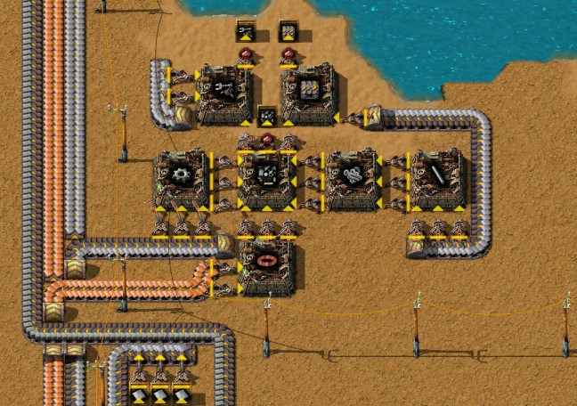
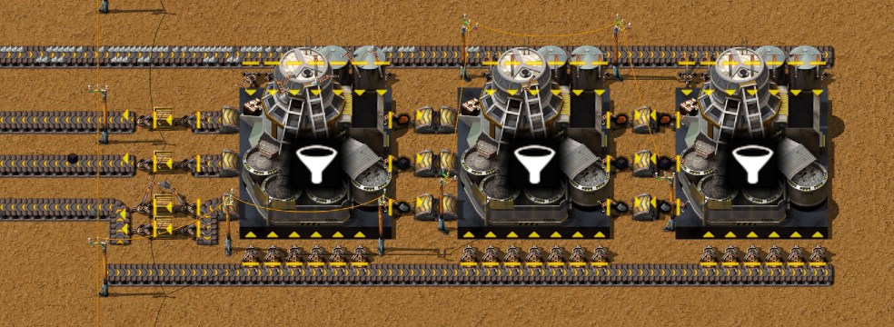
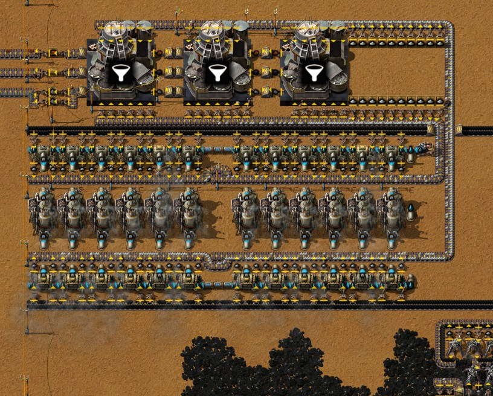
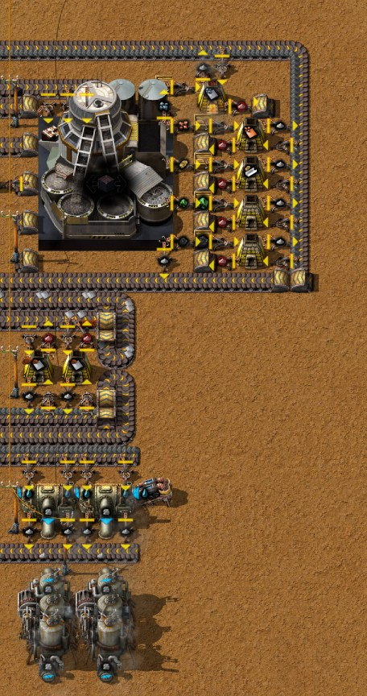

# Chapter 3 — Ash separation and Raw coal power

[中文版](03-ash-separation-raw-coal-power.zh-CN.md) · [Index](../README.md) · Previous:
[chapter 2](02-coke-steel-crushed-iron.md)

This chapter follows the same recorded run from 3:37 to 6:13. The author researched Ash
separation and built everything that turns the base's Ash into something: Solid separators at the
end of one Ash belt from the whole base, Coal dust burnt in Boilers and furnaces, Soot separated
into ores, Iron oxide smelted into Iron plates. The power moved to the large coal field in the
south, into a station sized for two belts of Raw coal, and a second mall now makes belts and
inserters. At 6:13 the base runs by itself, with the one exception the author named: the Coal gas
is held back for aluminium mining, so the coke columns stand still (section 8). Times are game
time (by now 1.4 hours paused in Factory Planner, which game time does not count). Numbers come
from the game's data, from the recorder's 10-minute production windows, from one more minute of
the save of 6:13 (`tools/inspect-save.ps1 -Ticks 3700`) and from engine tests on a copy of it.

The plan in one sentence: every Ash belt in the base runs to Solid separators; their Coal dust
goes back into Boilers and furnaces, their Soot into ores and their Iron oxide into Iron plates;
and the power moves next to a coal field big enough for 24 Boilers.

## The run at a glance

| Game time | What happened |
|---|---|
| 3:37–3:55 | A second mall: seven Burner assembling machines for Mechanical inserters, Transport belts and Small parts, first set down by the steel site, then on the bus |
| 3:58 | Ash separation done (60 red, from 2:11); Mining with fluid next (3:58–4:06), then Glass technologies (4:06–6:10) |
| 4:01 | Chat note: "给原木产区留出空间，多余灰尘通向灰尘处理" — leave room for the log area; send the surplus Ash to Ash processing |
| 4:05–4:40 | A first separator site about 150 tiles south: three Solid separators and a row of Stone furnaces, moved twice and taken down before it ran |
| 4:35–5:10 | The power station on the southern coal field: two Raw coal modules, then 24 Boilers, 12 Steam engines and 3 Solid separators, placed as one blueprint by robots and moved once |
| 5:05–5:20 | The first Ash is separated, at the power station (7.2 Ash/s in the window ending 5:10). The Exhaust pipe comes out (5:14 note: "留出另一组发电的空间" — leave room for another power group; 5:16 note: "去掉排气管预留一点煤气准备采铝矿" — remove the Exhaust pipe, keep some Coal gas for mining aluminium). The old twelve-Boiler block comes down |
| 5:15–5:25 | The Ash separation block at the end of the base's Ash belt |
| 5:25–5:45 | Soot separation and Iron oxide smelting at the south end |
| 5:45–5:55 | About 930 belts by hand: the long lines that take Coal dust, Soot and Iron oxide south and bring Iron plates back north to the bus |
| 5:55–6:05 | Coal dust power: two Boilers, two Steam engines, an Offshore pump |
| 6:05–6:13 | The Iron ore field of the crushers grows by 47 drills; Glass technologies done (6:10), Botany - Stage 1 started |

Production per second (10-minute windows from the recorder; the last row is the minute measured
after 6:13):

| Window ending | Raw coal mined | Ash made | Ash separated | Coal dust | Soot | Iron oxide | Iron plate | Copper plate | Steam |
|---|---|---|---|---|---|---|---|---|---|
| 3:40 | 13.48 | 12.39 | 0 | 0 | 0 | 0 | 3.00 | 1.21 | 27.3 |
| 4:00 | 13.12 | 13.21 | 0 | 0 | 0 | 0 | 2.91 | 1.88 | 26.8 |
| 4:20 | 13.09 | 13.23 | 0 | 0 | 0 | 0 | 3.00 | 1.88 | 26.2 |
| 4:40 | 15.18 | 14.82 | 0 | 0 | 0 | 0 | 2.95 | 1.88 | 35.3 |
| 5:00 | 13.01 | 13.01 | 0 | 0 | 0 | 0 | 2.90 | 1.88 | 26.1 |
| 5:10 | 16.73 | 13.52 | 7.17 | 0.35 | 0.14 | 0.04 | 2.72 | 1.27 | 36.3 |
| 5:20 | 12.19 | 12.22 | 20.28 | 1.02 | 0.43 | 0.12 | 2.50 | 0.94 | 34.8 |
| 5:30 | 13.25 | 13.22 | 31.72 | 1.57 | 0.62 | 0.15 | 1.69 | 0.94 | 46.1 |
| 5:40 | 12.82 | 12.81 | 28.00 | 1.41 | 0.53 | 0.14 | 2.40 | 0.94 | 40.6 |
| 5:50 | 12.57 | 12.80 | 27.75 | 1.37 | 0.49 | 0.15 | 2.10 | 0.95 | 41.9 |
| 6:00 | 12.04 | 12.29 | 24.82 | 1.25 | 0.44 | 0.15 | 2.44 | 0.95 | 39.4 |
| 6:10 | 8.76 | 10.18 | 24.38 | 1.21 | 0.49 | 0.10 | 1.87 | 0.94 | 33.7 |
| 6:13 + 1 min | 15.7 | 15.5 | 28.1 | 1.30 | 0.57 | 0.12 | 3.37 | 0.95 | 49.5 |

("Ash separated" counts only what the Solid separators took; Planter boxes, handcrafted for red
science, use a little Ash too.) Read with the timeline:

- **Ash was made at 10–15 a second all along; from 5:10 the separators took 20–32.** The
  difference is the backlog: the author had carried 63,680 Ash at 3:37 (10,025 left at 6:13) and
  poured it into chests that feed the separators; 20 of those chests still held about 66,000 at
  6:13. Coal dust, Soot and Iron oxide follow the Ash separated at 0.05, 0.02 and 0.005 per Ash,
  as the recipe says (section 3).
- **Coke and Steel made almost nothing in this chapter,** apart from a short run around
  5:10–5:30 (0.11 Steel/s in the window ending 5:30): first the steel chest was full, then the
  Coal gas had nowhere to go (section 8).
- **Iron plates fell to 1.7–2.4 a second from 5:20,** with Iron ore mined down to 7–11 a second;
  after the field was extended at 6:05 the measured minute shows a full belt again (15.1 Iron
  ore/s) and 3.37 Iron plates/s, the Iron oxide's plates included.
- **Copper halved from 5:20:** one of the two copper columns stands with full outputs. The copper
  belt of the bus is full (480 plates on 60 tiles) and nothing draws much copper yet.
- **Steam 26–46 a second,** 6.4–11.4 MW (one Steam = 0.247 MJ of electricity, from data); 49.5 in
  the measured minute, 12.2 MW, with coke and steel standing.

## 1. The technologies of this stage

| Technology | Cost | Researched | Unlocks what this chapter uses |
|---|---|---|---|
| Ash separation | 60 red | 2:11–3:58 | Solid separator MK 01, Ash separation, Soot separation |
| Mining with fluid | 24 red | 3:58–4:06 | Fluid mining drill MK 01 and Aluminium plate from Aluminium ore (also Tin plate and Tinned cable) |
| Glass technologies | 30 red | 4:06–6:10 | Crystal mine MK 01, Glassworks MK 01, Glass (not used yet) |
| Botany - Stage 1 | 30 red | from 6:10, 8 % at 6:13 | Botanical nursery MK 01 (next chapter) |

The queue at 6:13 continues with Moss - Stage 1 and Wood processing, the log recipes of the next
chapter. Mining with fluid is there for aluminium: Aluminium ore can only be mined with Coal gas as
the mining fluid (from data), which is why the author stopped venting it.

## 2. A second mall: belts and inserters

Blueprint: [`burner-belt-mall.txt`](../blueprints/burner-belt-mall.txt), the author's
"初期爪带超市" (early mall for inserters and belts).

- **Seven Burner assembling machines** pass their parts from machine to machine by inserters,
  like the first mall: Iron gear wheel, Iron stick, Bolts and Copper cable feed Small parts,
  Mechanical inserters and Transport belts. Iron and Copper plates come off the bus by short
  belts; fuel goes in by hand.
- **Three chests with limits** take the products: Mechanical inserters (5 slots, 250), Transport
  belts (10 slots, 1000) and Small parts (10 slots, 2000). At 6:13 the inserter and belt chests
  were full (Small parts 1110) and six of the seven machines stood with full outputs: the mall
  makes stock and stops, as the author's rule for malls says (not balanced, just produce).
- It replaced the first mall, whose six machines came down at 3:35–3:45. Handcrafting did not stop
  (for example 300 Transport belts at 5:45–5:55): a full chest of 1000 belts goes quickly when
  laying 900-tile lines.

## 3. What ten Ash give back

| Recipe | Machine | In → out |
|---|---|---|
| Ash separation | Solid separator MK 01 (7×7, 1.5 MW) | 10 Ash → 1 Coal dust (50 %), 1 Soot (20 %), 1 Iron oxide (5 %), 1 s |
| Soot separation | Solid separator MK 01 | 2 Soot → 1 each of Iron ore and Copper ore (20 %), Ash (30 %), Aluminium ore, Zinc ore and Lead ore (10 %), 1 s |
| Iron plate | Stone furnace | 20 Iron oxide → 10, 3.5 s |
| Aluminium plate | Stone furnace | 10 Aluminium ore → 1, 6 s |

Coal dust is a fuel of 3 MJ, the same as Raw coal, and burns to Ash again; it stacks to 100
(Raw coal 50). Zinc and Lead ore cannot be smelted yet (their recipes are not unlocked).

**The energy balance (from data).** A separator spends 1.5 MJ of electricity on 10 Ash. Steam
engines turn half of the steam's heat into electricity, so that is 3 MJ of fuel at the Boilers.
The 10 Ash give back 0.5 Coal dust, 1.5 MJ. Half the fuel comes back: separating all of the
base's Ash costs about 5 % more Raw coal (0.05 Raw coal per Ash). What it buys:

- **No Ash to carry.** Chapter 2's Boilers stopped when their 1000-Ash slots filled, and the
  author emptied chests and Boilers by hand. Now Ash is just another belt.
- **A trickle of materials.** At the 15.5 Ash/s of the measured minute: 0.78 Coal dust, 0.31
  Soot and 0.08 Iron oxide per second; the Soot gives 0.03 Iron ore, 0.03 Copper ore and 0.016
  each of Aluminium, Zinc and Lead ore per second, the Iron oxide 0.04 Iron plates. The distillation
  columns' Iron oxide is worth more: 0.44 a second while they run, 0.22 Iron plates.

## 4. The Ash belt and the separator block

The drill fields' fuel loops and the furnace rows carry their Ash on the outer lane as in
chapters 1 and 2. Where most of those lanes ended in chests, the Ash now goes on: onto one belt
that runs west through the base and then about 220 tiles south along its west edge, to the
separator block (the 4:01 note). The Ash of the far south (Soot separation, Iron oxide furnaces,
Coal dust Boilers) comes back north on a second belt and joins it just before the block.

Blueprint: [`ash-separation.txt`](../blueprints/ash-separation.txt), "灰烬分离".

- **Three Solid separators in a row** between two belts, one above the row and one below. A
  separator at full speed eats 10 Ash/s, so it gets **13 inserters** (13 × 0.83 = 10.8/s): 20
  inserters on the belt above, 19 on the belt below, for the three. **Only the belt above has a
  source:** the Ash belt runs onto it, while the belt below starts at the block's west edge with
  nothing feeding it, in the blueprint and in the author's base. (Corrected after chapter 4: this
  section first said the Ash belt splits into both.)
- **Outputs.** On the west side of each separator three inserters, filtered to Coal dust, Soot
  and Iron oxide, put them on three belts running west. Each belt passes a buffer chest (an
  inserter in, an inserter out; two chests for the Coal dust), then joins the long belts south.
- **Capacity 30 Ash/s with both belts fed, 15 as built.** One belt carries 15 Ash/s. On the
  bench of chapter 4 (section 7) the block runs at 50 % with only the belt above full and at
  100 % (29.9 Ash/s) with both. The base made 15.5 in the measured minute, so after the backlog one
  and a half separators' worth would do; at 6:13 two of the three stood short of Ash.

## 5. Power on two belts of Raw coal

Blueprint: [`raw-coal-power-two-belts.txt`](../blueprints/raw-coal-power-two-belts.txt), the
author's "两满带原煤发电" (power from two full belts of Raw coal).

The station stands on the large coal field in the south (83.5 million Raw coal within the save's
scan), about 350 tiles south of the steel site; small electric poles carry the power north. Two
Raw coal modules from chapter 1 (nine drills each) fill its two belts. It replaced the
twelve-Boiler block of chapter 2, which came down at 5:15–5:20.

- **Layout.** Two rows of twelve Boilers face each other with twelve Steam engines between them.
  Each row has its Raw coal belt on the outside and **two fuel inserters per Boiler** (1.23 Raw
  coal/s at full load), and its Ash belt on the inside with **two Ash inserters per Boiler**: a
  Boiler makes one Ash per Raw coal. The Ash belts run to three Solid separators above the
  station, which also take Ash from 20 chests filled by hand; their Coal dust, Soot and Iron oxide
  leave west through buffer chests, as in the separator block.
- **From data.** 24 Boilers make 180 Steam/s, what 12 Steam engines use: **44.4 MW**, burning
  **29.6 Raw coal/s** at full load, two full belts.
- **At 6:13 only half of it had water.** The Offshore pump stands at the east end, and nothing
  carried the water across the three free tiles between the east and the west half. In the save of
  6:13 the twelve western Boilers and six western engines stood with no water, so the station gave
  at most **22.2 MW**, no more than the block it replaced. Boilers pass water along, so three pipes
  in each Boiler row close the gap: the author added them after reading this, in the game and in
  the blueprint, and in their save of 6:14 all fourteen Steam engines were running.
- **Measured.** 49.5 Steam/s (12.2 MW) in the minute after 6:13, with coke and steel standing; the
  six watered engines here ran at about 41 % (the rest came from Coal dust, section 6).
- **Is 22.2 MW enough? Not with everything running** (from data): columns 2.5 MW, foundries 9.6,
  Soil extractors 3.6, crushers 6, labs and Flora collector 0.2 — chapter 2's 21.9 MW — plus the
  Solid separators: 1.5 MW each while busy, about 2.5 MW for the Ash the base makes, 10.5 MW while
  all seven work through a backlog. Against 22.2 MW and 1–3.7 MW from Coal dust. In the engine
  tests of section 9, with the steel site running and the separators still busy, the foundries
  reported low power in 5–22 % of the samples. With water in both halves the station has twice
  the power, 44.4 MW.

## 6. Coal dust power

Blueprint: [`coal-dust-power.txt`](../blueprints/coal-dust-power.txt), "煤粉处理".

- **Two Boilers burn Coal dust** from the long Coal dust belt (two inserters each), with their own
  Offshore pump; their Ash goes onto the Ash belt back north. Two Boilers make 15 Steam/s, one
  Steam engine's worth (3.7 MW), and burn 2.47 Coal dust/s at full load.
- **And two Steam engines.** The author's note: "多出的蒸汽机是为了优先消耗煤粉" — the extra
  Steam engine is there so that Coal dust is used first. The electric network spreads the load
  over all Steam engines that have steam, each taking the same share of what it can deliver. Two
  engines on these two Boilers take two engines' share, so the Coal dust Boilers work twice as
  hard as the Raw coal Boilers, up to their full output, and Raw coal covers only the rest.
- **Checked against the measured minute:** 49.5 Steam/s over the eight engines with water is 41 %
  of their 120. Two engines' share is 12.4 Steam/s, 1.65 Boilers' worth, about 2.0 Coal dust/s;
  the base burnt 2.03 Coal dust/s (a few furnaces included). One engine would have taken half.
- **When it matters.** In steady state the separators make only about 0.78 Coal dust/s (0.05
  per Ash). One engine burns all of that when the base runs above about 32 % load, two engines from
  16 %. So the extra engine matters while there is a backlog (about 2,600 Coal dust stood in the
  power station's buffer chests at 6:13) and when the load is low, as now with coke and steel
  standing. If Coal dust were not burnt, its belt would back up, then the separators' outputs, then
  the Ash belt, and finally the Boilers and furnaces that put Ash on it.

## 7. Soot and Iron oxide

Blueprints: [`soot-separation.txt`](../blueprints/soot-separation.txt) ("烟煤分离") and
[`iron-oxide-smelting.txt`](../blueprints/iron-oxide-smelting.txt) ("氧化铁处理"), at the south
end next to the Coal dust power.

- **Soot separation: one Solid separator,** 2 Soot/s at most; the base makes about 0.31 in steady
  state (0.4–0.6 with the backlog). Five inserters, filtered to Iron ore, Copper ore, Aluminium
  ore, Zinc ore and Lead ore, put each ore into its own chest, and each chest feeds its own Stone
  furnace. The furnaces burn Coal dust and put their plates on a belt north; Ash (the 30 % of the
  recipe, and the furnaces') goes back to the Ash belt. Iron and Copper ore smelt now, Aluminium
  ore too since Mining with fluid (9 Aluminium plates by 6:13); Zinc and Lead ore cannot be
  smelted yet and wait in their chests (103 and 94 at 6:13), with a furnace ready for each.
- **Iron oxide: two Stone furnaces.** 20 Iron oxide → 10 Iron plates in 3.5 s: one furnace could
  take 5.7 Iron oxide/s, but its one input inserter brings 0.857 a second, so the pair smelts at
  most 1.717 Iron oxide/s at 15 % of its speed (measured on the bench in chapter 4, section 9);
  still more than the base makes. The Iron oxide belt starts at the
  distillation columns, about 450 tiles north, and picks up the separators' Iron oxide on the way;
  the furnaces burn Coal dust; the plates go north to the bus on a long Iron plate belt. From 6:00
  they smelted 0.7–0.9 Iron oxide/s, the stock that had piled up since chapter 2.

## 8. Coal gas: why coke and steel stand still

The author took the Exhaust pipe out at 5:10–5:15 to keep Coal gas for the aluminium drills of
the next chapter. But a distillation column stops when any of its outputs is full (chapter 2),
and the five columns make Coal gas with everything they make: 108 Coal gas/s at full rate. The
pipes filled within minutes. At 6:13 all five columns stood with full outputs, no Coke had been
made for about 50 minutes, and all eight foundries waited for ingredients, although the steel
chest held only 374 of its 500.

Storing the gas is not an option yet:

- **A Tailings pond is no store for gas.** It keeps liquids like the Tar, but pycoalprocessing's
  script empties every gas that runs into a pond, Coal gas included, and counts 15 % of it as
  pollution (off on this map). A pond on the Coal gas pipe is just another vent. (The author
  pointed this out; read in the mod's `scripts/tailings-pond.lua`.)
- **Tanks are small.** They come with Storage tanks (70 red, after Alloy smelting - Stage 1) and
  hold 10,000–30,000: under five minutes of the columns' 108 Coal gas/s.

So until the Fluid mining drills draw the gas, the choice is between venting it and a stopped
coke line, and with it a stopped steel line.

## 9. Steel: Limestone < 8

After chapter 2 the author set the Soil extractors' condition to **Limestone < 8**, in the game
and in the blueprint ([`steel-foundries.txt`](../blueprints/steel-foundries.txt), now labelled
"0.533 [Steel plate]"), reasoning that an extractor makes 8 per craft, so 8 must be enough.
Measured in the engine on a copy of the save of 6:13 (the steel chest emptied; the probe tops each
foundry up to 10 Coke every second, because the columns stood still, so only Limestone can run
short; ten minutes after a two-minute warm-up):

| Condition on the Soil extractors | Steel per second | Each foundry | Tick model |
|---|---|---|---|
| Limestone < 5 (chapter 2) | **0.435** | 3.2–3.3 a minute, short of Limestone in 17 % of the samples | 0.441 |
| Limestone < 8 (the author's after chapter 2) | **0.493** | 3.70 a minute, short of Limestone in 8 % | 0.492 |
| Limestone < 10 | **0.533** | 4.00 a minute, never short | 0.533 |

**Why 8 is not enough.** The amount is fine; the timing is not. While the extractor is stopped
the foundry holds at least the threshold. When the foundry takes its 5 Limestone for a craft, the
extractor starts again from zero and needs 20 s, while the foundry's craft takes 15 s. If fewer
than 5 are left, the foundry waits about 5 s. With < 8 the foundry can hold 8 or 9 when it takes
a batch and keep only 3 or 4. With < 10 it keeps at least 5, enough for its next craft, and the
extractor delivers before that one ends (15 + 15 s > 20 s). So the threshold has to cover two
batches: 2 × 5 = **10**. The rule behind it: when the supplier's craft is slower than the
consumer's, start the supplier while the consumer still holds a batch beyond the one it is about
to take.

The tick model is one pair as the engine runs it: the foundry takes 5 Limestone when a craft
starts, the extractor runs only below the threshold and keeps its progress while stopped. It
gives the right column above for eight foundries, and 0.457, 0.474 and 0.512 Steel/s for
thresholds 6, 7 and 9; every threshold from 10 up gives 0.533. The low power these runs met
(section 5) did not change the count: with < 10 every foundry finished exactly 40 plates.

After these tests the author set all eight extractors to **Limestone < 10**, in the game and in
the book.

## 10. Checklist

- Ash on belts, not in chests: every fuel loop and furnace row's Ash lane leads to one Ash belt
  and Solid separators. 13 inserters per separator (10 Ash/s each); size the separators for the
  backlog, not only for what the base makes.
- Every byproduct needs a place to go, or the chain stops back to the Boilers: Coal dust to
  Boilers and furnaces, Soot to Soot separation, Iron oxide to furnaces, a buffer chest in each line.
- Separating Ash costs about 5 % more Raw coal (half of its electricity's fuel comes back as Coal
  dust); what it buys is a base with no Ash to carry.
- Two belts of Raw coal: 24 Boilers and 12 Steam engines, 44.4 MW. Check that every Boiler has
  water.
- Coal dust Boilers with one Steam engine more than they need burn the Coal dust first.
- A distillation column needs a way out for its Coal gas, or it stops Coke and with it Steel. A
  Tailings pond vents gas instead of storing it; keep the Exhaust pipe until something uses the gas.
- Steel: the Soil extractors' condition at Limestone < 10, not < 8 (0.533 against 0.493 Steel/s,
  measured).

## 11. How these facts were checked

- The run: the companion mod's recorder (run `2652821414-0`), read with
  `tools/recorder-phases.js` (timeline in 5-minute slices, chat notes) and `tools/recorder-log.js`
  (production per 10-minute window, items and fluids).
- The save of 6:13 (`Py-Exploration`, consistency check passed): `tools/inspect-save.ps1 -Ticks
  3700`, then `tools/summarize-save.js` (research, machine states, the measured minute),
  `tools/render-save-map.js`, `tools/render-area.js` and `tools/trace-layout.js` (belt lines and
  their contents, what feeds what, fluid networks: the dry west half of the power station, chest
  contents, the columns' state); the save of 6:14 for the author's fixes (both halves of the
  station watered, the extractors at < 10).
- The steel site in the engine: `tools/save-probe.ps1` with `tools/steel-probe`, variants
  `as-built,coke`, `lt5,coke` and `lt10,coke` (the probe now takes any `ltN` and can top up Coke).
  The tick model is a small script, not part of the tools; its results are in the table.
- The blueprints: exported by the author with the companion mod (2026-10-10) and pulled into
  `blueprints/`; layouts, filters, chest limits and the circuit condition read from the blueprint
  data. The new blocks were measured where they stand in the author's game, not in the design lab.
- Prototype values (recipes and chances, machine power and sizes, fuel values and stack sizes,
  Boiler and Steam engine rates, tank sizes, Aluminium ore's mining fluid, technology costs and
  unlocks): `data.raw` of the run's mod set (Factorio 2.1.21), dumped in the save setup. That a
  Tailings pond vents gas: pycoalprocessing 3.1.7, `scripts/tailings-pond.lua`.
- Computed from data, not measured: the energy balance of Ash separation, the station's 44.4 MW
  and its power budget, the share of load on the Coal dust Boilers.
- Pictures: in-game screenshots with entity info (alt view), taken in the author's game with the
  companion's `/pt-shots` after 6:13.

Next: [chapter 4](04-aluminium-glass-logs.md), aluminium mining, glass making, log production and red science.
The log chain needs both of the others: a Botanical nursery MK 01 takes 10 Glass and a Moss farm
MK 01 10 Aluminium plates (from data).

