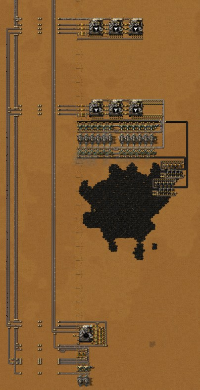

# 第三章：灰烬分离与原煤发电

[English](03-ash-separation-raw-coal-power.md) · [目录](../README.zh-CN.md) · 上一章：[第二章](02-coke-steel-crushed-iron.zh-CN.md)

本章接着同一局有记录的游戏，从 3:37 到 6:13。作者研究了灰烬分离，并建起了把基地灰烬变成有用东西的全套设施：全基地的灰烬汇到一条灰烬带，末端是固体分离机；煤粉回到锅炉和石炉里烧，烟煤分离成各种矿，氧化铁炼成铁板。电站搬到南边的大煤矿区，按两条原煤带的规模建造；第二个超市开始做传送带和机械臂。到 6:13 基地已能自行运转，只有作者自己点出的一个例外：煤气留给铝矿开采，所以焦炭蒸馏塔停着（第 8 节）。文中时间是游戏时间（至今共有 1.4 小时停在 Factory Planner 里，不计入游戏时间）。数字来自游戏数据、记录器每 10 分钟的产量统计、把 6:13 的存档再运行一分钟的实测（`tools/inspect-save.ps1 -Ticks 3700`），以及在存档副本上做的引擎测试。

一句话概括思路：基地里每条灰烬带都通向固体分离机；分出的煤粉回到锅炉和石炉，烟煤变成矿，氧化铁变成铁板；电站搬到一块够 24 台锅炉烧的煤矿旁边。

## 这一局的概览

| 游戏时间 | 发生了什么 |
|---|---|
| 3:37–3:55 | 第二个超市：七台热能组装机做工业机械臂、基础传送带和小部件，先放在炼钢区旁，后来挪到总线边 |
| 3:58 | 灰烬分离完成（60 红瓶，2:11 开始）；接着研究流体采矿（3:58–4:06），然后是玻璃技术（4:06–6:10） |
| 4:01 | 聊天留言："给原木产区留出空间，多余灰尘通向灰尘处理" |
| 4:05–4:40 | 在南边约 150 格处试建第一个分离点：三台固体分离机和一排石炉，挪了两次，还没运转就拆掉了 |
| 4:35–5:10 | 南部煤矿区上的电站：先是两个原煤模块，然后 24 台锅炉、12 台蒸汽机和 3 台固体分离机，作为一张蓝图由机器人建造，挪过一次 |
| 5:05–5:20 | 第一批灰烬在电站被分离（截至 5:10 的十分钟里每秒 7.2 个）。拆掉排气管（5:14 留言："留出另一组发电的空间"；5:16 留言："去掉排气管预留一点煤气准备采铝矿"）。拆除旧的十二锅炉电站 |
| 5:15–5:25 | 在基地灰烬带末端建灰烬分离区块 |
| 5:25–5:45 | 南端的烟煤分离和氧化铁冶炼 |
| 5:45–5:55 | 手动铺了约 930 格传送带：把煤粉、烟煤、氧化铁送往南边、把铁板送回北边总线的长带 |
| 5:55–6:05 | 煤粉发电：两台锅炉、两台蒸汽机、一台抽取泵 |
| 6:05–6:13 | 破碎机的铁矿采矿区增加 47 台采矿机；玻璃技术完成（6:10），开始研究植物学：阶段 1 |

每秒产量（记录器每 10 分钟的统计；最后一行是 6:13 之后实测的一分钟）：

| 截至 | 原煤开采 | 灰烬产出 | 灰烬分离 | 煤粉 | 烟煤 | 氧化铁 | 铁板 | 铜板 | 蒸汽 |
|---|---|---|---|---|---|---|---|---|---|
| 3:40 | 13.48 | 12.39 | 0 | 0 | 0 | 0 | 3.00 | 1.21 | 27.3 |
| 4:00 | 13.12 | 13.21 | 0 | 0 | 0 | 0 | 2.91 | 1.88 | 26.8 |
| 4:20 | 13.09 | 13.23 | 0 | 0 | 0 | 0 | 3.00 | 1.88 | 26.2 |
| 4:40 | 15.18 | 14.82 | 0 | 0 | 0 | 0 | 2.95 | 1.88 | 35.3 |
| 5:00 | 13.01 | 13.01 | 0 | 0 | 0 | 0 | 2.90 | 1.88 | 26.1 |
| 5:10 | 16.73 | 13.52 | 7.17 | 0.35 | 0.14 | 0.04 | 2.72 | 1.27 | 36.3 |
| 5:20 | 12.19 | 12.22 | 20.28 | 1.02 | 0.43 | 0.12 | 2.50 | 0.94 | 34.8 |
| 5:30 | 13.25 | 13.22 | 31.72 | 1.57 | 0.62 | 0.15 | 1.69 | 0.94 | 46.1 |
| 5:40 | 12.82 | 12.81 | 28.00 | 1.41 | 0.53 | 0.14 | 2.40 | 0.94 | 40.6 |
| 5:50 | 12.57 | 12.80 | 27.75 | 1.37 | 0.49 | 0.15 | 2.10 | 0.95 | 41.9 |
| 6:00 | 12.04 | 12.29 | 24.82 | 1.25 | 0.44 | 0.15 | 2.44 | 0.95 | 39.4 |
| 6:10 | 8.76 | 10.18 | 24.38 | 1.21 | 0.49 | 0.10 | 1.87 | 0.94 | 33.7 |
| 6:13 后 1 分钟 | 15.7 | 15.5 | 28.1 | 1.30 | 0.57 | 0.12 | 3.37 | 0.95 | 49.5 |

（"灰烬分离"只算固体分离机吃掉的；为红瓶手搓的种植箱也用一点灰烬。）对照时间线来看：

- **灰烬一直以每秒 10–15 个的速度产出；从 5:10 起分离机每秒吃 20–32 个**。差额是积压：3:37 时作者身上带着 63,680 个灰烬（6:13 剩 10,025），都倒进了给分离机供料的箱子；6:13 时其中 20 个箱子里还有约 66,000 个。煤粉、烟煤、氧化铁按每个灰烬 0.05、0.02、0.005 个跟着分离量走，与配方一致（第 3 节）。
- **本章焦炭和钢材几乎没有产出**，只在 5:10–5:30 前后短暂运转过（截至 5:30 的十分钟里每秒 0.11 块钢）：先是钢材箱满了，后来煤气无处可去（第 8 节）。
- **从 5:20 起铁板降到每秒 1.7–2.4 块**，铁矿开采同时降到每秒 7–11 个；6:05 扩建采矿区后，实测那一分钟又是满带（每秒 15.1 个铁矿），铁板每秒 3.37 块（含氧化铁炼出的）。
- **从 5:20 起铜板减半**：两列铜冶炼列中有一列出料口全满停着。总线上的铜板带已经满了（60 格上 480 块），暂时还没有什么大量用铜。
- **蒸汽每秒 26–46 个**，即 6.4–11.4 MW（一个蒸汽发 0.247 MJ 电，来自数据）；实测那一分钟是 49.5 个，12.2 MW，当时焦炭和钢材都停着。

## 1. 这一阶段的科技

| 科技 | 花费 | 研究时间 | 本章用到的解锁内容 |
|---|---|---|---|
| 灰烬分离 | 60 红瓶 | 2:11–3:58 | 固体分离机 MK1、灰烬分离、烟煤分离 |
| 流体采矿 | 24 红瓶 | 3:58–4:06 | 液压采矿机 MK1、用铝矿炼铝板（另有锡板、镀锡电线） |
| 玻璃技术 | 30 红瓶 | 4:06–6:10 | 晶体矿石采矿机 MK1、玻璃工厂 MK1、玻璃（暂未使用） |
| 植物学：阶段 1 | 30 红瓶 | 6:10 起，6:13 时 8% | 异星苗圃 MK1（下一章） |

6:13 的研究队列接下来是苔藓：阶段 1 和木材处理，也就是下一章的原木配方。研究流体采矿是为了铝：铝矿只能用煤气作采矿流体来开采（来自数据），所以作者不再排放煤气。

## 2. 第二个超市：传送带和机械臂

蓝图：[`burner-belt-mall.txt`](../blueprints/burner-belt-mall.txt)，作者的"初期爪带超市"。

- **七台热能组装机**像第一个超市那样用机械臂在机器之间直接传递零件：铁齿轮、铁棒、螺栓和铜缆供给小部件、工业机械臂和基础传送带。铁板和铜板用短带从总线上取，燃料靠手放。
- **三个限格箱子**收成品：工业机械臂（5 格，250 个）、基础传送带（10 格，1000 个）和小部件（10 格，2000 个）。6:13 时机械臂箱和传送带箱都满了（小部件 1110 个），七台机器中六台出料口全满停着：超市就是做够库存然后停下，正如作者对超市的原则（不求平衡，只管生产）。
- 它取代了第一个超市，后者的六台机器在 3:35–3:45 拆除。手搓并没有停（比如 5:45–5:55 手搓了 300 个基础传送带）：铺 900 格长的带子时，一箱 1000 个传送带很快就用完。

## 3. 十个灰烬能换回什么

| 配方 | 机器 | 输入 → 输出 |
|---|---|---|
| 灰烬分离 | 固体分离机 MK1（7×7，1.5 MW） | 10 灰烬 → 1 煤粉（50%）、1 烟煤（20%）、1 氧化铁（5%），1 秒 |
| 烟煤分离 | 固体分离机 MK1 | 2 烟煤 → 铁矿、铜矿各 1（20%），灰烬（30%），铝矿、锌矿、铅矿各 1（10%），1 秒 |
| 铁板 | 石炉 | 20 氧化铁 → 10，3.5 秒 |
| 铝板 | 石炉 | 10 铝矿 → 1，6 秒 |

煤粉是 3 MJ 的燃料，和原煤一样，烧完又变成灰烬；一组 100 个（原煤 50 个）。锌矿和铅矿暂时还不能冶炼（配方未解锁）。

**能量账（来自数据）**。固体分离机处理 10 个灰烬要耗 1.5 MJ 电。蒸汽机只能把蒸汽热量的一半变成电，所以这相当于锅炉里 3 MJ 的燃料。10 个灰烬换回 0.5 个煤粉，即 1.5 MJ。燃料只回来一半：把基地的灰烬全部分离，要多烧约 5% 的原煤（每个灰烬 0.05 个原煤）。换来的是：

- **不用再搬灰烬**。第二章的锅炉在 1000 格灰烬装满后就停机，作者要手动清空箱子和锅炉。现在灰烬只是又一条传送带。
- **一点点材料**。按实测那一分钟每秒 15.5 个灰烬算：每秒 0.78 个煤粉、0.31 个烟煤、0.08 个氧化铁；烟煤再分出每秒 0.03 个铁矿、0.03 个铜矿，铝矿、锌矿、铅矿各 0.016 个；氧化铁炼出每秒 0.04 块铁板。蒸馏塔的氧化铁更值钱：它们运转时每秒 0.44 个，能炼 0.22 块铁板。

## 4. 灰烬带和分离区块

采矿区的燃料环和冶炼排仍像第一、二章那样把灰烬放在外侧那一道。以前这些道大多止于箱子，现在灰烬继续往前走：汇到一条横穿基地向西、再沿西缘往南约 220 格的传送带上，通向分离区块（4:01 的留言）。最南端（烟煤分离、氧化铁石炉、煤粉锅炉）的灰烬由第二条带往北送回，在区块前汇入。

蓝图：[`ash-separation.txt`](../blueprints/ash-separation.txt)，"灰烬分离"。

- **三台固体分离机排成一排**，夹在两条带之间，一条在上方，一条在下方。分离机满速时每秒吃 10 个灰烬，所以每台配 **13 个机械臂**（13 × 0.83 = 每秒 10.8 个）：三台共计上方带上 20 个、下方带上 19 个。**只有上方那条带有来源**：灰烬带接到上方这条，下方那条从区块西缘开始，没有任何东西供给它，蓝图里和作者的基地里都是这样。（第四章之后更正：本节原先说灰烬带分成上下两条。）
- **产物**。每台分离机西侧有三个机械臂，分别筛选煤粉、烟煤和氧化铁，放到三条往西的带上。每条带都经过一个缓冲箱（一个机械臂放进，一个取出；煤粉有两个箱子），然后汇入往南的长带。
- **两条带都供灰时处理能力每秒 30 个灰烬，照现状只有 15 个**。一条带每秒运 15 个灰烬。在第四章的测试台上（第 7 节），只有上方带满时区块跑 50%，两条都满时跑 100%（每秒 29.9 个灰烬）。实测那一分钟基地产出 15.5 个，所以积压清完后一台半分离机就够；6:13 时三台中有两台在缺灰烬。

## 5. 吃两条原煤带的电站

蓝图：[`raw-coal-power-two-belts.txt`](../blueprints/raw-coal-power-two-belts.txt)，作者的"两满带原煤发电"。

电站建在南部的大煤矿区上（存档扫描范围内有 8350 万原煤），离炼钢区往南约 350 格；电力靠小型电线杆送往北边。两个第一章的原煤模块（每个九台采矿机）填满它的两条带。它取代了第二章的十二锅炉电站，后者在 5:15–5:20 拆除。

- **布局**。两排各十二台锅炉面对面，中间是十二台蒸汽机。每排外侧是原煤带，**每台锅炉两个上料机械臂**（满负荷每秒 1.23 个原煤）；内侧是灰烬带，**每台锅炉两个清灰机械臂**：锅炉每烧一个原煤出一个灰烬。灰烬带通到电站上方的三台固体分离机，这三台还从 20 个手动装灰烬的箱子取料；它们的煤粉、烟煤和氧化铁像分离区块那样经缓冲箱向西离开。
- **来自数据**。24 台锅炉每秒产 180 个蒸汽，正好是 12 台蒸汽机的用量：**44.4 MW**，满负荷每秒烧 **29.6 个原煤**，即两条满带。
- **6:13 时只有一半有水**。抽取泵在东端，而东西两半之间空着三格，没有任何东西把水送过去。6:13 的存档里西边十二台锅炉和六台蒸汽机都没有水，所以电站最多只能发 **22.2 MW**，并不比它取代的旧电站多。锅炉会把水往下传，所以在每排锅炉的空隙里放三节管道就能接通：作者看到后在游戏里和蓝图里都补上了，在 6:14 的存档里十四台蒸汽机全部在运转。
- **实测**。6:13 之后那一分钟每秒 49.5 个蒸汽（12.2 MW），当时焦炭和钢材都停着；这里有水的六台蒸汽机约以 41% 负荷运转（其余来自煤粉，第 6 节）。
- **22.2 MW 够吗？全部开动时不够**（来自数据）：蒸馏塔 2.5 MW、铸造厂 9.6、土壤挖掘机 3.6、破碎机 6、研究中心和植被采集器 0.2——这是第二章的 21.9 MW——再加固体分离机：工作时每台 1.5 MW，处理基地自产的灰烬约需 2.5 MW，七台一起消化积压时要 10.5 MW。供电则是 22.2 MW 加上煤粉的 1–3.7 MW。第 9 节的引擎测试里，炼钢区运转、分离机还在消化积压，铸造厂有 5–22% 的采样处于电力不足。两半都有水时，电站功率翻倍，达到 44.4 MW。

## 6. 煤粉发电

蓝图：[`coal-dust-power.txt`](../blueprints/coal-dust-power.txt)，"煤粉处理"。

- **两台锅炉烧煤粉**，煤粉来自那条长长的煤粉带（每台两个机械臂），自带一台抽取泵；灰烬放上往北的灰烬带。两台锅炉每秒产 15 个蒸汽，够一台蒸汽机（3.7 MW），满负荷每秒烧 2.47 个煤粉。
- **却配了两台蒸汽机**。作者的说明："多出的蒸汽机是为了优先消耗煤粉"。电网把负荷分摊给所有有蒸汽的蒸汽机，每台承担它能输出的同样比例。这两台锅炉后面有两台蒸汽机，就分到两台的份额，于是煤粉锅炉的出力是原煤锅炉的两倍（直到满负荷为止），原煤只补其余部分。
- **用实测那一分钟验证**：每秒 49.5 个蒸汽分给八台有水的蒸汽机，是它们 120 个上限的 41%。两台的份额是每秒 12.4 个蒸汽，相当于 1.65 台锅炉，约每秒 2.0 个煤粉；基地当时每秒烧了 2.03 个煤粉（含几台石炉）。只配一台蒸汽机的话只有一半。
- **什么时候起作用**。稳定状态下分离机每秒只产约 0.78 个煤粉（每个灰烬 0.05 个）。基地负荷在约 32% 以上时，一台蒸汽机就能把它全部烧掉；两台的话 16% 以上即可。所以多出的那台在有积压时（6:13 电站的缓冲箱里约有 2,600 个煤粉）和负荷低时才起作用，比如现在焦炭和钢材都停着。煤粉如果烧不掉，它的带子会堵，接着是分离机的出料口，然后是灰烬带，最后是往灰烬带上放灰烬的锅炉和石炉。

## 7. 烟煤和氧化铁

蓝图：[`soot-separation.txt`](../blueprints/soot-separation.txt)（"烟煤分离"）和 [`iron-oxide-smelting.txt`](../blueprints/iron-oxide-smelting.txt)（"氧化铁处理"），在最南端，挨着煤粉发电。

- **烟煤分离：一台固体分离机**，每秒最多处理 2 个烟煤；基地稳定时只产约 0.31 个（有积压时 0.4–0.6）。五个机械臂分别筛选铁矿、铜矿、铝矿、锌矿和铅矿，各放进自己的箱子，每个箱子各供一台石炉。石炉烧煤粉，炼出的板放上往北的带子；灰烬（配方里那 30%，加上石炉自己的）回到灰烬带。铁矿和铜矿现在就能炼，流体采矿之后铝矿也能炼（6:13 时已有 9 块铝板）；锌矿和铅矿暂时还不能冶炼，留在箱子里（6:13 时分别有 103 和 94 个），每种都已备好一台石炉。
- **氧化铁：两台石炉**。20 个氧化铁 3.5 秒炼成 10 块铁板：一台石炉每秒能吃 5.7 个氧化铁，但它只有一个送料机械臂，每秒只送 0.857 个，所以两台合计每秒最多炼 1.717 个氧化铁，只有石炉速度的 15%（第四章第 9 节在测试台上实测）；这仍然超过基地的产量。氧化铁带从北边约 450 格外的蒸馏塔出发，沿途接上分离机的氧化铁；石炉烧煤粉；铁板经一条长长的铁板带往北送到总线。从 6:00 起它们每秒炼 0.7–0.9 个氧化铁，消耗的是第二章以来积下的库存。

## 8. 煤气：焦炭和钢材为什么停着

作者在 5:10–5:15 拆掉排气管，好把煤气留给下一章的铝矿采矿机。但只要有一种产物出不去，蒸馏塔就会停（第二章），而五台蒸馏塔生产每样东西时都会出煤气：满速时每秒 108 个。管道几分钟就满了。6:13 时五台蒸馏塔出料口全满停着，已经大约 50 分钟没有产出焦炭，八台铸造厂全都在等原料，尽管钢材箱里只有 374 块，没到 500 的上限。

目前还没法把煤气存起来：

- **尾矿池存不了气体**。它能存焦油这样的液体，但 pycoalprocessing 的脚本会把流进尾矿池的所有气体清空，煤气也不例外，并把其中 15% 计为污染（这张地图关闭了污染）。接在煤气管道上的尾矿池只是又一个排气口。（这是作者指出的；见该模组的 `scripts/tailings-pond.lua`。）
- **储液罐太小**。它们由储液罐科技解锁（70 红瓶，前置是合金冶炼：阶段 1），容量 10,000–30,000，按蒸馏塔每秒 108 个煤气算撑不到五分钟。

所以在液压采矿机开始用煤气之前，只能二选一：要么排掉煤气，要么焦炭线停产，钢材线也跟着停。

## 9. 炼钢：石灰石 < 8

第二章之后，作者把土壤挖掘机的条件改成了 **石灰石 < 8**，游戏里和蓝图里都改了（[`steel-foundries.txt`](../blueprints/steel-foundries.txt)，标签现在是"0.533 [钢材]"），理由是挖掘机一次产出 8 个，所以 8 一定够。在 6:13 存档的副本上用引擎实测（清空钢材箱；因为蒸馏塔停着，测量模组每秒把每台铸造厂的焦炭补到 10 个，这样只可能缺石灰石；预热两分钟后测十分钟）：

| 土壤挖掘机的条件 | 每秒钢材 | 每台铸造厂 | 逐 tick 模型 |
|---|---|---|---|
| 石灰石 < 5（第二章） | **0.435** | 每分钟 3.2–3.3 块，17% 的采样缺石灰石 | 0.441 |
| 石灰石 < 8（作者第二章之后的） | **0.493** | 每分钟 3.70 块，8% 缺石灰石 | 0.492 |
| 石灰石 < 10 | **0.533** | 每分钟 4.00 块，从不缺料 | 0.533 |

**为什么 8 不够**。数量没问题，问题在时间。挖掘机停着时，铸造厂里至少有门槛那么多石灰石。铸造厂开始一轮制作时取走 5 个，挖掘机从零开始重新工作，要 20 秒才出货，而铸造厂一轮只要 15 秒。如果剩下的不足 5 个，铸造厂就要等约 5 秒。条件是 < 8 时，铸造厂取料时可能有 8 或 9 个，取完只剩 3 或 4 个；条件是 < 10 时，它至少剩 5 个，够下一轮用，而挖掘机会在那一轮结束前交货（15 + 15 秒 > 20 秒）。所以门槛要覆盖两批：2 × 5 = **10**。背后的规律：供料机器一轮比用料机器慢时，要在用料机器除了正要取走的那批之外还握有一批时就启动供料。

逐 tick 模型就是按引擎的规则模拟一对机器：铸造厂在一轮开始时取 5 个石灰石，挖掘机只在低于门槛时运转、停下时保留进度。它对八台铸造厂给出上表最右一列；门槛为 6、7、9 时分别是每秒 0.457、0.474、0.512 块，10 及以上都是 0.533。这几次测试遇到的电力不足（第 5 节）没有影响数量：条件 < 10 时每台铸造厂正好做了 40 块。

做完这些测试后，作者把八台挖掘机都改成了 **石灰石 < 10**，游戏里和蓝图书里都改了。

## 10. 检查清单

- 灰烬走传送带，不进箱子：每个燃料环和冶炼排的灰烬道都通到同一条灰烬带和固体分离机。每台分离机 13 个机械臂（每台每秒 10 个灰烬）；分离机数量按积压来定，不只按基地的产量。
- 每种副产物都要有去处，否则会一路堵回锅炉：煤粉进锅炉和石炉，烟煤去烟煤分离，氧化铁进石炉，每条线上放一个缓冲箱。
- 分离灰烬要多烧约 5% 的原煤（它耗的电所用的燃料，只有一半以煤粉的形式回来）；换来的是一个不用搬灰烬的基地。
- 两条原煤带：24 台锅炉加 12 台蒸汽机，44.4 MW。检查每台锅炉都有水。
- 烧煤粉的锅炉多配一台蒸汽机，煤粉就会优先烧掉。
- 蒸馏塔的煤气必须有出路，否则焦炭停产，钢材也跟着停。尾矿池会把气体排掉而不是存起来；在有东西用煤气之前，保留排气管。
- 炼钢：土壤挖掘机的条件设为石灰石 < 10，而不是 < 8（实测每秒 0.533 对 0.493 块钢）。

## 11. 这些事实是怎么核实的

- 这局游戏：助手模组的记录器（运行 `2652821414-0`），用 `tools/recorder-phases.js`（按 5 分钟分段的时间线和聊天留言）和 `tools/recorder-log.js`（每 10 分钟窗口的物品和流体产量）读取。
- 6:13 的存档（`Py-Exploration`，一致性检查通过）：`tools/inspect-save.ps1 -Ticks 3700`，然后用 `tools/summarize-save.js`（研究、机器状态、实测的一分钟）、`tools/render-save-map.js`、`tools/render-area.js` 和 `tools/trace-layout.js`（带线及其内容、谁给谁供料、流体网络：电站干着的西半边、箱子内容、蒸馏塔的状态）；6:14 的存档用来核对作者的修正（电站两半都有水，挖掘机改为 < 10）。
- 引擎里的炼钢区：`tools/save-probe.ps1` 加 `tools/steel-probe`，变体 `as-built,coke`、`lt5,coke` 和 `lt10,coke`（模组现在接受任意 `ltN`，并能补焦炭）。逐 tick 模型是一个小脚本，不在工具里；结果见上表。
- 蓝图：作者用助手模组导出（2026-10-10），拉进 `blueprints/`；布局、筛选、箱子限格和电路条件读自蓝图数据。新区块是在作者的游戏里原地测的，没有放进设计实验室。
- 原型数值（配方和概率、机器功率和尺寸、燃料值和堆叠数、锅炉和蒸汽机的速率、储液罐容量、铝矿的采矿流体、科技花费和解锁）：本局模组组合（Factorio 2.1.21）的 `data.raw`，在读档环境里导出。尾矿池排掉气体这一点：pycoalprocessing 3.1.7 的 `scripts/tailings-pond.lua`。
- 由数据计算、未实测的：灰烬分离的能量账、电站的 44.4 MW 和电力预算、煤粉锅炉分到的负荷。
- 图片：带实体信息（Alt 视图）的游戏内截图，6:13 之后在作者的游戏里用助手模组的 `/pt-shots` 拍摄。

下一章：[第四章](04-aluminium-glass-logs.zh-CN.md)，铝矿开采、玻璃制造、原木生产和红瓶生产。原木生产同时要用到另外两样：异星苗圃 MK1 要 10 块玻璃，苔藓农场 MK1 要 10 块铝板（来自数据）。

