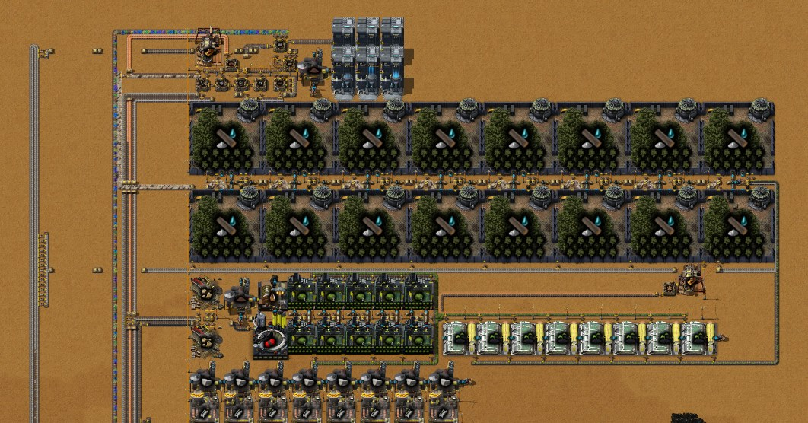
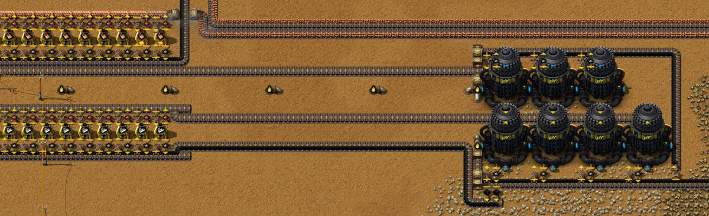
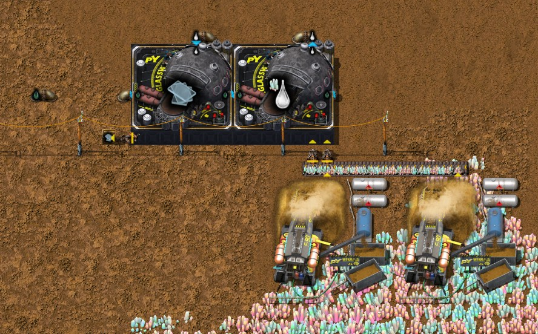
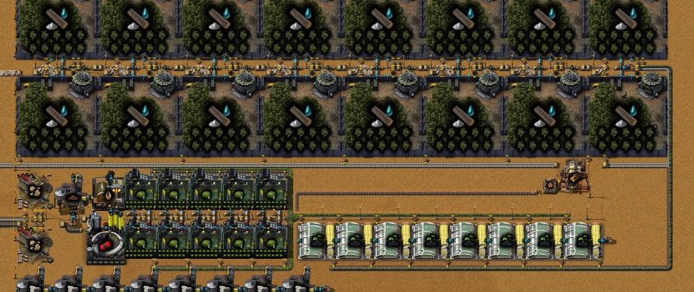
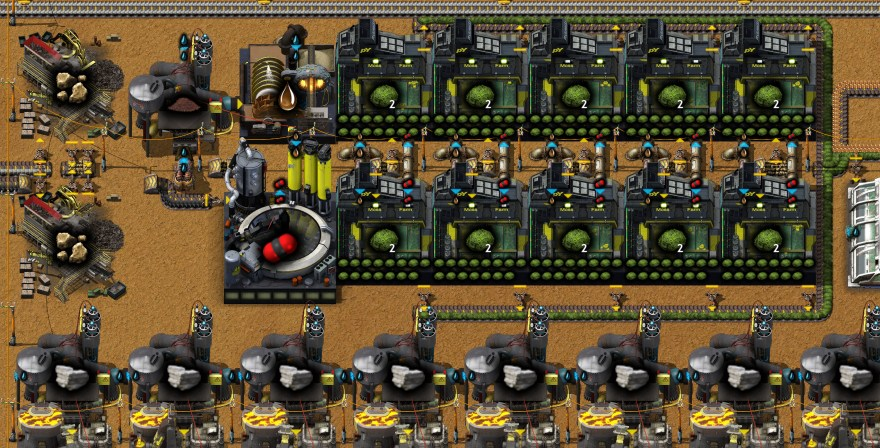
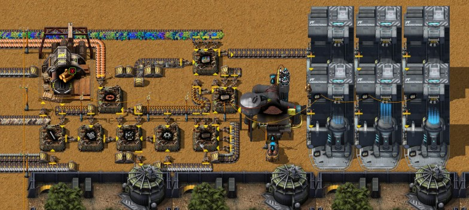

# Chapter 4 — Aluminium mining, glass making, log production and red science

[中文版](04-aluminium-glass-logs.zh-CN.md) · [Index](../README.md) · Previous:
[chapter 3](03-ash-separation-raw-coal-power.md)

This chapter follows the same recorded run from 6:13 to 9:37. The log chain needs the other two:
a Botanical nursery MK 01 takes 10 Glass and a Moss farm MK 01 10 Aluminium plates (from data).
So the author first mined Aluminium ore with the Coal gas held back in chapter 3, then made Glass
at the nearest quartz field, burning Tar piped there from the coke columns, and then built one
block that turns Moss, Tree seedlings and Ash into Logs. On top of that came a line that makes
0.2 red science a second from Logs, Native flora and the bus. Times are game time (by now 1.5
hours paused in Factory Planner, which game time does not count). Numbers come from the game's
data, from the recorder's 10-minute production windows, from one more minute of the saves of 9:36
and 9:37 (`tools/inspect-save.ps1 -Ticks 3700`), and from a new bench that builds a blueprint on
an empty map and runs it with unlimited inputs (`tools/bp-bench.ps1`, section 11).

The plan in one sentence: a little aluminium from Coal gas, a little glass from Tar, and from
then on Logs and red science made by machines instead of by hand.

## The run at a glance

| Game time | What happened |
|---|---|
| 6:10–6:30 | Seven Fluid mining drills MK 01 on the aluminium field east of the smelting columns, a Coal gas pipe of about 300 tiles from the coke columns, and a smelting column for the ore; Botany - Stage 1 done (6:19) |
| 6:30–6:40 | First Aluminium ore (0.5/s in the window ending 6:30), 3.5/s from 6:40 |
| 6:41 | Chat note: "看起来是离基地最近的石英矿" — looks like the quartz field nearest the base, about 450 tiles south-east of the start. Two Crystal mines MK 01 and two Glassworks MK 01 go there |
| 6:20–7:10 | About 900 tiles of Tar pipe, mostly Pipes to ground, from the coke columns' Tar network to the Glassworks; Engine researched in between (6:46–7:04) for its two Pumps |
| 7:10–7:20 | First Glass, 0.2/s from 7:20; Moss - Stage 1 done (7:09), Wood processing (7:17) |
| 7:10–7:40 | A first try of Moss farms, nurseries and forestries next to the Native flora field (y ≈ 96), taken down again |
| 7:37 | Fastwood forestry upgrade done (65 red); 8:25 note: "turd选择'选择性切割'" — the upgrade's choice is Selective cutting heads |
| 7:40–8:10 | The log block north of the steel site, mostly placed by robots from a blueprint: 10 Moss farms, 8 Botanical nurseries, 16 Fastwood forestries, the Wood processing unit last (8:00) |
| 8:14–8:20 | Concrete (24 red, a prerequisite of Tar processing); Tar processing started |
| 8:32 | Chat note: "发现灰烬运力不够" — the Ash capacity is not enough: the first draft of the log block brought its Ash on half a belt, 7.5 a second against the 12 it needs, and was redrawn (section 6) |
| 8:30–9:37 | The red science line: eight Burner assembling machines, a Soil extractor and a Wood processing unit; the labs moved next to it (9:10–9:30); two Flora collectors on the Native flora field (9:20). Tar processing done by the save of 9:37 |
| after 9:37 | The author added a second Wood inserter and a third Stone brick inserter to the red science line (blueprint updated, section 8) |

Production per second (selected 10-minute windows from the recorder; the last row is the minute
measured after 9:37):

| Window ending | Aluminium ore | Coke | Coal gas | Quartz ore | Glass | Tar burnt | Moss | Logs | Red science |
|---|---|---|---|---|---|---|---|---|---|
| 6:30 | 0.53 | 0.61 | 21.1 | 0 | 0 | 0 | 0 | 0 | 0.03 (hand) |
| 6:40 | 3.52 | 0.88 | 35.3 | 0 | 0 | 0 | 0 | 0 | 0 |
| 7:00 | 3.52 | 0.88 | 35.1 | 0.10 | 0 | 0 | 0 | 0 | 0.07 (hand) |
| 7:10 | 3.54 | 0.88 | 35.4 | 0.44 | 0.07 | 20.3 | 0 | 0 | 0.07 (hand) |
| 7:20 | 2.29 | 0.03 | 5.7 | 1.20 | 0.20 | 56.0 | 0 | 0 | 0.10 (hand) |
| 7:30–7:50 | 0.02 | 0 | 0 | 1.20 | 0.20 | 56.0 | 0 | 0 | 0–0.05 (hand) |
| 8:00 | 2.46 | 0.61 | 24.5 | 1.20 | 0.20 | 56.0 | 0 | 0 | 0 |
| 8:10 | 0.02 | 0 | 0 | 1.20 | 0.10 | 53.3 | 0 | 0 | 0 |
| 8:30 | 1.19 | 0.29 | 11.7 | 0 | 0 | 0 | 1.95 | 0 | 0.01 (hand) |
| 8:40 | 1.25 | 0.33 | 12.8 | 0 | 0 | 0 | 2.03 | 0.43 | 0 |
| 9:00 | 0.96 | 0.24 | 9.6 | 0 | 0 | 0 | 1.52 | 0.88 | 0 |
| 9:20 | 0.74 | 0.18 | 7.3 | 0 | 0 | 0 | 1.17 | 0.48 | 0 |
| 9:30 | 0.20 | 0.05 | 1.9 | 0 | 0 | 0 | 0.32 | 0.39 | 0 |
| 9:37 + 1 min | 0 | 0 | 0 | 0 | 0 | 0 | 0 | 0.10 | **0.20** |

Read with the timeline:

- **Coal gas follows Coke, and Aluminium ore follows Coal gas:** 40 Coal gas and 4 Aluminium ore
  per Coke taken from the columns, in every window (section 3). The ore stops whenever nothing
  takes Coke.
- **Glass ran for one hour at 0.2 a second and then stopped on purpose:** its chest takes no more
  than 400 (section 4). The Glassworks burnt 56 Tar a second meanwhile, mostly Tar stored in the
  Tailings pond since chapter 2.
- **Moss and Logs ramp up from 8:20 and then stop:** the log block stands with full outputs at
  9:37, because nothing uses Logs at its rate yet (red science takes 0.09 a second). On the bench
  it makes its 2.35 a second (section 6).
- **Red science by machine from 9:30:** 0.20 a second in the measured minute, six labs busy. Before,
  the author handcrafted it (20 to 51 packs per 10 minutes).

## 1. The technologies of this stage

| Technology | Cost | Researched | Unlocks what this chapter uses |
|---|---|---|---|
| Glass technologies | 30 red | 4:06–6:10 (chapter 3) | Crystal mine MK 01, Glassworks MK 01, Molten glass, Glass |
| Botany - Stage 1 | 30 red | 6:10–6:19 | Botanical nursery MK 01 |
| Moss - Stage 1 | 30 red | 6:19–7:09, Engine in between | Moss farm MK 01, Moss |
| Engine | 60 red | 6:46–7:04 | Pump (and Engine unit) |
| Wood processing | 32 red | 7:09–7:17 | Fastwood forestry MK 01, Tree seeds, Tree seedling, Logs |
| Fastwood forestry upgrade | 65 red | 7:17–7:37 | A choice for the forestries' second stage (below) |
| Concrete | 24 red | 8:14–8:20 | Nothing used yet; a prerequisite of Tar processing |
| Tar processing | 60 red | from 8:20, done by 9:37 | Next chapter |

Costs are the unit counts the engine reports (data says 32.5 for Wood processing; the game counts
32); every unit takes 30 s in a lab.

**The upgrade choice (TURD).** Fastwood forestry upgrade is one of Py's upgrade technologies: after
researching it you pick one of three sub-technologies, each changing the buildings in its own way
(from pyalienlife's `prototypes/upgrades/fwf.lua`):

- *Dry storage*: the Fiber recipe takes twice as long and gives four times the Raw fiber, plus
  Biomass and Fiber.
- *Selective cutting heads* (the author's choice, 选择性切割): the Wood processing unit's Log →
  Wood recipe becomes 4 Logs → 40 Wood in 1 s instead of 4 Logs → 20 Wood in 4 s.
- *Internal burner*: the forestries get −50 % energy, +50 % speed and +50 % productivity, but each
  Log recipe takes twice the Ash.

The author took the one for Wood. In this base the Logs go into Wood: Tree seeds for the nurseries
and Empty planter boxes for red science (sections 6 and 8).

## 2. Aluminium: Coal gas as the mining fluid

Aluminium ore can only be mined with Coal gas (data: the resource's `required_fluid`), which is
why the author kept the gas in chapter 3. The mine is small:

- **Seven Fluid mining drills MK 01** at about (−5, 30), on the north edge of the aluminium field,
  in two rows east of the smelting columns. Each mines 0.5 ore/s (mining speed 0.5, mining time
  1), 3.5 ore/s for the seven: measured 3.52 in the windows ending 6:40–7:10. The drills burn
  fuel (400 kW): Raw coal comes on a belt and their Ash goes back onto the same belt.
- **10 Coal gas per ore**, measured: 35.3 Coal gas/s for 3.52 ore/s. The gas comes through about
  300 tiles of pipe from the coke columns.
- **Smelting: an ordinary smelting column** on the ore belt west of the drills (the chapter 1
  design, ten Stone furnaces). Aluminium plate is 10 ore → 1 plate in 6 s, so a furnace could
  take 1.67 ore/s; but its one ore inserter brings at most 0.833 ore/s from the moving belt, and
  each furnace runs at half speed (section 9). The 3.5 ore/s need five of the ten. Measured: 0.35
  plates/s. The plates end in two chests, 1,276 at 9:37.

**How much aluminium is needed.** Only two recipes unlocked so far use Aluminium plates: Engine unit
(5) and Moss farm MK 01 (10) (from data, recipes against the 20 technologies researched). The
author's view: before Duralumin, aluminium only goes into a few buildings, so a little is enough.
The 1,276 plates in the chests are 127 Moss farms.

**The field under the drills is nearly gone.** The seven drills reach 24,800 ore between them at
9:36 (neighbouring drills share columns of tiles, so the real figure is lower): under two hours at
3.5 ore/s. The field's bulk lies further south (1.2 million around (−3, 54)).

## 3. Coal gas comes with Coke

The columns of chapter 2 make Coal gas only together with their other products, and a column
stops when any of its outputs is full. From data:

| Recipe (Destructive distillation column MK 01) | In | Out |
|---|---|---|
| Coal (three columns) | 10 Raw coal, 2 s | 60 Coal gas, 30 Tar, 3 Coal, 1 Iron oxide (20 %) |
| Coal gas from coal (two columns) | 10 Coal, 3 s | 40 Coal gas, 50 Tar, 6 Coke, 1 Iron oxide (30 %) |

Six Coke take 10 Coal, which take 3⅓ crafts of the first recipe: 240 Coal gas and 150 Tar in all.
So **every Coke taken from the columns lets them make 40 Coal gas and 25 Tar**, and 40 Coal gas
are 4 Aluminium ore. The windows show it:

| Who took the Coke | Coke/s | Coal gas/s | Aluminium ore/s |
|---|---|---|---|
| The steel site, until its chest was full (6:30–7:10) | 0.88 | 35.3 | 3.52 (the drills' full rate) |
| Nobody (7:20–7:50) | 0 | 0 | 0 |
| The log block's High pressure furnace, for Carbon dioxide (8:30–9:20) | 0.18–0.33 | 7–13 | 0.7–1.3 |
| Nobody: the log block full too (after 9:30) | 0 | 0 | 0 |

The steel chest (limited to 500) filled around 7:10, the eight foundries stopped, the Coke backed
up into the columns and the drills ran dry. In the window ending 8:00 the only Coke user was the
log block's new High pressure furnace, filling its Carbon dioxide pipes: the burst in that row.
At 9:37 all five columns stand with full outputs (Coke and Coal), the seven drills report missing
fluid, and the steel chest holds its 500.

The drills need 0.875 Coke/s taken to run at full rate. If more aluminium is ever wanted, the
rule is to give the Coke (or the Coal) a steady user, for example as fuel in Boilers: Coke is 5 MJ,
Coal 4 MJ. For now the author does not need more (section 2).

## 4. Glass at the quartz field, on Tar

The nearest quartz field the author found lies at about (297, 348), some 450 tiles south-east of
the start. Glass is made right there:

- **Two Crystal mines MK 01** (9×9, 420 kW, mining speed 2) on quartz: 1 Quartz ore/s each.
- **Two Glassworks MK 01**: one melts the ore (6 Quartz ore → 10 Molten glass, 5 s), the other
  casts it (50 Molten glass → 5 Glass, 3 s), connected by a short pipe. The melter sets the rate:
  1.2 Quartz ore/s, 2 Molten glass/s, **0.2 Glass/s** (measured 0.20, 7:20–8:00). The caster
  could take 16.7 Molten glass/s and works 12 % of the time.
- **Glassworks burn fluid.** Their energy source is a fluid burner of 10 MW (data). The author feeds
  them Tar (0.2 MJ a unit): 50 Tar/s for a busy Glassworks, 56 for the pair at this rate
  (measured 56.0). That is **280 Tar, 56 MJ, for one Glass.**
- **The Tar pipe:** about 900 tiles, mostly Pipes to ground (10 tiles apart at most), from the coke
  columns' Tar network west to x −101, south to y 338 and east to the Glassworks, with two Pumps
  on the way. The Tailings pond on that network (a 1,000,000 tank for liquids, data) had stored the
  columns' Tar since chapter 2; it paid for most of the hour of glass, since the columns made
  little Tar after 7:10 (section 3). 29,507 Tar left in it at 9:36.
- **One chest, 400 Glass.** The caster puts the Glass into a Wooden chest whose inserter waits for
  space with 4 of its 16 slots used: a chest limited to 400. Since about 8:10 the site stands full
  and burns nothing. 400 Glass are 40 Botanical nurseries (10 each, data).

## 5. The log chain

From data (all of these machines have crafting speed 1 once filled with their modules, below):

| Step | Machine (power) | Recipe |
|---|---|---|
| Soil | Soil extractor MK 01 (400 kW) | 800 Water → 16 Soil, 8 s |
| Muddy sludge | Washer MK 01 (400 kW) | 10 Soil + 100 Water → 100 Muddy sludge, 4 s |
| Carbon dioxide | High pressure furnace MK 01 (2 MW) | 2 Coke → 80 Carbon dioxide, 5 s |
| Stone | Jaw crusher MK 01 (1 MW) | 4 Stone brick → 8 Stone, 5 s |
| Moss | Moss farm MK 01 (100 kW) | 100 Muddy sludge + 100 Carbon dioxide + 20 Stone → 16 Moss, 80 s |
| Wood | Wood processing unit MK 01 (500 kW) | 4 Logs → 40 Wood, 1 s (with Selective cutting heads) |
| Tree seeds | Burner assembling machine MK 01 (75 kW of fuel) | 5 Wood → 4 Tree seeds, 5 s |
| Tree seedling | Botanical nursery MK 01 (125 kW) | 1 Tree seeds + 5 Moss + 100 Water → 3 Tree seedlings, 20 s |
| Logs | Fastwood forestry MK 01 (450 kW) | 3 Tree seedlings + 30 Ash + 500 Water → 6 Logs, 40 s |

**Farms run on their modules.** A Moss farm and a Fastwood forestry have a base effect of −100 %
speed (data), so empty they do nothing. Their module slots take only their own kind: Moss in the
15 slots of a Moss farm, Trees in the 10 of a forestry, each +100 % speed. Full, a Moss farm runs
at 15 × 0.0667 = 1 and a forestry at 10 × 0.1 = 1 (measured on the bench: 80 s and 40 s a craft).
The blueprint requests them; build them in by hand or let robots bring them (the bench put 150
Moss and 160 Trees in).

**The chain closes on itself.** Logs make Wood, Wood makes Tree seeds, the seeds make seedlings
and the seedlings Logs again. A new block needs a few Logs (or some Wood) to start: the bench
put 20 Logs into the Wood processing unit once.

**Balance at full speed** (data):

- 10 Moss farms make 10 × 16 / 80 = **2.0 Moss/s**, what 8 nurseries take (8 × 5 / 20).
- 8 nurseries make 8 × 3 / 20 = **1.2 Tree seedlings/s**, what 16 forestries take (16 × 3 / 40).
- 16 forestries make 16 × 6 / 40 = **2.4 Logs/s**.
- The seeds: 0.4/s for the nurseries, 0.5 Wood/s, that is 0.05 Logs/s, plus the seed machine's
  fuel (about 0.019 Wood/s at its half-time work). Net **2.348 Logs/s**: the author's label.
- Inputs per second: **Ash 12** (16 × 30 / 40), Stone 2.5 (1.25 Stone bricks), Carbon dioxide 12.5
  (0.31 Coke), Muddy sludge 12.5 (1.25 Soil), and about 316 Water.

## 6. The log block

Blueprint: [`log-production.txt`](../blueprints/log-production.txt), the author's
"2.348 [Log]" (121 × 47 tiles, 787 entities).

- **West end:** the Soil extractor, Washer, High pressure furnace and two Jaw crushers. The
  Soil extractor runs while the Washer holds under 20 Soil (a circuit wire). Ash, Stone bricks
  and Coke come in from the bus on the west edge, Logs leave there.
- **Middle:** two rows of five Moss farms; their Moss runs east, together with the Tree seeds, on
  one belt past the row of eight Botanical nurseries.
- **Top:** two rows of eight Fastwood forestries, 12 Ash a second together. The Ash comes on a
  full belt that runs east under the lower row; the lower eight take theirs from it. The rest turns
  north at the east end, where the nurseries' seedlings join it, and runs back west between the
  rows carrying both: the upper row takes Ash and seedlings from it, the lower row only seedlings.
  Each forestry's Logs go onto a short belt that joins the Log line west.
- **East end:** the Wood processing unit gets its Logs straight from one forestry. That forestry's
  other output inserter, onto the Log line, runs only while the unit holds 2 Logs or more (wired
  through the forestry), so Wood comes first. The unit hands the Wood directly to the Tree seeds
  machine, which burns some of it.
- Three Offshore pumps give the Water (this map's `pump-anywhere-fork` lets them stand on land).

**This is the second draft.** The author's note at 8:32, "发现灰烬运力不够" (the Ash capacity is not
enough), is about the first, which brought the Ash on half a belt: 7.5 a second against the 12 the
forestries need. Now the full belt serves the lower row first (6 a second) and what is left serves
the upper row (6 more).

**On the bench** (the blueprint on an empty map: unlimited power, the three input belts kept full,
the Log belt emptied, 30 minutes measured after a 30-minute warm-up):

| Machines | Crafts done of possible | Share |
|---|---|---|
| 16 Fastwood forestries | 720 of 720 | **100 %** |
| 8 Botanical nurseries | 720 of 720 | **100 %** |
| 10 Moss farms | 228 of 225 | 101 % (crafts begun in the warm-up) |
| 2 Jaw crushers | 560 of 720 | 78 % |
| High pressure furnace | 282 of 360 | 78 % |
| Soil extractor | 142 of 225 | 63 % (off by circuit the rest) |
| Washer | 228 of 450 | 51 % |
| Tree seeds machine | 179 of 360 | 50 % |
| Wood processing unit | 25 of 1800 | 1 % |

**2.336 Logs/s out** (2.31, 2.35 and 2.35 in the three 10-minute windows), against the label's
2.348; the Wood processing unit made a little more Wood than was used while its belt filled. The
inputs: Ash 12.0, Stone bricks 1.25 and Coke 0.31 a second. So the block reaches its full output;
its limit is the nurseries and the forestries, which match each other exactly.

Its electricity: about **13 MW** at these shares (the machines' power from data, times the measured
share of working time), the largest electric user in the base so far. In the author's game at 9:37
it stands with full outputs: nothing uses Logs at this rate yet.

## 7. Ash: the loop, and why the separators starve

**The Ash loop.** The Ash of the base no longer runs only to the separators. One belt goes up the
west edge (x −93) to the north end and comes back down beside itself (x −94), about 380 tiles to
the Ash separation block (y 205). On the way up, the log block takes from it (y −131) and so does
the red science line (y −176); what is left goes south. The block that needs Ash for its product
is served before the block that only removes Ash.

**Enough Ash for the whole base?** At full output the log block takes 12 Ash/s and red science 1.2, 13.2 together.
The whole base made **11.1 Ash/s** in the minute measured after 9:37. One belt carries 15. So once
the Logs are used at their full rate, no Ash is left for the separators and the log block itself
runs short. While the Logs have no user the block stands and the Ash goes south.

**The separator block of chapter 3, on the bench.** Its three Solid separators take 10 Ash/s each,
13 inserters each from the belts above and below the row. But only the belt above has a source: the
one below starts at the block's west edge with nothing feeding it, in the blueprint and in the
author's base (and in the picture of chapter 3, where it is empty). Chapter 3 said the Ash belt
splits above and below; it does not. Measured, 10 minutes after a 2-minute warm-up:

| Variant | Ash in | Separators | Coal dust / Soot / Iron oxide out |
|---|---|---|---|
| As built: the belt above full | **15.0 Ash/s** | **50 %**, short of Ash in 51 % of the samples | 0.76 / 0.27 / 0.06 a second |
| Both belts full | **29.9 Ash/s** | **100 %** (1,792 of 1,800 crafts) | 1.53 / 0.63 / 0.15 a second |

So the design reaches its 30 Ash/s once both belts are fed; as built it can never take more than
one belt, 15. With the base making 11 Ash/s and the log block first in line, that is enough for
now.

## 8. Red science at 0.2 a second

Blueprint: [`red-science.txt`](../blueprints/red-science.txt), the author's
"0.2 [Automation science pack]" (42 × 15 tiles, 165 entities, the version updated after 9:37).

The recipe (data): Automation science pack = 2 Planter boxes + 10 Native flora + 2 Small parts,
5 s. One Burner assembling machine makes **0.2 a second**, and six labs researching at 30 s a unit
(Tar processing, Creosote) use 6 / 30 = 0.2. The rest of the line:

- **Planter box** (Empty planter box + 5 Soil + 3 Ash, 2 s): 0.4/s keeps one machine busy 80 % of
  the time. **Empty planter box** (4 Stone bricks + 2 Wood + 1 Iron plate, 1 s): 40 %. The
  machines hand these on directly by inserter: Empty planter box → Planter box → science.
- **Small parts** (1 Iron gear wheel + 3 Copper cable + 3 Bolts → 2) from four small machines for
  gears, sticks, bolts and cable, as in the malls.
- **Soil:** one Soil extractor, 16 Soil in 8 s = 2.0/s, exactly what 0.4 Planter boxes take. It
  runs while the Planter box machine holds under 20 Soil (a circuit wire).
- **Wood:** the line's own Wood processing unit turns Logs from the bus into Wood: 0.8/s for the
  Empty planter boxes and about 0.1/s burnt as fuel by the eight Burner assembling machines.
- **Native flora:** 2.0/s from two Flora collectors MK 01 on the Native flora field at about
  (27, 85), 1 a second each (data: mining speed 1, mining time 1); they reach 86,000 Native flora
  (tiles both reach counted twice), about 12 hours of it.
- Six belts come in from the west: Native flora, Copper plates, Ash, Logs, Stone bricks and Iron
  plates. Per second (bench): Native flora 2.0, Stone bricks 1.6, Ash 1.2, Iron plates 1.1, Copper
  plates 0.3, Logs 0.09, and 100 Water from its Offshore pump.

**On the bench** (20 minutes after a 10-minute warm-up, all six input belts full, the labs on
Tar processing for ever):

| Version | Red science/s | What limits it |
|---|---|---|
| As exported at 9:36 | 0.196 (98 %) | The one inserter with Wood for the Empty planter box machine, busy in all 1,200 samples. It moved 0.798 Wood/s; the machine needs 0.8 as ingredient plus 0.015 as fuel (section 9) |
| The author's update | **0.200 (100 %)**, labs busy in every sample | Nothing; the Soil extractor now runs all the time (2.0 Soil/s, no margin) |

The author's update: a second Wood inserter on that machine (with a short new belt branch for it)
and a third for Stone bricks, which it needs at 1.6 a second, close to what two inserters move.

## 9. Inserters set the pace

The 98 % above called for a closer look at the Mechanical inserter. Measured to three decimals
(`tools/inserter-rate-probe`: one inserter per case, 10 minutes each, every drop timed to the
tick; Iron plates, no inserter capacity bonus):

| Picks up from | Ticks per item | Items/s |
|---|---|---|
| A chest or a machine | 76 | **0.789** |
| A moving full belt (both lanes, or only the lane nearer the inserter) | 72 | **0.833** |
| A moving belt with only the far lane full | 73.6 | 0.815 |
| A standing full belt, such as the end of a belt (both lanes, or only the near lane) | 70 | **0.857** |
| A standing belt with only the far lane full | 74 | 0.811 |

Where it drops makes no difference: into a chest, onto a belt, into a Burner assembling machine or
into a Stone furnace (on Aluminium ore and on Iron oxide) it took the same ticks. The 0.80 in the
older notes was a one-minute count (48 plates); from a chest the inserter moves 0.789.

The red science line's Wood inserter took from a belt tile that held only 1.95 Wood on average
(the Wood joins that belt from the side), and needed 75 ticks a Wood: 0.798 a second, against the
0.815 its machine needs (0.8 as ingredient, 0.015 burnt). Hence the 98 %.

**A machine is no faster than the inserters that fit around it** (the author's rule). In a
smelting column a Stone furnace has room for one input inserter (from data: Stone furnace speed
1, recipes as listed):

| Furnace recipe | The furnace could take | One inserter brings | The furnace's share of its speed |
|---|---|---|---|
| Iron or Copper plate: 8 ore → 1, 10 s | 0.800 ore/s | 0.833 (moving belt) | 100 % |
| Aluminium plate: 10 ore → 1, 6 s | 1.667 ore/s | 0.833 (moving belt) | **50 %** |
| Iron plate from Iron oxide: 20 → 10, 3.5 s | 5.714 Iron oxide/s | 0.857 (standing lane) | **15 %** |

On the bench, with the book's blueprints:

- **The smelting column on Aluminium ore,** one full ore lane (7.5 ore/s): nine furnaces take the
  whole lane at 0.833 each and run at 50 %; the tenth gets nothing; 0.75 Aluminium plates/s. So
  the column smelts at most 7.5 Aluminium ore/s, and the author's 3.5 need five furnaces.
- **The Iron oxide pair** of chapter 3: both inserters at 70 ticks, 1.717 Iron oxide/s, both
  furnaces at 15 %, 0.85 Iron plates/s. One furnace could take 5.7 Iron oxide/s, as chapter 3 said,
  but its one inserter brings 0.857. The base makes 0.7–0.9 Iron oxide/s, so the pair is enough.

## 10. Checklist

- Aluminium ore: Fluid mining drills with Coal gas, 10 per ore; 10 ore → 1 plate. Until Duralumin
  only Engine units and Moss farms use the plates, so a few drills do.
- Coal gas, Tar and Coke come together: each Coke taken from the columns frees 40 Coal gas and 25
  Tar. With no user for Coke there is no gas and no aluminium; a steady Coke user (fuel) fixes it.
- Glassworks burn 10 MW of fluid each: on Tar, 280 Tar per Glass. A limited chest stops the site
  once there is enough (10 Glass per nursery).
- Farms run only on their own modules: 15 Moss in a Moss farm, 10 Trees in a Fastwood forestry.
- The log block: 10 Moss farms, 8 nurseries, 16 forestries, 2.35 Logs/s, 12 Ash/s, about 13 MW.
  Start it with a few Logs in the Wood processing unit.
- A Mechanical inserter moves 0.789 items/s from a chest or a machine, 0.833 from a moving full
  belt and 0.857 from a standing one, less from a thin belt or only the far lane. Count the
  inserters for the big ingredients, fuel included.
- A machine is no faster than its input inserters: Stone furnaces with one inserter smelt
  Aluminium ore at 50 % and Iron oxide at 15 % of their speed.
- Ash is an input now: the Ash loop serves the log block first, the separators get what is left.
  The separator block needs both of its Ash belts fed to reach 30 Ash/s.

## 11. How these facts were checked

- The run: the companion mod's recorder (run `2652821414-0`), read with
  `tools/recorder-phases.js` (timeline in 10-minute slices, chat notes) and `tools/recorder-log.js`
  (production per 10-minute window, items and fluids).
- The saves of 9:36 and 9:37 (`Py-Exploration`, consistency check passed): `tools/inspect-save.ps1
  -Ticks 3700`, then `tools/summarize-save.js` (research, machine states, the measured minute),
  `tools/render-area.js` and `tools/trace-layout.js` (belt lines and what they carry, the Coal gas
  and Tar pipelines and the Tailings pond's Tar, chest contents, the drills' status and the ore
  under them).
- **The blueprint bench** (new): `tools/bp-bench.ps1 -Bench <name> [-Variant <v>]` with the mod in
  `tools/bp-bench/` and one file per bench in `tools/bp-bench/benches/`. It builds the blueprint on
  an empty lab-tile map with the game's own blueprint building, puts the requested modules in,
  gives every electric network an energy interface, keeps both lanes of each input belt full by
  script, empties the output belts, lets the labs research without end, and counts every machine's
  crafts against what its recipe allows at its actual speed, with status samples, the ingredient a
  waiting machine lacks, and watched inserters (every drop timed, items on the belt tile they take
  from). Benches here: `ash-separation` (variant `both-belts`), `log-production`, `red-science`
  (both versions of the file), `iron-oxide-smelting` and `smelting-column-aluminium`; sources can
  fill one lane only. It runs in the save setup (`C:\tmp\cf-save`, the author's current mods)
  with the 20 technologies of the save.
- **The Mechanical inserter's rate:** `tools/run-probe.ps1 -Probe inserter-rate-probe -Ticks 36700
  -Work C:\tmp\cf-save` (15 cases on a new map: chest, moving and standing belt, one lane or
  both, into a chest, a belt, a Burner assembling machine and a Stone furnace).
- The blueprints: exported by the author with the companion mod (2026-10-11; red science again
  after the update) and pulled into `blueprints/`; layouts, filters and circuit conditions read
  from the blueprint data.
- Prototype values (recipes, machine power, speed, size and module slots, the farms' −100 % base
  speed, fuel values, Aluminium ore's mining fluid, the Tailings pond's volume, Pipe to ground
  reach, which recipes use Aluminium plates, technology unlocks): `data.raw` of the run's mod set
  (Factorio 2.1.21). The upgrade choices: pyalienlife 3.1.8, `prototypes/upgrades/fwf.lua`.
  Technology unit counts: read in the engine on a new map.
- Computed from data, not measured: 40 Coal gas and 25 Tar per Coke (the windows in section 3
  agree), the 0.875 Coke/s the drills need, the log block's balance and its 13 MW.
- The author's own judgement, checked against the recipes: before Duralumin a little aluminium
  is enough.
- Pictures: in-game screenshots with entity info (alt view), taken in the author's game with the
  companion's `/pt-shots` after 9:37.

Next: [chapter 5](05-tin-zinc-smelting.md), tin and zinc smelting.
