# Chapter 5 — Tin, zinc and lead smelting

[中文版](05-tin-zinc-smelting.zh-CN.md) · [Index](../README.md) · Previous:
[chapter 4](04-aluminium-glass-logs.md)

This chapter follows the same recorded run from 9:37 to 13:05. With red science running at 0.2 a
second, the author researched the prerequisites of Electronics - Stage 1 and Electronics itself,
and got the three metals of the Simple circuit board ready: Tin plates (for Solder, Ceramic
capacitors and High-power resistors), Zinc plates (for the CuZn Battery) and Lead plates (for
Solder). All three ores need a mining fluid (from data): Tin ore takes Steam, Zinc ore Aromatics,
Lead ore Acetylene. So the author built a steam block and a tin mine with its own smelting column
520 tiles south of the base; a Tar processing line at the west edge for the Aromatics and a zinc
mine 450 tiles east, whose ore comes by belt to a column in the base; and an acetylene block beside
the Tar processing that turns the Tar line's Coke into Acetylene, for a lead mine about 150 tiles
further west. The Tar line's other byproducts are dealt with for the time being: Pitch and
Anthracene oil become Coke, Hydrogen goes into the air, and four liquids go into Tailings ponds.
The author's view: Zinc is only used in circuit boards, so these products get their real uses when
the circuit boards are made. Alongside: a second crushed iron block and more iron drills (Iron
plates from 2 to 6 a second), a new mall that burns Wood, and the coke columns of chapter 2 taken
down. Times are game time. Numbers come from the game's data, from the recorder's 10-minute
production windows, from the save of 13:05 (`tools/inspect-save.ps1`), from ten minutes of that
save measured (`tools/rate-probe`, new), from the blueprint bench for the author's acetylene block
(section 7), and from a probe for pipes, Pumps and Check valves (`tools/valve-probe`, section 4).

The plan in one sentence: Tin from Steam, Zinc from Aromatics, Lead from Acetylene, and the Tar
that gives the Aromatics gives, through its Coke, the Acetylene as well.

## The run at a glance

| Game time | What happened |
|---|---|
| 9:36–10:33 | Research, one technology about every five minutes (what 0.2 red science a second pays for): Creosote, Acetylene, Solder - Stage 1, Seaweed - Stage 1, Petri dish, Moondrop - Stage 1, Moondrop upgrade, Ceramic, Fluid pressurization, Sap - Stage 1, and Electronics - Stage 1 at 10:33 |
| 9:40–9:50 | A steam block at y 98–120: the chapter 3 power station blueprint placed again and built without its twelve Steam engines, so 24 Boilers and 3 Solid separators. 18 more Burner mining drills on the northern coal field, filling two more belts south |
| 9:53–10:10 | A steam pipe of about 625 tiles to the tin field, 520 tiles south, with a Pump at (−103, 235); 16 Fluid mining drills on Tin ore and a smelting column of 12 Stone furnaces beside them. First Tin plates at 10:10 |
| 10:14 | Chat notes: "月落草升级选择碳捕集" — the Moondrop upgrade's choice is Carbon capture; "之前产二氧化碳的高压炉可原地替换为温室，但是要先产出月落草作为插件" — the High pressure furnace that makes Carbon dioxide can be replaced in place by a greenhouse, but Moondrop has to be grown first for its modules (section 8) |
| 10:15–10:20 | A second crushed iron block, the chapter 2 blueprint, beside the first |
| 10:20–10:35 | A new mall beside the red science line that burns Wood (blueprint 初期超市-2, section 8) |
| about 10:30 | The steel line stops with its outputs full; Coke, Coal gas and so Aluminium ore stop with it (chapter 4: the gas comes with the Coke) |
| 10:40–10:50 | More Burner mining drills on the iron field |
| 10:50–11:23 | Tar processing at the west edge: two Tar processing units MK 01 and two Destructive distillation columns MK 01, Tar from the Tailings pond, Steam from the steam block. At 11:03 the five coke columns of chapter 2 (y −88) come down |
| 11:14 | Fluid handling researched: the Check valve |
| 11:10–11:39 | An Aromatics pipe of about 930 tiles from the Tar processing to the zinc field, cut into three by two Check valves |
| 11:30–11:45 | 12 Fluid mining drills on Zinc ore at x 410–450, y 215–221, and about 520 tiles of belt to a smelting column of 12 Stone furnaces beside the Ash separation block |
| 11:31–11:48 | The author takes out the two Pumps at (−103, 235) and (−101, 235), on the steam pipe to the tin field and on the Tar pipe to the Glassworks. The steam pipe south of y 179 is relaid with two Check valves (11:47–11:48); the Tar pipe stays cut (section 4) |
| 11:46–13:04 | Research: Logistics, Storage tanks, Plastics, Basic substrate, Genetics - Stage 1, Biotechnology machines - Stage 1, Copper processing - Stage 1, Electrolysis, Biotechnology - Stage 1, Xenobiology, Land animals - Stage 1, Vrauks - Stage 1, Rendering and Zoology, most of them on the way to pY science pack 1 |
| 11:50 | A third Destructive distillation column, to crack Anthracene oil into Gasoline and Coke |
| 11:58–12:30 | The acetylene block north of the Tar processing (x −173 to −131, y −166 to −145): four Gasifiers (11:58), a Lime furnace with two Soil extractors and an Exhaust pipe (12:06–12:08), two Calcium carbide furnaces (12:09–12:12), a Washer and a Sinkhole (12:21–12:24), the whole block moved once by robots (12:26), an Evaporator (12:30) |
| 12:35–12:37 | Six Fluid mining drills on Lead ore at y −152, x −309 to −284 (ten placed, four taken back), and a smelting column of 13 Stone furnaces at y −69 |
| 12:40–12:55 | A Raw coal module (the chapter 1 blueprint) at (19, −64) for the lead line's fuel, and about 1,560 tiles of belt laid by hand: Raw coal to the lead drills and furnaces, the ore to its column, the drills' Ash to the Ash loop |
| 12:55–12:59 | Four Tailings ponds at x −139 for Naphthalene oil, Creosote, Carbolic oil and Gasoline, and an Exhaust pipe for Hydrogen. From here the Tar line runs without stopping |
| 13:00–13:04 | A fourth column, the second for Anthracene oil; two more Tar processing units placed and taken away again |
| 13:05 | The save |

Production per second (10-minute windows from the recorder; the last row is ten minutes measured
in a copy of the save of 13:05, `tools/rate-probe`):

| Window ending | Tin ore | Tin plate | Zinc ore | Zinc plate | Lead ore | Lead plate | Aromatics | Acetylene | Coke | Iron plate | Raw coal |
|---|---|---|---|---|---|---|---|---|---|---|---|
| 9:40 | 0 | 0 | 0 | 0 | 0.01 | 0 | 0 | 0 | 0.02 | 2.09 | 10.6 |
| 10:00 | 0 | 0 | 0.02 | 0 | 0.03 | 0.08 | 0 | 0 | 1.09 | 2.07 | 43.0 |
| 10:20 | 7.50 | 0.71 | 0.03 | 0 | 0.01 | 0 | 0 | 0 | 0.77 | 2.13 | 36.9 |
| 10:40 | 7.50 | 0.75 | 0.03 | 0.03 | 0.03 | 0.01 | 0 | 0 | 0.02 | 2.47 | 31.4 |
| 11:00 | 4.95 | 0.54 | 0.03 | 0 | 0.03 | 0.01 | 0 | 0 | 0.22 | 5.99 | 39.2 |
| 11:20 | 7.50 | 0.75 | 0.04 | 0.01 | 0.04 | 0.01 | 0.33 | 0 | 0 | 6.13 | 41.9 |
| 11:40 | 2.41 | 0.45 | 0.05 | 0.01 | 0.03 | 0.01 | 0 | 0 | 0 | 5.96 | 25.5 |
| 12:00 | 7.51 | 0.69 | 0.14 | 0.01 | 0.03 | 0.01 | 0.50 | 0 | 0.37 | 2.98 | 33.8 |
| 12:20 | 0.92 | 0.09 | 0.02 | 0 | 0.01 | 0 | 0 | 0 | 0 | 2.94 | 16.0 |
| 12:40 | 1.78 | 0.17 | 0.01 | 0.03 | 0.01 | 0 | 0 | 4.67 | 0 | 2.97 | 17.1 |
| 13:00 | 1.33 | 0.13 | 0.76 | 0.02 | 1.59 | 0.26 | 3.00 | 14.0 | 1.63 | 3.64 | 26.1 |
| 13:05 + 10 min | 0 | 0 | 1.45 | 0.12 | 3.02 | 0.50 | 5.75 | 42.7 | 3.58 | 3.03 | 29.4 |

Read with the timeline:

- **Tin ran at exactly 7.5 ore and 0.75 plates a second** from 10:20 to 11:30 (one window less):
  half a belt of ore (section 3). It stopped when the Pump on its steam pipe came out at 11:31 and
  ran again at full speed once the Check valves were in (the window ending 12:00). From about 12:10
  its two chests are full and it runs only as plates are taken out; 4,816 Tin plates were made in
  all.
- **Zinc runs on what the Tar line gives.** The 0.03 Zinc ore a second before 11:30 is the Soot
  separation of chapter 3 (10 % Zinc ore per 2 Soot). The zinc drills run as Aromatics arrive: 0.76
  ore a second in the last window, 1.45 in the measured ten minutes, a quarter of what the twelve
  could mine (section 6).
- **Lead from about 12:45:** 3.02 ore and 0.50 plates a second in the measured ten minutes, six drills at
  0.5 ore each. The 0.08 Lead plates a second in the window ending 10:00 are 288 Lead ore the Soot
  separation had gathered (it gives 10 % Lead ore too), smelted once Solder was researched.
- **The Tar line ran only in short bursts** while its byproducts had nowhere to go (Aromatics 0.33
  and 0.50 a second in the windows ending 11:20 and 12:00), and without stopping once the Tailings
  ponds took them, from 12:55 (section 6). Acetylene follows the Coke it brings.
- **Coke, Aluminium ore and Steel stop together around 10:30**, as chapter 4 found: the steel line
  is the Coke user, and the Coal gas for aluminium comes with the Coke (Aluminium ore 3.5 a second
  in the window ending 10:00, 0.04 from 11:20). The Coke that comes back at the end is the Tar
  line's.
- **Iron plates triple** from 2.1 to 6.1 a second when the second crushed iron block and the new
  drills come in (section 8), and fall back to 3 a second from 11:50: the base uses about 3 a
  second, and once the belts and chests are full the blocks make only what is taken.

## 1. The technologies of this stage

| Technology | Cost | Researched | Unlocks what this chapter uses |
|---|---|---|---|
| Mining with fluid | 24 red | 3:58–4:06 (chapter 3) | Fluid mining drill MK 01, Tin plate (40 Tin ore → 4 plates) |
| Tar processing | 60 red | done 9:36 (chapter 4) | Tar processing unit MK 01; Tar refining bottoms and tops, Coke from Pitch, Aromatics from Light oil, Anthracene oil cracking |
| Creosote | 60 red | 9:36–9:41 | Creosote from Anthracene, Carbolic and Naphthalene oil (not built) |
| Acetylene | 60 red | 9:41–9:46 | Gasifier MK 01, Calcium carbide, Acetylene; a prerequisite of Solder |
| Solder - Stage 1 | 60 red | 9:46–9:51 | Lead plate (6 Lead ore → 1 plate), Solder (2 Tin + 4 Lead plates → 1) |
| Seaweed - Stage 1 | 60 red | 9:51–9:56 | Seaweed crop facility MK 01 (50 Tin plates each) |
| Petri dish | 60 red | 9:56–10:01 | A prerequisite of Moondrop |
| Moondrop - Stage 1 | 60 red | 10:01–10:06 | Moondrop greenhouse MK 01 |
| Moondrop upgrade | 65 red | 10:06–10:12 | A choice for the greenhouses (below) |
| Ceramic | 60 red | 10:12–10:17 | Ceramic, Clay pit, Electronics factory MK 01 |
| Fluid pressurization | 60 red | 10:17–10:22 | Vacuum |
| Sap - Stage 1 | 60 red | 10:22–10:27 | Sap extractor |
| Electronics - Stage 1 | 65 red | 10:27–10:33 | Zinc plate (40 Zinc ore → 4 plates), Ceramic capacitors, High-power resistors, CuZn Battery, Simple circuit board |
| Fluid handling | 65 red | 11:08–11:14 | Check valve |
| Evaporation processing 1 | 60 red | 11:24–11:29 | Evaporator MK 01; Slaked lime → Lime + Gravel |
| Storage tanks | 70 red | 11:46–11:52 | PyTanks; the PyTank (40 kL) takes 30 Lead plates |

Electronics - Stage 1 needs seven of these (data: Wood processing, Moondrop, Sap, Creosote,
Solder, Ceramic, Fluid pressurization); the author researched the missing ones and their own
prerequisites first, with the Moondrop upgrade in between. After it came Repair pack, Gun turret,
Stone wall, Gate, Landfill, Lamp, Automobilism, Fluid handling, Hydrogenation and basic reforming,
Radar - Stage 1, Evaporation processing 1, Military and Alloy smelting - Stage 1 (Duralumin,
Smelter MK 01), then the list in the timeline; at 13:05 Latex stands at 8 %, with pY science pack
1 next in the queue. Every unit takes 30 s in a lab; at 0.2 red a second a 60-unit technology takes
300 s, which is the five-minute rhythm of the timeline. The acetylene block also uses recipes of
older technologies: Lime (Concrete, chapter 4), the High pressure furnace, Tailings pond, Exhaust
pipe and Limestone from the Soil extractor (Coal processing 1), the Sinkhole (Steel processing),
the Washer (Soil washing) and Saline water from Gravel (Crusher).

**The Moondrop upgrade choice.** Like the forestry upgrade of chapter 4 it offers three
sub-technologies (pyalienlife's `prototypes/upgrades/moondrop.lua`):

- *Copper*: the Moondrop recipes take 10 Copper ore, give twice the Moondrop in half the time, and
  drop their other ingredients.
- *Moon*: +35 % productivity, −50 % speed, and a Methane recipe that uses a Lamp.
- *Carbon capture* (the author's choice, 碳捕集): +50 % speed, twice the energy, and a new
  greenhouse recipe that makes 200 Carbon dioxide every 5 s from nothing.

The author chose it for the log block, whose High pressure furnace burns Coke for its Carbon
dioxide (section 8).

## 2. What Tin, Zinc and Lead are for

Recipes unlocked by the 58 technologies of the save that take the plates (data):

- **Tin plate:** Solder (2 Tin + 4 Lead), Ceramic capacitors (2 Tin + 1 Ceramic → 3), High-power
  resistors (1 Tin + 2 Coke + 1 Glass → 3), Tinned cable, and two buildings: Evaporator MK 01 (40)
  and Seaweed crop facility MK 01 (50).
- **Zinc plate:** only the CuZn Battery (10 Copper + 10 Zinc + 5 Cellulose + 250 Saline water →
  1). This is the author's point: Zinc goes into circuit boards and nothing else yet.
- **Lead plate:** Solder; the PyTank (40 kL) (30, no Duralumin needed) and the other tanks, which
  also take Duralumin; Firearm magazines (2 for 5) and Shotgun shells.

The Simple circuit board takes 1 Printed circuit board, 3 Vacuum tubes, 3 Air-core inductors, 5
Ceramic capacitors, 6 High-power resistors, 2 Solder and 1 CuZn Battery for 3 boards. Per board
that is **3.11 Tin plates, 3.33 Zinc plates and 2.67 Lead plates**. The author's Factory Planner
plan of 10:51 aims at 6 boards a minute: 18.7 Tin, 20 Zinc and 16 Lead plates a minute, that is
0.31, 0.33 and 0.27 a second.

## 3. Tin: Steam as the mining fluid

Tin ore needs Steam to mine (data: `required_fluid`, 100 per 10 ore: **10 Steam per ore**, the
same rule as the 10 Coal gas per Aluminium ore measured in chapter 4). The nearest tin field lies
about 520 tiles south of the base, around (12, 556).

**The steam block.** The author placed the chapter 3 power station blueprint again, north of the
Ash separation block at y 98–120, and built it without its Steam engines: two rows of twelve
Boilers facing each other, the Raw coal belts outside, the Ash belts inside to three Solid
separators above, an Offshore pump at the east end. The steam that would have gone to the engines
is gathered between the rows and leaves west in one pipe. From data and chapter 3: a Boiler makes
7.5 Steam/s at 250 °C and burns 1.23 Raw coal/s doing it, so the block makes up to **180 Steam/s**,
far more than is drawn: the tin drills take 75 when they run, the Tar processing about 36 (section
6). At 13:05 all 24 Boilers stand "full output".

**The pipe.** From the block it runs west to x −103, then north through a Check valve at
(−103.5, −74.5) to the Tar processing, and south along x −103 to the tin field: about 625 tiles of
Pipe to ground to the drills. Until 11:31 a Pump at (−103, 235) split the southern part in two;
since 11:48 two Check valves at (−103.5, 179.5) and (−103.5, 498.5) do, so the line has three
segments (section 4 says why there must be something every 320 tiles).

**The mine.** 16 Fluid mining drills MK 01 in two rows of eight (y 523 and 529, x −13 to 22) drop
onto one belt between them. Each mines 0.5 ore/s, 8 for the sixteen. The drills burn fuel (400 kW):
Raw coal comes down a 587-tile belt along x 70 from the northern coal field, and their Ash goes
west, where six inserters lift it onto the Ash loop at x −93 (chapter 4, section 7). Two
inserters filtered to Raw coal take the furnaces' fuel off the drills' belt.

**The smelting column.** The ore belt joins the side of the column's belt, so all the ore lands on
the lane next to the furnaces: at most **7.5 ore/s**, half a belt, and exactly what the recorder
shows from 10:20 to 11:30. The column is the author's chapter 1 design with 12 Stone furnaces
instead of ten: ore lane and plate lane on one belt (output inserters "all but Ash"), Raw coal and
Ash on the other. From data: Tin plate is 40 ore → 4 plates in 60 s, so a furnace takes 0.667 ore/s,
less than the 0.833 its one inserter brings from a moving belt (chapter 4, section 9); 7.5 ore/s
need 11.25 furnaces, and twelve could smelt 0.8 plates/s. The lane gives **0.75 Tin plates/s**.
They go into two chests at (−71, 527), because Tin plates also build things (section 2); the
chests hold 1,600 each and have been full since about 12:10:
3,200 Tin plates, enough for about 1,030 Simple circuit boards. Since then the drills stand
"waiting for space" (all sixteen in the measured ten minutes).

**What a Tin ore costs.** Its 10 Steam carry 4.94 MJ of Boiler heat (2.1 kJ per degree from 15 to
250 °C), which is 1.65 Raw coal; the drill burns another 0.27 (400 kW at 0.5 ore/s). So **one Tin
ore costs 1.9 Raw coal** and leaves as much Ash, and one Tin plate 19 Raw coal before its furnace
fuel. At 7.5 ore/s that is 14 Raw coal a second, nearly the whole output of a Raw coal module
(15/s), and 75 Steam/s, ten of the 24 Boilers.

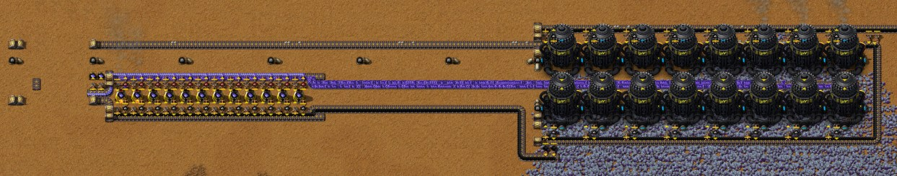

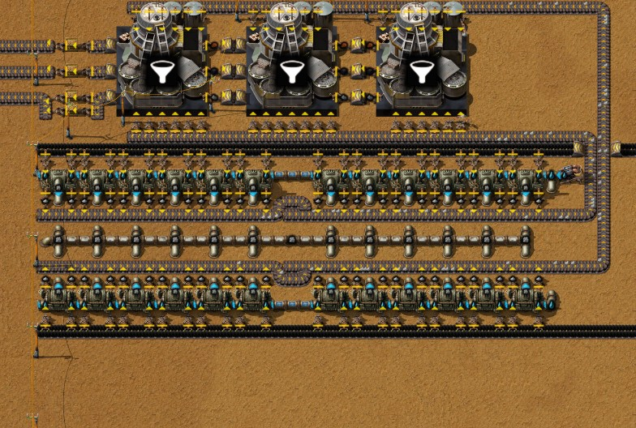

## 4. A pipeline spans at most 320 tiles

Pipes that touch form one fluid segment, and a segment can only span so far: Py's Pipe and Pipe
to ground have a `max_pipeline_extent` of **320 tiles** (data; the engine's default for other
fluid boxes is 1280). A Pump or a Check valve ends a segment, so long lines need one every 320
tiles. Measured with a probe (`tools/valve-probe`): Steam lines of Pipes to ground at their full
reach (11 tiles a pair), kept full at the start, everything that arrives at the end counted:

| Line | Steam arriving per second |
|---|---|
| 55 tiles | 4,800 |
| 310 tiles | 4,800 |
| 330 tiles | **0** (the line fills and nothing comes out) |
| 625 tiles | **0** |
| 625 tiles, Pump at tile 310 | 3,880 |
| 625 tiles, Check valve at tile 310 | 4,781 |
| 625 tiles, Pump at tile 205 (420 tiles behind it) | **0** |
| An L: 200 tiles east, then 200 south | 4,800 |

The limit is the segment's extent on the map, not its length: the L of 400 tiles in a 202 × 202
box flows. Below the limit the flow is thousands a second, far above anything here (the tin drills
need 75).

**The author's pipes** at 13:05, each segment as the tiles its box covers on the map (from the
save):

| Line | Segments | Ended by |
|---|---|---|
| Steam to the tin field | 81 × 255 (from the steam block, north to the Tar processing's valve, south to y 179), 1 × 319, 127 × 31 (to the drills) | Check valves at (−103.5, 179.5) and (−103.5, 498.5) |
| Aromatics to the zinc field | 21 × 310, 320 × 25, 243 × 18 | Check valves at (−113.5, 179.5) and (205.5, 204.5) |
| Acetylene to the lead field | 201 × 16 | One segment |
| Tar to the Glassworks | 1 × 309 (cut off at both ends), 318 × 103, 72 × 1 (the Glassworks) | The Pump at (217, 338.5) |

The widest, the middle Aromatics segment, covers exactly 320 tiles and flows; every one of the
author's segments stays within the limit. When the author took the Pumps out at
11:31 to use Check valves instead, the tin drills went dry ("missing required fluid") until the
valves were in, 17 minutes later; the steam pipe south of y 179 was relaid on the way. The Tar pipe
to the Glassworks stays cut on purpose, beside the pond and where its Pump stood: now that the Tar
is refined, the Glassworks need not burn Tar. Of the 9,900 Tar left in the pipe, 9,400 can still
reach them (7,800 before the Pump at (217, 338.5), 1,600 after it), and the author takes the pipe
away once they have burnt it. Meanwhile the Glass chest is full and the Glassworks stand.

**Is a Check valve a Pump?** The author took the Pumps out because the valve seems to do the same
without power and in one tile instead of two (data: Pump 1 × 2, 29 kW, 200 per tick; Check valve 1
× 1, no energy, one-way, 200 per tick). For these lines it does: it ends a segment and passed 4,781
Steam/s in the probe. The difference shows when the far side is fuller. Two 100-tile segments
joined by the device, 40 s:

| Device | Start (near / far side) | After 40 s |
|---|---|---|
| Pump | 380 / 1,520 (20 % / 80 %) | 0 / 1,900 (far side full) |
| Check valve | 400 / 1,520 | 400 / 1,520 (nothing moves) |
| Check valve, near side fuller | 1,600 / 380 | 1,000 / 980 (levelled) |

A Pump pushes until the far side is full or the near side empty. A Check valve only lets fluid
run from the fuller side to the emptier one, never back, and stops when both are level. A supply
line whose far end is drained by drills or Glassworks always runs "downhill", so a valve serves;
a Pump is still needed to fill a tank higher than the line that feeds it, or to empty a store into
a fuller line. (A 100-tile segment of Pipes to ground holds only 1,900: a pipe holds 100 and an
underground pair counts as two pipes.)

## 5. Zinc: Aromatics as the mining fluid

Zinc ore needs Aromatics (data: 40 per 10 ore, **4 Aromatics per ore**). The nearest zinc field
lies about 450 tiles east of the base, around (432, 240).

- **The mine:** 12 Fluid mining drills MK 01 on both sides of one belt at y 218 (four north, eight
  south, x 413–448). At 0.5 ore/s each that is 6 ore/s and 24 Aromatics/s.
- **Three long belts** tie it to the base: Raw coal for the drills comes east along y 225 (379
  tiles, from the Raw coal belt on x 70), the drills' Ash goes back west along y 213 (415 tiles),
  and the Zinc ore goes west along y 218, north at x 3 and west again along y 200: about 520 tiles
  to the smelting column.
- **The Aromatics pipe**, about 930 tiles from the Tar processing at the west edge: south along x
  −114, a Check valve at (−113.5, 179.5), east along y 180–204, a Check valve at (205.5, 204.5),
  east to the drills.
- **The smelting column**, beside the Ash separation block (y 199, x −57 to −35): the same twelve
  furnaces as for tin, Zinc plate being 40 ore → 4 plates in 60 s like Tin. The ore joins from the
  side, so one lane, 7.5 ore/s at most; the drills give 6, so **0.6 Zinc plates/s** at full. The
  plate end of the belt has no chest, on purpose: unlike Tin, Zinc and Lead plates are only for
  circuit boards, and the author will run them straight onto the bus later. At 13:05 59 Zinc
  plates stand on the belt.

The drills get what the Tar line makes (next section): in the measured ten minutes 5.75 Aromatics
a second, enough for 1.44 ore. They were "working" in 24 % of the samples and "missing required
fluid" in the rest, mined 1.45 ore a second and the column made about 0.13 Zinc plates a second.
132 Zinc plates were made by 13:05.

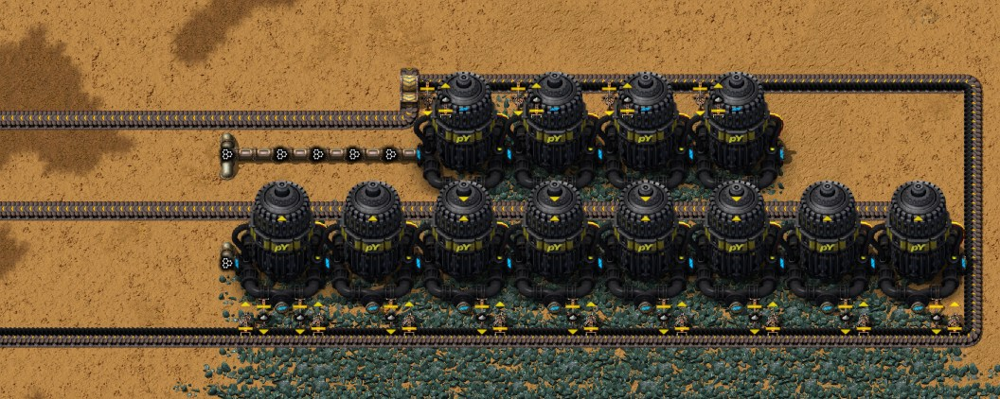

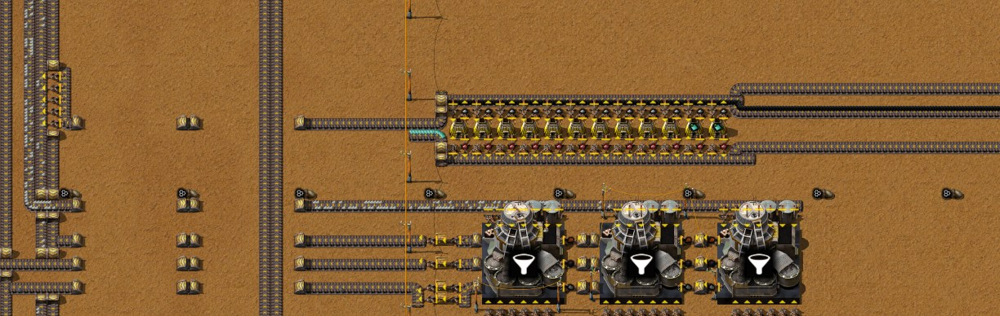

## 6. Aromatics from Tar, and where the rest goes

Aromatics come from Light oil, and Light oil from Tar (data, all unlocked by Tar processing):

| Recipe | Machine | In | Out |
|---|---|---|---|
| Tar refining bottoms, 5 s | Tar processing unit MK 01 | 100 Tar + 100 Steam | 30 Middle oil, 24 Creosote, 75 Anthracene oil, 140 Pitch |
| Tar refining tops, 4 s | Tar processing unit MK 01 | 100 Middle oil + 100 Steam | 50 Light oil, 50 Carbolic oil, 100 Naphthalene oil |
| Coke (from Pitch), 5 s | Destructive distillation column MK 01 | 100 Pitch + 100 Steam | 10 Hydrogen, 20 Light oil, 20 Naphthalene oil, 30 Anthracene oil, 10 Coke |
| Aromatics, 2 s | Destructive distillation column MK 01 | 50 Light oil | 50 Aromatics, 25 Gasoline |
| Gasoline (from Anthracene oil), 4 s | Destructive distillation column MK 01 | 50 Anthracene oil | 20 Gasoline, 5 Coke |

**Per 100 Tar** through the first four: 43 Light oil, so **43 Aromatics**, enough for 10.75 Zinc
ore (1.075 Zinc plates). With its 117 Anthracene oil cracked as well it gives **25.7 Coke** (14
from the Pitch, 11.7 from the oil), and 68 Gasoline, 58 Naphthalene oil, 24 Creosote, 15 Carbolic
oil and 14 Hydrogen; 270 Steam go in.

**The author's line** stands at the west edge (x −150 to −131, y −143 to −81), from the bottom: the
bottoms unit, the tops unit, the Aromatics column, the Pitch column, and the two cracking columns
side by side at the top. Tar comes from the Tailings pond at (−10, −72), which still holds the Tar
stored since chapter 2; Steam from the steam block through the Check valve at (−103.5, −74.5). One
Tar refining unit could take 20 Tar/s and make 28 Pitch/s, but one column refines only 20 Pitch/s,
so the Pitch column sets the pace. Measured over ten minutes:

| Per second | Made | Where it goes |
|---|---|---|
| Tar | 13.3 refined | The bottoms unit stands "full output" a third of the time, held back by the Pitch |
| Pitch | 18.7 (18.5 refined) | The Pitch column, working 93 % of the time |
| Aromatics | 5.75 | The zinc drills (section 5) |
| Coke | 3.58 | By belt to the acetylene block (section 7) |
| Anthracene oil | 15.6 (17.3 cracked) | The two cracking columns, 70 % busy; the oil stored in their pipe goes down |
| Gasoline | 9.8 | A Tailings pond |
| Naphthalene oil | 7.5 | A Tailings pond |
| Creosote | 3.2 | A Tailings pond |
| Carbolic oil | 1.9 | A Tailings pond |
| Hydrogen | 1.85 | An Exhaust pipe |
| Steam | about 36 used | From the steam block |

**How the byproducts got their way out.** The first line (10:50–11:23) had only four machines,
and every byproduct ran into a pipe that ended nowhere: after 850 Aromatics it stopped, with the
Anthracene oil pipe (3,200 of 3,200) and the Pitch pipe (2,900 of 2,900) full in the save of
11:45. The author then gave each one somewhere to go:

- **Anthracene oil**, the largest byproduct, is cracked into Gasoline and Coke: one column at
  11:50, a second at 13:00 (a column takes 12.5 a second; the line makes 15.6).
- **Pitch** is refined in its column as before, into Coke, Light oil and more oils.
- **Coke** goes by belt west to the acetylene block, which turns it into the lead drills' mining
  fluid (section 7).
- **Gasoline, Naphthalene oil, Creosote and Carbolic oil** go into one Tailings pond each
  (12:55–12:58, at x −139 between y −56 and 3). A pond holds 1,000,000 of one liquid (data); at the
  measured rates the Gasoline pond would be full first, after about 28 hours (Naphthalene oil 37,
  Creosote 87, Carbolic oil 145).
- **Hydrogen** goes into an Exhaust pipe (12:59). (A Tailings pond would vent a gas too, chapter 3;
  pollution is off on this map.)

The four stored liquids are the temporary part. What could use them is already researched (data):
Creosote from the three oils (Creosote), and they burn, Gasoline at 1.2 MJ a unit, Carbolic oil
0.35, Naphthalene oil 0.3, for example in Glassworks, which burn fluid fuel (chapter 4; the
author's circuit plan burns Gasoline there). The author leaves this until the circuit boards are
made and the products are needed.

**The Tar is a store, not a source.** Since the coke columns came down at 11:03 no machine makes
Tar (none in the measured ten minutes), and the line lives on what chapter 2 stored. The pond and
its pipe held 91,722 Tar at 11:45 and 82,094 at 13:05; at 13.3 a second that lasts **1.7 hours**,
until about 14:50. Then the Aromatics, the Coke and the Acetylene stop, and with them zinc and
lead. The Tar came from the coke distillation of chapter 2
([`coke-distillation.txt`](../blueprints/coke-distillation.txt)): 67.5 Tar a second from 15 Raw coal,
with 2.7 Coke and 108 Coal gas. The author's next step is a Tar line that cannot jam when its Coke
is not taken: a circuit turns the surplus Coke into Coal gas and Tar (data: Coal gas from Coke,
20 Coke → 20 Coal gas + 20 Tar + 1 Ash in 5 s in a Destructive distillation column, unlocked by
Coal processing 1). It comes with the next update of this chapter.

**How much is needed.** The author's plan of 6 boards a minute needs 0.33 Zinc plates/s: 3.33 ore,
13.3 Aromatics and 31 Tar a second through the whole chain. The twelve drills at full would need
24 Aromatics and 56 Tar a second. The line gives 5.75 Aromatics from 13.3 Tar: 0.14 Zinc plates a
second, 2.6 boards a minute. A second Pitch column would let the bottoms unit take its full 20 Tar
a second (8.6 Aromatics); beyond that it takes more refining units.

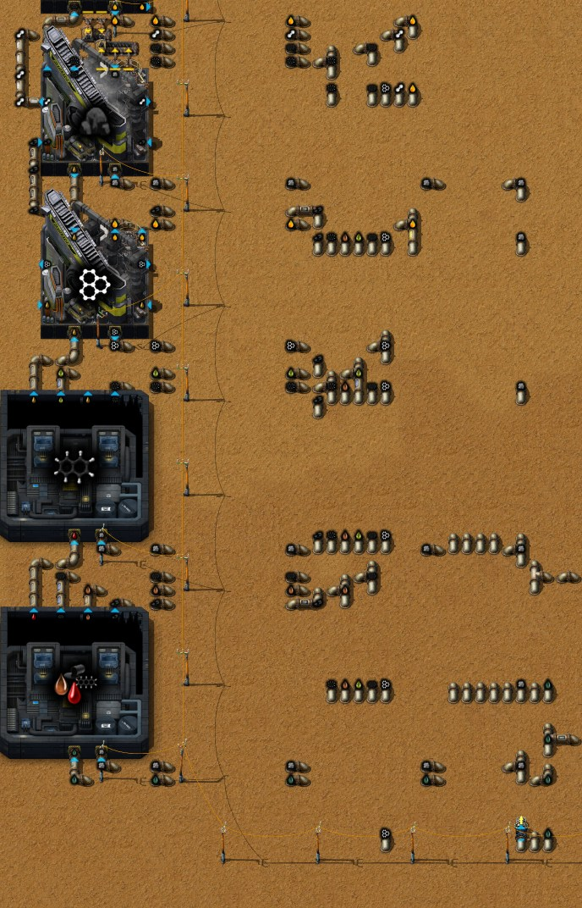

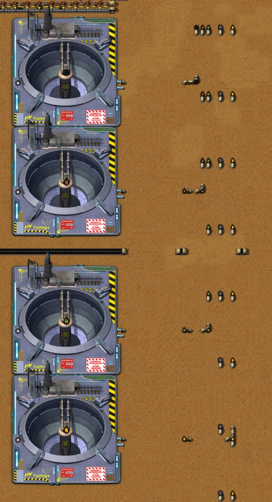

## 7. Lead: Acetylene as the mining fluid

Lead ore needs Acetylene (data: 100 per 10 ore, **10 Acetylene per ore**), and a Lead plate takes 6
ore in 10 s in a Stone furnace (Solder - Stage 1): 0.6 ore/s a furnace. The nearest lead field
lies west of the Tar processing, around (−288, −128).

**The acetylene block** ([`acetylene.txt`](../blueprints/acetylene.txt), the author's
"50 [Acetylene]"), north of the Tar processing at x −173 to −131, y −166 to −145. Six steps, all
in electric machines (data):

| Step | Machines | Recipe | At full speed |
|---|---|---|---|
| Limestone | 2 Soil extractors MK 01 | 400 Water → 8 Limestone, 20 s | 0.8 Limestone/s, dropped straight into the Lime furnace (output port) |
| Lime | 1 High pressure furnace MK 01 | 15 Coke + 10 Limestone → 10 Lime + 100 Carbon dioxide, 5 s | up to 2 Lime/s; the Carbon dioxide into an Exhaust pipe |
| Calcium carbide | 2 High pressure furnaces MK 01 | 7 Coke + 2 Lime → 10 Calcium carbide, 4 s | 5 Calcium carbide/s |
| Acetylene | 4 Gasifiers MK 01 | 300 Water + 10 Calcium carbide → 100 Acetylene + 25 Slaked lime, 8 s | **50 Acetylene/s**, the label |
| Lime back | 1 Evaporator MK 01 | 60 Slaked lime → 1 Lime + 1 Gravel, 2 s | 0.21 Lime/s back from the 12.5 Slaked lime/s |
| Gravel away | 1 Washer MK 01 | 15 Gravel + 100 Water → 50 Saline water, 20 s | the Saline water into a Sinkhole |

Coke comes in from the west on one lane of a belt. The Lime furnace puts its Lime on the other
lane, and the Evaporator's Lime joins it there (one inserter filtered to Lime), so one belt brings
both to the carbide furnaces. The carbide goes by belt to the Gasifiers, the Slaked lime by pipe
back to the Evaporator, the Gravel by inserter into the Washer. Water comes from two Offshore pumps.
The two Soil extractors run only while the Lime furnace holds less than 20 Limestone (a circuit
condition). The block is balanced at its 50 Acetylene a second: the 0.8 Limestone make 0.8 Lime,
the Slaked lime gives 0.21 back, and the carbide furnaces take 1.0.

**What a Lead ore costs** (data): 10 Acetylene, that is 1 Calcium carbide, that is **0.94 Coke**
(0.7 for the carbide, 0.24 for the Lime beyond what comes back) and 0.16 Limestone. A Lead plate
takes 5.6 Coke. Per 100 Tar the Tar line gives Coke for 27 Lead ore (4.6 plates) but Aromatics for
only 1.1 Zinc plates, so Lead is not what limits circuit boards.

**On the bench** (Coke fed on its lane, Water from the Offshore pumps, and the Acetylene pipe
emptied: the bench can now empty a pipe as well as a belt): **43.2 Acetylene/s**, 86 % of the
label. The limit is one inserter. The second Calcium carbide furnace has three input inserters,
but the belt ends one tile early, at a Small electric pole (−155.5, −155.5), and the third
inserter reaches for that tile. So the furnace gets 2 × 0.83 items a second against the 2.25 it
needs (1.75 Coke and 0.5 Lime) and stands short of Coke. A copy with one belt tile in place of the
pole makes **49.5 Acetylene/s** (99 %), the carbide furnaces at 100 % and the Soil extractors at
their full 0.8 Limestone a second. The pole links the eastern machines to the power network, so
it would need another tile. For the six drills the block has room either way: they take 30.

**In the base** (measured ten minutes) the Gasifiers made 42.7 Acetylene a second, as on the bench,
and the drills took 30.0; the rest filled the pipe, and by the end the Gasifiers began to stand
with full outputs. Calcium carbide 4.33, Lime 0.86 (furnace and Evaporator), Coke 4.10 used against
3.58 arriving from the Tar line: the Coke on the belts went down while the pipe filled. The drills
alone need 2.8 Coke a second.

**The mine.** Six Fluid mining drills MK 01 in one row at y −152 (x −309 to −284) drop onto one
belt: 0.5 ore/s each, 3 a second, 30 Acetylene. The Acetylene comes in one pipe of 201 × 16 tiles
from the block; it leaves east, turns, and runs back west along y −143.5. Three long belts serve
the line:

- **Raw coal** for the drills (400 kW each) and the furnaces comes from a new Raw coal module at
  (19, −64), the chapter 1 blueprint ([`raw-coal-module.txt`](../blueprints/raw-coal-module.txt), 9
  Burner mining drills, 15 Raw coal/s), placed for this line alone: about 500 tiles of belt, south
  along x −1, west along y −27 and north along x −232, with a branch east along y −71 to the
  furnaces. The lead line burns about 1.1 Raw coal a second, so the belt stands full and most of
  the module waits.
- **The ore** goes about 230 tiles east along y −149, south along x −234 and east along y −68 to
  the column.
- **The drills' Ash** goes north along x −314 and east along y −179, 228 tiles, onto the Ash loop
  at x −95 (chapter 4), which takes it to the Ash separation.

**The smelting column.** 13 Stone furnaces at y −69 (x −157 to −133), the same design as for tin
and zinc: ore lane and plate lane on the lower belt, Raw coal and Ash on the upper one. Thirteen
could take 7.8 ore/s; the six drills give 3, so seven furnaces get ore (busy 71 % of the time) and
**0.50 Lead plates/s** come out (measured), enough for 11 boards a minute. As with zinc, the belt
ends without a chest on purpose (two chests placed at 12:36 were taken away again at 12:38): the
plates are to go onto the bus later. Until then the plate lane is full (111 plates at 13:05) and
the plates gather in the furnaces, up to a stack of 100 each. 323 Lead plates were made by 13:05.

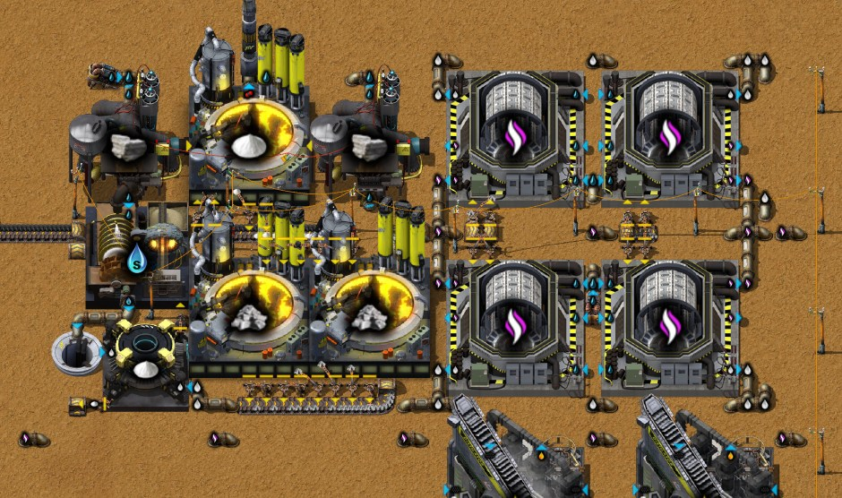

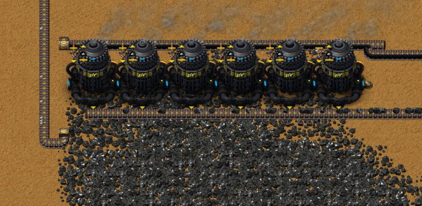

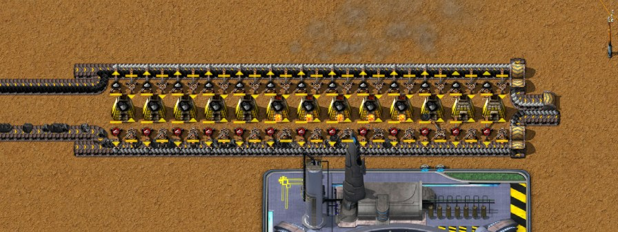

## 8. Iron, a mall that burns Wood, and the coke columns

**Iron times three.** At 10:15–10:20 robots built a second copy of the chapter 2 crushed iron block
([`crushed-iron.txt`](../blueprints/crushed-iron.txt), "3 [Iron plate]": 6 Jaw crushers, 18 iron
and 5 brick furnaces) just south of the first (crushers at y −15 and y 1), and at 10:40–10:50 the
author added Burner mining drills on the iron field: 52 of them stand at y −18 to −6 at 13:05.
The windows ending 10:40 and 11:10: Iron ore 11.5 → 30.1 a second, Crushed iron ore 6.9 → 18.0,
**Iron plates 2.5 → 6.1**, what two blocks of 3 a second promise. The base uses about 3 a second,
so once the belts and chests had filled the blocks made only that: at 13:05 half the twelve
crushers stand with full outputs. The exported blueprint gained one Small electric pole; nothing
else changed.

**A mall that burns Wood** ([`wood-mall.txt`](../blueprints/wood-mall.txt), the author's
"初期超市-2", beside the red science line): ten Burner assembling machines make Transport belts,
Underground belts, Mechanical inserters, Pipes and Pipes to ground, with the Iron gears, Iron
sticks, Bolts, Copper cable and Small parts made on the spot. Logs, Iron plates and Copper plates
come in from the west; a Wood processing unit turns the Logs into Wood (4 Logs → 40 Wood in 1 s with
the Selective cutting heads of chapter 4), which rides on the Iron plate belt to every machine as
fuel. The products go into chests with limited slots. Why Wood (data):

- **No Ash.** Wood has no burnt result; Raw coal leaves one Ash each (3 MJ). The two earlier malls
  were fuelled by hand.
- **A Log made into Wood gives five times the heat.** A Log burns for 4 MJ; as 10 Wood it gives
  20 MJ.
- **It takes little.** A Burner assembling machine uses 75 kW: the ten at full work burn 0.375
  Wood/s, 0.04 Logs/s, out of the log block's 2.35.

The two older malls are in the author's book again under new names, 初期超市-0 (the chapter 1
mall) and 初期超市-1 (the chapter 3 belt mall), unchanged. Not measured on the bench: a mall makes
what is taken from it.

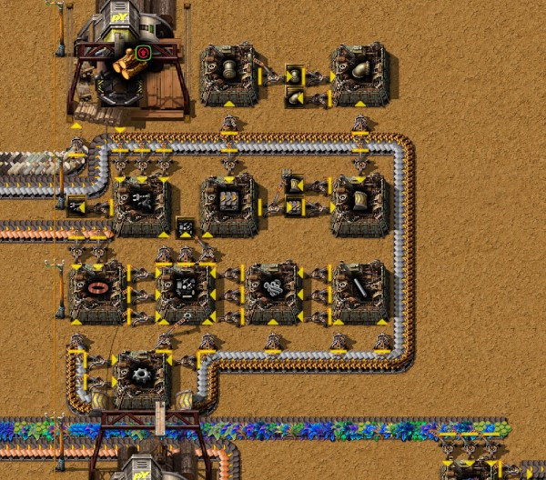

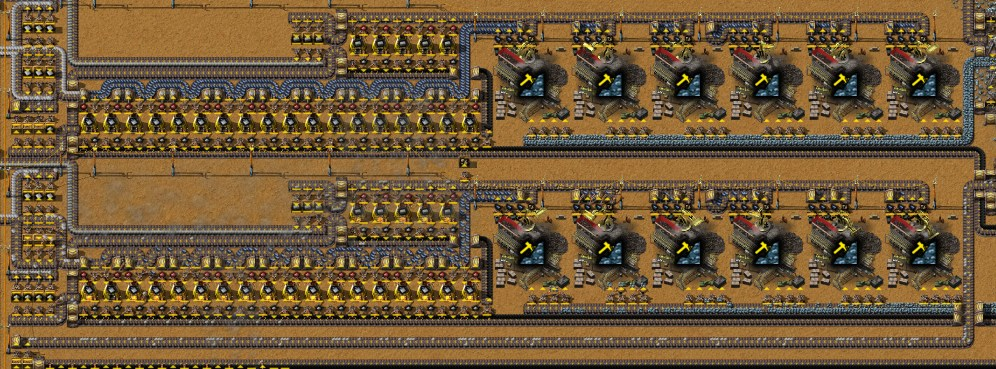

**The coke columns come down.** The steel line stopped at about 10:30 with its outputs full.
Without that Coke user the five coke columns of chapter 2 stopped too, and with them the Coal gas:
the aluminium drills stand "missing required fluid", as chapter 4 predicted. At 11:03 the author
took the columns away. Since then the only Coke comes from the Tar line, 3.6 a second in the measured ten
minutes, and it all goes to the acetylene block; there is no Coal gas in the base. At 13:05 the eight steel
foundries hold Iron ore and Limestone and wait for Coke.

**The author's note on the log block.** The log block's High pressure furnace burns 0.31 Coke/s
into the forestries' Carbon dioxide. The Carbon capture greenhouse recipe makes 200 Carbon dioxide
every 5 s from nothing; with 16 Moondrop as modules a Moondrop greenhouse MK 01 runs at speed 1
(data: speed 0.0625, base effect −100 %, +100 % a Moondrop), so one greenhouse gives about 40 a
second against the 12.5 the block needs, and the Coke and the furnace's 2 MW are freed. The author
noted it in the blueprint: "高压炉可原地替换为月落草温室" (the furnace can be replaced in place by a
Moondrop greenhouse). One check from the blueprint: the greenhouse is 9 × 9, the furnace 7 × 7;
centred on the furnace it would overlap the Moss farm east of it, one inserter and two pipes, so
the swap needs a little rebuilding.

## 9. Checklist

- Tin, Zinc and Lead plates are for circuit boards: 3.11 Tin, 3.33 Zinc and 2.67 Lead per Simple
  circuit board. Zinc has no other use yet; Lead also makes tanks.
- Tin ore is mined with Steam, 10 per ore; Zinc ore with Aromatics, 4 per ore; Lead ore with
  Acetylene, 10 per ore. Tin and Zinc smelt 40 ore → 4 plates in 60 s (0.667 ore/s a Stone
  furnace: twelve take half a belt), Lead 6 ore → 1 plate in 10 s (0.6 ore/s).
- Steam-mined Tin costs about 1.9 Raw coal per ore (Boiler and drill): half a belt of Tin ore burns
  nearly a whole Raw coal module.
- Acetylene is made from Calcium carbide, and that from Coke and Lime: about 0.94 Coke per Lead
  ore. Dry the Slaked lime back into Lime and send the Gravel away.
- A fluid segment spans at most 320 tiles (its box on the map, not its length). Put a Pump or a
  Check valve at least every 320 tiles, and never leave the gap empty.
- A Check valve ends a segment like a Pump, without power and in one tile, but it only lets fluid
  run from the fuller side to the emptier one. Supply lines to consumers are fine; filling a store
  above the line's level needs a Pump.
- 100 Tar make 43 Aromatics through four recipes, and 25.7 Coke once the Anthracene oil is cracked
  too. Every byproduct needs a way out, or the line stops when its pipe fills: turn it into
  something used, store a liquid in a Tailings pond (1,000,000), vent a gas in an Exhaust pipe.
- A store is not a source: a line fed from a tank or pond stops when it is empty. Count the hours.
- Check every inserter of a new block reaches a belt: one that reaches for a pole tile cost the
  acetylene block 14 % of its output.
- Wood is the fuel for burner buildings that should not make Ash: one Log as Wood gives 20 MJ.

## 10. How these facts were checked

- The run: the companion mod's recorder (run `2652821414-0`), read with
  `tools/recorder-phases.js` (timeline in 5-minute slices, chat notes), `tools/recorder-log.js`
  (production per 10-minute window) and its minute records (what was built and removed where:
  the Pumps at 11:31, the Check valves at 11:47–11:48, the coke columns at 11:03, the acetylene
  block, the lead line and the ponds).
- The save of 13:05 (`Py-Exploration`, consistency check passed): `tools/inspect-save.ps1 -Ticks
  3700`, then `tools/summarize-save.js` (research, machine states, the drills' status),
  `tools/trace-layout.js` (belt lines, fluid segments with their contents and extent),
  `tools/render-area.js` and `tools/render-save-map.js`; fluid segment boxes counted in tiles from
  the snapshot's `entities.json`. The save of 11:45 for the first Tar line and its full pipes.
- **Ten minutes of the base:** `tools/save-probe.ps1 -Save Py-Exploration -Probe rate-probe -Ticks
  39700 -Variant 60,600` (new): after one minute it measures what the base makes and uses per
  second for ten minutes, and the status of every machine and drill once a second.
- **The acetylene block on the bench:** `tools/bp-bench.ps1 -Bench acetylene` (Coke on its lane,
  the Acetylene pipe emptied by the new fluid sink; 20 minutes after 10 of warm-up), and the same
  with one belt tile for the pole (a copy, not kept).
- Data: the current dump of the author's mods (`C:\tmp\cf-save\data\script-output\data-raw-dump.json`):
  mining fluids, recipes, machine speeds and energy, stack sizes, fuel values, Tailings pond
  volume, `max_pipeline_extent`, the Pump and the Check valve, which technology unlocks what;
  pyalienlife's `prototypes/upgrades/moondrop.lua` for the upgrade's choices.
- **Pipes and valves:** `tools/run-probe.ps1 -Probe valve-probe -Ticks 2500 -Work C:\tmp\cf-save`:
  steam lines of 55 to 625 tiles of Pipe to ground, an L, a Pump or a Check valve part way, an
  infinity pipe at the start and a counted sink at the end; and two 100-tile segments at 20 % and
  80 % joined by a Pump, a Check valve or a plain pipe.
- The blueprints: exported by the author with the companion mod (2026-10-11, 19:06, and the
  acetylene block on 2026-10-12, 12:45) and pulled into `blueprints/`: the Wood mall, the two older
  malls under their new names, one more pole in the crushed iron block, the author's note in the
  log block's description, and the acetylene block.

Next: chapter 6 (to come).
