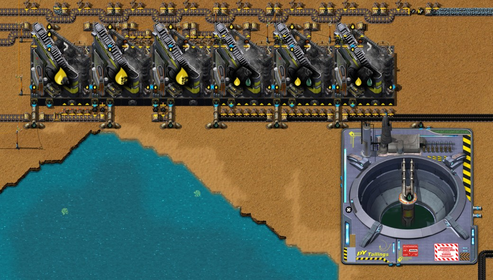

# 第五章 —— 锡矿、锌矿、铅矿冶炼

[English](05-tin-zinc-smelting.md) · [目录](../README.zh-CN.md) · 上一章：[第四章](04-aluminium-glass-logs.zh-CN.md)

本章接着同一局记录，从 9:37 到 13:28。红瓶以每秒 0.2 个的速度运转后，作者研究了"电子学：阶段 1"的前置科技和它本身，并备好简易电路板要用的三种金属：锡板（做焊料、陶瓷电容器和高功率电阻器）、锌板（做铜锌电池）和铅板（做焊料）。这三种矿都要用采矿流体（来自数据）：锡矿用蒸汽，锌矿用芳烃，铅矿用乙炔。所以作者在基地以南 520 格建了蒸汽区块和锡矿，矿边就地冶炼；在西缘建了焦油处理线来产芳烃，并在基地以东 450 格建了锌矿，矿石用传送带运回基地里的冶炼排；又在焦油处理旁边建了一个乙炔区块，把焦油线产的焦炭变成乙炔，供再往西约 150 格的铅矿使用。焦油线的其余副产物暂时这样处理：沥青和蒽油变成焦炭，氢排到空中，四种液体存进尾矿池。作者的看法是：锌只用在电路板里，所以这些产物等到做电路板、用得上的时候再真正利用。焦油本身是存货：产焦油的是第二章的焦炭塔，它们在 11:03 因焦炭没人要而被拆掉，13:22 又以一个新区块的形式回来，新区块的第六座蒸馏塔把没人要的焦炭转化为煤气和焦油。随后作者断开了它的电力，要先用完尾矿池里的焦油。此外还有第二个碎矿炼铁区块和更多铁矿采矿机（铁板最高产量从每秒 3 块变成 6 块，不算氧化铁）、一个烧木材的新超市，以及重建的铜矿。时间均为游戏时间。数字来自游戏数据、记录器每 10 分钟的产量窗口、13:05 和 13:28 的存档（`tools/inspect-save.ps1`）、在这两个存档的副本里各实测的十分钟（`tools/rate-probe`，新工具）以及后一个存档之后的半小时、作者乙炔区块和焦炭区块的蓝图测试台（第 6、7 节），以及一个测管道、管道泵和止回阀的探针（`tools/valve-probe`，第 4 节）。

一句话概括计划：用蒸汽采锡，用芳烃采锌，用乙炔采铅；产芳烃的焦油，又通过它的焦炭提供了乙炔。

## 本局概览

| 游戏时间 | 发生了什么 |
|---|---|
| 9:36–10:33 | 研究，大约每五分钟一项（每秒 0.2 个红瓶正好负担得起）：木榴油、乙炔、焊料：阶段 1、海藻：阶段 1、培养皿、月落草、月落草升级、陶瓷制品、流体增压、树脂：阶段 1，10:33 完成电子学：阶段 1 |
| 9:40–9:50 | 在 y 98–120 建了一个蒸汽区块：把第三章的发电站蓝图再放一次，但不建那 12 台蒸汽机，于是只有 24 台锅炉和 3 台固体分离机。北边煤田上又放了 18 台热能采矿机，多填满两条往南的带子 |
| 9:53–10:10 | 一条约 625 格的蒸汽管通往以南 520 格的锡矿，在 (−103, 235) 处有一台管道泵；锡矿上 16 台液压采矿机，旁边一列 12 台石炉的冶炼排。10:10 出第一块锡板 |
| 10:14 | 留言："月落草升级选择碳捕集"；"之前产二氧化碳的高压炉可原地替换为温室，但是要先产出月落草作为插件"（第 8 节） |
| 10:15–10:20 | 第二个碎矿炼铁区块（第二章的蓝图），紧挨着第一个 |
| 10:20–10:35 | 红瓶产线旁边一个烧木材的新超市（蓝图"初期超市-2"，第 8 节） |
| 约 10:30 | 炼钢产线因产物堆满而停下；焦炭、煤气以及铝矿随之停下（第四章：煤气随焦炭而来） |
| 10:40–10:50 | 铁矿上加了更多热能采矿机 |
| 10:50–11:23 | 西缘的焦油处理：两台焦油处理设施 MK1 和两台破坏性蒸馏塔 MK1，焦油来自尾矿池，蒸汽来自蒸汽区块。11:03 第二章的五座焦炭塔（y −88）被拆除 |
| 11:14 | 研究完流体处理：止回阀 |
| 11:10–11:39 | 一条约 930 格的芳烃管从焦油处理通往锌矿，用两个止回阀分成三段 |
| 11:30–11:45 | 锌矿上（x 410–450，y 215–221）12 台液压采矿机，约 520 格传送带通到灰烬分离区块旁边一列 12 台石炉的冶炼排 |
| 11:31–11:48 | 作者拆掉 (−103, 235) 和 (−101, 235) 两台管道泵，一台在通往锡矿的蒸汽管上，一台在通往玻璃工厂的焦油管上。y 179 以南的蒸汽管重新铺设，装了两个止回阀（11:47–11:48）；焦油管保持断开（第 4 节） |
| 11:46–13:25 | 研究：物流学、储液罐、塑料、基础基质、遗传学：阶段 1、生物科技设备：阶段 1、铜处理：阶段 1、电解、生物科技：阶段 1、异星生物学、陆地动物：阶段 1、钳尾刀虫：阶段 1、屠宰、动物学、乳胶技术、pY科技包 1（13:19）和纤维素：阶段 1，其中大多数通往 pY科技包 1 |
| 11:50 | 第三台破坏性蒸馏塔，把蒽油裂解成汽油和焦炭 |
| 11:58–12:30 | 焦油处理北边的乙炔区块（x −173 到 −131，y −166 到 −145）：四台气化炉（11:58），一台做生石灰的高压炉、两台土壤挖掘机和一根排气管（12:06–12:08），两台做碳化钙的高压炉（12:09–12:12），一台洗涤机和一个渗水坑（12:21–12:24），整个区块由机器人整体挪过一次（12:26），一台蒸发器（12:30） |
| 12:35–12:37 | 铅矿上六台液压采矿机，在 y −152，x −309 到 −284（放了十台，又收回四台），以及 y −69 一列 13 台石炉的冶炼排 |
| 12:40–12:55 | 在 (19, −64) 放了一个原煤模块（第一章的蓝图）专供铅矿线的燃料，并手工铺了约 1560 格传送带：原煤送往铅矿采矿机和石炉，矿石送往冶炼排，采矿机的灰烬送上灰烬环 |
| 12:55–12:59 | x −139 处四个尾矿池，分别存萘油、木榴油、酚油和汽油，另有一根排氢气的排气管。从这时起焦油线不再停顿 |
| 13:00–13:04 | 第四台蒸馏塔，第二台裂解蒽油的；另外放了两台焦油处理设施，又收了回去 |
| 13:07–13:10 | 重建铜矿：拆掉七台热能采矿机和四个箱子，在 x 37–65、y 23–27 放了两排共 18 台采矿机，两条铜矿带往西 |
| 13:11–13:19 | 作者的新焦炭区块由机器人放在基地以东（x 150–190，y 39），带一根排气管，手工改了一阵，又拆掉了 |
| 13:22–13:24 | 新焦炭区块建在旧焦炭塔原来的位置（y −88）：六座蒸馏塔，没有排气管，传送带往西接好（第 6 节） |
| 13:26–13:27 | 石英矿旁一台设为空培养皿的玻璃工厂加了一个机械臂和一个箱子。留言："为月落草做准备"（第 8 节） |
| 13:28 | 存档。作者已断开焦炭区块的电力（拆掉一根电线杆），要先用完尾矿池里的焦油 |

每秒产量（记录器的 10 分钟窗口；最后一行是在 13:28 存档的副本里实测的十分钟，`tools/rate-probe`）：

| 窗口结束 | 锡矿 | 锡板 | 锌矿 | 锌板 | 铅矿 | 铅板 | 芳烃 | 乙炔 | 焦炭 | 铁板 | 原煤 |
|---|---|---|---|---|---|---|---|---|---|---|---|
| 9:40 | 0 | 0 | 0 | 0 | 0.01 | 0 | 0 | 0 | 0.02 | 2.09 | 10.6 |
| 10:00 | 0 | 0 | 0.02 | 0 | 0.03 | 0.08 | 0 | 0 | 1.09 | 2.07 | 43.0 |
| 10:20 | 7.50 | 0.71 | 0.03 | 0 | 0.01 | 0 | 0 | 0 | 0.77 | 2.13 | 36.9 |
| 10:40 | 7.50 | 0.75 | 0.03 | 0.03 | 0.03 | 0.01 | 0 | 0 | 0.02 | 2.47 | 31.4 |
| 11:00 | 4.95 | 0.54 | 0.03 | 0 | 0.03 | 0.01 | 0 | 0 | 0.22 | 5.99 | 39.2 |
| 11:20 | 7.50 | 0.75 | 0.04 | 0.01 | 0.04 | 0.01 | 0.33 | 0 | 0 | 6.13 | 41.9 |
| 11:40 | 2.41 | 0.45 | 0.05 | 0.01 | 0.03 | 0.01 | 0 | 0 | 0 | 5.96 | 25.5 |
| 12:00 | 7.51 | 0.69 | 0.14 | 0.01 | 0.03 | 0.01 | 0.50 | 0 | 0.37 | 2.98 | 33.8 |
| 12:20 | 0.92 | 0.09 | 0.02 | 0 | 0.01 | 0 | 0 | 0 | 0 | 2.94 | 16.0 |
| 12:40 | 1.78 | 0.17 | 0.01 | 0.03 | 0.01 | 0 | 0 | 4.67 | 0 | 2.97 | 17.1 |
| 13:00 | 1.33 | 0.13 | 0.76 | 0.02 | 1.59 | 0.26 | 3.00 | 14.0 | 1.63 | 3.64 | 26.1 |
| 13:20 | 0 | 0 | 1.56 | 0.16 | 3.03 | 0.50 | 6.17 | 37.5 | 3.67 | 2.99 | 31.1 |
| 13:28 后 10 分钟 | 0 | 0 | 1.22 | 0.12 | 3.02 | 0.49 | 4.92 | 29.8 | 2.88 | 2.97 | 26.9 |

对照时间线来看：

- **锡矿从 10:20 到 11:30 稳定在每秒 7.5 个矿、0.75 块锡板**（只有一个窗口偏低）：正好半带矿（第 3 节）。11:31 蒸汽管上的管道泵拆掉后就停了，止回阀装好后又满速运转（12:00 结束的窗口）。约 12:10 起它的两个箱子满了，只有取走锡板时才动一下；总共做了 4816 块锡板。
- **锌矿靠焦油线给多少就采多少。** 11:30 之前每秒 0.03 个锌矿来自第三章的烟煤分离（每 2 个烟煤有 10% 出一个锌矿）。锌矿采矿机随芳烃到来而运转：13:00 结束的窗口每秒 0.76 个，13:20 结束的窗口 1.56 个，实测十分钟 1.22 个，是 12 台采矿机能力的五分之一（第 6 节）。
- **铅从约 12:45 开始：** 实测十分钟每秒 3.02 个矿、0.49 块铅板，即六台采矿机每台 0.5 个。10:00 结束的窗口里每秒 0.08 块铅板，来自烟煤分离攒下的 288 个铅矿（它也有 10% 出铅矿），焊料研究完之后炼掉了。
- **焦油线在副产物无处可去时只能短暂地跑一阵**（11:20 和 12:00 结束的窗口里每秒 0.33 和 0.50 个芳烃），12:55 尾矿池接上副产物后就不再停顿（第 6 节）。乙炔跟着焦油线送来的焦炭走；铅矿采矿机的管道灌满后，焦炭反过来跟着乙炔走：最后两行之间，芳烃从每秒 6.17 个降到 4.92 个。
- **焦炭、铝矿和钢材在约 10:30 一起停下**，正如第四章所说：炼钢产线是焦炭的用户，而采铝用的煤气随焦炭而来（铝矿在 10:00 结束的窗口里每秒 3.5 个，11:20 起只有 0.04）。最后重新出现的焦炭来自焦油线；新的焦炭区块在 13:28 时没有通电。
- **铁板产能翻了一倍。** 一个碎矿炼铁区块每秒最多 3 块，两个最多 6 块（不算氧化铁；第 8 节）。窗口里之前是每秒 2.1 块，那是基地当时用掉的量；新传送带和箱子灌装期间是 6.1 块，11:50 起又回落到每秒 3 块：基地每秒只用约 3 块，传送带和箱子填满后，两个区块就只做被拿走的那么多。

## 1. 这一阶段的科技

| 科技 | 花费 | 研究时间 | 解锁了本章用到的什么 |
|---|---|---|---|
| 流体采矿 | 24 红瓶 | 3:58–4:06（第三章） | 液压采矿机 MK1、锡板（40 锡矿 → 4 块） |
| 焦油处理 | 60 红瓶 | 9:36 完成（第四章） | 焦油处理设施 MK1；焦油底层精炼和顶层精炼、用沥青做焦炭、用轻油做芳烃、裂解蒽油 |
| 木榴油 | 60 红瓶 | 9:36–9:41 | 用蒽油、酚油、萘油做木榴油（未建造） |
| 乙炔 | 60 红瓶 | 9:41–9:46 | 气化炉 MK1、碳化钙、乙炔；焊料的前置 |
| 焊料：阶段 1 | 60 红瓶 | 9:46–9:51 | 铅板（6 铅矿 → 1 块）、焊料（2 锡板 + 4 铅板 → 1） |
| 海藻：阶段 1 | 60 红瓶 | 9:51–9:56 | 海藻生长池 MK1（每台 50 块锡板） |
| 培养皿 | 60 红瓶 | 9:56–10:01 | 月落草的前置 |
| 月落草 | 60 红瓶 | 10:01–10:06 | 月落草温室 MK1 |
| 月落草升级 | 65 红瓶 | 10:06–10:12 | 温室的升级选择（见下） |
| 陶瓷制品 | 60 红瓶 | 10:12–10:17 | 陶瓷、黏土坑 MK1、电子厂 MK1 |
| 流体增压 | 60 红瓶 | 10:17–10:22 | 真空 |
| 树脂：阶段 1 | 60 红瓶 | 10:22–10:27 | 树脂提取器 MK1 |
| 电子学：阶段 1 | 65 红瓶 | 10:27–10:33 | 锌板（40 锌矿 → 4 块）、陶瓷电容器、高功率电阻器、铜锌电池、简易电路板 |
| 流体处理 | 65 红瓶 | 11:08–11:14 | 止回阀 |
| 流体加工机 1 | 60 红瓶 | 11:24–11:29 | 蒸发器 MK1；熟石灰 → 生石灰 + 碎石 |
| 储液罐 | 70 红瓶 | 11:46–11:52 | 各种储液罐；储液罐 40k 要 30 块铅板 |

电子学：阶段 1 需要其中七项（数据：木材处理、月落草、树脂、木榴油、焊料、陶瓷制品、流体增压）；作者先研究了还缺的几项及其前置，中间插了月落草升级。之后依次是修理包、机枪炮塔、石墙、闸门、填埋材料、照明灯、汽车、流体处理、氢化和基本重整、雷达：阶段 1、流体加工机 1、军工学和合金冶炼：阶段 1（硬铝、冶炼厂 MK1），然后是时间线里列的那些，直到 pY科技包 1（90 红瓶，13:12–13:19：pY科技包1型、科研枢纽 MK1、瓶子和橡胶塞）；13:28 时干酪根处理研究到 56%，队列里下一项是页岩油开发。每个单位在研究中心里要 30 秒；以每秒 0.2 个红瓶计，60 个单位的科技要 300 秒，这就是时间线上五分钟一项的节奏。乙炔区块还用到更早科技的配方：生石灰（标准混凝土，第四章），高压炉、尾矿池、排气管和土壤挖掘机挖石灰石（煤炭加工 1），渗水坑（炼钢技术），洗涤机（土壤清洗），以及用碎石做盐水（碎矿技术）。

**月落草升级的选择。** 和第四章的林场升级一样，它提供三个子科技（pyalienlife 的 `prototypes/upgrades/moondrop.lua`）：

- *铜*（`cu`）：月落草配方多要 10 个铜矿，产量翻倍、时间减半，并去掉其他原料。
- *月*（`moon`）：产能 +35%，速度 −50%，另有一个要用照明灯的甲烷配方。
- *碳捕集*（`carbon-capture`，作者的选择）：速度 +50%，能耗翻倍，并解锁一个温室配方：不要任何原料，每 5 秒产出 200 个二氧化碳。

作者是为原木区块选的：区块里的高压炉在烧焦炭做二氧化碳（第 8 节）。

## 2. 锡、锌和铅用来做什么

存档已研究的 61 项科技所解锁、用到这三种板的配方（数据）：

- **锡板：** 焊料（2 锡 + 4 铅）、陶瓷电容器（2 锡 + 1 陶瓷 → 3）、高功率电阻器（1 锡 + 2 焦炭 + 1 玻璃 → 3）、镀锡电线，以及两种建筑：蒸发器 MK1（40 块）和海藻生长池 MK1（50 块）。
- **锌板：** 只有铜锌电池（10 铜 + 10 锌 + 5 纤维素 + 250 盐水 → 1）。这正是作者说的：锌目前只进电路板，别无他用。
- **铅板：** 焊料；储液罐 40k（30 块，不需要硬铝）和其他储液罐（还要硬铝）；标准弹匣（2 块做 5 个）和霰弹。

简易电路板一次用 1 块印刷电路基板1型、3 个真空管、3 个空心电感器、5 个陶瓷电容器、6 个高功率电阻器、2 个焊料和 1 个铜锌电池，做出 3 块。折合每块电路板要 **3.11 块锡板、3.33 块锌板和 2.67 块铅板**。作者 10:51 的 Factory Planner 规划目标是每分钟 6 块电路板：每分钟 18.7 块锡板、20 块锌板、16 块铅板，即每秒 0.31、0.33 和 0.27 块。

## 3. 锡：用蒸汽作采矿流体

采锡矿要蒸汽（数据：`required_fluid`，每 10 个矿 100 单位，即**每个矿 10 蒸汽**，和第四章实测的每个铝矿 10 煤气是同一条规则）。最近的锡矿在基地以南约 520 格，(12, 556) 附近。

**蒸汽区块。** 作者把第三章的发电站蓝图又放了一次，位置在灰烬分离区块以北的 y 98–120，但不建蒸汽机：两排各 12 台锅炉相对，原煤带在外侧，灰烬带在内侧通往上方的三台固体分离机，东端一台抽取泵。原本要送去蒸汽机的蒸汽在两排之间汇集，用一根管道往西送出。根据数据和第三章：一台锅炉每秒产 7.5 个 250 °C 的蒸汽，同时烧 1.23 个原煤，所以整个区块最多**每秒 180 个蒸汽**，远超实际用量：锡矿采矿机运转时每秒用 75 个，焦油处理约 30 个（第 6 节）。13:28 时 24 台锅炉全都处于"产物已满"。

**管道。** 从区块往西到 x −103，往北经过 (−103.5, −74.5) 的一个止回阀通到焦油处理，往南沿 x −103 通到锡矿：到采矿机约 625 格地下管道。11:31 之前，南段由 (−103, 235) 的一台管道泵分成两段；11:48 起改由 (−103.5, 179.5) 和 (−103.5, 498.5) 两个止回阀分段，整条线共三段（为什么每 320 格必须有一个，见第 4 节）。

**矿场。** 16 台液压采矿机 MK1 分两排，每排 8 台（y 523 和 529，x −13 到 22），都把矿放到中间同一条带子上。每台每秒采 0.5 个，16 台共 8 个。采矿机要烧燃料（400 kW）：原煤沿 x 70 一条 587 格的带子从北边煤田送来，采矿机的灰烬往西送，由六个机械臂放上 x −93 的灰烬环（第四章第 7 节）。另有两个只抓原煤的机械臂从采矿机的带子上取石炉的燃料。

**冶炼排。** 矿带从侧面并入冶炼排的带子，所以矿全部落在靠石炉的那一道上：最多**每秒 7.5 个**，即半带，记录器从 10:20 到 11:30 显示的正是这个数。冶炼排是作者第一章的设计，只是石炉从 10 台变成 12 台：矿道和板道在同一条带上（出料机械臂设为"除灰烬外"），原煤和灰烬在另一条带上。根据数据：锡板是 40 个矿 → 4 块，60 秒，所以一台石炉每秒吃 0.667 个矿，比它唯一的送料机械臂从流动带上能送的 0.833 少（第四章第 9 节）；每秒 7.5 个矿要 11.25 台石炉，12 台最多每秒炼 0.8 块。这一道矿给出**每秒 0.75 块锡板**。锡板进 (−71, 527) 的两个箱子，因为锡板还要用来造建筑（第 2 节）；每个箱子装 1600 块，约 12:10 起就满了：3200 块锡板，够约 1030 块简易电路板用。此后采矿机一直"等待输出空间"（实测十分钟里 16 台全是）。

**一个锡矿的代价。** 它的 10 个蒸汽带着 4.94 MJ 锅炉热量（每度 2.1 kJ，从 15 °C 到 250 °C），相当于 1.65 个原煤；采矿机再烧 0.27 个（400 kW，每秒 0.5 个矿）。所以**每个锡矿要花 1.9 个原煤**，并留下同样多的灰烬；一块锡板在进炉之前就要 19 个原煤。每秒 7.5 个矿就是每秒 14 个原煤，几乎是一个原煤模块的全部产量（每秒 15 个），以及每秒 75 个蒸汽，即 24 台锅炉中的 10 台。

## 4. 一段管道最多跨 320 格

相连的管道组成一个流体段，而一个流体段只能跨这么远：Py 的管道和地下管道的 `max_pipeline_extent` 是 **320 格**（数据；引擎对其他流体盒的默认值是 1280）。管道泵或止回阀会把流体段隔开，所以长管道至少每 320 格要有一个。用探针实测（`tools/valve-probe`）：用地下管道按最大间距（每对 11 格）铺的蒸汽管，起点保持满，终点统计每秒到达的量：

| 管道 | 每秒到达的蒸汽 |
|---|---|
| 55 格 | 4800 |
| 310 格 | 4800 |
| 330 格 | **0**（管道灌满，但一点都流不出来） |
| 625 格 | **0** |
| 625 格，第 310 格处一台管道泵 | 3880 |
| 625 格，第 310 格处一个止回阀 | 4781 |
| 625 格，第 205 格处一台管道泵（后面还有 420 格） | **0** |
| L 形：先往东 200 格，再往南 200 格 | 4800 |

限制的是流体段在地图上占的范围，而不是管道长度：L 形管道长 400 格，但只占 202 × 202 的范围，照样能流。在限制以内，流量每秒数千，远超这里任何需求（锡矿采矿机只要 75）。

**作者的管道**（每段按它在地图上占的格数计，来自 13:05 的存档；这些管道到 13:28 都没有改动）：

| 管道 | 各段 | 分段靠 |
|---|---|---|
| 通往锡矿的蒸汽 | 81 × 255（从蒸汽区块往北到焦油处理的止回阀，往南到 y 179）、1 × 319、127 × 31（到采矿机） | (−103.5, 179.5) 和 (−103.5, 498.5) 的止回阀 |
| 通往锌矿的芳烃 | 21 × 310、320 × 25、243 × 18 | (−113.5, 179.5) 和 (205.5, 204.5) 的止回阀 |
| 通往铅矿的乙炔 | 201 × 16 | 只有一段 |
| 通往玻璃工厂的焦油 | 1 × 309（两端都断开）、318 × 103、72 × 1（玻璃工厂） | (217, 338.5) 的管道泵 |

最宽的是芳烃管中间那段，正好占 320 格，照样能流；作者的每一段都在限制以内。11:31 作者拆掉管道泵、准备换成止回阀后，锡矿采矿机一直"缺少所需流体"，直到 17 分钟后止回阀装好；顺便把 y 179 以南的蒸汽管重铺了一遍。通往玻璃工厂的焦油管是有意断开的，断在尾矿池旁边和原来管道泵的位置：焦油已经有了精炼线，玻璃工厂不必再烧焦油。13:05 时管道里剩下的 9900 个焦油中，还能流到玻璃工厂的有 9400 个（(217, 338.5) 的管道泵之前 7800 个，之后 1600 个），烧完后作者就拆掉这条管道。13:28 时管道泵两侧都已没有焦油，两台玻璃工厂都没有燃料，其中改做空培养皿的那台做出了 14 个（第 8 节）。

**止回阀等于管道泵吗？** 作者拆掉管道泵，是因为止回阀看起来作用一样，却不耗电、只占一格而不是两格（数据：管道泵 1 × 2，29 kW，每 tick 200；止回阀 1 × 1，无能耗，单向，每 tick 200）。对这几条管道确实如此：它同样隔开流体段，探针里每秒通过 4781 个蒸汽。区别出现在下游更满的时候。两段各 100 格的管道用该器件相连，40 秒后：

| 器件 | 开始（上游 / 下游） | 40 秒后 |
|---|---|---|
| 管道泵 | 380 / 1520（20% / 80%） | 0 / 1900（下游满了） |
| 止回阀 | 400 / 1520 | 400 / 1520（完全不动） |
| 止回阀，上游更满 | 1600 / 380 | 1000 / 980（拉平） |

管道泵会一直推，直到下游满或上游空。止回阀只让流体从更满的一侧流向更空的一侧，绝不倒流，两边一样满就停。末端被采矿机或玻璃工厂抽走的供料管道总是"往低处流"，所以止回阀够用；但要把储罐灌得比供料管道还满，或者把储存的流体送进更满的管道，仍然需要管道泵。（100 格地下管道组成的流体段只装 1900：一节管道装 100，一对地下管道算两节。）

## 5. 锌：用芳烃作采矿流体

采锌矿要芳烃（数据：每 10 个矿 40 单位，即**每个矿 4 芳烃**）。最近的锌矿在基地以东约 450 格，(432, 240) 附近。

- **矿场：** 12 台液压采矿机 MK1 分在 y 218 一条带子的两侧（北 4 台、南 8 台，x 413–448）。每台每秒 0.5 个，共每秒 6 个矿、24 个芳烃。
- **三条长传送带**连回基地：采矿机的原煤沿 y 225 往东送来（379 格，接自 x 70 的原煤带），采矿机的灰烬沿 y 213 往西送回（415 格），锌矿沿 y 218 往西，在 x 3 转北，再沿 y 200 往西：到冶炼排共约 520 格。
- **芳烃管**从西缘的焦油处理出发，约 930 格：沿 x −114 往南，(−113.5, 179.5) 一个止回阀，沿 y 180–204 往东，(205.5, 204.5) 一个止回阀，再往东到采矿机。
- **冶炼排**在灰烬分离区块旁边（y 199，x −57 到 −35）：和锡用的一样是 12 台石炉，锌板和锡板一样是 40 个矿 → 4 块，60 秒。矿从侧面并入，所以只占一道，最多每秒 7.5 个；采矿机给 6 个，所以满速时**每秒 0.6 块锌板**。带子的出板一端没接箱子，这是有意的：和锡不同，锌板和铅板只用来做电路板，作者以后会把它们直接接到总线上。在那之前锌板堆在带子上（13:28 时 103 块）和石炉里，每台最多一组，即 100 块。

采矿机能拿到多少芳烃，取决于焦油线（下一节）：实测十分钟里每秒 4.92 个芳烃，够采 1.23 个矿。采样中 20% 是"工作中"，其余是"缺少所需流体"；每秒采 1.22 个矿，冶炼排每秒出 0.12 块锌板。到 13:28 共做了 316 块锌板。

## 6. 用焦油产芳烃，以及其余产物的去处

芳烃来自轻油，轻油来自焦油（数据，都由焦油处理解锁）：

| 配方 | 机器 | 输入 | 输出 |
|---|---|---|---|
| 焦油底层精炼，5 秒 | 焦油处理设施 MK1 | 100 焦油 + 100 蒸汽 | 30 中油、24 木榴油、75 蒽油、140 沥青 |
| 焦油顶层精炼，4 秒 | 焦油处理设施 MK1 | 100 中油 + 100 蒸汽 | 50 轻油、50 酚油、100 萘油 |
| 焦炭（用沥青），5 秒 | 破坏性蒸馏塔 MK1 | 100 沥青 + 100 蒸汽 | 10 氢、20 轻油、20 萘油、30 蒽油、10 焦炭 |
| 芳烃，2 秒 | 破坏性蒸馏塔 MK1 | 50 轻油 | 50 芳烃、25 汽油 |
| 汽油（用蒽油），4 秒 | 破坏性蒸馏塔 MK1 | 50 蒽油 | 20 汽油、5 焦炭 |

**每 100 焦油**走完前四步得 43 个轻油，也就是 **43 个芳烃**，够采 10.75 个锌矿（1.075 块锌板）。如果把其中 117 个蒽油也裂解掉，还能得到 **25.7 个焦炭**（14 个来自沥青，11.7 个来自蒽油），以及 68 汽油、58 萘油、24 木榴油、15 酚油和 14 氢；消耗 270 个蒸汽。

**作者的产线**在西缘（x −150 到 −131，y −143 到 −81），从下往上依次是：底层精炼、顶层精炼、芳烃蒸馏塔、沥青蒸馏塔，最上面是并排的两台裂解塔。焦油来自 (−10, −72) 的尾矿池，池里还存着第二章以来积下的焦油；蒸汽来自蒸汽区块，经过 (−103.5, −74.5) 的止回阀。一台焦油底层精炼每秒能吃 20 个焦油、产 28 个沥青，但一台蒸馏塔每秒只能精炼 20 个沥青，所以速度由沥青蒸馏塔决定，而它只有在焦炭被取走时才能运转。从 13:28 的存档起实测十分钟：

| 每秒 | 产出 | 去处 |
|---|---|---|
| 焦油 | 精炼 11.2 | 底层精炼有 44% 的时间"产物已满"，被沥青拖住 |
| 沥青 | 15.6（精炼 15.7） | 沥青蒸馏塔，78% 的时间在工作，其余时间"产物已满"：它的焦炭没人取 |
| 芳烃 | 4.92 | 锌矿采矿机（第 5 节） |
| 焦炭 | 2.88 | 用传送带送往乙炔区块（第 7 节） |
| 蒽油 | 13.1（裂解 13.1） | 两台裂解塔，53% 的时间在忙 |
| 汽油 | 7.7 | 一个尾矿池 |
| 萘油 | 6.6 | 一个尾矿池 |
| 木榴油 | 2.7 | 一个尾矿池 |
| 酚油 | 1.75 | 一个尾矿池 |
| 氢 | 1.57 | 一根排气管 |
| 蒸汽 | 用掉约 30 | 来自蒸汽区块 |

**副产物是怎么有了出路的。** 第一版产线（10:50–11:23）只有四台机器，每种副产物都流进一条没有出口的管道：产出 850 个芳烃后就停了，11:45 的存档里蒽油管（3200/3200）和沥青管（2900/2900）都满着。作者随后给每一种都找了去处：

- **蒽油**是最大的副产物，裂解成汽油和焦炭：11:50 一台蒸馏塔，13:00 又一台（一台每秒处理 12.5 个；产线每秒精炼 13.3 个焦油时产 15.6 个）。
- **沥青**照旧在它的蒸馏塔里精炼，变成焦炭、轻油和更多的油。
- **焦炭**用传送带往西送到乙炔区块，变成铅矿采矿机的采矿流体（第 7 节）。
- **汽油、萘油、木榴油和酚油**各进一个尾矿池（12:55–12:58，在 x −139，y −56 到 3 之间）。一个尾矿池能装 1000000 单位的一种液体（数据）；按 13:28 起实测的速度，汽油池最先装满，约 35 小时后（萘油 41 小时、木榴油 103 小时、酚油 158 小时）。
- **氢**进一根排气管（12:59）。（尾矿池同样会把气体排掉，见第三章；这张地图关闭了污染。）

存起来的四种液体就是"临时"的部分。能用上它们的配方都已研究（数据）：三种油都能做木榴油（木榴油科技），而且都能当燃料烧：汽油每单位 1.2 MJ、酚油 0.35、萘油 0.3，比如烧在玻璃工厂里，它烧的就是流体燃料（第四章；作者的电路板规划正是用汽油给玻璃工厂当燃料）。作者把这件事留到做电路板、这些产物用得上的时候。

**焦炭决定速度。** 焦油线的焦炭只有一个用户，就是乙炔区块，而这个区块只做六台铅矿采矿机要用的乙炔。从 13:05 起实测的十分钟里，气化炉还在给采矿机的管道灌乙炔，每秒拿走 4.1 个焦炭；焦油线每秒精炼 13.3 个焦油、产 5.75 个芳烃。到 13:28 管道已满，区块每秒只拿 2.8 个焦炭，正是采矿机所需：沥青蒸馏塔有 22% 的时间"产物已满"，焦油线每秒只精炼 11.2 个焦油、产 4.92 个芳烃。而铅板除了石炉没有别处可去，13 台石炉在存档后约 20 分钟就满了（第 7 节）。同一个存档继续往下跑，在 13:28 之后第 25 到 35 分钟，整条链都停着：铅矿采矿机"等待输出空间"（96% 的采样），气化炉"产物已满"（97%），沥青蒸馏塔和底层精炼"产物已满"（100%），锌矿采矿机"缺少所需流体"（100%），焦油一点都没用。

眼下这不算毛病。锌板和铅板现在还没有用户，产物没人用时产线停着是正常的。作者的原则是：当某种主产物有了稳定需求，产线就必须能自己一直运行下去，这里的主产物是电路板，规划为每秒 0.1 块。从那时起，产线不能被任何副产物堵住，而且每种需要稳定生产的产物之间应当解耦。铅和锌现在还没有解耦：两者都挂在焦油线上，每 100 焦油给出的焦炭够做 4.6 块铅板，芳烃却只够 1.1 块锌板（第 7 节），而一块简易电路板要 2.67 块铅板对 3.33 块锌板；作者会在搭电路板产线时处理这个比例。已经能自己运行的例子：作者说"灰尘处理结束后"（第三章），整张地图输入各类原矿，输出铁板、铜板，并能稳定地每秒产 0.2 个红瓶。

**焦油是存货，它的来源又回来了。** 11:03 焦炭塔拆掉后，再没有机器产焦油，这条线靠的是第二章存下的焦油：尾矿池和它的管道在 11:45 时有 91722 个，13:05 时有 82094 个。这些焦油来自那些焦炭塔（[`coke-distillation.txt`](../blueprints/coke-distillation.txt)，第二章）：每秒用 15 个原煤产 67.5 个焦油，同时产 2.7 个焦炭和 108 个煤气；只要焦炭没人取，它们就停（第四章）。作者的新版本（同一个文件，标签"2.7 [焦炭]"）13:22 建在旧区块原来的位置（x −60 到 −12，y −95 到 −81），为这种情况多加了第六座蒸馏塔：

- 第二章的五座蒸馏塔照旧：三座把原煤带上的原煤做成煤矿，两座把煤矿做成焦炭。焦炭往西出区块，再沿 x −72 往北，送到高级铸造厂和原木区块的高压炉。
- 第六座蒸馏塔在焦炭那一端，配方是煤气（用焦炭）：20 焦炭 → 20 煤气 + 20 焦油 + 1 灰烬，5 秒（数据，煤炭加工 1），每秒最多吃 4 个焦炭。焦炭离开区块前的最后一格传送带 (−56.5, −82.5) 读取自己上面的物品，用红线接到这座塔的四个送料机械臂上，它们只在这一格有 4 个以上焦炭时才工作。焦炭没人取时，带子堵起来，这座塔就把焦炭变成焦油。
- 焦油送进 (−10, −72) 的尾矿池，也就是焦油线取焦油的那个池子；氧化铁用传送带沿 x −92 往南送到第三章的氧化铁石炉；第六座塔的灰烬送上灰烬环；煤气进通往铝矿采矿机的管道。这个版本没有排气管（13:11 先放在基地以东的那一份是有的）。

作者的蓝图说明："焦油储存到临时尾矿池，煤气暂时销毁；多余焦炭被转化为焦油和煤气"。

**焦炭区块上测试台**（原煤两道都送满；氧化铁、灰烬和焦油始终被取走；预热十分钟后测二十分钟），每秒，分别在焦炭有人取或没人取、煤气有出口或没出口时：

| 焦炭 | 煤气 | 送出焦炭 | 焦炭转成焦油 | 焦油 | 煤气 | 原煤 |
|---|---|---|---|---|---|---|
| 有人取 | 全部取走 | 2.70 | 0 | 67.5 | 108 | 15 |
| 没人取 | 全部取走 | 0 | 2.70 | 70.2 | 110.7 | 15 |
| 有人取 | 每秒取 20 | 0.50 | 0 | 12.5 | 20 | 2.8 |
| 没人取 | 每秒取 20 | 0 | 0.48 | 12.7 | 20 | 2.7 |
| 没人取 | 没人取 | 0 | 0 | 0 | 0 | 0 |

电路达到了它的目的：焦炭没人取时，第六座塔（68% 的时间在忙）把它全部变成焦油，其他五座照样满速运转。但煤气没有去处时，蒸馏塔同样会停（第三章）。这个区块的煤气管只通到铝矿上的四台液压采矿机，四台都在采时每秒用 20 个煤气（存档的一分钟实测：20.0，铝矿 2.0 个）。测试台把这样的管道当作每秒取 20 个的出口：区块就只能跑 18%，每秒 0.5 个焦炭、12.5 个焦油，焦炭有没有人取都一样。这四台采矿机下面只剩 9000 个铝矿（存档），按每秒 2 个最多 75 分钟；它们一停，就是最后一行。像第二章那样在煤气管上装一根排气管，不管采矿机怎样，都能得到前两行。

**断电是有意的。** 新蒸馏塔建好后跑了一小会儿：13:28 时它们的煤气管里有 6596 个煤气（13:05 时基地里一点都没有），够铝矿采矿机用实测十分钟的一半左右（每秒 0.98 个矿）。然后作者拆掉了 (−55.5, −92.5) 的一根小型电线杆，正是它把区块接进电网：五座蒸馏塔"无电力"，第六座由西边供电，但没有焦炭。作者的理由是先用完尾矿池里的焦油。13:28 时池里有 73365 个焦油（连管道 73764 个）：按每秒 11.2 个，够焦油线用 1.8 小时，前提是焦油线一直在运转。

**需要多少。** 作者每分钟 6 块电路板的规划要每秒 0.33 块锌板：每秒 3.33 个锌矿、13.3 个芳烃，全流程每秒 31 个焦油。12 台采矿机满速要每秒 24 个芳烃、56 个焦油。13:28 时这条线每秒用 11.2 个焦油产 4.92 个芳烃：每秒 0.12 块锌板，即每分钟 2.2 块电路板。在焦炭有人取的前提下，加一台沥青蒸馏塔，底层精炼就能吃满每秒 20 个焦油（每秒 8.6 个芳烃）；再往上就要更多的焦油处理设施。

## 7. 铅：用乙炔作采矿流体

采铅矿要乙炔（数据：每 10 个矿 100 单位，即**每个矿 10 乙炔**），一块铅板在石炉里用 6 个矿、10 秒（焊料：阶段 1）：每台石炉每秒吃 0.6 个矿。最近的铅矿在焦油处理以西，(−288, −128) 附近。

**乙炔区块**（[`acetylene.txt`](../blueprints/acetylene.txt)，作者的"50 [乙炔]"），在焦油处理北边，x −173 到 −131，y −166 到 −145。六个步骤，机器都用电（数据）：

| 步骤 | 机器 | 配方 | 满速时 |
|---|---|---|---|
| 石灰石 | 2 台土壤挖掘机 MK1 | 400 水 → 8 石灰石，20 秒 | 每秒 0.8 个石灰石，直接放进做生石灰的高压炉（出货口） |
| 生石灰 | 1 台高压炉 MK1 | 15 焦炭 + 10 石灰石 → 10 生石灰 + 100 二氧化碳，5 秒 | 最多每秒 2 个生石灰；二氧化碳进一根排气管 |
| 碳化钙 | 2 台高压炉 MK1 | 7 焦炭 + 2 生石灰 → 10 碳化钙，4 秒 | 每秒 5 个碳化钙 |
| 乙炔 | 4 台气化炉 MK1 | 300 水 + 10 碳化钙 → 100 乙炔 + 25 熟石灰，8 秒 | **每秒 50 个乙炔**，即标签上的数 |
| 回收生石灰 | 1 台蒸发器 MK1 | 60 熟石灰 → 1 生石灰 + 1 碎石，2 秒 | 每秒 12.5 个熟石灰换回 0.21 个生石灰 |
| 处理碎石 | 1 台洗涤机 MK1 | 15 碎石 + 100 水 → 50 盐水，20 秒 | 盐水排进渗水坑 |

焦炭从西边沿一条带子的一道送进来。生石灰炉把生石灰放到另一道上，蒸发器回收的生石灰也并到这一道（一个只抓生石灰的机械臂），所以一条带子就把两样都送到碳化钙炉。碳化钙用传送带送到气化炉，熟石灰用管道送回蒸发器，碎石由机械臂直接放进洗涤机。水来自两台抽取泵。两台土壤挖掘机只在生石灰炉里的石灰石少于 20 个时运转（电路条件）。这个区块按每秒 50 个乙炔配平：0.8 个石灰石做出 0.8 个生石灰，熟石灰换回 0.21 个，碳化钙炉正好要 1.0 个。

**一个铅矿的代价**（数据）：10 个乙炔，即 1 个碳化钙，即 **0.94 个焦炭**（0.7 个用于碳化钙，0.24 个用于回收之外还缺的生石灰），外加 0.16 个石灰石。一块铅板要 5.6 个焦炭。每 100 焦油，焦油线给出的焦炭够采 27 个铅矿（4.6 块铅板），芳烃却只够 1.1 块锌板，所以限制电路板产量的不是铅。

**测试台上**（焦炭只送它那一道，水来自抽取泵，乙炔管道被清空：测试台现在既能清空传送带，也能清空管道）：**每秒 43.2 个乙炔**，是标签的 86%。瓶颈是一个机械臂。第二台碳化钙炉有三个送料机械臂，但传送带早一格就到头了，那一格 (−155.5, −155.5) 立着一根小型电线杆，第三个机械臂伸向的正是这一格。所以这台炉子每秒只能拿到 2 × 0.83 个物品，而它需要 2.25 个（1.75 个焦炭和 0.5 个生石灰），一直缺焦炭。把那根电线杆换成一格传送带的副本做到**每秒 49.5 个乙炔**（99%），碳化钙炉 100%，土壤挖掘机达到每秒 0.8 个石灰石。那根电线杆把东边的机器连进电网，所以它得挪到别的格子。对现在的六台采矿机来说两种都绰绰有余：它们只要每秒 30 个。本章之后作者做了这处改动；`acetylene.txt` 现在是改好的区块，测试台每秒 49.75 个乙炔（[第六章](06-simple-circuit-boards.zh-CN.md#9-其他变化)）。

**基地里**这个区块只做六台采矿机拿走的那么多。从 13:05 起实测的十分钟里，采矿机的管道还在灌，气化炉每秒产 42.7 个乙炔，和测试台一样，用掉 4.1 个焦炭。从 13:28 起管道已满：每秒 29.8 个乙炔，气化炉有三分之一的采样"产物已满"，碳化钙每秒 3.0 个，生石灰 0.61 个（高压炉加蒸发器），焦炭每秒 2.8 个，即采矿机的 3 个矿 × 0.94。焦油线的焦炭也就只能送出这么多（第 6 节）。

**矿场。** 六台液压采矿机 MK1 排成一排，在 y −152（x −309 到 −284），都把矿放到同一条带子上：每台每秒 0.5 个，共 3 个，用 30 个乙炔。乙炔从区块用一根 201 × 16 格的管道送来：先往东出区块，转个弯，再沿 y −143.5 往西。三条长传送带为这条线服务：

- **原煤**供采矿机（每台 400 kW）和石炉，来自 (19, −64) 新放的一个原煤模块，即第一章的蓝图（[`raw-coal-module.txt`](../blueprints/raw-coal-module.txt)，9 台热能采矿机，每秒 15 个原煤），专供这条线：约 500 格传送带，沿 x −1 往南，沿 y −27 往西，再沿 x −232 往北，在 y −71 分出一支往东通到石炉。铅矿线每秒只烧约 1.1 个原煤，所以带子一直是满的，模块的大部分采矿机在等。
- **矿石**沿 y −149 往东、沿 x −234 往南、再沿 y −68 往东，约 230 格到冶炼排。
- **采矿机的灰烬**沿 x −314 往北、沿 y −179 往东，228 格送上 x −95 的灰烬环（第四章），由它送到灰烬分离。

**冶炼排。** y −69 一列 13 台石炉（x −157 到 −133），和锡、锌用的是同一种设计：矿道和板道在下面那条带子上，原煤和灰烬在上面那条。13 台最多每秒吃 7.8 个矿；六台采矿机给 3 个，13:28 起实测**每秒 0.49 块铅板**，够每分钟 11 块电路板。和锌一样，带子末端有意不接箱子（作者 12:36 放的两个箱子 12:38 又收了回去）：铅板以后要接到总线上。在那之前板道是满的（13:28 时 124 块），铅板就堆在石炉里，每台一组，即 100 块：13:28 时前五台已装满 100 块、处于"产物已满"，接下来五台各有 23 到 80 块，一台有 8 块，最后两台还没拿到过矿，共 735 块。矿会越过满了的石炉送到下一台，所以冶炼排一直干到 13 台都装满 1300 块为止：按每秒 0.49 块，约在存档后 20 分钟。到那时铅矿采矿机就停了，乙炔区块和焦油线也跟着停：在铅板还没有用户时，这是正常的（第 6 节）。到 13:28 共做了 979 块铅板。

## 8. 铁、铜、烧木材的超市和焦炭塔

**铁翻一倍。** 10:15–10:20 机器人照第二章的碎矿炼铁蓝图（[`crushed-iron.txt`](../blueprints/crushed-iron.txt)，"3 [铁板]"：6 台颚式破碎机、18 台炼铁石炉、5 台石砖炉）在第一个区块南边紧挨着又建了一个（破碎机分别在 y −15 和 y 1），10:40–10:50 作者在铁矿上加了热能采矿机：13:28 时 y −18 到 −6 共有 52 台。对比 10:40 和 11:10 结束的两个窗口：铁矿每秒 11.5 → 30.1，加工铁矿 6.9 → 18.0，**铁板 2.5 → 6.1**：两个各 3 块的区块，是一个区块上限的两倍（不算氧化铁；之前的 2.5 是基地当时用掉的量，不是第一个区块的上限）。基地每秒只用约 3 块，所以传送带和箱子填满之后，两个区块就只做这么多：从 13:28 起实测的十分钟里，12 台破碎机有一半时间"产物已满"。导出的蓝图多了一根小型电线杆，其他没变。

**重建铜矿。** 13:07–13:10 作者从 (54, 35) 一带的铜矿上拆掉七台热能采矿机和四个箱子，改放两排共 18 台采矿机，在 y 23（x 37–47）和 y 27（x 43–65）；13:28 时还有 17 台。铜矿用两条带子往西送出；原煤来自 x 70 的原煤带，灰烬往西送走。铜矿从每秒 5.7 个（13:10 结束的窗口）升到 12.8 个（13:20 结束），这是在填满传送带；实测十分钟里是每秒 7.55 个矿、0.94 块铜板，也就是基地拿走的量：铜冶炼石炉有 38% 的时间"产物已满"。

**烧木材的超市**（[`wood-mall.txt`](../blueprints/wood-mall.txt)，作者的"初期超市-2"，在红瓶产线旁边）：10 台热能组装机做基础传送带、基础地下传送带、工业机械臂、管道和地下管道，铁齿轮、铁棒、螺栓、铜缆和小部件就地制作。原木、铁板和铜板从西边进来；一台木材工坊把原木做成木材（有了第四章的选择性切割，4 原木 → 40 木材，1 秒），木材和铁板走同一条带子，送到每台机器当燃料。成品进限格的箱子。为什么烧木材（数据）：

- **没有灰烬。** 木材烧完不留东西；原煤每个留下一个灰烬（3 MJ）。前两个超市都靠手放燃料。
- **原木做成木材，热量变成五倍。** 一根原木直接烧是 4 MJ；做成 10 个木材是 20 MJ。
- **用得很少。** 热能组装机功率 75 kW：10 台全速每秒烧 0.375 个木材，即 0.04 根原木，而原木区块每秒产 2.35 根。

作者的蓝图书里，两个旧超市换了新名字："初期超市-0"（第一章的超市）和"初期超市-1"（第三章的传送带超市），内容没变。超市没有上测试台：超市做多少取决于拿走多少。

**焦炭塔拆了，又回来了。** 炼钢产线在约 10:30 因产物堆满而停下。没了这个焦炭用户，第二章的五座焦炭塔也停了，煤气随之没有：铝矿采矿机"缺少所需流体"，和第四章预料的一样。11:03 作者拆掉了这些焦炭塔。此后唯一的焦炭来自焦油线，全部送往乙炔区块。13:22 作者的六座新蒸馏塔接替了旧焦炭塔的位置（第 6 节）；13:28 时它没有通电，所以 8 台高级铸造厂里有铁矿和石灰石，仍在等焦炭。

**作者关于原木区块的留言。** 原木区块的高压炉每秒烧 0.31 个焦炭，给林场做二氧化碳。碳捕集的温室配方不要原料，每 5 秒产 200 个二氧化碳；插上 16 个月落草当插件后，月落草温室 MK1 以速度 1 运转（数据：速度 0.0625，基础效果 −100%，每个月落草 +100%），所以一台温室每秒约 40 个，而区块只要 12.5 个（作者选的碳捕集附带一个速度 +800% 的隐藏插件，插满 16 个月落草时速度 1.5，即每秒 60 个，空着也有 0.5，[第六章](06-simple-circuit-boards.zh-CN.md#2-月落草为了基板要的甲烷)），焦炭和高压炉的 2 MW 电都省下了。作者把这句写进了蓝图说明："高压炉可原地替换为月落草温室"。按蓝图核对一下：温室是 9 × 9，高压炉是 7 × 7；以高压炉为中心放温室，会压到东边的苔藓农场、一个机械臂和两节管道，所以替换时要稍微改动一下。

**为月落草做准备。** 作者最后一条留言在 13:27："为月落草做准备"。前一分钟，石英矿旁那台设为空培养皿的玻璃工厂加了一个机械臂和一个箱子；到存档时它做出了 14 个，现在没有燃料（第 4 节）。第一批月落草要用培养皿来种（数据：1 个月落草数据集 + 2 个培养皿 + 1 个种植箱 + 1000 水 → 4 个月落草，200 秒，由月落草科技解锁；培养皿就是空培养皿加琼脂）。

## 9. 检查清单

- 锡板、锌板和铅板都是做电路板的：每块简易电路板 3.11 块锡板、3.33 块锌板、2.67 块铅板。锌目前别无他用；铅还能做储液罐。
- 锡矿用蒸汽开采，每个矿 10 个；锌矿用芳烃，每个矿 4 个；铅矿用乙炔，每个矿 10 个。锡和锌在石炉里 40 个矿 → 4 块板，60 秒（每台每秒吃 0.667 个矿：12 台吃半带），铅是 6 个矿 → 1 块，10 秒（每秒 0.6 个）。
- 用蒸汽采锡，每个矿约花 1.9 个原煤（锅炉加采矿机）：半带锡矿几乎烧掉一整个原煤模块的产量。
- 乙炔用碳化钙做，碳化钙用焦炭和生石灰做：每个铅矿约 0.94 个焦炭。把熟石灰烘回生石灰，碎石另行处理掉。
- 一个流体段最多跨 320 格（按在地图上占的范围算，不按长度）。至少每 320 格放一台管道泵或一个止回阀，而且不要让那个位置空着。
- 止回阀像管道泵一样隔开流体段，不耗电、只占一格，但它只让流体从更满的一侧流向更空的一侧。给用户供料的管道没问题；要把储罐灌得比供料管道还满，就得用管道泵。
- 100 个焦油经过四个配方得 43 个芳烃，再把蒽油裂解掉共得 25.7 个焦炭。每种副产物都要有出路，否则它的管道一满，整条线就停：变成有用的东西，液体存进尾矿池（1000000），气体用排气管排掉。
- 存货不是来源：靠储罐或尾矿池供料的产线，存货用完就停。先算算能撑几个小时。
- 一条产线的速度由它最慢的出路决定。焦油线的焦炭只送乙炔区块，而它只拿六台铅矿采矿机所需的量，所以铅和锌是耦合的；铅板又只能堆在石炉里，13:28 之后约 20 分钟一切都停下。
- 还没有用户的产物堵住是正常的。一次为一种主产物建造（现在是电路板）；它有了稳定需求后，整条链必须能自己一直运行：不能被任何副产物堵住，每种需要稳定生产的产物之间要解耦。
- 电路可以给多余的产物开一条出路：焦炭区块的第六座蒸馏塔只在带子最后一格有 4 个以上焦炭时才取焦炭，把它变成焦油。但任何一种产物满了机器都会停，所以每种产物，包括煤气，都要有自己的出路。
- 新区块的每个机械臂都要确认够得着传送带：一个伸向电线杆格子的机械臂，让乙炔区块少了 14% 的产量。
- 不想产生灰烬的热能建筑就烧木材：一根原木做成木材能放出 20 MJ。

## 10. 这些事实是怎么核实的

- 本局：伴生模组的记录器（运行 `2652821414-0`），用 `tools/recorder-phases.js`（5 分钟一段的时间线、聊天留言）、`tools/recorder-log.js`（每 10 分钟窗口的产量）以及它的分钟记录（在哪里建了什么、拆了什么：11:31 拆管道泵，11:47–11:48 装止回阀，11:03 拆焦炭塔，乙炔区块、铅矿线和尾矿池，铜矿，两次放置的新焦炭区块，玻璃工厂的箱子）读取。
- 13:05 和 13:28 的存档（`Py-Exploration`，一致性检查通过）：`tools/inspect-save.ps1 -Ticks 3700`（含一分钟实测），然后用 `tools/summarize-save.js`（研究、机器状态、采矿机状态及其下方剩余矿量）、`tools/trace-layout.js`（带线、流体段及其内容和范围）、`tools/render-area.js` 和 `tools/render-save-map.js`；流体段的范围按快照 `entities.json` 数格子，石炉里的铅板和焦炭区块的电线杆也来自这个文件。第一版焦油线和它堵满的管道来自 11:45 的存档。
- **基地的十分钟：** `tools/save-probe.ps1 -Save Py-Exploration -Probe rate-probe -Ticks 39700 -Variant 60,600`（新）：跑一分钟后，测十分钟里全基地每秒的产出和消耗，并每秒记录一次每台机器和采矿机的状态；两个存档都测了。13:28 的存档还用 `-Ticks 126100 -Variant 1500,600` 测了存档后第 25 分钟起的十分钟，那时铅冶炼排已满。
- **乙炔区块上测试台：** `tools/bp-bench.ps1 -Bench acetylene`（焦炭只送它那一道，乙炔管道由新的流体出口清空；预热 10 分钟后测 20 分钟），以及把那根电线杆换成一格传送带的副本（未保留）。
- **焦炭区块上测试台：** `tools/bp-bench.ps1 -Bench coke-distillation`，变体 `vent`（焦炭和煤气都被取走）、`full`（只取煤气，不取焦炭）、`al` 和 `al-full`（同前两种，但煤气每秒只取 20 个：流体出口现在可以设定速度），以及不带变体（两样都不取）。
- 数据：作者当前模组的数据导出（`C:\tmp\cf-save\data\script-output\data-raw-dump.json`）：采矿流体、配方、机器速度和功率、堆叠数、燃料值、尾矿池容量、`max_pipeline_extent`、管道泵和止回阀、哪项科技解锁什么；月落草升级的选项来自 pyalienlife 的 `prototypes/upgrades/moondrop.lua`。
- **管道和止回阀：** `tools/run-probe.ps1 -Probe valve-probe -Ticks 2500 -Work C:\tmp\cf-save`：55 到 625 格的地下管道蒸汽线、一条 L 形管道、中途加管道泵或止回阀，起点用无限管道供汽，终点统计到达量；以及两段 100 格的管道分别装到 20% 和 80%，用管道泵、止回阀或普通管道相连。
- 蓝图：作者用伴生模组导出（2026-10-11 19:06，以及 2026-10-12 12:45 的乙炔区块），拉取到 `blueprints/`：烧木材的超市、改了名的两个旧超市、碎矿炼铁区块多出的一根电线杆、原木区块说明里作者的备注，以及乙炔区块；2026-10-13 21:49 导出新的焦炭区块（`coke-distillation.txt`，六座蒸馏塔，作者的说明）。

下一章：[第六章，简易电路板](06-simple-circuit-boards.zh-CN.md)。
