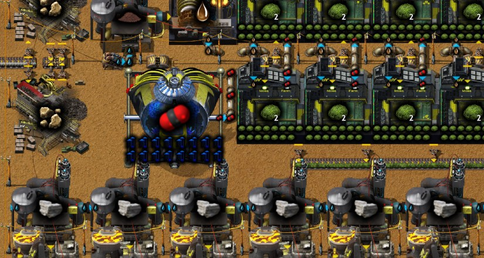
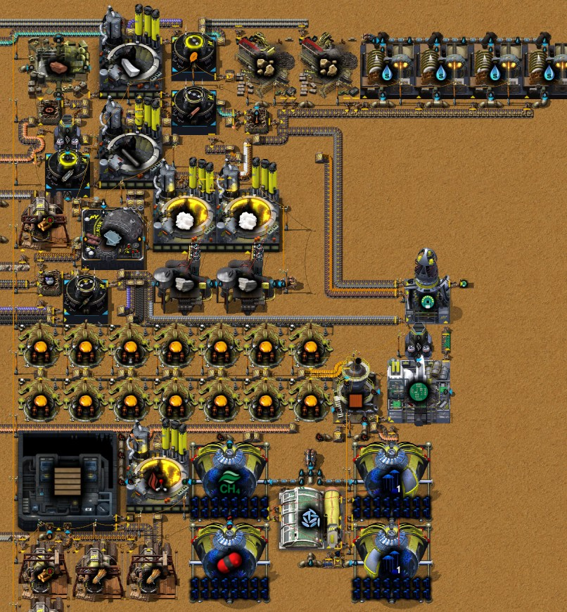
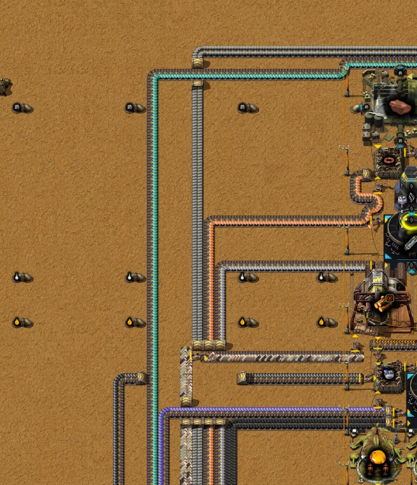
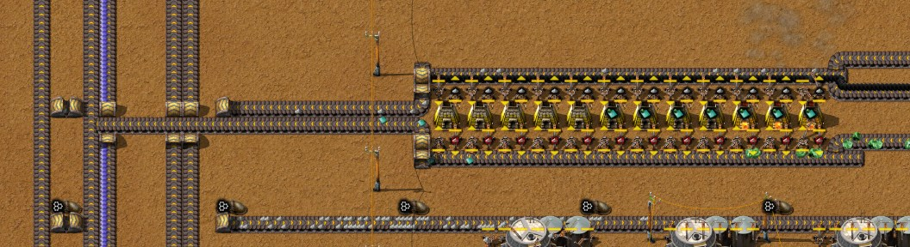
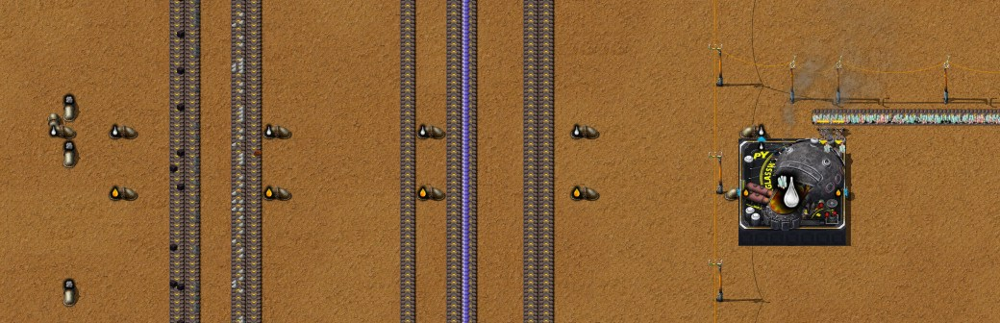
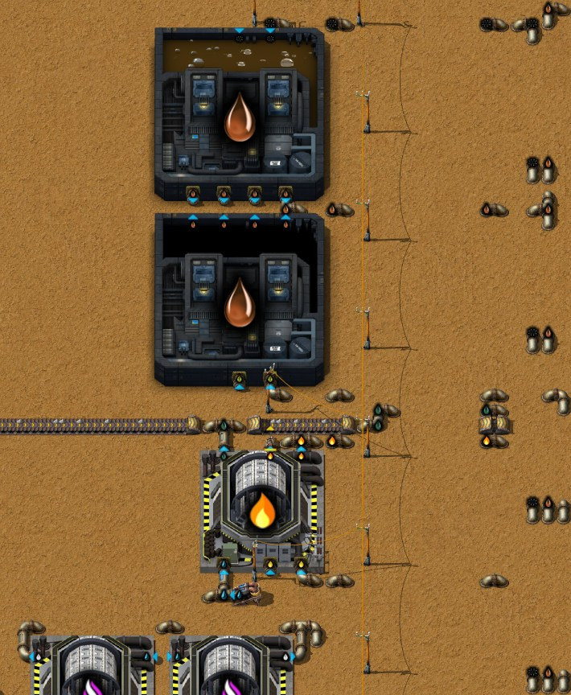

# 第六章 —— 简易电路板

[English](06-simple-circuit-boards.md) · [目录](../README.zh-CN.md) · 上一章：[第五章](05-tin-zinc-smelting.zh-CN.md)

本章接着同一局记录，从 13:28 到 16:40。原计划只做印刷电路基板1型；作者最后把整个简易电路板都做完了：在基地北边建了一个区块（蓝图 `simple-circuit-board`，标签为每秒 0.1 块），生产基板、真空管、三种小零件（陶瓷电容器、高功率电阻器、空心电感器）、焊料和铜锌电池。在它能运转之前，先要把月落草养起来：基板要塑料装饰板，塑料装饰板要甲醛，甲醛要甲烷，而甲烷来自月落草温室。围绕这个区块，作者从各冶炼排铺了一条七根带子的总线，长约 630 格；把石英矿区的玻璃工厂搬到总线旁，熔融玻璃用约 690 格管道送往北边；又把焦油线的萘油和酚油做成木榴油，供处理过的木材使用。第一批电路板出现在 16:08 存档前几分钟。作者预计这条产线撑不了多久，但还不知道哪里会先断；实测它撑了 40 分钟。随后作者用半小时整理了焦油线，从 16:40 的存档起整条链能一直运行下去，只有萘油和汽油在各自的尾矿池里累积，留给以后的科技。时间都是游戏时间。数字来自游戏数据、记录器的 10 分钟产量窗口、16:08 的存档（`tools/inspect-save.ps1`，现在还会记录每台机器的插件、速度和所在电网）和 16:40 的存档、第一次存档之后一小时按 5 分钟分段的实测（`tools/rate-probe`，现在可以输出这样的时间线）、把焦炭区块那根电线杆放回去后的同一小时、第二次存档之后的两小时，以及作者改好的乙炔区块在蓝图测试台上的结果。

结论：区块的产量由一台温室的甲烷卡在每秒 0.1 块。16:08 时，基地能让它维持约 40 分钟；然后总线上的锌板用完，电路板一停，焦油线也跟着停，因为它的木榴油没有别的用户。作者整理之后，焦油线的每种副产物都有了出路，实测三小时没有任何东西停下；铝矿采矿机还在取煤气时电路板每秒 0.1 块，存档后约两个半小时它们的矿挖完，之后是每秒 0.07 块（第 8 节）。

## 本局概览

| 游戏时间 | 发生了什么 |
|---|---|
| 13:25–13:36 | 研究：纤维素：阶段 1（13:25）、干酪根处理（13:30）、页岩油开发（13:36）。这是本章最后的研究：13:36 以后，剩下的科技都还需要 pY科技包 1，研究中心一直闲着 |
| 13:30–13:55 | 基地北边的新场地（x −65 到 −30，y −230 到 −195）：14 台树脂提取器、三台木材工坊、一台异星苗圃、一台做处理过的木材的焦油处理设施；手搓 28 个种植箱 |
| 13:40–13:55 | 海藻生长池放下又拆走，手搓四台月落草温室。13:45 留言："月落草需要一点海藻启动，后续py1再做海藻完整产线"（第 2 节） |
| 约 13:50 | 铅板石炉装满：铅矿机、乙炔区块和焦油线停下（芳烃在截至 13:50 的窗口为每秒 4.5，14:10 起为 0），与第五章在存档副本中测得的"存档后约 20 分钟"一致 |
| 14:00–14:10 | 手搓 200 个空心电感器和 80 根镀锡电线，做成四个月落草数据集，另有八个培养皿；温室和苗圃挪到最终位置（y −212 到 −203）；一台做甲醛的高压炉 |
| 14:10–14:20 | 纸浆厂 MK1（塑料装饰板）、印制电路板厂 MK1（基板）和压力泵 MK1（真空），位于 x −24 到 −13，y −228 到 −219。14:20 起有了第一批月落草 |
| 14:20–14:45 | 手铺约 630 格传送带；石英矿区的玻璃工厂搬到 (−57, 348)，石英矿用 356 格传送带运来，熔融玻璃管道沿蒸汽管向北铺设（约 210 个地下管道，14:30–14:40）。14:40 起产出熔融玻璃 |
| 14:45–15:00 | 焦油线北端（x −137）：一台把酚油做成木榴油的焦油处理设施（另有两台放下又拆走）、一台把煤气做成合成气的气化炉；拆走一个尾矿池。焦油线的焦炭现在还沿一条约 300 格的传送带送往新区块（第 4 节），这条带子装填期间焦油线重新运转（截至 14:50 和 15:00 的窗口，芳烃每秒 4.7 和 6.2） |
| 15:00–15:05 | 原木区块里，(−47, −116) 处原来做二氧化碳的高压炉位置，放了一台生产二氧化碳的月落草温室（作者 10:14 的留言，第 2 节） |
| 15:00–15:40 | 区块的电子部分：四台电子厂 MK1（真空管、高功率电阻器、空心电感器、陶瓷电容器）；做铜缆、焊料和铜锌电池的热能组装机；做陶瓷、石墨和纤维素的黏土坑与高压炉，另有两台挖石灰石的土壤挖掘机；两台颚式破碎机和四台做盐水的洗涤机；一台做玻璃的玻璃工厂 |
| 15:45–16:05 | 总线完工：又铺了约 1,700 格传送带；拆走第二个尾矿池；更多管道；射片机 MK1 放在 (−15, −232)（15:50–15:55） |
| 16:05 | 一台把萘油做成木榴油的焦油处理设施，位于 (−136, −198) |
| 16:08 | 存档：区块的箱子里有 30 块简易电路板。本章的截图在此时拍摄（`/pt-shots`） |
| 16:10–16:35 | 更多焦油精炼：第二台焦油精炼设施（16:10–16:15）、第二座沥青蒸馏塔（16:15–16:20）、第三座蒽油蒸馏塔（16:30–16:35） |
| 16:10–16:30 | 十台锅炉烧焦油线多余的焦炭，为它供蒸汽，先放在 y −75，再挪到 y −253，最后在 y −257；用第一批电路板手搓了 107 个基础分流器和三个阀门 |
| 16:20–16:40 | 蒸汽区块管道上的底流阀（16:20–16:25）；木榴油的溢流阀和渗水坑（16:25–16:30）；煤气的溢流阀和合成气的排气管（16:35–16:40） |
| 16:35–16:40 | 焦炭区块的电线杆放回去；拆掉焦油尾矿池和萘油那台设施 |
| 16:40 | 第二次存档（第 7 节） |

每秒产量（记录器的 10 分钟窗口）：

| 窗口截至 | 甲烷 | 甲醛 | 熔融玻璃 | 锌板 | 铅板 | 锡板 | 芳烃 | 乙炔 | 焦炭 | 木榴油 |
|---|---|---|---|---|---|---|---|---|---|---|
| 13:30 | 0 | 0 | 0.52 | 0.13 | 0.49 | 0 | 4.83 | 30.2 | 3.46 | 2.64 |
| 13:50 | 0 | 0 | 0 | 0.12 | 0.31 | 0 | 4.50 | 28.8 | 2.69 | 2.52 |
| 14:00 | 0 | 0 | 0 | 0.07 | 0.09 | 0 | 0.92 | 5.50 | 0.55 | 0.52 |
| 14:10 到 14:40 | 0 | 0 | 0 到 0.63 | 0 到 0.01 | 0.01 | 0 | 0 | 0 | 0 | 0 |
| 14:50 | 2.33 | 1.92 | 2.00 | 0.03 | 0 | 0.35 | 4.67 | 0 | 2.81 | 2.64 |
| 15:00 | 2.60 | 1.58 | 2.00 | 0.15 | 0.01 | 0.71 | 6.17 | 0 | 3.67 | 15.3 |
| 15:10 | 0 | 0 | 2.00 | 0.11 | 0 | 0.73 | 0.42 | 0 | 0.27 | 3.66 |
| 15:20 到 15:50 | 0 | 0 到 0.58 | 2.00 | 0 到 0.01 | 0 | 0.73 | 0 到 1.25 | 0 | 0 到 0.76 | 0 到 1.14 |
| 16:00 | 1.07 | 0.83 | 2.00 | 0.09 | 0.68 | 0.67 | 5.33 | 27.3 | 3.16 | 4.79 |
| 16:10 | 4.00 | 3.33 | 2.00 | 0.15 | 0.51 | 0.34 | 6.17 | 29.8 | 3.68 | 10.3 |
| 16:20 | 4.00 | 3.33 | 2.00 | 0.15 | 0.51 | 0.37 | 7.25 | 30.0 | 4.33 | 22.2 |
| 16:30 | 4.00 | 3.33 | 2.00 | 0.19 | 0.51 | 0.40 | 7.25 | 30.5 | 4.23 | 12.3 |
| 16:40 | 4.00 | 3.33 | 2.00 | 0.23 | 0.50 | 0.38 | 10.5 | 29.5 | 7.06 | 10.4 |

结合时间线来看：

- **焦油线约在 13:50 停下，停了一个小时。** 铅板石炉装满了，第五章在存档副本里已经测到；铅板还没有用户时，这是正常的（研究笔记，原则 23）。14:45 到 15:05，通往区块的新焦炭带装填期间它又跑了一阵（存档时带上有 2,700 个焦炭）；16:00 起焊料开始消耗铅板，它才重新运转。
- **甲烷分两次出现：** 甲烷温室先灌满了新的甲醛高压炉和管道（14:50、15:00），然后等纸浆厂开始取甲醛（15:50 起）。
- **熔融玻璃从 14:40 到存档一直是每秒 2.00：** 一台玻璃工厂不停地熔化石英矿，灌满向北约 690 格的管道（存档时管道里有 7,452 熔融玻璃）。
- **锡板从 14:50 起每秒 0.73：** 锡矿冶炼排的箱子早已满了（第五章）；有了总线，锡板开始北运，存档时总线上有 3,061 块锡板。
- 截至 16:00 的窗口里，记录器没有简易电路板：电路板是在存档前最后八分钟做出来的（箱子里 30 块）。从 16:20 起各窗口都是每秒 0.12 块，甲烷温室满负荷每秒 4。
- **整理的效果从 16:30 开始显现：** 截至 16:40 的窗口里，芳烃每秒 7.25 → 10.5，焦炭 4.2 → 7.1，来自第二台精炼设施和焦炭区块的焦油（这个窗口每秒产 23.6 焦油）。

## 1. 这一阶段的科技

电路板用到的每个配方都已在第五章研究完毕；本章不需要新科技。

| 科技 | 花费 | 研究时间 | 解锁了本章用到的什么 |
|---|---|---|---|
| 电子学：阶段 1 | 65 红瓶 | 10:27–10:33 | 简易电路板、印刷电路基板1型、塑料装饰板、甲醛、真空管、石墨、陶瓷电容器、高功率电阻器、铜锌电池、纤维素、盐水、锌板；射片机、印制电路板厂和纸浆厂 MK1 |
| 陶瓷制品 | 60 红瓶 | 10:12–10:17 | 黏土、陶瓷、空心电感器；黏土坑和电子厂 MK1 |
| 流体增压 | 60 红瓶 | 10:17–10:22 | 真空；压力泵 MK1 |
| 树脂：阶段 1 | 60 红瓶 | 10:22–10:27 | 树脂提取器 MK1、树脂、橡树种子、橡树 |
| 培养皿 | 60 红瓶 | 9:56–10:01 | 琼脂（用海藻做）、培养皿、空培养皿 |
| 月落草 | 60 红瓶 | 10:01–10:06 | 月落草温室 MK1、甲烷、月落草（用数据集做）、月落草数据集、月落草种子、月落草 |
| 月落草升级 | 65 红瓶 | 10:06–10:12 | 作者选了"碳捕集"：温室速度 +50%、耗电翻倍，并能凭空产出二氧化碳 |
| 木榴油 | 60 红瓶 | 9:36–9:41 | 处理过的木材；用酚油、萘油做木榴油 |
| 焊料：阶段 1 | 60 红瓶 | 9:46–9:51 | 铅板、焊料 |
| 氢化和基本重整 | 65 红瓶 | 11:14–11:19 | 煤气制合成气 |

本章开头研究的三项还没有用上：纤维素：阶段 1（用木材和氢氧化钠做纤维素）、干酪根处理（干馏釜；它的干酪根要靠一项尚未研究的科技来开采）、页岩油开发（用页岩油做凝析油、烯烃处理站、转化炉）。13:36 以后六台研究中心一直闲着：剩下还没研究的科技（共 18 项，数据）除了红瓶都还需要 pY科技包 1，而作者还没有生产 pY科技包 1。

## 2. 月落草：为了基板要的甲烷

月落草是从基板这里牵出来的（数据）：

- 印刷电路基板1型，印制电路板厂：2 塑料装饰板 + 5 铜板 + 50 真空 → 1，5 秒。
- 塑料装饰板，纸浆厂：2 处理过的木材 + 5 粗纤维 + 10 树脂 + 50 甲醛 → 1，10 秒。
- 甲醛，高压炉：60 甲烷 + 5 铜板 → 50，4 秒。
- 甲烷，月落草温室：100 水 + 100 二氧化碳 + 1 月落草种子 → 40，15 秒。按作者已有的科技，这是唯一的甲烷配方：其他甲烷配方要么需要尚未研究的科技，要么需要月落草升级的另一个选项"月光"。

**第一批月落草从哪来。** 温室（速度 0.0625）的基础效果是速度 −100%，插件槽只能插月落草，每个 +100%：没有升级时空着什么也不做，插满 16 个时速度为 1（数据）。作者选的"碳捕集"会给每台温室配一个隐藏插件塔，里面是速度 +800%（能耗 +200%）的插件（pyalienlife 的 T.U.R.D. 脚本和数据），所以空温室也有速度 0.5，插满时为 1.5，存档里读到的正是 1.5。第一批月落草来自异星苗圃里用数据集做月落草的配方：1 月落草数据集 + 2 培养皿 + 1 种植箱 + 1,000 水 → 4 月落草，200 秒。数据集手搓，用 2 玻璃、50 空心电感器和 20 镀锡电线；培养皿由一个空培养皿（第五章石英矿区的玻璃工厂做过）和一个琼脂合成，琼脂在高压炉里用 5 海藻 + 100 蒸汽做成。这就是作者 13:45 的留言："月落草需要一点海藻启动，后续py1再做海藻完整产线"。海藻生长池从 13:40 放到 13:55；14:00–14:10 作者手搓了 200 个空心电感器和 80 根镀锡电线、四个数据集和八个培养皿：够做四次，16 个月落草。

**月落草自己繁殖。** 月落草种子，苗圃，5 秒：5 月落草 → 返还 2 月落草（另有 10% 概率多出 1 到 3 个）+ 7 种子（另有 25% 概率多出 1 到 3 个）；平均 2.8 个月落草变成 7.5 个种子。月落草，温室，140 秒：4 种子 + 100 水 → 4 月落草。第一批月落草约在 14:20 做出（记录器）；到存档时，作者的五台温室共插着 80 个。区块里两台温室种月落草、一台苗圃做种子；速度 1.5 时两台每秒共产 0.086 个月落草，苗圃把它们变成每秒 0.23 个种子，比两台温室取回的多 0.14 个。甲烷温室每秒用 0.1 个种子。存档后一小时实测：种子每秒产 0.165、用 0.164，两台月落草温室有 75% 的时间在工作：这个循环能自己维持。

**第四台温室生产二氧化碳**（碳捕集：每 5 秒凭空产出 200，速度 1.5 时每秒 60），供甲烷温室使用，后者每秒要 10。第五台在原木区块的 (−47, −116)，也做二氧化碳，原来那里是一台烧焦炭、给速成林场供二氧化碳的高压炉：这就是作者 10:14 留言里说的替换，"之前产二氧化碳的高压炉可原地替换为温室，但是要先产出月落草作为插件"。第五章按每台温室每秒 40 二氧化碳算；有了升级是 60。

## 3. 区块

蓝图 `simple-circuit-board`（"0.1[item=electronic-circuit]"，578 个实体，在存档中位于 x −60 到 −2，y −264 到 −202）。简易电路板（射片机）：1 基板 + 3 真空管 + 3 空心电感器 + 5 陶瓷电容器 + 6 高功率电阻器 + 2 焊料 + 1 铜锌电池 → 3，4 秒。区块里每台机器，以及每秒 0.1 块电路板对它的要求（数据；每台机器的速度读自存档：都是 1，温室 1.5，树脂提取器插两棵橡树后为 1）：

| 部件 | 配方 | 机器 | 每秒 0.1 块所需 | 忙碌 |
|---|---|---|---|---|
| 简易电路板 | 见上 | 1 台射片机 | 每秒 0.1 | 13% |
| 印刷电路基板1型 | 2 塑料装饰板 + 5 铜板 + 50 真空 → 1，5 秒 | 1 台印制电路板厂 | 每秒 0.033 | 17% |
| 塑料装饰板 | 2 处理过的木材 + 5 粗纤维 + 10 树脂 + 50 甲醛 → 1，10 秒 | 1 台纸浆厂 | 每秒 0.067 | 67% |
| 甲醛 | 60 甲烷 + 5 铜板 → 50，4 秒 | 1 台高压炉 | 每秒 3.33 | 27% |
| 甲烷 | 100 水 + 100 二氧化碳 + 1 种子 → 40，15 秒 | 1 台温室 | 每秒 4.0 | **100%** |
| 二氧化碳 | → 200，5 秒 | 1 台温室 | 每秒 10 | 17% |
| 树脂 | → 4，80 秒 | 14 台树脂提取器 | 每秒 0.67 | 95% |
| 粗纤维 | 10 木材 → 2，10 秒 | 2 台木材工坊 | 每秒 0.33 | 83% |
| 处理过的木材 | 100 木榴油 + 1 木材 → 2，2 秒 | 1 台焦油处理设施 | 每秒 0.13 | 13% |
| 真空 | → 200，2 秒 | 2 台压力泵 | 每秒 4.2 | 2% |
| 真空管 | 5 铁板 + 2 铜板 + 2 石墨 + 50 真空 + 2 玻璃 → 2，7 秒 | 1 台电子厂 | 每秒 0.1 | 35% |
| 石墨 | 5 焦炭 → 2，3 秒 | 1 台高压炉 | 每秒 0.1 | 15% |
| 玻璃 | 50 熔融玻璃 → 5，3 秒 | 1 台玻璃工厂 | 每秒 0.17 | 10% |
| 高功率电阻器 | 1 锡板 + 2 焦炭 + 1 玻璃 → 3，5 秒 | 1 台电子厂 | 每秒 0.2 | 33% |
| 陶瓷电容器 | 1 陶瓷 + 2 锡板 → 3，5 秒 | 1 台电子厂 | 每秒 0.17 | 28% |
| 空心电感器 | 2 陶瓷 + 20 铜缆 → 5，5 秒 | 1 台电子厂 | 每秒 0.1 | 10% |
| 铜缆 | 1 铜板 → 2，0.5 秒 | 1 台热能组装机 | 每秒 0.4 | 10% |
| 陶瓷 | 10 黏土 + 1 焦炭 → 5，5 秒 | 1 台高压炉 | 每秒 0.096 | 10% |
| 黏土 | 100 蒸汽 → 3，4 秒 | 1 台黏土坑 | 每秒 0.19 | 25% |
| 焊料 | 2 锡板 + 4 铅板 → 1，6 秒 | 1 台热能组装机 | 每秒 0.067 | 40% |
| 铜锌电池 | 10 铜板 + 10 锌板 + 5 纤维素 + 250 盐水 → 1，10 秒 | 1 台热能组装机 | 每秒 0.033 | 33% |
| 纤维素 | 7 木材 + 4 石灰石 → 1，10 秒 | 2 台高压炉 | 每秒 0.17 | 83% |
| 石灰石 | 400 水 → 8，20 秒 | 2 台土壤挖掘机 | 每秒 0.67 | 83% |
| 盐水 | 10 石矿 + 100 水 → 50，20 秒 | 4 台洗涤机 | 每秒 8.3 | 83% |
| 石矿 | 4 石砖 → 8，5 秒 | 2 台颚式破碎机 | 每秒 1.67 | 52% |
| 木材 | 4 原木 → 40，1 秒 | 2 台木材工坊 | 每秒 2.9 | 4% |
| 月落草、种子 | 见上 | 2 台温室、1 台苗圃 | 每秒 0.1 个种子 | 70% |

**标签上的 0.1 就是那台甲烷温室。** 一台速度 1.5 的温室每 10 秒产 40 甲烷，即每秒 4：对应 3.33 甲醛、0.067 塑料装饰板、0.033 基板、0.1 块电路板。其余机器都有富余；其次是树脂提取器，95%。存档实测：这台温室一小时内 100% 在工作，甲烷每秒 4.000。

**区块从外面取什么（每秒 0.1 块时，按上表计算）：** 铜板 1.13（甲醛 0.33、电池 0.33、铜缆 0.2、基板 0.17、真空管 0.1）、铁板 0.25、锡板 0.31、铅板 0.27、锌板 0.33、焦炭 0.40、石砖 0.83、原木 0.29、熔融玻璃 1.67、木榴油 6.7、蒸汽 6.4（黏土坑），以及区块自己那台玻璃工厂的汽油 0.8（10 MW 的 10%；汽油 1.2 MJ）。水来自区块里的三台抽取泵。

**电路板进箱子**（存档时 30 块）：现在还没有东西用它。

## 4. 总线和管道

区块的原料都从西边来（读自存档）：

- **总线**：七根传送带并排在 x −82 到 −73，向北通到区块。铅板（x −82）在 y −69 从铅冶炼排并入；锌板（x −79）在 y 199 从锌冶炼排（12 台石炉，第五章）并入；锡板（x −78）来自 y 528 的锡冶炼排；铜板（x −74）在 y 17 并入；铁板（x −73）在 y −18 和 −3 从碎矿炼铁区块并入；石砖（x −75）在 y −23 和 −8 并入；原木（x −76）在 y −148 从原木区块并入。四根板材带都从约 y 365 开始，就在第三章烟煤分离旁边，那里已经有几根空的短带接进来；从那里到区块约 630 格，锡板带 790 格。
- **焦炭**：一条约 300 格的传送带，从焦油线的蒸馏塔（x −179）向南到 y −78，向东到 x −72，再向北到区块。存档时带上有 2,700 个焦炭。
- **熔融玻璃**：来自 (−57, 348) 的玻璃工厂，它熔化的石英矿由 356 格传送带从 x 292–301 的两台晶体矿石采矿机运来；约 690 格管道沿蒸汽管向北，被 y 179.5 和 −74.5 两处止回阀分成三段（存档时其中有 7,452 熔融玻璃）。
- **汽油**，供两台玻璃工厂：来自焦油线和它的汽油尾矿池（x −139，y 3），经 (−111.5, −135.5) 的止回阀向北到区块，经 (−111.5, 179.5) 的止回阀向南到熔化用的玻璃工厂。
- **蒸汽**，供黏土坑：来自第五章的蒸汽管，在 (−103.5, −74.5) 新加了一个止回阀。
- **木榴油**：同一个管道段（57 节管道，x −136 到 −58）连着焦油精炼设施的木榴油出口、两台新的木榴油设施 (−137, −187)（酚油）和 (−137, −199)（萘油，来自它的尾矿池，存档时 41,499），以及区块里做处理过的木材的那台设施——唯一的用户（16:08 时；后来的改动见第 7 节）。

## 5. 16:08 存档后的一小时

作者预计这条产线撑不了多久的每秒 0.1 块。在 16:08 存档的副本中实测（`tools/rate-probe`，先预热一分钟，再测一小时，按 5 分钟分段；每秒数值，为各段平均）：

| 存档后分钟 | 电路板 | 锌板 产/用 | 铅板 | 焦油消耗 | 焦炭 | 木榴油 产/用 | 芳烃 | 汽油消耗 | 熔融玻璃 | 这一段发生了什么 |
|---|---|---|---|---|---|---|---|---|---|---|
| 0–5 | 0.120 | 0.15 / 0.40 | 0.51 | 14.3 | 3.70 | 20.6 / 20.7 | 6.17 | 10.2 | 2.00 | 木榴油管道在灌装 |
| 5–10 | 0.120 | 0.15 / 0.40 | 0.51 | 14.3 | 3.67 | 20.6 / 8.7 | 6.17 | 10.1 | 2.00 | 做处理过的木材那台设施的木榴油箱满了（400） |
| 10–15 | 0.120 | 0.17 / 0.40 | 0.51 | 11.7 | 3.50 | 16.8 / 7.0 | 5.83 | 9.3 | 2.00 | 焦油精炼设施停在"输出已满"，输出箱里是木榴油 |
| 15–20 | 0.120 | 0.15 / 0.40 | 0.51 | 4.3 | 2.28 | 5.9 / 6.0 | 3.67 | 9.3 | 2.00 | 萘油那台也停在"输出已满" |
| 20–25 | 0.120 | 0.11 / 0.40 | 0.51 | 5.3 | 1.35 | 7.1 / 7.0 | 2.33 | 9.3 | 2.00 | 碳化钙高压炉等焦炭 |
| 25–30 | 0.120 | 0.05 / 0.40 | 0.51 | 5.0 | 1.30 | 6.8 / 7.0 | 2.00 | 7.5 | 1.53 | 气化炉等碳化钙：乙炔从 30 降到 15 |
| 30–35 | 0.120 | 0.07 / 0.40 | 0.50 | 4.7 | 1.20 | 6.2 / 6.0 | 2.00 | 3.1 | 0.53 | 熔化用的玻璃工厂没有汽油了 |
| 35–40 | 0.110 | 0.04 / 0.40 | 0.23 | 5.0 | 1.28 | 6.9 / 7.0 | 2.33 | 3.5 | 0.63 | 铅矿采矿机等乙炔 |
| 40–45 | 0.040 | 0.07 / 0.07 | 0.24 | 5.3 | 1.35 | 7.1 / 7.0 | 2.33 | 3.6 | 0.77 | **铜锌电池那台机器等锌板** |
| 45–50 | 0.010 | 0.05 / 0.07 | 0.23 | 3.7 | 0.97 | 4.9 / 5.0 | 1.50 | 2.5 | 0.57 | |
| 50–55 | 0.020 | 0.04 / 0.03 | 0.15 | 1.3 | 0.33 | 1.9 / 2.0 | 0.50 | 0.9 | 0.20 | 印制电路板厂和纸浆厂满了停下 |
| 55–60 | 0.010 | 0.03 / 0.03 | 0.03 | 0 | 0 | 0 / 0 | 0 | 0 | 0 | 焦油线停下，箱里还有焦油 |

整小时平均每秒 0.086 块。从链条底部往上读：

- **区块本身能维持每秒 0.1 块，存货还在时还能多一点。** 前 35 分钟它每秒做 0.120 块：温室每秒 0.033 个基板对应 0.1 块，多出来的来自带子上存着的基板和零件。甲烷温室整小时都在工作。
- **最先用完的是锌板。** 存档时总线和区块里共有 724 块锌板；区块每秒用 0.40，锌冶炼排最多每秒产 0.15。到第 40 分钟总线空了，做电池的机器开始等待，电路板跌到锌板能支撑的量：每秒 0.01 到 0.04。
- **焦油线在第 15 分钟变慢，第 55 分钟停下。** 它的木榴油只有一个用户——做处理过的木材的那台设施，却有三个来源接在同一根管道上：焦油精炼设施（每 100 焦油 24 个），以及把酚油和尾矿池里的萘油做成木榴油的两台新设施。管道一满，焦油精炼设施就带着输出箱里的木榴油停下（每 5 分钟读一次：76 到 92，放不下下一份 24），只能跟着处理过的木材的速度走：每秒 4 到 5 个焦油，而不是 14。随之下降的有芳烃（6.2 → 2.0，也就是锌）、焦炭（3.7 → 1.3，也就是乙炔和铅）以及汽油。电路板一停，塑料装饰板停，处理过的木材停，木榴油管道失去最后一个用户，焦油线就完全停了。
- **这个停顿不会自己解开：** 电路板等锌，锌等芳烃，芳烃等焦油线，焦油线等电路板重新消耗木榴油。
- **接下来就轮到玻璃。** 熔化用的玻璃工厂烧汽油（10 MW，满负荷时每秒 8.3 汽油）；焦油线慢下来以后，汽油尾矿池的 4,534 撑了约半小时。管道里约 7,500 熔融玻璃让区块在电路板运转期间一直有玻璃。
- 焦油尾矿池本身不是限制：存档时 26,381 焦油，这一小时用了约 23,000。

**把焦炭区块的电线杆放回去**（作者在 13:28 拔掉它，想先用完尾矿池里的焦油；同样一小时，读档时在 (−55.5, −92.5) 放一根小型电线杆）：焦炭区块每秒产 6.1 到 6.6 焦油，尾矿池重新开始积累，但电路板走的是同一条路（前 35 分钟 0.120，然后 0.110、0.040、0.010）。它的煤气给三台铝矿采矿机（每秒约 10，铝矿每秒 1.16；它们下面还剩 8,200 矿，约两小时）。新的煤气制合成气气化炉整小时停在"输出已满"：它的合成气管道止于 (−108.5, −176.5)，合成气还没有出路。

## 6. 电路板对焦油线的要求

从这里起，作者的原则（研究笔记，原则 23）开始适用：电路板是主产物，它的产线已经搭好，所以整条链必须能一直运行，不能被任何副产物堵住，每种需要稳定生产的产物也不应挂在别的产物上。每秒 0.1 块电路板对焦油线的要求，按数据计算（作者的焦油线每 100 焦油产 43 芳烃、25.7 焦炭、68 汽油和 24 木榴油，另有 58 萘油和 15 酚油，两台新设施再把它们做成 35 和 15 个木榴油）：

| 用途 | 每秒所需 | 每秒焦油 |
|---|---|---|
| 锌板 0.33（铜锌电池） | 13.3 芳烃（每个矿 4，每块板 10 个矿） | **31** |
| 玻璃用的汽油，熔融玻璃 1.67 | 约 7.8 汽油（熔化 83%、浇铸 10%，各 10 MW） | 11.5 |
| 铅板 0.27 和区块的焦炭 | 1.9 焦炭（每个铅矿 0.94，区块 0.40） | 7.4 |
| 处理过的木材 0.13 | 6.7 木榴油 | 仅靠精炼需 28 |

- **锌决定焦油的量：每秒 31。** 而一台焦油精炼设施最多每秒处理 20（5 秒 100 个焦油），一座沥青蒸馏塔每秒处理 20 沥青，而 31 焦油会产出 43 沥青。木榴油灌满之前，作者的焦油线每秒跑 14.3 焦油：6.2 芳烃、0.15 锌板，只够每秒 0.046 块电路板。前 40 分钟的 0.12 靠的是锌板存货。
- **在每秒 31 焦油时，其余全是富余：** 焦炭 8（用 1.9）、汽油 21（用 7.8）、仅精炼就有木榴油 7.4（用 6.7），加上萘油和酚油两台设施还更多。每一种富余都要有出路，否则就会像木榴油这样把产线堵住。
- **铅和锌是耦合的**，正如作者在第五章之后所说：两者都挂在焦油线上，锌靠它的芳烃，铅靠它的焦炭。16:08 时焦油线的速度取决于它最慢的出路——木榴油，而这个速度又由电路板自己决定。第 7 节是作者怎样给每种副产物开出路，第 8 节是之后焦油线能给多少。

数据里现成可用的东西，供作者参考（现在都能用）：木榴油目前唯一的用途是处理过的木材，但尾矿池可以储存它，渗水坑可以把它排掉（"Void 木榴油"，每次 20,000）；焦油处理里还有一个破坏性蒸馏塔配方，以主产物命名为"二氧化碳"，能直接从焦油得到芳烃：350 焦油 → 100 芳烃 + 500 废气 + 100 二氧化碳 + 1 富泥土，2.5 秒，副产物是气体和一种物品。

## 7. 作者的整理，16:10–16:40

看过第 5 节的测量后，作者用半小时改造了焦油线（记录器；16:40 的存档）：

- **更多焦油精炼。** 第二台焦油精炼设施在 (−147.5, −85.5)（16:10–16:15），第二座沥青蒸馏塔在 (−146, −127)（16:15–16:20），第三座蒽油蒸馏塔在 (−157, −139)（16:30–16:35）：两台精炼设施每秒最多处理 40 焦油（数据：每台 5 秒 100 个）。
- **焦炭区块重新开工。** (−55.5, −92.5) 的电线杆放回去了（16:35–16:40）；区块的焦油直接送往精炼设施，(−10, −72) 的焦油尾矿池连同其中的焦油一起拆掉（16:35–16:40）。区块的焦炭在 (−72, −83) 并入通往电路板区块的焦炭带。
- **烧焦炭给焦油线供蒸汽。** 焦炭带现在经过电路板区块后继续沿 y −255 向西，通到 y −257 的十台锅炉（x −160 到 −133；先放在 y −75，又挪了两次，16:10–16:30）。它们的蒸汽进入同一根管道，供两台精炼设施、顶层精炼设施、两座沥青蒸馏塔和黏土坑。铅和区块用不完的焦炭在这里烧掉，再也堵不住蒸馏塔。蒸汽区块的管道上加了一个底流阀，位于 (−60.5, 110.5)（16:20–16:25），它只在出口一侧低于 80% 时放行蒸汽（数据）。
- **给煤气和木榴油开出路**，用的是溢流阀：只在入口一侧高于 80% 时放行（数据）：
  - 煤气：铝矿采矿机优先使用；越过 (−129.5, −168.5) 的溢流阀后，剩下的进气化炉（煤气制合成气），合成气现在通到 (−108.5, −176.5) 的排气管（16:35–16:40），焦油并入精炼设施的焦油管。
  - 木榴油：做处理过的木材那台设施的管道满了以后，越过 (−116.5, −91.5) 的溢流阀，进入 (−116.5, −89.5) 的渗水坑（16:25–16:30）。"Void 木榴油"每次要 20,000（数据），所以渗水坑是攒满一批再排掉。
  - 萘油那台设施又拆掉了（16:35–16:40）。萘油和汽油进各自的尾矿池：这是作者的选择，以后解锁更多科技时两者应该都有用。
- **第一批电路板的第一个用途。** 溢流阀和底流阀各要一块简易电路板（数据；流体处理），基础分流器也要一块：作者手搓了这三个阀门和 107 个分流器（110 块电路板；到 16:40 放下了三个分流器）。到存档时共做了 261 块电路板，箱子里有 146 块。

## 8. 16:40 存档后的两小时

在 16:40 存档的副本中实测（`tools/rate-probe`，先预热一分钟，再测两小时，按 10 分钟分段；每秒数值，为各段平均；尾矿池为每段结束时的存量）：

| 16:40 后分钟 | 电路板 | 电池 | 锌板 产/用 | 铝矿 | 煤气 | 焦油 | 芳烃 | 焦炭 | 木榴油 产/给处理过的木材 | 萘油尾矿池 | 汽油尾矿池 |
|---|---|---|---|---|---|---|---|---|---|---|---|
| 0–10 | 0.110 | 0.040 | 0.32 / 0.40 | 1.56 | 32.0 | 30.0 | 12.4 | 8.41 | 11.3 / 6.5 | 49,831 | 18,252 |
| 10–20 | 0.100 | 0.040 | 0.30 / 0.40 | 1.08 | 26.8 | 26.7 | 12.3 | 8.00 | 11.2 / 7.0 | 59,792 | 24,338 |
| 20–40 | 0.100 | 0.040 | 0.31 / 0.40 | 1.04 | 26.6 | 26.7 | 12.3 | 8.01 | 11.2 / 6.5 | 79,615 | 36,533 |
| 40–60 | 0.100 | 0.031 | 0.31 / 0.31 | 1.05 | 26.7 | 26.7 | 12.1 | 7.93 | 10.7 / 6.8 | 99,039 | 48,250 |
| 60–80 | 0.100 | 0.031 | 0.31 / 0.31 | 1.05 | 26.7 | 26.7 | 12.0 | 7.89 | 10.5 / 6.8 | 118,165 | 59,732 |
| 80–100 | 0.100 | 0.030 | 0.29 / 0.30 | 1.04 | 27.0 | 26.9 | 11.5 | 7.59 | 10.4 / 6.5 | 136,772 | 70,505 |
| 100–110 | 0.100 | 0.028 | 0.30 / 0.28 | 0.69 | 23.7 | 24.8 | 10.8 | 7.04 | 9.7 / 7.0 | 145,458 | 75,218 |
| 110–120 | **0.090** | 0.028 | 0.25 / 0.28 | 0.53 | 21.9 | 23.7 | 10.3 | 6.60 | 9.3 / 6.5 | 153,686 | 79,334 |
| 150–180（第二次运行） | 0.070 | 0.023 | 0.22 / 0.23 | 0.04 | 16.7 | 20.4 | 8.75 | 5.64 | 8.0 / 4.6 | 198,192 | 99,930 |

（20 分钟的行是两段的平均。）

- **没有任何东西停下。** 焦油线的每种副产物都有去处：焦炭产多少用多少（铅和区块用剩的由锅炉烧掉）；木榴油每秒 6.5 到 7 个给处理过的木材，其余进渗水坑，渗水坑在第 50 到 60 分钟之间排掉了第一批 20,000（箱内 19,556 → 1,750）；合成气（每秒 23.3）进排气管；铅板产多少用多少（第 50 分钟起每秒 0.27）。甲烷温室两小时一直在工作。
- **萘油和汽油按作者的打算累积**：两小时平均每秒约 16 和 9.4。一个尾矿池装 1,000,000（数据）：照这个速度，萘油尾矿池约 15 小时后满，汽油尾矿池要一天以上。
- **电路板：前 110 分钟每秒 0.100 块，最后十分钟 0.090。** 决定产量的又是锌，不过这次是稳定的：焦油线来多少焦炭区块的焦油就处理多少，每秒 26 到 27（两台精炼设施合计最多 40），每秒 12 个芳烃对应 0.30 块锌板、0.030 个电池、0.09 块电路板。前 110 分钟的 0.1 还用到了存档时存着的 328 块锌板和 995 个锌矿，以及前 40 分钟用它们做出的电池。
- **焦油随煤气而来，而煤气的一个用户正在耗尽。** 焦炭区块的煤气被取走多少，它才产多少焦油：先给铝矿采矿机，越过溢流阀后给气化炉，后者最多每秒 16.7（每 3 秒 50 个，数据）。16:40 时三台铝矿采矿机下面分别还有 341、3,124 和 4,354 个铝矿，每台每秒采 0.5：第一台不到十分钟就停了，第二台约在第 100 分钟。煤气从每秒 27 降到 22，焦油从 27 降到 24，芳烃降到 10.3，电路板降到 0.090。
- **铝矿挖完以后**（第二次运行：存档后 2.5 小时起测半小时），气化炉成了煤气唯一的出路，每秒 16.7。焦炭区块随之每秒产约 10 个焦油，气化炉再产 10 个（每 50 煤气 30 个焦油，数据）：合计 20.4，芳烃 8.75，锌板 0.22，电路板稳定在每秒 0.07 块。其余都没变：每种副产物照样有去处，两个尾矿池照样在涨（萘油每秒 11.8，汽油 5.0）。
- 总之：产线现在能一直运行下去，和作者预想的一样。它的产量跟着焦油走，而焦油取决于焦炭区块的煤气能交出去多少：16:40 时铝矿采矿机加一台气化炉每秒取走 27（电路板 0.1），铝矿挖完后只剩一台气化炉的 16.7（电路板 0.07）。

## 9. 其他变化

- **乙炔区块改好了。** 作者挪走了焦炭带末端的电线杆，在那里补了一格传送带，也就是第五章建议的做法。2026-10-14 导出后重新上测试台：每秒 49.75 个乙炔，四台气化炉全部 100%（之前 43.2）。
- **尾矿池。** 木榴油和酚油两个尾矿池在 14:45–14:50 和 15:50–15:55 被拆走（记录器没有说哪个在先），焦油尾矿池在 16:35–16:40 被拆走。剩下两个：萘油（16:40 时 38,694）和汽油（10,781）。

## 10. 检查清单

- 用一点海藻启动月落草：琼脂 → 培养皿，加上月落草数据集和种植箱，在苗圃里得到 4 个月落草；再用种子和温室繁殖。温室要插 16 个月落草才有速度 1（选了碳捕集时：空着 0.5，插满 1.5）。
- 区块的标签按最紧的那台机器定：一台甲烷温室就是每秒 0.1 块电路板。
- 存货换来的是时间，不是产能：724 块锌板换来 40 分钟的每秒 0.12 块，之后电路板就跌到焦油线产锌的水平。
- 只有一个用户的副产物，会让它的产线按那个用户的速度走；如果那个用户又依赖这条产线，停下来就不会自己恢复（木榴油 → 处理过的木材 → 电路板 → 锌 → 焦油线）。
- 在主产物依赖这条产线之前，先给每种副产物开好出路，并放在溢流阀后面，让真正的用户优先：以后的科技会用到的进尾矿池，其余的进渗水坑或排气管，多余的焦炭进锅炉（蒸汽再送回产线）。
- 主产物的产线搭好之后，先把整个基地跑上一两个小时再算完工（`tools/rate-probe` 加时间线），并留意会耗尽的出路：这里是铝矿采矿机下面的矿，它们是决定焦油产量的煤气的两个去处之一。

## 11. 这些事实是怎么核实的

- 过程：伴生模组的记录器（运行 `2652821414-0`），用 `tools/recorder-phases.js`（5 分钟分段的时间线、留言、在哪里建了什么、手搓了什么）和 `tools/recorder-log.js`（每 10 分钟窗口的产量）读取。
- 16:08 和 16:40 的存档（`Py-Exploration`，一致性检查通过）：`tools/inspect-save.ps1 -Ticks 3700`，现在还会记录每台制造机的插件、速度，以及每个实体所在的电网；`tools/summarize-save.js`；`tools/trace-layout.js`（总线各条带子及其汇入点、管道段以及哪些机器共用一段：木榴油那一段）；`tools/render-area.js` 和 `tools/render-save-map.js`；带上的锌板、焦炭、锡板和尾矿池里的存量取自快照的 `entities.json`。
- **基地的一小时：** `tools/save-probe.ps1 -Save Py-Exploration -Probe rate-probe -Ticks 219700 -Variant 60,3600,300,<名称>`：`tools/rate-probe` 现在可以指定分段长度和一份物品、流体和机器位置（`@x:y`）的清单，每段输出每样东西的产量和消耗、所观察机器的状态和流体箱内容，以及常态发生变化的每组机器。先只测产量，再加上每段读取焦油精炼设施、两台木榴油设施和熔化用的玻璃工厂（两次数字相同），另跑一次带 `+small-electric-pole@-55.5:-92.5`（读档时放下这根电线杆：探针对基地只做这一处改动）。在 16:40 的存档上：`-Ticks 435700 -Variant 60,7200,600,<名称>`（两小时，每段读取焦油精炼设施、尾矿池、渗水坑、一台烧焦炭的锅炉和熔化用的玻璃工厂；`@x:y` 现在可以读任何带流体箱的实体）和 `-Ticks 648100 -Variant 9000,1800,600,<名称>`（存档后 2.5 小时起的半小时）。
- **乙炔区块上测试台：** 用导出的蓝图跑 `tools/bp-bench.ps1 -Bench acetylene`。电路板区块没有上测试台：温室的速度和它的二氧化碳配方来自存档里选定的月落草升级，空白的测试地图没有这个选择；所以改为在原地实测。
- 数据：作者当前模组的数据导出（`C:\tmp\cf-save\data\script-output\data-raw-dump.json`）：配方、机器速度、基础效果和插件槽、玻璃工厂的能耗、汽油的燃料值、哪项科技解锁什么，以及其他甲烷、芳烃和木榴油配方；碳捕集取自 pyalienlife 的 `prototypes/upgrades/moondrop.lua`。
- 蓝图：作者于 2026-10-14 15:00 用伴生模组导出，拉取到 `blueprints/`：新的电路板区块（`simple-circuit-board.txt`，补上了说明）和改好的乙炔区块。第 7 节的整理没有做成蓝图。
- 截图：作者在 16:08 用伴生模组拍摄（`/pt-shots`）。
- 阀门：数据中的 `py-overflow-valve` 和 `py-underflow-valve`（模式、80% 阈值、配方）；碳捕集插件和隐藏插件塔：pyalienlife 的 `scripts/turd/turd.lua` 和数据中的 `carbon-capture-module-mk01`；尚未研究的科技及其所需科技包：数据和存档的研究列表。

下一章：第七章（待续）。
