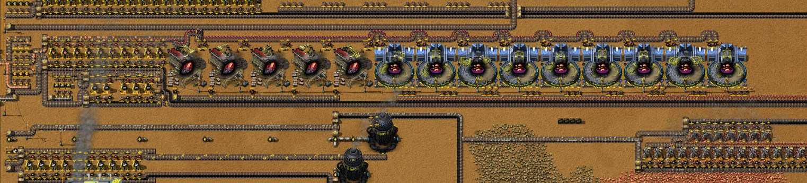
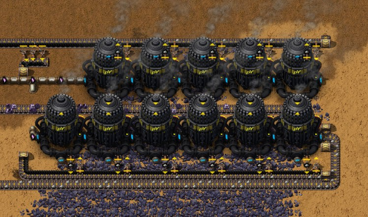
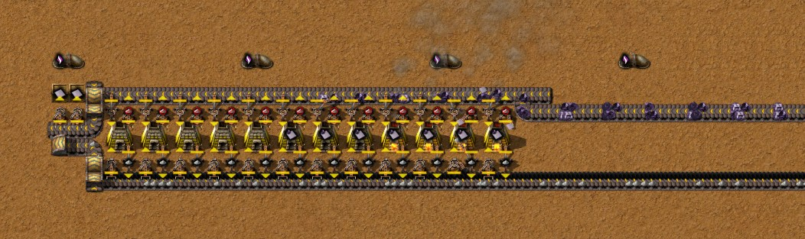
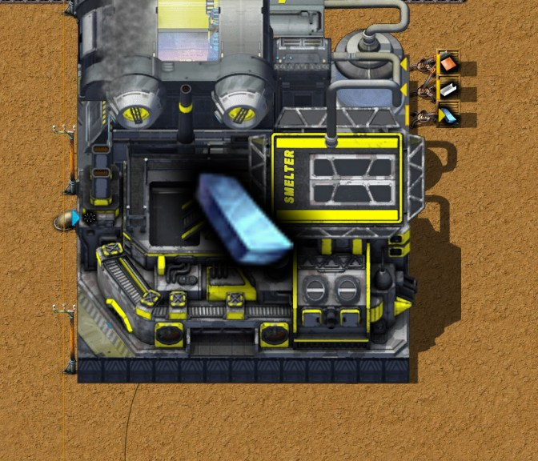

# Chapter 7 — Copper screening, titanium smelting and duralumin

[中文版](07-copper-screening-titanium-duralumin.zh-CN.md) · [Index](../README.md) · Previous:
[chapter 6](06-simple-circuit-boards.md)

This chapter follows the same recorded run from 16:40. It has three steps. The first two were built
from 16:40 to the save of 17:48: **copper screening** (Copper processing - Stage 1: Copper ore
screened and crushed before it is smelted) and **titanium** (Titanium ore mined with Acetylene and
smelted in Stone furnaces). The third, **Duralumin**, followed from 17:50 to the save of 18:03, and
on purpose it is only a small temporary line: one Smelter fed from chests by hand (section 6). The
order is set by the buildings: Duralumin is made only in a Smelter MK 01, and the Smelter needs
15 Titanium plates (data). The author's Factory Planner plan for pY science pack 1 also needs
Titanium plates, for its Slaughterhouse and Reproductive complex (section 1).
Times are game time. Numbers come from the game's data, from the recorder's 10-minute production
windows, from the saves of 17:48 and 18:03 (`tools/inspect-save.ps1`), from an hour after each
save in 10-minute steps and half an hour two hours after the first (`tools/rate-probe`), and from
the author's Factory Planner plan (`tools/planner-summary.js`). The author has not exported
blueprints of the new blocks.

The result: the screened copper makes **3.0 Copper plates a second** from one belt of Copper ore
(15 a second), against 0.54 in the window ending 16:00 from the old furnaces, which take 8 ore per
plate where screening takes 5. Eleven Fluid mining drills make **2.75 Titanium ore a second** with
11 Acetylene, and the work of four of twelve Stone furnaces turns it into **0.275 Titanium plates a second**,
which gather in two chests. In the hours after the save nothing stops, and the boards hold 0.1 a
second, also once the aluminium drills' ore is gone (section 4). Then one Smelter MK 01, burning the
Naphthalene oil the Tar line had stored, makes **0.197 Duralumin a second** from chests of
Aluminium and Copper plates: about 400 in all from the plates the author put in, more than the
about 345 that the machines starting the Vrauks need (section 6).

## The run at a glance

| Game time | What happened |
|---|---|
| 16:43–16:45 | Robots take away 29 Burner mining drills and about 340 tiles of belt (the recorder counts them without positions); Copper ore falls to 1.4 a second in the window ending 16:50 and to 0.08 in the next, so the copper mine of chapter 5 was among them |
| 16:48–16:53 | A row of nine Automated screeners MK 01 at y 16 (x −2 to 55) and five Jaw crushers MK 01 west of it, handcrafted on the spot with their Steam engines and Air-core inductors |
| 16:56–16:59 | A second power station from the author's blueprint `raw-coal-power-two-belts` (24 Boilers, 12 Steam engines, three Solid separators for its Ash) at x −60 to −18, y 217 to 245, just north of the first, and three Raw coal modules (27 Burner mining drills) on the coal field south of them, around (−24, 302) |
| 17:02–17:17 | The copper furnaces beside the bus rebuilt: ten Stone furnaces for the screened copper at y 13 (x −63 to −45), five for Stone bricks at y 19, chests; at 17:15 robots move the whole row one tile north (screeners, crushers, belts and inserters taken away and placed again in the same minute) |
| 17:10–17:30 | Hardly any boards (none in the window ending 17:20, 0.04 a second in the next): the Copper plates on the bus are used up while the copper is rebuilt (section 2) |
| 17:18 | A second Gasifier for Syngas from Coal gas at (−146, −173), beside the first (section 5) |
| 17:20–17:23 | A new copper drill field: 22 Burner mining drills in two rows (y 27, x 45–57 and y 30, x 37–65) and their belt to the screeners. Screened copper from the window ending 17:30 |
| 17:30–17:31 | An Overflow valve on the Acetylene line at (−108.5, −74.5) and the first Pipes to ground south along x −108.5, with a Check valve at y 179.5 |
| 17:33–17:38 | Eleven Fluid mining drills MK 01 on the titanium field at x 264 to 290, y 414 to 421, handcrafted in batches (with Pipes, Steam engines, Stone furnaces, Burner mining drills) |
| 17:39–17:46 | The rest of the Acetylene pipe (a Check valve at (201.5, 414.5)), about 620 tiles of belt along y 417 for the ore, twelve Stone furnaces at y 419 (x −67 to −45) with two chests, and the Raw coal belt for the drills |
| 17:47 | Factory Planner: the author's factory "pY科技包1型" (pY science pack 1) saved again (first written at 14:45) |
| 17:48 | The save (end of the first two steps) |
| 17:50–17:56 | The aluminium drills on the last of their ore: three Fluid mining drills taken up and one put down again at (−7.5, 27.5), with 735 ore under it; two are left (section 6) |
| 17:55–17:58 | The Smelter MK 01 handcrafted (with its ten Steam engines) and placed at (−54.5, 43.5) |
| 17:57 | A small repair beside the main work: the belt bringing Ash to the Ash loop had jammed. The loop's outer lane was full, and the incoming Ash also ran on one lane, the right one, so neither joining the belt straight on nor a Splitter helped (the author). Five Mechanical inserters at x −91.5 (y 22.5 to 26.5), in place of a piece of belt, now lift the Ash from the belt at x −90.5 onto the inner lane of the loop at x −92.5 |
| 18:00–18:01 | Three Wooden chests with one inserter each beside the Smelter, and a Naphthalene oil pipe to it from the Tar line's pond: 153 tiles of Pipe to ground |
| 18:03 | The save (end of the chapter) |

Production per second (10-minute windows from the recorder). Titanium ore does not appear yet:
the drills started after 17:40.

| Window ending | Copper ore | Copper (grade 2) | Copper plate | Stone brick | Acetylene | Lead plate | Aluminium ore | Coal gas | Simple circuit board |
|---|---|---|---|---|---|---|---|---|---|
| 16:00 | 4.33 | 0 | 0.54 | 0.96 | 27.3 | 0.68 | 0.03 | 0 | 0 |
| 16:40 | 1.75 | 0 | 0.22 | 0.60 | 29.5 | 0.50 | 0.64 | 33.4 | 0.120 |
| 16:50 | 1.36 | 0 | 0.30 | 0.60 | 30.0 | 0.51 | 1.58 | 32.0 | 0.115 |
| 17:00 | 0.08 | 0 | 0.01 | 0.56 | 30.5 | 0.47 | 1.14 | 26.3 | 0.090 |
| 17:10 | 0.12 | 0 | 0.02 | 0.50 | 26.7 | 0.33 | 1.08 | 26.9 | 0.100 |
| 17:20 | 0.10 | 0 | 0.01 | 0.50 | 15.7 | 0.27 | 1.06 | 30.6 | 0 |
| 17:30 | 9.96 | 4.24 | 1.48 | 1.13 | 12.5 | 0.18 | 1.04 | 36.6 | 0.040 |
| 17:40 | 15.10 | 7.50 | 3.01 | 1.86 | 24.7 | 0.16 | 1.06 | 28.2 | 0.105 |

## 1. Why copper, then titanium, then duralumin

No technology was researched in this chapter: every open one still needs pY science pack 1. The
recipes come from two technologies researched earlier with red science alone (data; recorder):

- **Copper processing - Stage 1** (12:21) unlocks the Automated screener MK 01 and three recipes:
  screening Copper ore, crushing Copper (grade 1), and smelting Copper (grade 2) (section 2).
- **Alloy smelting - Stage 1** (11:40) unlocks the Smelter MK 01, Titanium plate (40 Titanium ore
  → 4 plates in 60 s, in a furnace) and Duralumin (4 Aluminium plates + 2 Copper plates → 1 in
  4 s, only in a Smelter).

The Smelter MK 01 itself costs 15 Titanium plates, 40 Steel plates, 50 Ceramic, 40 Iron plates,
20 Stone bricks, 10 Steam engines, 50 Small parts and 5 Simple circuit boards, and burns a fluid
fuel at 10 MW (data). So Duralumin waits for titanium.

The author's Factory Planner plan "pY科技包1型" (pY science pack 1, six a minute, saved at 17:47;
first written at 14:45) shows what else titanium is for. The pack is made from Basic substrate and
Glassware; the Glassware needs Rubber stoppers, the stoppers Latex, the Latex Formic acid, and the
Formic acid comes from Vrauks rendered in a **Slaughterhouse MK 01** (40 Titanium plates); the
Vrauks grow in a Vrauk paddock from cocoons bred in a **Reproductive complex MK 01** (100 Titanium
plates, 100 Steel plates, 100 Concrete) (plan; data). Titanium processing - Stage 1, a screening
route for titanium like the copper one, needs pY science pack 1 (data); the author smelts Titanium
ore directly.

## 2. Copper screening

| Step | Machine (data) | Recipe (data) | One machine, per second |
|---|---|---|---|
| Screening | Automated screener MK 01, 7 × 7, 300 kW, speed 1 | 5 Copper ore → 2 Copper (grade 2) + 1 Copper (grade 1), 3 s | takes 1.667 ore |
| Crushing | Jaw crusher MK 01, 7 × 7, 1 MW, speed 1 | 2 Copper (grade 1) → 1 Copper (grade 2) + 2 Stone, 3 s | takes 0.667 grade 1 |
| Smelting | Stone furnace, speed 1 | 5 Copper (grade 2) → 2 Copper plates, 2 s | takes 2.5 grade 2, makes 1 plate |
| Stone bricks | Stone furnace | 2 Stone → 1 Stone brick, 3.2 s | takes 0.625 Stone |

Five Copper ore give 2.5 Copper (grade 2), one Copper plate, and one Stone (half a Stone brick).
The old recipe takes **8 Copper ore for one plate**, in 10 s (data; chapter 1): screening saves
three ore in eight, and one furnace smelts ten times as many plates (1 a second against 0.1).

The block runs along y 10 to 21 from x 65 west to the bus (screenshot below):

- **Ore.** 22 Burner mining drills (1 Copper ore a second each: speed 1, mining time 1; data) in two
  rows at y 27 and y 30 (x 37 to 65) fill one belt, which runs north at x 65 and west along y 20:
  one Basic transport belt, 15 ore a second.
- **Nine screeners** in a row (x −6 to 51) take the ore from the belt below them: 9 × 1.667 = 15,
  the whole belt. Both grades go onto the belt above them, at y 10, which runs west.
- **Five crushers** (x −41 to −13) take the Copper (grade 1) from that belt with filtered
  inserters and put the grade 2 back on it; their Stone goes onto the belt at y 20. The screeners
  make 3 grade 1 a second; that needs 4.5 crushers.
- **Ten Stone furnaces** at y 13 (x −63 to −45) smelt the grade 2, 7.5 a second, which needs three
  of them. The plates go west onto the bus (x −74) and into chests.
- **Five Stone furnaces** at y 19 make Stone bricks from the crushers' Stone (3 a second needs 4.8);
  the bricks go onto the bus (x −75) and into three chests (1,954 bricks in them at the save).
- **Electricity:** 9 × 300 kW + 5 × 1 MW = 7.7 MW (data). The author placed a second power station
  the same quarter of an hour (section 5).

Measured in the hour after the save (section 4): 15.1 Copper ore a second, 7.50 Copper (grade 2)
and 3.00 Copper (grade 1) made and used, **3.01 Copper plates a second**: exactly the recipes'
sums. The screeners work 99 % of the time, the crushers 89 %, the copper furnaces 30 % (the work of
three). In the window ending 16:00 the old furnaces made 0.54 plates from 4.33 ore (8 to 1).

**The gap while it was rebuilt.** The old copper mine went at 16:43–16:45 and the new drills came
at 17:20–17:23. Meanwhile the Copper plates on the bus ran out: the base used 0.27 a second in the
window ending 17:20, and the board line made no boards (0.04 a second in the next window, 0.105 in
the one ending 17:40). Nothing else stopped, and the boards came back by themselves.

**No margin in the ore.** One belt of ore is exactly what the screeners take, so the plates follow
the drill field: in the second half of the hour after the save it gives 14.6 Copper ore a second and
the block 2.91 plates (section 4). Five of the 22 drills had fewer than 5,000 ore under them at the
save (2,520 to 4,550; x 37, 39, 41, 59 and 61).

## 3. Titanium

**Mining with Acetylene.** Titanium ore can only be mined with Acetylene, 40 per 10 ore (data:
`required_fluid`, `fluid_amount`), so 4 per ore; Lead ore takes 10 per ore. Measured: the 2.75
Titanium ore and 1.25 Lead ore a second of the first ten minutes used 23.0 Acetylene a second
(4 × 2.75 + 10 × 1.25 = 23.5). A Fluid mining drill MK 01 has mining speed 0.5 and burns fuel at
400 kW (data); Titanium ore takes 2 s to mine, so each drill mines 0.25 a second and uses 1
Acetylene a second.

- **The mine:** eleven drills in two rows (y 414.5 and 420.5, x 264 to 290) on the titanium field
  around (272, 441) (47.0 million ore in its chunks), dropping onto one belt between the rows:
  **2.75 Titanium ore a second**, measured at every step of the hour, the drills "working" 100 %.
  Raw coal comes 222 tiles east from the belt on x 70, and their Ash goes back west on another.
- **The Acetylene** comes from the acetylene block of chapter 5 (four Gasifiers; 49.75 a second on
  the bench), whose pipe already fed the six lead drills (x −308 to −283). The author put an
  Overflow valve at the east end of that segment, at (−108.5, −74.5): Acetylene passes to the
  titanium only while the lead side is over 80 % full, so the lead drills keep first call. From
  the valve the pipe runs 489 tiles south along x −108.5 and 398 tiles east along y 414.5 to the
  last drill, about 890 tiles, nearly all Pipe to ground (reach 10; data). Two Check valves, at
  (−108.5, 179.5) and (201.5, 414.5), cut it into segments spanning 254, 311 and 88 tiles, each
  under the 320-tile limit (techniques principle 18). Measured: the valve's box and every drill's
  box were full at every step, and the acetylene Gasifiers stood "full output" 42 % of the hour:
  the lead and titanium drills used 23 to 27 of the block's 49.75 a second.
- **The ore belt** runs 332 tiles west along y 417 to the furnaces. It could carry 15 ore a second;
  it carries 2.75.
- **Twelve Stone furnaces** at y 419 (x −67 to −45), a smelting column like the author's book design
  (Raw coal on its own belt, Ash out with filtered inserters). A furnace takes 0.667 Titanium ore a
  second (40 in 60 s), so 2.75 need 4.1 furnaces. Measured: the furnaces that took the recipe
  worked 63 % of their time, the work of about four; the rest wait for ore. **0.275 Titanium
  plates a second** (16.5 a minute) go into two Wooden chests at (−70.5, 416.5) and (−69.5,
  416.5): 28 plates at the save, 16 more in the author's inventory.

Two Wooden chests hold 3,200 Titanium plates (16 slots × 100; data), about 3 hours and 15 minutes
of the column. Then the furnaces fill and the drills stop: normal while nothing uses titanium
(techniques principle 23). The first users are the Smelter MK 01 (15) and the plan's buildings (40
and 100).

## 4. An hour after the save of 17:48

Measured in a copy of the save (`tools/rate-probe`, one minute of warm-up, then an hour in
10-minute steps; per second, each step's average; the last row from a second run, half an hour
starting two hours after the save):

| Minutes after 17:48 | Copper ore | Copper (grade 2) | Copper plates made / used | Titanium ore | Titanium plates | Acetylene | Lead ore | Aluminium ore | Coal gas | Boards |
|---|---|---|---|---|---|---|---|---|---|---|
| 0–10 | 15.10 | 7.50 | 3.01 / 1.72 | 2.75 | 0.267 | 22.8 | 1.25 | 1.06 | 28.4 | 0.100 |
| 10–20 | 15.12 | 7.50 | 3.02 / 1.39 | 2.75 | 0.280 | 24.5 | 1.39 | 1.06 | 28.1 | 0.100 |
| 20–30 | 15.09 | 7.50 | 3.01 / 1.33 | 2.75 | 0.267 | 26.3 | 1.60 | 1.05 | 28.2 | 0.100 |
| 30–40 | 14.69 | 7.45 | 3.00 / 1.12 | 2.75 | 0.287 | 26.3 | 1.60 | 0.73 | 27.2 | 0.100 |
| 40–50 | 14.60 | 7.25 | 2.91 / 1.10 | 2.75 | 0.267 | 26.7 | 1.60 | 0.55 | 26.0 | 0.100 |
| 50–60 | 14.60 | 7.25 | 2.91 / 1.12 | 2.75 | 0.280 | 26.7 | 1.60 | 0.55 | 25.5 | 0.100 |
| 120–150 (second run) | 6.14 | 3.04 | 1.22 / 1.11 | 2.75 | 0.278 | 26.6 | 1.60 | 0.05 | 23.4 | 0.100 |

- **Nothing stops.** No machine group changes its usual status for long in either run; the
  lead drills work more as their furnaces empty (1.25 to 1.6 Lead ore a second; the Lead plates are
  used as made, 0.267 a second, by the board line).
- **Copper: 3.0 plates a second, at first into store.** The base used 1.1 to 1.7 of them (the board
  line takes 1.13), and about 6,000 plates went onto the bus and into chests in the hour. Two hours
  after the save the store is full: the block makes what is used, 1.2 plates a second, with the
  screeners "full output" 59 % of the time, the crushers 62 % and the drills waiting for space
  61 %. That is the jam of a surplus nothing uses yet (techniques principle 23), not a fault: a new
  user of Copper plates gets up to 3 a second from the same block.
- **Titanium: 2.75 ore and 0.27 to 0.29 plates a second throughout,** 0.278 two hours later, all
  into the chests. The drills' Acetylene never ran short.
- **The aluminium drills are done.** One stopped between minutes 30 and 40 (Aluminium ore 1.05 →
  0.55 a second); two hours after the save only Soot separation's 0.05 a second is left.
- **The boards hold 0.1 a second, also without the aluminium drills.** In chapter 6 the one
  Gasifier was the coke block's only taker of Coal gas once the aluminium was gone, and the boards
  fell to 0.07. With the author's second Gasifier (section 5) the two take 23.4 Coal gas a second,
  the Tar line gets 28.5 Tar, 12.3 Aromatics and 0.31 Zinc plates, and the boards stay at 0.100
  in every step.

## 5. Other changes

- **A second power station** (16:56–16:59): the author's two-belt raw coal design again (24
  Boilers, 12 Steam engines, at most 44.4 MW on 29.6 Raw coal a second; chapter 3), just north of
  the first, with three Raw coal modules on the coal field. At the save all 48 Boilers of the two
  stations work. The copper block alone draws up to 7.7 MW.
- **A second Gasifier for Syngas from Coal gas** (17:18), beside the first at the Tar line's north
  end. Each takes at most 16.7 Coal gas a second (data); chapter 6 found that one is not enough once
  the aluminium drills stop. With two, the boards hold 0.1 a second (section 4).
- **Aluminium for Duralumin.** Duralumin takes 4 Aluminium plates each. The aluminium drills
  of chapter 4 have mined their part of the field (section 4); at the save there are 2,929
  Aluminium plates in the two chests at (−70.5, 29.5) and (−69.5, 29.5) (1,329 and 1,600), 100 in a
  chest at (−62.5, 365.5) and 122 in the author's inventory: 3,151, enough for 787 Duralumin. The
  aluminium fields near the base: around (−3, 54), 1.2 million in its chunks (the one mined so
  far), and around (96, −160), 6.5 million (save snapshot). Aluminium ore needs 10 Coal gas per
  ore (chapter 4).

## 6. Duralumin

**A batch, not a line.** Before building, the author asked what Duralumin is needed for now (data;
the author's plan):

- The buildings of the pY science pack 1 plan need none. But the plan's Formic acid comes from
  Vrauks, and the first Vrauks can only be made in a **Creature chamber MK 01** (recipe: 10 Native
  flora, 3 Moss gene samples, 1 Vrauk codex, 2 Generic earth DNA samples and 10 Petri dishes → 1
  Vrauk in 400 s). The Vrauk paddock MK 01 and the Reproductive complex MK 01 have a base speed of
  −100 % and work only with Vrauks put in as modules (10 and 2 slots). The Creature chamber and the
  machines for its ingredients are made with Duralumin:

| Machine (data) | For | Duralumin | Titanium plates | Plastic bars |
|---|---|---|---|---|
| Creature chamber MK 01 (its recipe uses up a Gene lab MK 01, which uses up a Biofactory MK 01 and two PyTanks) | the first Vrauks | 130 | 95 | 40 |
| Gene lab MK 01 | Moss gene samples: 2 Petri dishes + 20 Moss, 10 s | 100 | 55 | 20 |
| Data array | Generic earth DNA samples: 1 Iron chest + 15 red science + 10 Biosamples, 25 s | 50 | 100 | – |
| Incubator MK 01 | Biosamples: 1 Bio container (2 Titanium plates in it) + 15 Native flora, 10 s | 15 | 30 | – |
| Biofactory MK 01 | Plastic bars: 50 Aromatics + 100 Syngas → 1, 1.5 s, the only recipe unlocked | 50 | 15 | – |
| **Total** | | **345** | **295** | **60** |

- Of the 18 technologies pY science pack 1 opens, two need Duralumin: Crusher 2 (Secondary crusher
  MK 01, 20) and Composting (Compost plant MK 01, 30 and 10 Intermetallics). It is used steadily
  only later: in Burner assembling machines MK 02 (5 each), locomotives and cargo wagons, and
  Intermetallics, whose Vitreloy takes 3 Duralumin per 2 (data).

So the author made one batch, from the Aluminium plates already in store, and leaves a full line
(with a new aluminium mine) for later.

**The line** (17:55–18:01):

- **One Smelter MK 01** (13 × 13) at (−54.5, 43.5), handcrafted on the spot. Duralumin takes 4
  Aluminium plates and 2 Copper plates in 4 s: 1 Aluminium plate a second at full speed.
- **Three Wooden chests** on its east side at x −46.5, each with one Mechanical inserter: Copper
  plates (y 37.5), Aluminium plates (y 38.5), and the Duralumin out (y 39.5). The author filled them
  by hand: at the save 1,440 Copper plates and 1,449 Aluminium plates are in them, and 36 Duralumin
  already made. The old aluminium chests by the furnaces at y 29.5 were emptied; 1,495 Aluminium
  plates are in the author's inventory.
- **Fuel: Naphthalene oil**, which the Tar line had been storing for later (chapter 6). A new line of
  Pipe to ground, 153 tiles, takes it from the pipe of the Tar line's Tailings pond at (−139, −56)
  south along x −117.5 and east along y 43.5 to the Smelter. It burns any fluid fuel at 10 MW
  (data); Naphthalene oil has 0.3 MJ, so at full speed 33.3 a second.

**Measured** (a copy of the save of 18:03, an hour in 10-minute steps after a minute of warm-up;
`tools/rate-probe`):

| Minutes after 18:03 | Duralumin | Aluminium plates used | Naphthalene oil made / used | Naphthalene oil in the pond (end of step) | Aluminium ore | Boards |
|---|---|---|---|---|---|---|
| 0–10 | 0.198 | 0.793 | 16.5 / 26.3 | 108,985 | 1.05 | 0.100 |
| 10–20 | 0.197 | 0.787 | 16.7 / 26.3 | 103,218 | 1.04 | 0.100 |
| 20–30 | 0.192 | 0.760 | 16.5 / 25.4 | 97,912 | 0.73 | 0.100 |
| 30–40 | 0 | 0 | 16.5 / 0 | 107,741 | 0.55 | 0.100 |
| 40–60 | 0 | 0 | 16.6 / 0 | 127,499 | 0.56 | 0.100 |

- **0.197 Duralumin a second, 79 % of full speed.** The Smelter works 79 % of the time and waits
  for Aluminium plates the rest: one Mechanical inserter moves 0.789 items a second from a chest
  (chapter 4), and the recipe takes 1 a second. Two inserters on the Aluminium plates, or one
  electric Inserter (1.25 a second; it costs 1 Duralumin), would let it run at full speed.
- **About 400 Duralumin in all.** Between minutes 20 and 30 the Aluminium chest is empty and the
  Smelter stops: its 1,449 plates made 362 more, about 400 with the 36 of the save, more than the
  345 of the table. The 1,495 plates in the author's inventory would make 373 more.
- **The fuel lasts.** While the Smelter runs, the pond loses 10 Naphthalene oil a second (115,427 at
  the save, 97,912 after half an hour); the Tar line makes 16.5 a second, enough to keep one Smelter
  at half speed for good, and the pond fills again once it stops (it holds 1,000,000; data).
- **Nothing else changes.** The boards stay at 0.100 a second in every step, Copper plates at 2.9
  to 3.0 made, Titanium plates at 0.27 to 0.28.
- **The last aluminium ore.** The drill put down at (−7.5, 27.5) mines its 735 ore in about 25
  minutes (Aluminium ore 1.05 → 0.55 a second, each drill 0.5); the one at (−12.5, 33.5) has 1,911
  ore under it, about an hour. After that only Soot separation gives Aluminium ore (section 4).

## 7. Checklist

- Screen copper before smelting it (Copper processing - Stage 1, red science only): 5 Copper ore
  per plate instead of 8, and one Stone with each plate. One belt of ore (15 a second) takes nine
  Automated screeners, five Jaw crushers, three Stone furnaces for the plates and five for the
  Stone bricks, and gives 3 plates and 1.5 bricks a second. It needs 7.7 MW: power first.
- Build the new supply of the main product's ingredient before taking the old one away, or keep
  a stock: the boards lost about a quarter of an hour while the copper was rebuilt.
- Titanium ore needs Acetylene, 4 per ore. A Fluid mining drill MK 01 mines 0.25 a second; a
  Stone furnace smelts 0.667 ore a second into 0.0667 plates. Eleven drills keep four furnaces busy.
- Feed a new user from an old fluid line through an Overflow valve, so the old users keep first
  call (here the lead drills, then the titanium drills), and cut a long line into segments under
  320 tiles with Check valves (no power needed).
- Duralumin is made only in a Smelter MK 01, which needs 15 Titanium plates: titanium comes first.
- Before building a line for a new material, look at what it is needed for now. Before pY science
  pack 1, Duralumin is needed once: about 345 for the machines that start the Vrauks. One Smelter
  fed from chests made about 400 from the Aluminium plates in store in half an hour.
- Duralumin takes 1 Aluminium plate a second, more than one Mechanical inserter brings (0.789): use
  two, or an electric Inserter.
- A stored by-product fluid is fuel: the Smelter burns Naphthalene oil (0.3 MJ; 33.3 a second at
  full speed), and the Tar line's 16.5 a second keep one Smelter at half speed.

## 8. How these facts were checked

- The run: the companion mod's recorder (run `2652821414-0`), read with `tools/recorder-phases.js`
  (timeline in 5-minute slices) and `tools/recorder-log.js` (production per 10-minute window, and
  each minute's build record with its area: what was built, taken away and handcrafted where).
- The author's plan: the Factory Planner factory the companion writes out
  (`tools/planner-summary.js --factory pY`), and the building recipes of its machines from the data.
- The save of 17:48 (`Py-Exploration`, copied before reading; consistency check passed):
  `tools/inspect-save.ps1 -Ticks 3700`, `tools/summarize-save.js`, `tools/trace-layout.js` (the
  copper block's belts, the titanium belts, the Acetylene segments), `tools/render-area.js`;
  the ore under each drill, the pipe segments and their contents from the snapshot's
  `entities.json`.
- **An hour of the base:** `tools/save-probe.ps1 -Probe rate-probe -Ticks 219700 -Variant
  60,3600,600,<names>`, with a titanium drill, the Overflow valve, an acetylene Gasifier and a lead
  drill read every step; **half an hour two hours later:** `-Ticks 540100 -Variant
  7200,1800,600,<names>`, with the two Syngas Gasifiers read every step.
- The save of 18:03 (copied before reading; consistency check passed): `tools/inspect-save.ps1
  -Ticks 3700`; what changed since 17:48 from the two saves' `entities.json`; **an hour after it:**
  `tools/save-probe.ps1 -Probe rate-probe -Ticks 219700 -Variant 60,3600,600,<names>`, with the
  Smelter and the Naphthalene oil pond read every step.
- The machines that start the Vrauks: their building recipes from the data, expanded through the
  machines that go into them (Gene lab, Biofactory, PyTanks).
- Data: the current dump of the author's mods (`C:\tmp\cf-save\data\script-output\data-raw-dump.json`):
  recipes, machine speeds, power and sizes, the resources' mining fluids, stack and chest sizes,
  Pipe to ground reach, which technology unlocks what; English names from the mods' `locale/en`.
- No blueprint: the author has not exported the new blocks.
- The screenshots: taken by the author with the companion mod (`/pt-shots`).

Next: [chapter 8, Vrauks](08-vrauks.md).
