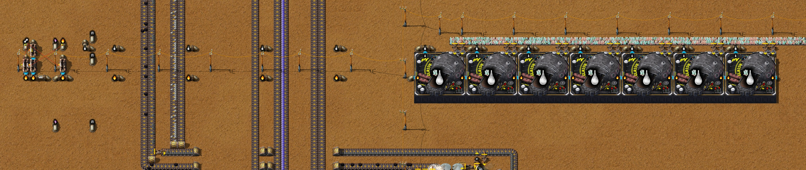

# Chapter 8 — Vrauks

[中文版](08-vrauks.zh-CN.md) · [Index](../README.md) · Previous:
[chapter 7](07-copper-screening-titanium-duralumin.md)

This chapter follows the same recorded run from the save of 18:03 to the save of 21:27, and the
author's fix of the Vrauk line up to the save of 21:35. Its goal
is the author's: a line that breeds **Vrauks**, the animals whose Formic acid pY science pack 1
needs (chapter 7, section 1). On the way the author built the supplies the Vrauks and the pack
share: Petri dishes, a second moss block, Quartz and Glass, Plastic. Then came a batch of start-up
machines that made the first five Vrauks by hand-fed recipes, and the line itself: eight Vrauk
paddocks, two Reproductive complexes and a loop of 64 Water barrels. The author expects the line
to need a long time before it runs at full output; the next chapter is to finish pY science pack 1.
Times are game time. Numbers come from the game's data, from the recorder's 10-minute production
windows, from the saves of 18:03 and 21:27 (`tools/inspect-save.ps1`), from runs of the 21:27 save
(`tools/vrauk-probe`, `tools/rate-probe`) and of the 21:35 save, from a belt test (`tools/belt-lab`) and from the
author's Factory Planner plan (`tools/planner-summary.js`). The author has not exported blueprints
of the new blocks; they plan to export the whole pY science pack 1 line once it is done.

The result: the supplies and the first five Vrauks are there, but **the line does not start by
itself**. In a copy of the save it stops within 25 minutes. The seven paddocks without Vrauks
still take ingredients in: an empty paddock runs at a ten-thousandth of its speed, so it starts a
craft that would take 370 days and holds 9 Water barrels. And the eight Splitters on the chains
where inserters only drop items keep 4 items each. With the output priority of those Splitters set,
128 barrels instead of 64, and every new Vrauk put back within a minute, all 84 module slots are
full **110 minutes** after the save, and the line makes the plan's 3 Vrauks a minute (section 6).
Separately, the base no longer holds its boards: with the Syngas Exhaust pipe gone, the Syngas
Gasifiers fill up, and the Tar line, the zinc and the boards run down to 0.005 a second within the
hour. With an Exhaust pipe put back, the boards stay at 0.1.

The author then fixed the line (21:27–21:35): a filter on each of the eight Splitters, the
Deconstruction planner sent to the side without a belt (a community trick: the filtered item never
comes, so everything goes the other way), and 64 more Barrels, 128 in all. Measured on the save of 21:35, all 84 slots are full 100 minutes later; with 96 or
100 barrels the start is as fast, but at full output the paddocks then wait a quarter of the time
(section 6).
The Syngas they leave for now: once pY science pack 1 is made, the Syngas will be used up, and so
will the stored Gasoline; they will decide then (the author).

## The run at a glance

| Game time | What happened |
|---|---|
| 18:05–18:20 | Six Glassworks MK 01 at y 348.5 (x −49.5 to −14.5) beside the one of chapter 6, making Molten glass from Quartz ore, and six Crystal mines MK 01 on the quartz field at x 274 to 320, y 348 to 358 (eight in all); three Seaweed crop facilities MK 01 north of the base, at y −270.5 |
| 18:20–18:30 | The Petri dish block beside them: a Glassworks for Empty petri dishes, a High pressure furnace for Agar, an assembler for Petri dishes, three Microorganism mines MK 01 for Incubated petri dishes, two High pressure furnaces for Cellulose with two Soil extractors for their Limestone, a Wood processing unit (section 2) |
| 18:35–18:40 | The iron drill field at x 17 to 64 laid again two tiles further south: 39 Burner mining drills, about 400 tiles of belt taken up and put down; Iron ore 4.2 a second in the window ending 18:40, 25.4 in the next |
| 18:40–18:55 | A second moss block at y −294: five Moss farms MK 01 (15 Moss each as modules), a Moondrop greenhouse MK 01 for their Carbon dioxide, a Washer and a Soil extractor for their Muddy sludge, a Jaw crusher for their Stone (section 3) |
| 18:50–18:55 | An assembler at (−13.5, −285.5) making Basic substrate from Moss, Incubated petri dishes and Cellulose: the first ingredient of pY science pack 1 |
| 19:10–19:20 | A Biofactory MK 01 for Plastic at (−134.5, −198.5), beside the Tar line, its Aromatics behind an Overflow valve; a third Destructive distillation column (Pitch refining) at (−157, −127) |
| 19:20–19:21 | Two PyTanks (30 kL), a second Biofactory and a Gene lab MK 01 handcrafted |
| 19:25–19:35 | The Gene lab at (−57, −307) makes 15 Moss gene samples; a Data array at (−56, −316) and five Vrauk codices; the Gene lab taken up again and an Incubator MK 01 put in its place, with 100 Bio containers: 100 Biosamples |
| 19:45–19:55 | Two Exhaust pipes taken away; their Syngas and Hydrogen go south instead in two new pipes along x −107.5 and −112.5, about 520 tiles each, as fuel for the seven Glassworks at y 348.5, where three pumps choose the fuel by circuit (section 3) |
| 20:00–20:04 | Seven Vrauk paddocks MK 01 handcrafted (one more at 19:39), and a Barreling machine |
| 20:05–20:15 | Concrete for the Reproductive complexes, made beside the acetylene block at (−174.5, −145.5) from Sand (a Jaw crusher on Gravel), Gravel and Lime |
| 20:18–20:19 | The Incubator and the Data array taken up |
| 20:21–20:57 | A Creature chamber MK 01 handcrafted (the Gene lab goes into it) and placed at (−54.5, −305.5); it makes five Vrauks, one every 400 s, and is taken up at 20:57 (section 4) |
| 20:28–20:47 | The paddocks placed, moved and placed again; three Sap extractors MK 01 and two Botanical nurseries for their Sap trees |
| 21:05–21:10 | The whole block laid again by robots in its final place (x −60 to 47, y −336 to −300): eight paddocks, sixteen Splitters, the Barreling machine and the barrel loop (section 5) |
| 21:05–21:15 | 64 Barrels handcrafted. The author's note: "做64个桶，这个数是我用同时进行的配方所需数乘估算得到的" (64 barrels, a number estimated from what the recipes running at the same time need) |
| 21:15–21:25 | Two Reproductive complexes MK 01 handcrafted and placed at (−43, −315) and (−21, −315), with 100 Concrete each; a Slaughterhouse MK 01 handcrafted and kept for the next chapter |
| 21:25 | The author's note: "循环物品形成环带避免堵塞" (items that circulate form a loop belt, so nothing jams) |
| 21:27 | The save: three Vrauks in one paddock, one in each Reproductive complex |
| 21:27–21:35 | The author's fix: the eight Splitters of the empty-barrel and Vrauk chains get a filter (Deconstruction planner, to the side without a belt), the Barrels stuck there are taken off, 64 more Barrels handcrafted; the Moondrop greenhouse filled to 16 Moondrops (section 3); screenshots at 21:34–21:35 (section 6) |
| 21:35 | The save (end of the chapter) |

Production per second (10-minute windows from the recorder):

| Window ending | Iron ore | Quartz ore | Molten glass | Seaweed | Petri dish | Moss | Plastic | Concrete | Vrauks | Boards |
|---|---|---|---|---|---|---|---|---|---|---|
| 18:00 | 9.84 | 1.20 | 2.0 | 0 | 0 | 0.267 | 0 | 0 | 0 | 0.100 |
| 18:20 | 8.27 | 5.78 | 8.4 | 0 | 0 | 0.293 | 0 | 0 | 0 | 0.100 |
| 18:50 | 25.42 | 1.01 | 1.7 | 0 | 0 | 0.320 | 0 | 0 | 0 | 0.100 |
| 19:20 | 16.31 | 7.80 | 14.0 | 0.483 | 0.167 | 1.013 | 0.085 | 0 | 0 | 0.100 |
| 19:40 | 15.08 | 7.02 | 10.2 | 0.600 | 0.120 | 0.533 | 0.107 | 0 | 0 | 0.100 |
| 20:00 | 12.16 | 3.76 | 6.2 | 0.483 | 0.097 | 0.213 | 0 | 0 | 0 | 0.080 |
| 20:20 | 10.06 | 3.14 | 4.8 | 0.400 | 0.052 | 0.160 | 0 | 0 | 0 | 0.065 |
| 20:40 | 4.68 | 0.98 | 1.6 | 0 | 0 | 0.240 | 0 | 0.017 | 0.002 | 0.100 |
| 21:00 | 8.15 | 0.99 | 1.7 | 0 | 0 | 0.267 | 0 | 0.008 | 0.002 | 0.100 |
| 21:20 | 8.18 | 0.98 | 1.6 | 0 | 0 | 1.200 | 0 | 0.217 | 0 | 0.100 |

The new blocks run while something takes their products and then stand full: the Seaweed, Petri
dishes and Plastic stop once their belts, chests and machines are full (normal for a product
nothing uses yet, techniques principle 23). The boards fell to 0.065 a second in the windows ending
20:00 to 20:20 and were back at 0.1 from the one ending 20:40.

## 1. Why Vrauks, and why they start slowly

No technology was researched in this chapter: every open one still needs pY science pack 1. The
author's Factory Planner plan "pY科技包1型" (pY science pack 1, six a minute; saved again at 20:43)
gets its Formic acid from three Vrauks a minute, rendered in a Slaughterhouse. It breeds them in
**eight Vrauk paddocks** from cocoons bred in **two Reproductive complexes** (plan; chapter 7):

| Machine (data) | Recipe (data) | Slots | Speed with n Vrauks inside |
|---|---|---|---|
| Vrauk paddock MK 01, 250 kW | 10 Vrauk cocoons + 15 Native flora + 5 Moss + 3 Water barrels → 2 Vrauks + 3 Barrels, 160 s | 10 | 0.05 × n |
| Reproductive complex MK 01, 500 kW | 10 Moss + 3 Sap + 5 Native flora + 4 Water barrels → 4 to 6 Vrauk cocoons (5 on average) + 4 Barrels, 40 s | 2 | 0.5 × n |

Both machines take the Vrauks themselves as modules (+1 speed each) and have a base speed effect of
−1, limited to −0.9999 (data). **With no Vrauk inside, a machine runs at one ten-thousandth of its
speed**, and that is not the same as standing still: a paddock without Vrauks (speed 0.000005)
starts a craft as soon as its ingredients are in, takes 10 cocoons, 15 Native flora, 5 Moss and 3
Water barrels into it, shows "working", and would finish in about 370 days; its inserters then fill
it up again, to 6 Water barrels and 20 cocoons (engine, in a copy of the save). A paddock with ten Vrauks makes 2 Vrauks every
320 s; eight of them make the plan's 3 a minute, and two complexes with two Vrauks each make the
15 cocoons a minute they need. The full line holds **84 Vrauks** (8 × 10 + 2 × 2).

The first Vrauks come only from a **Creature chamber MK 01**: 10 Native flora + 3 Moss gene samples
+ 1 Vrauk codex + 2 Generic earth DNA samples + 10 Petri dishes → 1 Vrauk, in 400 s (data). The
samples need three more machines: a Gene lab (Moss gene samples), an Incubator (Biosamples) and a
Data array (Generic earth DNA samples) (section 4).

After that the line grows only from what it makes. One Vrauk in a paddock makes 1/1600 of a Vrauk
a second (2 per 160 s at speed 0.05), so the Vrauks in the paddocks double at best every 18.5
minutes, and going from 3 to 80 takes 88 minutes, if every new Vrauk goes straight back into a
paddock and nothing else is short. Cocoons set a second limit: a paddock Vrauk uses 5 cocoons per
1,600 s and a complex Vrauk makes 5 per 80 s, so one Vrauk in a complex feeds 20 in paddocks.

## 2. Petri dishes and the first substrate

Petri dishes are in both of the author's next goals: the Vrauk start-up recipes take 80 (30 for
15 Moss gene samples, 50 for five Vrauks), and pY science pack 1 is made from Basic substrate,
which takes Incubated petri dishes (plan). The block stands north of the base around (−35, −280):

| Step | Machine | Recipe (data) |
|---|---|---|
| Seaweed | 3 Seaweed crop facilities MK 01, 10 Seaweed each as modules (speed 1.0) | 200 Water → 10 Seaweed, 50 s: 0.6 Seaweed a second from the three |
| Agar | High pressure furnace MK 01 | 5 Seaweed + 100 Steam → 1 Agar, 5 s |
| Empty petri dish | Glassworks MK 01 (burns Naphthalene oil) | 50 Molten glass → 1, 3 s |
| Petri dish | Burner assembling machine | 1 Agar + 1 Empty petri dish → 1, 5 s |
| Incubated petri dish | 3 Microorganism mines MK 01 | 1 Petri dish → 1, 20 s |
| Cellulose | 2 High pressure furnaces, 2 Soil extractors for Limestone, a Wood processing unit | 7 Wood + 4 Limestone → 1, 10 s |
| Basic substrate | Burner assembling machine at (−13.5, −285.5) | 5 Moss + 2 Incubated petri dishes + 3 Cellulose → 10, 3.5 s |

At the save the block stands full: 500 Petri dishes were made since 18:03, 240 used (the 80 of the
start-up among them), 100 wait in a chest at (−19.5, −280.5); 170 Basic substrate were made and
none used yet (save statistics). The Molten glass comes from the Glassworks at y 348.5 (section 3).

## 3. Moss, glass, syngas and plastic

- **A second moss block** at y −294 (x −37 to −7): five Moss farms MK 01 with 15 Moss each as
  modules (speed 1.0), on the recipe 100 Muddy sludge + 100 Carbon dioxide + 20 Stone → 16 Moss in
  80 s: **1.0 Moss a second** from the five, beside the ten of chapter 4. A Moondrop greenhouse
  makes their Carbon dioxide, a Soil extractor and a Washer their Muddy sludge, a Jaw crusher their
  Stone from Stone bricks (data). The plan needs 55.5 Moss a minute for the pack and the Vrauks; the
  five give 60.
- **The greenhouse's 16 slots.** It was built with 14 Moondrops, a mistake the author corrected in
  the fix of 21:27–21:35: in the 21:35 save it holds 16. The T.U.R.D. upgrade Carbon capture adds a
  module with speed +8 and consumption +2 to every greenhouse, and each Moondrop adds speed +1 and
  nothing to consumption (data), so the speed is 0.0625 × (8 + Moondrops): 1.375 with 14, 1.5 with
  16 (both saves), 200 Carbon dioxide per 5 s, that is 55 or 60 a second. The five farms use 6.25,
  so 14 were fast enough (the author), but the greenhouse draws the same 1.35 MW while it works
  either way, and with 16 it works 1.375/1.5 of the time for the same gas: 8 % less energy, which
  is why the author filled it.
- **Quartz and glass.** Molten glass is made from Quartz ore (6 → 10, 5 s; data). Six more Crystal
  mines MK 01 on the quartz field (eight in all) and six more Glassworks at y 348.5 (seven) make
  it: up to 14 Molten glass a second in the windows ending 19:20 and 19:30, and the Quartz ore 7.8 to
  8.0 a second. Glassworks burn fluid fuel (10 MW; data): these burn Syngas.
- **Fuel for the Glassworks: the by-products first** (19:45–19:55). Two Exhaust pipes went: the one at
  (−108.5, −176.5) that let the Tar line's surplus Syngas out, and the one at (−112.5, −73.5) for the
  Hydrogen of Pitch refining. Both gases now run south in new pipes along x −107.5 and x −112.5,
  beside the Gasoline pipe of chapter 6 (x −111.5, from the pond where the author keeps Gasoline),
  about 520 tiles each, cut by Check valves at y −74.5 and 179.5 (the 320-tile limit, techniques
  principle 18). At the south end three pumps feed one fuel pipe along y 348.5 to the seven
  Glassworks, each switched by a circuit condition read from the pipes (save): the **Hydrogen** pump
  runs while there is Hydrogen in its pipe, the **Syngas** pump while there is none, and the two
  **Gasoline** pumps in a row only while there is neither Hydrogen nor Syngas. A pipe holds one
  fluid at a time, so the fuel changes once the Glassworks have burnt the pipe empty. At the save
  the fuel pipe holds Syngas.

- **Molten glass** goes north again in the pipe of chapter 6 along x −104.5, now also to the Petri
  dish Glassworks at (−56.5, −267.5).
- **Plastic** (19:10–19:20): a Biofactory MK 01 beside the Tar line at (−134.5, −198.5), 50 Aromatics
  + 100 Syngas → 1 Plastic bar in 1.5 s (data), its Aromatics behind an Overflow valve so the Tar
  line's other users keep first call. 202 Plastic bars were made since 18:03, 40 went into the
  Creature chamber and Gene lab, 82 wait in its chest. A third Pitch refining column at
  (−157, −127) and a third Gasifier for Syngas at (−157, −173) (20:40) were added to the Tar line.

## 4. The start-up batch: five Vrauks

The author made the first Vrauks the way chapter 7 made Duralumin: a batch from machines placed
for the purpose, fed by hand, and taken up again (techniques principle 24).

| Time | Machine | Made (save statistics, recipes from data) |
|---|---|---|
| 19:25–19:30 | Gene lab MK 01 at (−57, −307) | 15 Moss gene samples (2 Petri dishes + 20 Moss each, 10 s) |
| 19:29 | Data array at (−56, −316), five Vrauk codices handcrafted (5 Glass + 5 boards + 10 Tinned cables each) | 10 Generic earth DNA samples (an Iron chest + 15 red science packs + 10 Biosamples each, 25 s) |
| 19:34 | Incubator MK 01 in the Gene lab's place, 100 Bio containers handcrafted (2 Titanium plates, a Lead plate, a Steel plate and a Glass each) | 100 Biosamples (a Bio container + 15 Native flora each, 10 s: 17 minutes) |
| 20:22–20:57 | Creature chamber MK 01 at (−54.5, −305.5) | 5 Vrauks (3 Moss gene samples, a codex, 2 earth samples and 10 Petri dishes each, 400 s) |

The Gene lab went into the Creature chamber: the chamber's recipe takes a whole Gene lab (data), so
the author used the lab first and crafted it into the chamber afterwards. Chapter 7 counted about
345 Duralumin for the start-up with a Gene lab of its own; this way the base used **245** (the
chamber with its Gene lab, Biofactory and two PyTanks 130, the Data array 50, the Incubator 15,
the Plastic Biofactory 50), 100 less, and 680 Titanium plates with the two Reproductive complexes
and the Slaughterhouse (save statistics). 155 Duralumin are left in the author's inventory, with the
Creature chamber, the Data array and the Incubator for later use.

The five Vrauks became modules: three in the paddock at (−1.5, −307.5) and one in each
Reproductive complex. The five took 33 minutes in the chamber; with 3 Vrauks a paddock makes 2
more every 1,067 s (18 minutes).

## 5. The Vrauk line

The line stands north of the base, x −60 to 47, y −336 to −300 (save of 21:27):

- **Two Reproductive complexes** (21 × 21) at (−43, −315) and (−21, −315), with **three Sap
  extractors** MK 01 (two Sap trees each, 3 Sap a minute each) just west of them.
- **Eight Vrauk paddocks** (12 × 12) in two rows of four, at y −324.5 and −307.5 (x −1.5, 11.5, 24.5,
  37.5), facing each other across a four-tile corridor (y −318 to −315).
- **Native flora and Moss** arrive on one belt from the west along y −327.5 (Flora from the three
  Flora collectors at y 84.5, west to the bus and north along it; Moss up x −60.5 from the new moss
  block), pass the complexes' inserters and go on into the corridor.
- **The corridor carries four chains.** Each pair of facing paddocks shares one Splitter per chain:
  a Splitter is two tiles wide, so its north half lies under the north paddock's inserter and its
  south half under the south paddock's. From one Splitter to the next each chain runs by Underground
  belts (reach 9 in Py; data). Per pair, from west to east:
  - *Water barrels and cocoons* (Splitters at x −6.5, 6.5, 19.5, 32.5): each paddock's input
    inserter takes from its half.
  - *Empty barrels* (x −3.5, 9.5, 22.5, 35.5): each paddock's filtered inserter puts its Barrels on
    its half; the chain ends at the Barreling machine.
  - *Vrauks* (x −0.5, 12.5, 25.5, 38.5): each paddock's filtered inserter puts its Vrauks on its half;
    the chain ends at a Wooden chest at (46.5, −317.5).
  - *Native flora and Moss* (x 2.5, 15.5, 28.5, 41.5): the second input inserter of each paddock.
- **The barrel loop.** The Barreling machine at (45.5, −311.5) fills Barrels with water from its
  own Offshore pump (0.2 s each at speed 0.5; data). Its Water barrels go onto a belt that runs
  south, west along y −300.5, back east along y −302.5 past the complexes (their input inserters
  take Water barrels there, and their cocoon inserters put the cocoons on it), north up x −9.5 into
  the corridor's first chain, through the four Splitters, and under the Barreling machine back to its
  start: a closed loop, the author's note at 21:25. The complexes' Barrels go east along y −301.5 to
  the empty-barrel chain.
- **64 Barrels**, the author's estimate (note at 21:10).

The four Splitters of each chain have a belt on one output only: the chain goes on from one half
and the other half is a dead end. That is intended: the far half is where the second paddock's
inserter works.

## 6. After the save: the line does not start by itself

Measured in copies of the save of 21:27 (`tools/vrauk-probe`, 10-minute steps). In the runs marked
*fill*, the probe does what the author's robots do with the module requests: every minute the
Vrauks in the line's chest go into free slots, into the paddock with the most Vrauks, and into a
complex once the paddocks hold 20 per Vrauk in the complexes (section 1). The what-ifs: the
output priority of the eight Splitters on the chains where inserters only drop (empty barrels and
Vrauks) set to the side with the belt, and 64 more Water barrels.

| Run | Barrels | Splitter priority | What happened |
|---|---|---|---|
| As built, nothing moved | 64 | as built | 13 cocoons and 2 Vrauks in the first 20 minutes, then nothing: from minute 25 the complexes, the paddock with Vrauks and the Barreling machine stand to the end of the hour |
| fill | 64 | set | The Barreling machine fills again, the complexes work half the time; 4 Vrauks by minute 30 (7 in the paddock), then none for 40 minutes |
| fill | 128 | set | The complexes work 100 % from the start. **All 84 slots full 110 minutes after the save**; from then 28 to 32 Vrauks and about 150 cocoons every 10 minutes: the plan's 3 and 15 a minute |
| fill | 128 | as built | The complexes work 100 %, the paddock with three Vrauks too: 6 Vrauks in the hour, and none reaches the chest |

**Where the 64 barrels go.** As built, at minute 30: 38 Water barrels wait in the paddocks'
inputs, 16 empty barrels and 4 Water barrels stand on Splitters, 3 are in the complexes and 3 in a
craft. The loop has nothing left for the complexes, so they stop, the cocoons stop, and the paddock
with Vrauks stops for want of cocoons. The barrels are held in two places:

- **The paddocks without Vrauks.** Each takes 6 Water barrels (two crafts) and, once 10 cocoons
  have reached it, 3 more into a craft that would take 370 days (section 1): 9 barrels and 30
  cocoons each, 63 barrels for the seven. With the Splitters set, they still swallowed the loop's
  barrels as the cocoons came: in the second run the visible barrels fell from 54 to 39.
- **The Splitters with one output belt.** The four of the empty-barrel chain keep 4 Barrels each on
  their dead output (`tools/belt-lab`: a Splitter sends items to an output without a belt and keeps
  4 there; with the output priority on the other side, none). The four of the Vrauk chain do the same
  with the Vrauks: in the fourth run all six stayed on them, and no Vrauk reaches the chest
  before 16 stand there.

**What the full line holds.** Every machine waits with two crafts of ingredients in its input and
one in work, also when it has no Vrauks: 8 × 9 + 2 × 12 = **96 barrels in the machines**. At full
output in the third run 96 barrels were in view (about 60 in machine inputs, 35 on belts) and 32
in crafts: all 128. The author's 64 is twice what the recipes running at the same time take
(8 × 3 + 2 × 4 = 32); the line needs four times that.

**How long the start takes.** 110 minutes in the third run, with every new Vrauk put back within a
minute; the bare arithmetic of section 1 gives 88 at best. Fewer moves, or Vrauks spread over many
paddocks, make it longer.

**The author's fix (21:27–21:35).** The eight Splitters got a filter instead of an output priority:
the Deconstruction planner, sent to the side without a belt, a common trick in the community to
keep items from sticking on a Splitter. That item never comes, so everything goes to the side where
the chain goes on. Measured (`tools/belt-lab`): with a belt at the end that takes everything, the
filter and the output priority both leave no item on the dead side; with the output belt backed
up, the priority sends 4 items there, the filter none. The author took the stuck Barrels off and
made 64 more: at 21:35 there are 128.

**After the fix.** On the save of 21:35, measured the same way (*fill*): all 84 slots full 100
minutes after the save, then 26 to 32 Vrauks every 10 minutes with the paddocks working 100 %.
The author's question was whether 96 or 100 barrels would do; the probe took the difference off
the belts when the save loaded:

| Barrels | All 84 slots full | Paddocks working at full output | Vrauks every 10 minutes at full output | Cocoons on the belts at minute 150 |
|---|---|---|---|---|
| 128 (the save) | 100 minutes | 100 % | 26 to 32 | 286 |
| 100 | 100 minutes | 75 % | 18 to 26 | 468 |
| 96 | 100 minutes | 75 % | 20 to 24 | 483 |

The start is as fast with 96: while few paddocks work, the barrels go round. At full output they
do not: with 96 or 100 the paddocks wait for Water barrels a quarter of the time (they held 24 to
36 of their 48), and the cocoons they cannot use pile up on the loop, still rising at minute 150.
With 128, 27 to 35 Water barrels are on the belts at full output; the paddocks need that slack.

**The rest of the base in the hour after the save.**

Measured with `tools/rate-probe` (10-minute steps, per second), once as the save stands and once
with an Exhaust pipe put back on the Syngas pipe when the save loads, at (−106.5, −177.5):

| Minutes after 21:27 | Boards | Zinc plates | Syngas made / used | Hydrogen made | Molten glass | Boards with an Exhaust pipe |
|---|---|---|---|---|---|---|
| 0–10 | 0.090 | 0.280 | 19.6 / 17.6 | 2.57 | 1.47 | 0.090 |
| 10–20 | 0.070 | 0.280 | 14.5 / 14.5 | 2.25 | 1.20 | 0.110 |
| 20–30 | 0.060 | 0.113 | 7.7 / 11.8 | 0.93 | 0.93 | 0.100 |
| 30–40 | 0.025 | 0.027 | 8.5 / 5.7 | 1.03 | 0.50 | 0.100 |
| 40–50 | 0.025 | 0.093 | 0 / 4.4 | 0 | 0.35 | 0.100 |
| 50–60 | 0.005 | 0 | 0 / 0 | 0 | 0 | 0.100 |

**The boards run down within the hour.** The Syngas has two takers now, the Glassworks (as fuel)
and the Plastic Biofactory, and both stand when their products are not used: the Glassworks were
"full output" 94 % of the hour, the Biofactory short of Aromatics all of it. So the three Syngas
Gasifiers stood "full output" 88 % of the hour. They are the coke block's way out for Coal gas,
and their Tar (30 per 50 Coal gas) feeds the Tar line: the Tar refining waited for Tar 80 % of the
hour, the Aromatics with it, the zinc drills (mined with Aromatics) lacked their fluid 85 %, and
the Zinc plates, the batteries and the boards stopped. Chapter 6 saw the same with Creosote: a
by-product whose only way out is a product nobody takes stops the line that makes it.
**With an Exhaust pipe put back** the Gasifiers stood full 44 % of the hour, the line made 36
Syngas, 32 Tar, 13.8 Aromatics and 0.34 to 0.36 Zinc plates a second throughout, and the boards
held 0.1 a second. The test vents all the Syngas that reaches it; behind an Overflow valve (as
the Coal gas in chapter 6) it would take only what the Glassworks leave. The author leaves the
Syngas as it is for now: once pY science pack 1 is made, it will be used up, and so will the
stored Gasoline (the author).

## 7. Other changes

- **The iron drill field relaid** (18:35–18:40): robots took up its drills, inserters and about
  400 tiles of belt, and the author laid it again two tiles further south. At 18:03 four of its 38
  Burner mining drills had no ore left under them; at 21:27 it has 46, all on ore (1.96 million
  under them). Iron ore 4.2 a second in the window ending 18:40, 25.4 and 28.0 in the next two,
  then 10 to 16.
- **Concrete** (20:05–20:15), for the Reproductive complexes (100 each): a Burner assembling machine
  at (−174.5, −145.5) beside the acetylene block, 5 Lime + 10 Sand + 10 Gravel + 100 Water → 5
  Concrete in 0.5 s, with a Jaw crusher for Sand (4 Gravel → 3, 1 s) and its own Offshore pump; Lime
  and Gravel come from the acetylene block (data; save). The Sinkhole beside them was there before,
  for Saline water (the author); it now stands at (−181.5, −150.5). 265 Concrete made in all, 200
  used.
- **Power:** two more Boilers and Steam engines beside the two at (−56, 382) (20:20–20:25); all 28
  Steam engines of the base are on one network.
- **Red science for the samples.** The ten Generic earth DNA samples took 150 red science packs
  (and 10 Iron chests). The red science line of chapter 4 stands full while nothing is researched;
  in these 3.4 hours it made 151, just what the samples took (save statistics).

## 8. Checklist

- Vrauk paddocks and Reproductive complexes run on Vrauks as modules. Without one, a machine runs
  at a ten-thousandth of its speed: it still takes one craft's ingredients in (a paddock: 3 Water
  barrels, 10 cocoons) and keeps two more in its input.
- Start the Vrauks with a batch: Gene lab, Data array and Incubator for the samples, then the
  Creature chamber, which takes the Gene lab into its recipe (use the lab first). 245 Duralumin and
  33 minutes of the chamber for five Vrauks.
- Count every place where a circulating container waits: three crafts' worth in every machine on
  the loop (also the idle ones), 4 on every Splitter output without a belt, and the belts. The Vrauk
  line holds 128 Water barrels at full output; with 64 it stops within half an hour, with 96 or 100 it
  starts as fast but runs at three quarters.
- A Splitter used as a two-tile drop point for two machines: give it a filter with an item that
  never comes (the Deconstruction planner) on the side without a belt, as the author did, or it
  keeps 4 items there for good. Output priority alone also works until the chain backs up.
- Put every new Vrauk back at once: from five Vrauks to all 84 slots took 110 minutes in the run
  that did.
- Every by-product keeps a way out that does not wait for an unused product. With the Syngas only
  burnt in Glassworks that stand full, the boards fall to 0.005 a second within an hour of the
  save; an Exhaust pipe put back keeps them at 0.1. The author leaves it until pY science pack 1
  uses the Syngas.

## 9. How these facts were checked

- The run: the companion mod's recorder (run `2652821414-0`), read with `tools/recorder-phases.js`
  (timeline in 5-minute slices), `tools/recorder-log.js` (production per 10-minute window, and each
  minute's build and handcraft record) and `tools/recorder-summary.js` (the author's notes).
- The author's plan: the Factory Planner factory the companion writes out
  (`tools/planner-summary.js --factory pY`, saved at 20:43).
- The save of 21:27 (`Py-Exploration`, copied before reading; consistency check passed):
  `tools/inspect-save.ps1 -Ticks 3700`, `tools/summarize-save.js`, `tools/trace-layout.js` and
  `tools/render-area.js` (the Vrauk line); what changed since 18:03 from the two saves'
  `entities.json`; what was made and used since 18:03 from the two saves' production statistics.
  The inspector now also records each Splitter's filter and priorities and what each inserter's
  hand holds.
- The belt chains of the Vrauk line, the pumps' circuit conditions and the barrels on each tile:
  short measurement mods in a copy of the save (`tools/save-probe.ps1`), following
  `belt_neighbours` and underground pairs from tile to tile.
- **The start-up:** `tools/save-probe.ps1 -Probe vrauk-probe` on the save of 21:27: `as-is` for an
  hour; `fill` (the Vrauks from the chest into free slots every minute) with the what-ifs `prio`
  and `barrels:64` for four hours, in 10-minute steps; on the save of 21:35, `fill` as saved (128
  barrels) for three hours and with `barrels:-28` and `barrels:-32` (100 and 96) for two and a half.
- **An empty paddock at work:** in a copy of the save, 10 cocoons put into a paddock without Vrauks,
  its status, crafting progress and input read every 2 seconds.
- **An hour of the base after the save:** `tools/save-probe.ps1 -Probe rate-probe -Ticks 219700
  -Variant 60,3600,600,<names>`, as it stands and with a Syngas Exhaust pipe put back when the save
  loads (`,+py-gas-vent@-106.5:-177.5:south`).
- **The Splitter with one output belt:** `tools/belt-lab` (test 7: no setting, output priority, the
  Deconstruction planner as filter, and the last two with the output belt backed up), run with
  `tools/run-probe.ps1 belt-lab -Ticks 3700 -Work C:\tmp\cf-save`.
- Data: the current dump of the author's mods (`C:\tmp\cf-save\data\script-output\data-raw-dump.json`):
  recipes, machine speeds, module slots and base effects, the barrel results the production
  statistics leave out (`ignored_by_stats`), Underground belt reach; English names from the mods'
  `locale/en`.
- No blueprint: the author will export the whole pY science pack 1 line when it is done.
- The screenshots: taken by the author with the companion mod (`/pt-shots`).

Next: [chapter 9, pY science pack 1](09-py-science-pack-1.md).
