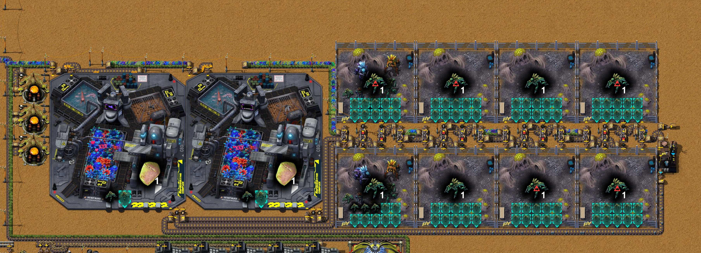

# 第八章 钳尾刀虫产线

[English](08-vrauks.md) · [目录](../README.zh-CN.md) · 上一章：[第七章](07-copper-screening-titanium-duralumin.zh-CN.md)

本章接着同一份录像，从 18:03 的存档到 21:27 的存档。目标是作者定的：一条繁殖**钳尾刀虫**的产线，pY科技包1型要用它们的甲酸（第七章第 1 节）。途中作者先建了钳尾刀虫和科技包共用的原料：培养皿、第二个苔藓区、石英和玻璃、塑料。接着用一批启动设备手工喂料做出头五只钳尾刀虫，然后建产线本身：八个钳尾刀虫围场、两台繁育复合体和一圈 64 个水桶。作者预计产线要很久才能满产；下一章计划完成pY科技包1型。时间均为游戏时间。数字来自游戏数据、记录器每 10 分钟的产量窗口、18:03 和 21:27 两个存档（`tools/inspect-save.ps1`）、在 21:27 存档上的运行（`tools/vrauk-probe`、`tools/rate-probe`）、一次传送带测试（`tools/belt-lab`）和作者的 Factory Planner 方案（`tools/planner-summary.js`）。作者还没有导出新区块的蓝图，打算等pY科技包1型整条线做完后一并导出。

结果：原料和头五只钳尾刀虫都有了，但**产线自己启动不起来**。在存档副本里，它 25 分钟内就停了。七个没装钳尾刀虫的围场仍在吞原料：空围场以万分之一的速度运转，于是开始一次要 370 天的生产，每个扣住 9 个水桶。而只放不取的链上那八个分流器，每个都扣下 4 个物品。把这八个分流器的输出优先级设好，水桶从 64 个加到 128 个，每只新出的钳尾刀虫一分钟内装回去，存档后 **110 分钟** 84 个插件槽全部装满，产线达到方案的每分钟 3 只（第 6 节）。另外，基地已经保不住电路板：合成气排气管拆掉之后，合成气气化炉被堵满，焦油线、锌和电路板在一小时内降到每秒 0.005。放回一根排气管，电路板就保持在 0.1。

## 本章一览

| 游戏时间 | 发生了什么 |
|---|---|
| 18:05–18:20 | 在第六章那台旁边，y 348.5（x −49.5 到 −14.5）又放了六台玻璃工厂 MK1，用石英矿做熔融玻璃；石英矿区 x 274 到 320、y 348 到 358 放了六台晶体矿石采矿机 MK1（共八台）；基地北面 y −270.5 放了三个海藻生长池 MK1 |
| 18:20–18:30 | 旁边的培养皿区：一台玻璃工厂做空培养皿，一台高压炉做琼脂，一台组装机做培养皿，三台微生物采集器 MK1 做孵化培养皿，两台高压炉做纤维素（配两台土壤挖掘机供石灰石），一台木材工坊（第 2 节） |
| 18:35–18:40 | x 17 到 64 的铁矿采矿区整体往南挪两格重铺：39 台热能采矿机，约 400 格传送带拆了再铺；铁矿在截至 18:40 的窗口是每秒 4.2，下一个窗口 25.4 |
| 18:40–18:55 | y −294 的第二个苔藓区：五个苔藓农场 MK1（各插 15 个苔藓），一台月落草温室 MK1 供二氧化碳，一台洗涤机和一台土壤挖掘机供泥浆，一台颚式破碎机供石矿（第 3 节） |
| 18:50–18:55 | (−13.5, −285.5) 的组装机用苔藓、孵化培养皿和纤维素做基础基质：pY科技包1型的第一种原料 |
| 19:10–19:20 | 焦油线旁 (−134.5, −198.5) 一台生物工厂 MK1 做塑料，芳烃经一个溢流阀进来；(−157, −127) 第三座破坏性蒸馏塔（沥青精炼） |
| 19:20–19:21 | 手搓两个储液罐 30k、第二台生物工厂和一台基因实验室 MK1 |
| 19:25–19:35 | 基因实验室放在 (−57, −307)，做 15 个苔藓基因样本；数据阵列仪放在 (−56, −316)，手搓五个钳尾刀虫数据集；然后收起基因实验室，原地放孵化器 MK1，配 100 个生态容器，做 100 个生态样本 |
| 19:45–19:55 | 拆掉两根排气管；原来排掉的合成气和氢气改走 x −107.5 和 −112.5 两条新管道往南，各约 520 格，送到 y 348.5 的七台玻璃工厂当燃料，三台管道泵用电路选择燃料（第 3 节） |
| 20:00–20:04 | 手搓七个钳尾刀虫围场 MK1（19:39 已做一个）和一台灌装机 |
| 20:05–20:15 | 在乙炔区旁 (−174.5, −145.5) 做繁育复合体要用的标准混凝土，原料是沙子（颚式破碎机碎碎石）、碎石和生石灰 |
| 20:18–20:19 | 收起孵化器和数据阵列仪 |
| 20:21–20:57 | 手搓生物室 MK1（基因实验室合进去了），放在 (−54.5, −305.5)；它做出五只钳尾刀虫，每只 400 秒，20:57 收起（第 4 节） |
| 20:28–20:47 | 围场放下、挪动、再放；三台树脂提取器 MK1，两台异星苗圃给它们育橡树 |
| 21:05–21:10 | 机器人把整个区块按最终位置重铺（x −60 到 47，y −336 到 −300）：八个围场、十六个分流器、灌装机和水桶环带（第 5 节） |
| 21:05–21:15 | 手搓 64 个空桶。作者留言："做64个桶，这个数是我用同时进行的配方所需数乘估算得到的" |
| 21:15–21:25 | 手搓两台繁育复合体 MK1，放在 (−43, −315) 和 (−21, −315)，各用 100 个标准混凝土；手搓一台屠宰场 MK1 留到下一章用 |
| 21:25 | 作者留言："循环物品形成环带避免堵塞" |
| 21:27 | 存档（本章结束）：一个围场里有三只钳尾刀虫，两台繁育复合体各一只 |

每秒产量（记录器的 10 分钟窗口）：

| 窗口截至 | 铁矿 | 石英矿 | 熔融玻璃 | 海藻 | 培养皿 | 苔藓 | 塑料 | 标准混凝土 | 钳尾刀虫 | 电路板 |
|---|---|---|---|---|---|---|---|---|---|---|
| 18:00 | 9.84 | 1.20 | 2.0 | 0 | 0 | 0.267 | 0 | 0 | 0 | 0.100 |
| 18:20 | 8.27 | 5.78 | 8.4 | 0 | 0 | 0.293 | 0 | 0 | 0 | 0.100 |
| 18:50 | 25.42 | 1.01 | 1.7 | 0 | 0 | 0.320 | 0 | 0 | 0 | 0.100 |
| 19:20 | 16.31 | 7.80 | 14.0 | 0.483 | 0.167 | 1.013 | 0.085 | 0 | 0 | 0.100 |
| 19:40 | 15.08 | 7.02 | 10.2 | 0.600 | 0.120 | 0.533 | 0.107 | 0 | 0 | 0.100 |
| 20:00 | 12.16 | 3.76 | 6.2 | 0.483 | 0.097 | 0.213 | 0 | 0 | 0 | 0.080 |
| 20:20 | 10.06 | 3.14 | 4.8 | 0.400 | 0.052 | 0.160 | 0 | 0 | 0 | 0.065 |
| 20:40 | 4.68 | 0.98 | 1.6 | 0 | 0 | 0.240 | 0 | 0.017 | 0.002 | 0.100 |
| 21:00 | 8.15 | 0.99 | 1.7 | 0 | 0 | 0.267 | 0 | 0.008 | 0.002 | 0.100 |
| 21:20 | 8.18 | 0.98 | 1.6 | 0 | 0 | 1.200 | 0 | 0.217 | 0 | 0.100 |

新区块在有人取货时运转，之后就满着停下：海藻、培养皿和塑料在带子、箱子和机器装满后停下（还没人用的产物堵住是正常的，见技巧笔记原则 23）。电路板在截至 20:00 到 20:20 的窗口跌到每秒 0.065，截至 20:40 的窗口起回到 0.1。

## 1. 为什么是钳尾刀虫，为什么启动慢

本章没有研究任何科技：所有可研究的科技都要pY科技包1型。作者的 Factory Planner 方案"pY科技包1型"（每分钟六个；20:43 又保存过一次）的甲酸来自每分钟三只钳尾刀虫，在屠宰场里分解。方案在**八个钳尾刀虫围场**里养它们，虫茧来自**两台繁育复合体**（方案；第七章）：

| 机器（数据） | 配方（数据） | 插槽 | 装 n 只钳尾刀虫时的速度 |
|---|---|---|---|
| 钳尾刀虫围场 MK1，250 kW | 10 钳尾刀虫茧 + 15 原生植被 + 5 苔藓 + 3 水桶 → 2 钳尾刀虫 + 3 空桶，160 秒 | 10 | 0.05 × n |
| 繁育复合体 MK1，500 kW | 10 苔藓 + 3 树脂 + 5 原生植被 + 4 水桶 → 4 到 6 个钳尾刀虫茧（平均 5 个）+ 4 空桶，40 秒 | 2 | 0.5 × n |

这两种机器都把钳尾刀虫本身当插件（每只 +1 速度），基础速度效果是 −1，下限 −0.9999（数据）。**一只钳尾刀虫都不装时，机器以万分之一的速度运转**，这和停着不一样：没有钳尾刀虫的围场（速度 0.000005）一凑齐原料就开工，把 10 个虫茧、15 个原生植被、5 个苔藓和 3 个水桶吞进这次生产，状态显示"工作中"，要约 370 天才做完；接着它的机械臂又把它补满，补到 6 个水桶和 20 个虫茧（在存档副本里实测）。装满十只的围场每 320 秒出 2 只；八个围场就是方案里的每分钟 3 只，两台繁育复合体各装两只，正好出它们要的每分钟 15 个虫茧。整条线满员时装着 **84 只钳尾刀虫**（8 × 10 + 2 × 2）。

头几只钳尾刀虫只能由**生物室 MK1**做：10 原生植被 + 3 苔藓基因样本 + 1 钳尾刀虫数据集 + 2 通用地球DNA样本 + 10 培养皿 → 1 只钳尾刀虫，400 秒（数据）。这些样本还要三台机器：基因实验室（苔藓基因样本）、孵化器（生态样本）和数据阵列仪（通用地球DNA样本）（第 4 节）。

之后产线只能靠自己产出的钳尾刀虫长大。围场里每只钳尾刀虫每秒产出 1/1600 只（速度 0.05 时 160 秒 2 只），所以围场里的钳尾刀虫最快每 18.5 分钟翻一倍。从 3 只到 80 只要 88 分钟，前提是每只新出的钳尾刀虫立刻装回围场，而且别的东西都不缺。虫茧是第二个上限：围场里每只钳尾刀虫每 1,600 秒用 5 个虫茧，繁育复合体里每只钳尾刀虫每 80 秒出 5 个，所以繁育复合体里的一只能供围场里的 20 只。

## 2. 培养皿和第一份基质

作者接下来的两个目标都要培养皿：钳尾刀虫的启动配方要 80 个（15 个苔藓基因样本 30 个，五只钳尾刀虫 50 个）；pY科技包1型用基础基质做，基础基质要孵化培养皿（方案）。这一区在基地北面 (−35, −280) 一带：

| 步骤 | 机器 | 配方（数据） |
|---|---|---|
| 海藻 | 3 个海藻生长池 MK1，各插 10 个海藻（速度 1.0） | 200 水 → 10 海藻，50 秒：三个合计每秒 0.6 海藻 |
| 琼脂 | 高压炉 MK1 | 5 海藻 + 100 蒸汽 → 1 琼脂，5 秒 |
| 空培养皿 | 玻璃工厂 MK1（烧萘油） | 50 熔融玻璃 → 1，3 秒 |
| 培养皿 | 热能组装机 MK1 | 1 琼脂 + 1 空培养皿 → 1，5 秒 |
| 孵化培养皿 | 3 台微生物采集器 MK1 | 1 培养皿 → 1，20 秒 |
| 纤维素 | 2 台高压炉，2 台土壤挖掘机供石灰石，1 台木材工坊 | 7 木材 + 4 石灰石 → 1，10 秒 |
| 基础基质 | (−13.5, −285.5) 的热能组装机 MK1 | 5 苔藓 + 2 孵化培养皿 + 3 纤维素 → 10，3.5 秒 |

存档时这一区都满着：18:03 以来做了 500 个培养皿，用掉 240 个（启动用的 80 个在内），还有 100 个在 (−19.5, −280.5) 的箱子里；基础基质做了 170 个，还没用（存档统计）。熔融玻璃来自 y 348.5 的玻璃工厂（第 3 节）。

## 3. 苔藓、玻璃、合成气和塑料

- **第二个苔藓区**在 y −294（x −37 到 −7）：五个苔藓农场 MK1，各插 15 个苔藓（速度 1.0），配方是 100 泥浆 + 100 二氧化碳 + 20 石矿 → 16 苔藓，80 秒：五个合计**每秒 1.0 苔藓**，加上第四章那十个。一台插 14 个月落草的月落草温室供二氧化碳（速度 0.875 时每 5 秒 200，每秒 35；五个农场用 6.25），一台土壤挖掘机加一台洗涤机供泥浆，一台颚式破碎机把石砖碎成石矿（数据）。方案里科技包和钳尾刀虫每分钟要 55.5 苔藓，这五个出 60。
- **石英和玻璃**：熔融玻璃用石英矿做（6 → 10，5 秒；数据）。石英矿区多了六台晶体矿石采矿机 MK1（共八台），y 348.5 多了六台玻璃工厂（共七台）：截至 19:20 和 19:30 的窗口熔融玻璃最高每秒 14，石英矿每秒 7.8 到 8.0。玻璃工厂烧液体燃料（10 MW；数据），这几台烧合成气。
- **玻璃工厂的燃料：先烧副产物**（19:45–19:55）。拆掉了两根排气管：(−108.5, −176.5) 那根原来排焦油线多余的合成气，(−112.5, −73.5) 那根排沥青精炼的氢。这两种气体现在走 x −107.5 和 x −112.5 两条新管道往南，旁边是第六章的汽油管（x −111.5，来自作者存汽油的尾矿池），各约 520 格，由 y −74.5 和 179.5 的止回阀切开（320 格上限，技巧笔记原则 18）。南端三处管道泵接进 y 348.5 一条通往七台玻璃工厂的燃料管，每处都由从管道读取的电路条件控制（存档）：**氢**泵在氢管里有氢时运转，**合成气**泵在没有氢时运转，**汽油**的两台串联泵只在既没有氢也没有合成气时运转。一段管道同一时间只能装一种流体，所以要等玻璃工厂把燃料管烧空，燃料才会换。存档时燃料管里是合成气。
- **熔融玻璃**仍走第六章那条沿 x −104.5 的管道往北，现在也送到 (−56.5, −267.5) 做培养皿的玻璃工厂。
- **塑料**（19:10–19:20）：焦油线旁 (−134.5, −198.5) 一台生物工厂 MK1，50 芳烃 + 100 合成气 → 1 塑料，1.5 秒（数据），芳烃经一个溢流阀进来，焦油线的其他用户优先。18:03 以来做了 202 个塑料，40 个用进了生物室和基因实验室，82 个在它的箱子里。焦油线还加了 (−157, −127) 第三座沥青精炼蒸馏塔和 (−157, −173) 第三台做合成气的气化炉（20:40）。

## 4. 启动批次：五只钳尾刀虫

作者做头几只钳尾刀虫的办法和第七章做硬铝一样：为此放几台机器，手工喂料，用完收起（技巧笔记原则 24）。

| 时间 | 机器 | 做出（存档统计，配方来自数据） |
|---|---|---|
| 19:25–19:30 | 基因实验室 MK1，在 (−57, −307) | 15 个苔藓基因样本（每个 2 培养皿 + 20 苔藓，10 秒） |
| 19:29 | 数据阵列仪，在 (−56, −316)；手搓五个钳尾刀虫数据集（每个 5 玻璃 + 5 电路板 + 10 镀锡电线） | 10 个通用地球DNA样本（每个一个铁箱 + 15 红瓶 + 10 生态样本，25 秒） |
| 19:34 | 孵化器 MK1，放在基因实验室原来的位置；手搓 100 个生态容器（每个 2 钛板、一块铅板、一块钢材、一个玻璃） | 100 个生态样本（每个一个生态容器 + 15 原生植被，10 秒：17 分钟） |
| 20:22–20:57 | 生物室 MK1，在 (−54.5, −305.5) | 5 只钳尾刀虫（每只 3 苔藓基因样本、一个数据集、2 个地球样本和 10 个培养皿，400 秒） |

基因实验室进了生物室：生物室的配方要用掉一整台基因实验室（数据），所以作者先用这台实验室做样本，之后再把它合进生物室。第七章按另配一台基因实验室估算，启动要约 345 个硬铝；这样做实际只用了 **245** 个，少了 100 个。其中生物室连同它的基因实验室、生物工厂和两个储液罐 130 个，数据阵列仪 50，孵化器 15，做塑料的生物工厂 50。钛板连同两台繁育复合体和屠宰场一共用了 680 块（存档统计）。作者背包里还剩 155 个硬铝，生物室、数据阵列仪和孵化器也留着以后用。

五只钳尾刀虫都当了插件：三只在 (−1.5, −307.5) 的围场里，两台繁育复合体各一只。生物室做这五只用了 33 分钟；装三只的围场每 1,067 秒（18 分钟）再出 2 只。

## 5. 钳尾刀虫产线

<!--  -->

产线在基地北面，x −60 到 47，y −336 到 −300（21:27 存档）：

- **两台繁育复合体**（21 × 21）在 (−43, −315) 和 (−21, −315)，紧挨着它们西边是**三台树脂提取器** MK1（各插两棵橡树，每台每分钟 3 树脂）。
- **八个钳尾刀虫围场**（12 × 12）分两排，每排四个，在 y −324.5 和 −307.5（x −1.5、11.5、24.5、37.5），隔着四格宽的走廊（y −318 到 −315）两两相对。
- **原生植被和苔藓**同在一条带上，沿 y −327.5 从西边来（原生植被来自 y 84.5 的三台植被采集器，先往西到主线、再沿主线往北；苔藓沿 x −60.5 从新苔藓区上来），经过繁育复合体的机械臂，再进走廊。
- **走廊里走四条链**。每对相对的围场在每条链上共用一个分流器：分流器有两格宽，北半边正在北边围场的机械臂下面，南半边在南边围场的机械臂下面。每条链从一个分流器到下一个都走地下传送带（Py 里最远 9 格；数据）。每对围场从西到东依次是：
  - **水桶和虫茧链**（分流器在 x −6.5、6.5、19.5、32.5）：每个围场的输入机械臂从自己那半边取。
  - **空桶链**（x −3.5、9.5、22.5、35.5）：每个围场带过滤的机械臂把空桶放到自己那半边；这条链的终点是灌装机。
  - **钳尾刀虫链**（x −0.5、12.5、25.5、38.5）：每个围场带过滤的机械臂把钳尾刀虫放到自己那半边；终点是 (46.5, −317.5) 的一个木箱。
  - **原生植被和苔藓链**（x 2.5、15.5、28.5、41.5）：每个围场的第二个输入机械臂。
- **水桶环带**：(45.5, −311.5) 的灌装机用自己的抽取泵给空桶灌水（速度 0.5 时每个 0.2 秒；数据）。灌好的水桶上一条带子：往南，沿 y −300.5 往西，再沿 y −302.5 往东经过繁育复合体（它们的输入机械臂在那里取水桶，虫茧机械臂把虫茧放上去），沿 x −9.5 往北进走廊的第一条链，穿过四个分流器，从灌装机下面钻回起点：一个闭合的环，也就是作者 21:25 的留言。繁育复合体吐出的空桶沿 y −301.5 往东进空桶链。
- **64 个空桶**，作者的估算（21:10 的留言）。

每条链的四个分流器都只有一个出口接了带子：链从一半继续往下走，另一半是死路。这是有意的：另一半正是对面围场的机械臂干活的地方。

## 6. 存档之后：产线自己启动不起来

在 21:27 存档的副本里实测（`tools/vrauk-probe`，每 10 分钟一段）。标为"回填"的几次，测量模组替作者的机器人完成插件请求：每分钟把产线箱子里的钳尾刀虫装进空插件槽，先装进钳尾刀虫最多的围场；当围场里的数量达到繁育复合体里每只对应 20 只时，再装进繁育复合体（第 1 节）。假设测试有两项：一是把八个只放不取的链（空桶、钳尾刀虫）上的分流器输出优先级设到接了带子的一侧，二是多加 64 个水桶。

| 运行 | 水桶 | 分流器优先级 | 结果 |
|---|---|---|---|
| 原样，不动任何东西 | 64 | 原样 | 前 20 分钟出 13 个虫茧、2 只钳尾刀虫，之后什么都没有：从第 25 分钟起，繁育复合体、装了钳尾刀虫的围场和灌装机一直停到一小时结束 |
| 回填 | 64 | 已设 | 灌装机重新开始灌桶，繁育复合体一半时间在转；到第 30 分钟出 4 只钳尾刀虫（围场里共 7 只），之后 40 分钟一只也没有 |
| 回填 | 128 | 已设 | 繁育复合体从一开始就 100% 运转。**存档后 110 分钟，84 个插件槽全部装满**；此后每 10 分钟出 28 到 32 只钳尾刀虫、约 150 个虫茧：正是方案的每分钟 3 只和 15 个 |
| 回填 | 128 | 原样 | 繁育复合体 100% 运转，装三只钳尾刀虫的围场也是：一小时出 6 只钳尾刀虫，一只也没进箱子 |

**64 个桶去了哪里**。原样运行到第 30 分钟时：38 个水桶在围场的输入里等着，16 个空桶和 4 个水桶停在分流器上，3 个在繁育复合体里，3 个在一次生产里。环带上已经没有桶给繁育复合体，于是它们停下，虫茧跟着停，装了钳尾刀虫的围场又因为缺虫茧停下。桶被扣在两个地方：

- **没装钳尾刀虫的围场**：每个都收 6 个水桶（两次生产的量）；一旦凑到 10 个虫茧，又把 3 个吞进一次要 370 天的生产（第 1 节）：每个 9 个桶、30 个虫茧，七个就是 63 个桶。设好分流器之后，虫茧一到，它们照样吞掉环带上的桶：第二次运行里看得见的桶从 54 个降到 39 个。
- **只有一个出口接了带子的分流器**：空桶链上的四个分流器，每个在死路出口上扣下 4 个空桶（`tools/belt-lab`：分流器会往没接带子的出口送东西，并在那里停住 4 个；把输出优先级设到另一侧，就一个都不停）。钳尾刀虫链上的四个分流器对钳尾刀虫也一样：第四次运行里六只全停在它们上面，要等到那里停满 16 只，产线才会再长。

**满产的产线装着多少桶**。每台机器的输入里都备着两次生产的原料，另有一次在做，没装钳尾刀虫的也一样：8 × 9 + 2 × 12 = **96 个桶在机器里**。第三次运行满产时，看得见的有 96 个（机器输入里约 60 个，带上约 35 个），生产中的 32 个：正好 128 个。作者的 64 个是同时进行的配方所需数的两倍（8 × 3 + 2 × 4 = 32）；产线实际要四倍。

**启动要多久**。第三次运行用了 110 分钟，前提是每只新出的钳尾刀虫一分钟内就装回去；按第 1 节单纯计算，最快也要 88 分钟。回填得越少，或者把钳尾刀虫分散装在很多围场里，都会更慢。

**存档后一小时，基地其余部分**。

用 `tools/rate-probe` 测量（每 10 分钟一段，每秒数值），一次按存档原样，一次在读档时往合成气管道上放回一根排气管，位置 (−106.5, −177.5)：

| 21:27 之后的分钟 | 电路板 | 锌板 | 合成气 产出 / 消耗 | 氢 产出 | 熔融玻璃 | 放回排气管时的电路板 |
|---|---|---|---|---|---|---|
| 0–10 | 0.090 | 0.280 | 19.6 / 17.6 | 2.57 | 1.47 | 0.090 |
| 10–20 | 0.070 | 0.280 | 14.5 / 14.5 | 2.25 | 1.20 | 0.110 |
| 20–30 | 0.060 | 0.113 | 7.7 / 11.8 | 0.93 | 0.93 | 0.100 |
| 30–40 | 0.025 | 0.027 | 8.5 / 5.7 | 1.03 | 0.50 | 0.100 |
| 40–50 | 0.025 | 0.093 | 0 / 4.4 | 0 | 0.35 | 0.100 |
| 50–60 | 0.005 | 0 | 0 / 0 | 0 | 0 | 0.100 |

**一小时内电路板就停了**。合成气现在只有两个去处：玻璃工厂（当燃料）和做塑料的生物工厂，产物没人用时两者都停：这一小时里玻璃工厂 94% 的时间"满载停机"，生物工厂全程缺芳烃。于是三台合成气气化炉 88% 的时间"满载停机"。它们是焦炭区煤气的出口，它们产的焦油（每 50 煤气 30 焦油）又是焦油线的原料：焦油精炼 80% 的时间在等焦油，芳烃跟着减少，用芳烃开采的锌矿采矿机 85% 的时间缺流体，锌板、电池和电路板依次停下。第六章的杂酚油也是这样：一种副产物唯一的出路是一个没人要的产物时，生产它的整条线会停。**放回一根排气管后**，气化炉只有 44% 的时间满载，产线全程每秒出 36 合成气、32 焦油、13.8 芳烃和 0.34 到 0.36 锌板，电路板保持每秒 0.1。这次测试的排气管把到达它的合成气全部排掉；如果像第六章的煤气那样放在溢流阀后面，它就只排玻璃工厂用剩的部分。

## 7. 其他变化

- **铁矿采矿区重铺**（18:35–18:40）：机器人拆走采矿机、机械臂和约 400 格传送带，作者往南挪两格重新铺好。18:03 时它的 38 台热能采矿机里有 4 台下面已经没矿；21:27 时有 46 台，全都压在矿上（下面共 196 万）。铁矿在截至 18:40 的窗口每秒 4.2，之后两个窗口 25.4 和 28.0，再往后 10 到 16。
- **标准混凝土**（20:05–20:15），给繁育复合体用（每台 100 个）：乙炔区旁 (−174.5, −145.5) 一台热能组装机，5 生石灰 + 10 沙子 + 10 碎石 + 100 水 → 5 标准混凝土，0.5 秒；一台颚式破碎机做沙子（4 碎石 → 3，1 秒），配自己的抽取泵和一个渗水坑；生石灰和碎石来自乙炔区（数据；存档）。一共做了 265 个，用掉 200 个。
- **电力：**(−56, 382) 那两台锅炉和蒸汽机旁边又加了两套（20:20–20:25）；全基地 28 台蒸汽机都在同一个电网上。
- **样本用的红瓶**：十个通用地球DNA样本用掉 150 个红瓶（和 10 个铁箱）。第四章的红瓶产线在没有研究时一直满着停下；这 3.4 小时里它做了 151 个，正好补上样本用掉的（存档统计）。

## 8. 检查清单

- 钳尾刀虫围场和繁育复合体靠钳尾刀虫当插件运转。一只都没有时，机器以万分之一的速度运转：它仍会吞下一次生产的原料（围场：3 个水桶、10 个虫茧），输入里再备两次的量。
- 用一批设备启动钳尾刀虫：基因实验室、数据阵列仪和孵化器做样本，再做生物室，它的配方要用掉基因实验室（先用实验室，再合进去）。五只钳尾刀虫要 245 个硬铝，生物室做 33 分钟。
- 循环使用的容器，把每个会停留的地方都算上：环上每台机器三次生产的量（没在运转的也算），每个没接带子的分流器出口 4 个，再加带上的。钳尾刀虫产线满产时装着 128 个水桶；只有 64 个时，半小时内就停。
- 拿分流器当两台机器共用的两格宽放料点时，把输出优先级设到链继续往下走的那一侧，否则它会在另一侧永久扣下 4 个物品。
- 每只新出的钳尾刀虫立刻装回去：这样做的那次运行，从五只到 84 个插件槽装满用了 110 分钟。
- 每种副产物都要留一个不依赖没人用的产物的出口。合成气只能在满载停机的玻璃工厂里烧时，存档后一小时内电路板就跌到每秒 0.005；放回一根排气管，就保持在 0.1。

## 9. 这些事实如何核对

- 游玩过程：助手模组的记录器（运行 `2652821414-0`），用 `tools/recorder-phases.js`（每 5 分钟一段的时间线）、`tools/recorder-log.js`（每 10 分钟窗口的产量，以及每分钟的建造和手搓记录）和 `tools/recorder-summary.js`（作者的留言）读取。
- 作者的方案：助手模组导出的 Factory Planner 工厂（`tools/planner-summary.js --factory pY`，20:43 保存）。
- 21:27 的存档（`Py-Exploration`，先复制再读；一致性检查通过）：`tools/inspect-save.ps1 -Ticks 3700`、`tools/summarize-save.js`、`tools/trace-layout.js` 和 `tools/render-area.js`（钳尾刀虫产线）；18:03 以来变了什么，来自两个存档的 `entities.json`；18:03 以来做了和用了多少，来自两个存档的产量统计。检查器现在还记录每个分流器的过滤和优先级，以及每台机械臂手里拿着什么。
- 钳尾刀虫产线的各条传送带链、管道泵的电路条件和每格带上的桶：在存档副本里用简短的测量模组（`tools/save-probe.ps1`），沿 `belt_neighbours` 和地下传送带配对逐格追踪。
- **启动过程**：在 21:27 存档上运行 `tools/save-probe.ps1 -Probe vrauk-probe`：`as-is` 一小时；`fill`（每分钟把箱子里的钳尾刀虫装进空插件槽）加假设测试 `prio` 和 `barrels:64`，最长四小时，每 10 分钟一段。
- **空围场开工**：在存档副本里往一个没装钳尾刀虫的围场里放 10 个虫茧，读它的状态、生产进度和输入。
- **只接一个出口的分流器：**`tools/belt-lab`（第 7 项测试），用 `tools/run-probe.ps1 belt-lab -Ticks 3700 -Work C:\tmp\cf-save` 运行。
- **存档后一小时：**`tools/save-probe.ps1 -Probe rate-probe -Ticks 219700 -Variant 60,3600,600,<名称>`，原样一次，读档时放回一根合成气排气管再一次（`,+py-gas-vent@-106.5:-177.5:south`）。
- 数据：作者当前模组的导出（`C:\tmp\cf-save\data\script-output\data-raw-dump.json`）：配方、机器速度、插件槽和基础效果、产量统计不计入的桶（`ignored_by_stats`）、地下传送带距离；英文名来自模组的 `locale/en`。
- 没有蓝图：作者会在pY科技包1型整条线完成后一并导出。
- 截图：作者用助手模组拍摄（`/pt-shots`）。

下一章：第九章，pY科技包1型（待续）。
