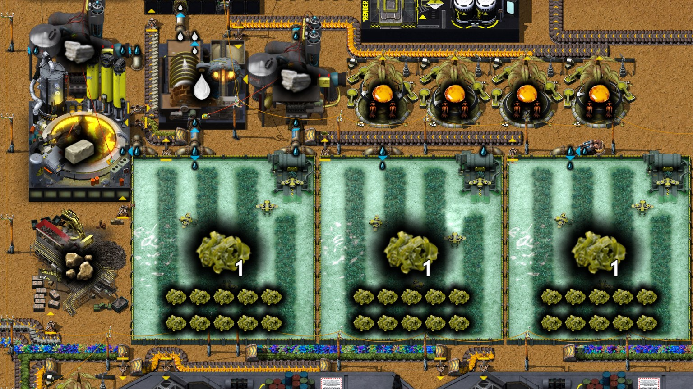
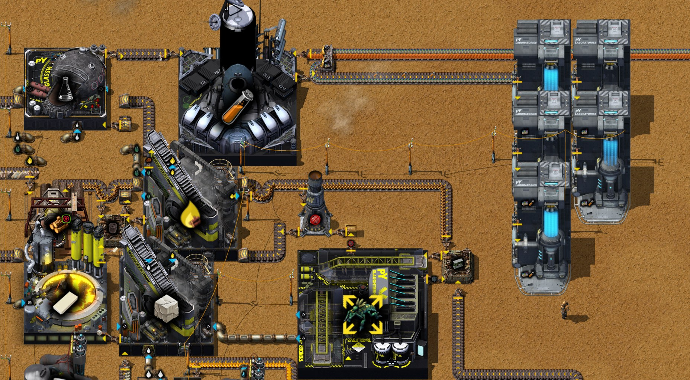
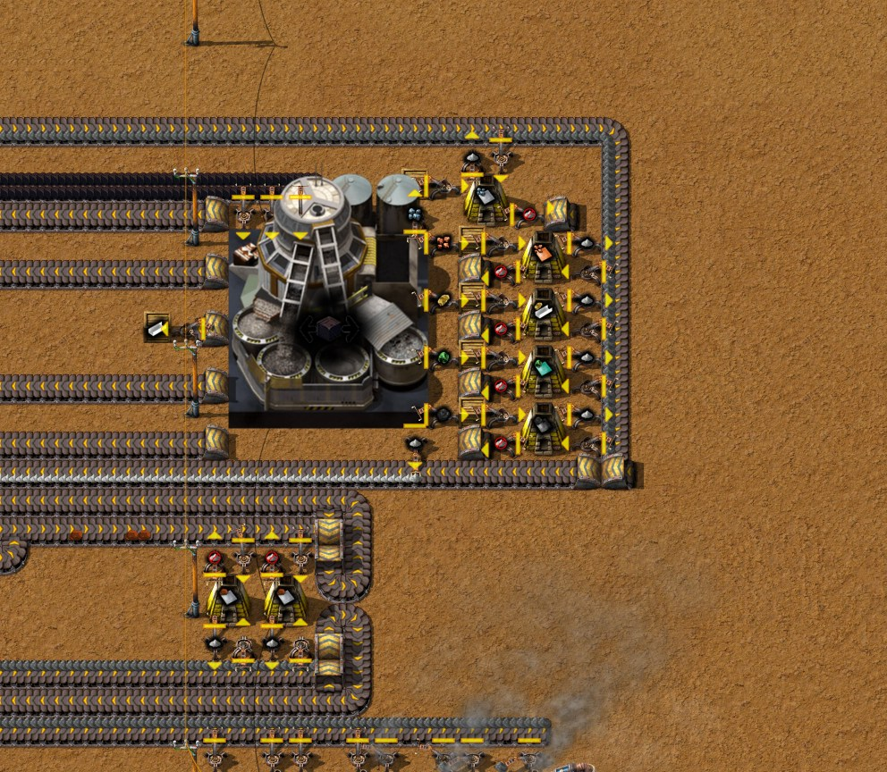

# 第九章 pY科技包1型

[English](09-py-science-pack-1.md) · [目录](../README.zh-CN.md) · 上一章：
[第八章](08-vrauks.zh-CN.md)

本章接着同一局录像，从 21:35 的存档到 23:31 的存档。目标是作者定的：**每秒 0.1 个pY科技包1型**，即 Factory Planner 里的工厂“pY科技包1型”（每分钟 6 个）。甲酸来自第八章的钳尾刀虫线；作者围绕它建了乳胶链（海藻、海藻酸钠、液态乳胶、乳胶块、乳胶）、橡胶塞和瓶子、做科技包的科研枢纽 MK1，并把研究中心搬到旁边。21:55 研究重新开始，第一项是“燃烧器”，这是 13:36 以来的第一项科技。作者把整条产线导出成蓝图 `py-science-pack-1`，同时导出了第七章的铜区块（`copper-screening`）。时间都是游戏时间。数字来自游戏数据、记录器每 10 分钟的产量窗口、23:31 的存档（`tools/inspect-save.ps1`）、这个存档之后两小时的实测（`tools/rate-probe`）、蓝图测试台（`tools/bp-bench.ps1`）和作者的 Factory Planner 方案（`tools/planner-summary.js`）。

结果：产线上的机器都齐了，钳尾刀虫线满产，每分钟 3 只，正好是每秒 0.1 包所需：一个科技包要半只钳尾刀虫。存档前最后一个记录窗口里，这条链每秒做出 0.070 包。但**基础基质送不到科研枢纽**：它的传送带在机器前一格就断了，科研枢纽的基质来自一个手放的箱子。在存档副本里，它做出 6 包就停了，15 分钟内后面的东西一路堵到屠宰场。在 (−36.5, −376.5) 补一个机械臂后，产线**每秒做 0.100 包**，它要的熔融玻璃把合成气烧掉了，和作者预计的一样：电路板保持每秒 0.1。但这时整个基地都在运转，烧掉的原煤和产出的灰烬都翻了一倍，**40 分钟后灰烬拖垮了电力**：烟煤分离机的灰烬送不出去，灰烬分离机的烟煤送不出去，锅炉被灰烬塞满，60 分钟时全基地断电（第 7 节）。

## 全程一览

| 游戏时间 | 发生了什么 |
|---|---|
| 21:35–21:45 | y −334.5 再建三个海藻生长池 MK1（x −46.5 到 −20.5）；(−56.5, −341.5) 一台做海藻酸钠的高压炉，(−56.5, −333.5) 一台为它做石矿的颚式破碎机，(−56.5, −348.5) 一台供石灰石的土壤挖掘机；(−21.5, −341.5) 一台抽取泵 |
| 21:45–21:55 | y −345.5 四台树脂提取器 MK1（x −35.5 到 −20.5），(−48, −346) 一台做液态乳胶的洗涤机，(−41.5, −346.5) 第二台土壤挖掘机；(−48, −355) 一台做乳胶块的破坏性蒸馏塔，(−56.5, −355.5) 一台做乳胶的高压炉；第八章做好的屠宰场 MK1 放在 (−31.5, −354.5) |
| 21:55 | 研究重新开始：燃烧器（50 份，每份 1 个pY科技包1型 + 2 个红瓶，45 秒） |
| 21:55–22:05 | (−52.5, −361.5) 一台做橡胶塞的组装机；它用的煤矿由木材来：(−57, −362) 一台木材工坊 MK1，(−46, −363) 一台跑“木材制煤气”的破坏性蒸馏塔；(−56.5, −373.5) 一台做瓶子的玻璃工厂 |
| 22:05–22:20 | (−42, −372) 科研枢纽 MK1，(−23.5, −358.5) 一台做笼装钳尾刀虫的组装机；旧科研角（y −173.5 和 −167.5）的六台研究中心拆掉；铺了约 790 格传送带：基础基质和红瓶都往东走，沿 x 48 往北，再沿 y −376 往西 |
| 22:15–23:35 | 研究中心放下、挪动、再放下：最后是五台，在 x −16.5 和 −11.5，y −370.5 到 −358.5 |
| 22:20–22:30 | 管道：萘油从第八章那条管道往北接到做瓶子的玻璃工厂，由 (−117.5, −272.5) 的止回阀切开；木材蒸馏塔的煤气和焦油往南（煤气管上有 (−102.5, −74.5) 的止回阀） |
| 22:30–22:35 | y 285 到 312（x −32.5 到 −17.5）的八个灰烬箱子连同机械臂拆掉 |
| 22:35 | 手搓一个笼子 |
| 22:40 | (−168, −139) 第四台裂解蒽油的破坏性蒸馏塔（50 蒽油 → 20 汽油 + 5 焦炭，4 秒；数据） |
| 22:50 | 第六章那十台烧焦炭的锅炉旁边，y −260 再建十台锅炉（x −159.5 到 −132.5），由机器人连同燃料带一起建；一台抽取泵从 (−161.5, −256.5) 挪到 (−129.5, −256.5) |
| 23:05–23:15 | 乙炔区块旁做混凝土的一角整体往西挪一格（渗水坑、颚式破碎机） |
| 23:31 | 存档（记录器的最后一条记录）：21:35 以来做了 48 个科技包，燃烧器研究到 75% |

每秒产量（记录器每 10 分钟的窗口）：

| 窗口结束于 | 钳尾刀虫 | 笼装钳尾刀虫 | 甲酸 | 海藻酸钠 | 乳胶 | 橡胶塞 | 瓶子 | 基础基质 | pY科技包1型 | 电路板 |
|---|---|---|---|---|---|---|---|---|---|---|
| 21:40 | 0 | 0 | 0 | 0 | 0 | 0 | 0 | 0 | 0 | 0.105 |
| 22:00 | 0.003 | 0 | 0 | 0.048 | 0 | 0 | 0 | 0 | 0 | 0.045 |
| 22:20 | 0.003 | 0 | 0 | 0 | 0 | 0 | 0 | 0.783 | 0 | 0.070 |
| 22:40 | 0.010 | 0 | 0 | 0 | 0 | 0 | 0 | 0.283 | 0 | 0.110 |
| 23:00 | 0.017 | 0 | 0 | 0 | 0 | 0 | 0 | 0 | 0 | 0.120 |
| 23:20 | 0.037 | 0 | 0 | 0 | 0 | 0 | 0 | 0 | 0 | 0.130 |
| 23:30 | 0.053 | 0.042 | 8.0 | 0.077 | 0.077 | 0.147 | 0.073 | 0 | 0.070 | 0.075 |

到 23:20 为止，每只新的钳尾刀虫都插回产线当插件，和第八章预计的一样；存档时 84 个槽全满，最后一个窗口里钳尾刀虫送进了屠宰场。第八章那台做基础基质的组装机 22:40 以后停了，因为没有东西把它的产物从传送带上取走。

## 1. 从钳尾刀虫到科技包

pY科技包1型的配方很短，但两种原料背后各有一条长链（数据）：

| 步骤 | 作者产线里的机器 | 配方（数据） | 每秒 0.1 包要几台 |
|---|---|---|---|
| pY科技包1型 | 科研枢纽 MK1 (−42, −372)，速度 1 | 18 基础基质 + 3 瓶子 → 3，15 秒 | 0.5 |
| 瓶子 | 玻璃工厂 MK1 (−56.5, −373.5) | 4 橡胶塞 + 100 熔融玻璃 → 2，3 秒 | 0.15 |
| 橡胶塞 | 热能组装机 (−52.5, −361.5) | 2 乳胶 + 5 煤矿 → 4，5 秒 | 0.25 |
| 煤矿 | 破坏性蒸馏塔 (−46, −363)，木材来自木材工坊 (−57, −362) | 10 木材 → 10 煤矿 + 10 煤气 + 30 焦油 + 1 氧化铁，3 秒 | 0.08 |
| 乳胶 | 高压炉 (−56.5, −355.5) | 1 乳胶块 + 150 蒸汽 → 1，10 秒 | **1.0** |
| 乳胶块 | 破坏性蒸馏塔 (−48, −355) | 1 海藻酸钠 + 100 液态乳胶 + 100 甲酸 → 1，5 秒 | 0.5 |
| 甲酸 | 屠宰场 MK1 (−31.5, −354.5) | 1 笼装钳尾刀虫 → 200 甲酸 + 2 肉 + 2 内脏 + 1 几丁质 + 1 大脑 + 1 笼子，10 秒 | 0.5 |
| 笼装钳尾刀虫 | 热能组装机 (−23.5, −358.5) | 1 钳尾刀虫 + 1 笼子 → 1，0.5 秒 | 0.03 |
| 钳尾刀虫 | 钳尾刀虫线（第八章） | 满产每分钟 3 只 | **全部** |
| 液态乳胶 | 洗涤机 (−48, −346) | 2 树脂 + 2 石灰石 + 100 水 → 100，8 秒 | 0.8 |
| 树脂 | y −345.5 四台树脂提取器 MK1，各插 2 棵橡树（速度 1） | → 4，80 秒 | 4 |
| 海藻酸钠 | 高压炉 (−56.5, −341.5) | 5 海藻 + 5 石矿 + 100 水 + 4 石灰石 → 1，5 秒 | 0.5 |
| 海藻 | y −334.5 三个海藻生长池 MK1，各插 10 个海藻（速度 1） | 200 水 → 10，50 秒 | 2.5 |
| 石矿 | 颚式破碎机 (−56.5, −333.5) | 4 石砖 → 8，5 秒 | 0.3 |
| 石灰石 | 两台土壤挖掘机 (−56.5, −348.5) 和 (−41.5, −346.5) | 400 水 → 8，20 秒 | 1.5 |
| 基础基质 | 热能组装机 (−13.5, −285.5)，第八章 | 5 苔藓 + 2 孵化培养皿 + 3 纤维素 → 10，3.5 秒 | 0.2 |

**一个科技包要半只钳尾刀虫。** 每包：1 个瓶子、2 个橡胶塞、1 个乳胶、1 个乳胶块、100 甲酸，也就是半只笼装钳尾刀虫。所以每秒 0.1 包要每秒 0.05 只钳尾刀虫，每分钟 3 只：正好是第八章那条线的全部产量，没有余量。另一步一直满负荷的是乳胶高压炉（每 10 秒一个乳胶）。链上其余部分都有余地：一台科研枢纽只用一半速度，一台玻璃工厂只用 15%。作者的方案是同样的数字（`planner-summary.js --factory pY`：每分钟 6 包、3 只笼装钳尾刀虫、一台乳胶高压炉）。

每包还要 6 个基础基质、做瓶子的 50 熔融玻璃和 2.5 个煤矿；每秒 0.1 包时，乳胶要每秒 15 蒸汽，加上第八章的琼脂共每秒 27 蒸汽。

## 2. 乳胶这一列

新机器排成一列，在钳尾刀虫线西边，x −57 到 −20，从 y −334 往北到 −373（下面的截图）：

- **海藻和海藻酸钠**（y −341 到 −334）：第八章那三个海藻生长池旁边再建三个，一台抽取泵供水，一台颚式破碎机把石砖碎成石矿，一台土壤挖掘机供石灰石，再加做海藻酸钠的高压炉。每秒 0.1 包要从带上取每秒 0.5 个海藻；三个新生长池每秒出 0.6 个。
- **液态乳胶**（y −346）：四台树脂提取器，各插两棵橡树（速度 1.0：每台每秒 0.05 个树脂，合计 0.2，正是洗涤机要的 0.2），加上洗涤机和第二台土壤挖掘机。
- **乳胶块和乳胶**（y −355）：蒸馏塔由传送带取海藻酸钠，由管道取液态乳胶和甲酸；旁边的乳胶高压炉取乳胶块和蒸汽。
- **橡胶塞和瓶子**（y −373 到 −361，第 4 节），最上面是科研枢纽。

<!--  -->

## 3. 甲酸：钳尾刀虫、一个笼子和屠宰场

钳尾刀虫线的产物（第八章）现在不进箱子，而是由传送带送到 (−23.5, −358.5) 做笼装钳尾刀虫的组装机。组装机把一只钳尾刀虫装进笼子；旁边的屠宰场用 10 秒把它分解成 200 甲酸、副产物和笼子，笼子再回到组装机。

**一个笼子就够了。** 作者手搓了一个（22:35），这也是存档里唯一的笼子：23:31 时在组装机里。转一圈要屠宰场的 10 秒加上机械臂的搬运；每秒 0.1 包时每 20 秒来一只钳尾刀虫。在补了基质机械臂的实测里（第 7 节），屠宰场每秒分解 0.05 只笼装钳尾刀虫：这一个笼子跟得上。

**副产物**进 (−24.5, −352.5) 到 (−24.5, −349.5) 的四个木箱，肉、几丁质、内脏、大脑各一个（存档时 58、29、58、29 个）。木箱有 16 格，这些东西每格 100 个（数据），所以每箱装 1,600 个。每分钟 3 只钳尾刀虫时，每秒出 0.1 个肉和 0.1 个内脏：**这两个箱子大约在存档后 4.3 小时装满**，几丁质和大脑的箱子再晚一倍，之后屠宰场停下，科技包也跟着停。屠宰场北边有四个燃烧器的虚影，这正是现在研究的科技解锁的建筑。燃烧器能销毁肉、内脏、大脑和几丁质，速度 5 时每 1.5 秒一个，每秒 3.3 个（数据）；四个虚影对四种副产物，看起来是一个箱子配一台燃烧器，不过作者没有说过。燃烧器本身烧化学燃料（180 kW；数据）。

## 4. 橡胶塞和瓶子

- **用木材做煤矿。** 橡胶塞要煤矿（4 个要 5 个）。作者就地生产：木材工坊把原木做成木材（4 → 40，1 秒），破坏性蒸馏塔把木材分解成煤矿、煤气、焦油和氧化铁（10 木材 → 10 煤矿 + 10 煤气 + 30 焦油 + 1 氧化铁，3 秒；数据）。速度 1 时这台蒸馏塔每秒能出 3.3 个煤矿，每秒 0.1 包时橡胶塞只用 0.25，所以它几乎一直是“输出已满”（第 7 节）。(−49.5, −367.5) 一个带过滤的机械臂把氧化铁取走；煤气走一条新管道往南，经过 (−102.5, −74.5) 的止回阀，焦油走另一条送到 (−147.5, −85.5) 的焦油处理设施。
- **橡胶塞**在 (−52.5, −361.5) 的热能组装机里做：2 乳胶 + 5 煤矿 → 4，5 秒。
- **瓶子**在 (−56.5, −373.5) 的玻璃工厂里做：4 橡胶塞 + 100 熔融玻璃 → 2，3 秒。熔融玻璃沿 x −104.5 的管道上来（第六章和第八章），每秒 0.1 包时每秒 5。燃料是**萘油**，作者存着的焦油线副产物（第六章）：一条新管道从原来给 (−56.5, −267.5) 培养皿玻璃工厂供油的管道往北接到这里，中间有 (−117.5, −272.5) 的止回阀（320 格上限，技巧笔记原则 18）。

## 5. 科研枢纽和研究中心

科研枢纽从玻璃工厂旁边一段两格长的传送带取瓶子，从 (−37.5, −378.5) 的木箱经一个机械臂取基础基质，做好的科技包放到通往研究中心的红瓶带上。

**基质的传送带。** 基础基质从第八章 (−13.5, −285.5) 的组装机出来，沿 y −272 往东到 x 48，沿 x 48 往北，再沿 y −376.5 往西；红瓶从 y −176 的旧科研角上来，走同一条带的另一道。(−34.5, −376) 一个分流器把红瓶过滤到左边出口，那边往南再往东通到研究中心；其余的，也就是基质，继续往西到 (−35.5, −376.5)，传送带在那里就断了，离科研枢纽还差一格。没有机械臂从那里取货。存档时有 244 格传送带上是基质，约一千个，它的组装机“输出已满”。科研枢纽里有 36 个，箱子里 37 个；21:35 以来做的 48 包用掉了 288 个，所以基质是手放进箱子的。蓝图里也是同样的缺口。在 (−36.5, −376.5) 放一个机械臂，从带子末端取货送进科研枢纽，就能补上（第 7 节）。

<!--  -->

**研究中心。** 五台研究中心在 x −16.5 和 −11.5（y −370.5 到 −358.5），从红瓶带上取货。燃烧器要 50 份，每份 1 个pY科技包1型和 2 个红瓶，45 秒，排在它后面的 pY 科技也一样（50 到 55 份；数据）。五台速度 1 的研究中心每秒能用 5/45 = 0.111 份，比每秒 0.1 包略多：所以快慢由科技包决定，每项科技 8 到 9 分钟，研究中心每秒用 0.2 个红瓶，正好是第四章红瓶区块的全部产量。

## 6. 蒸汽

乳胶高压炉每个乳胶要 150 蒸汽，每秒 0.1 包时每秒 15，第八章的琼脂高压炉另要 12。两者都挂在第六章 y −257 那十台烧焦炭的锅炉的蒸汽管上，从 y −355 到 −75 是同一段（存档）。22:50 机器人在 y −260 又建了一排十台锅炉，每台配一个机械臂和燃料带；存档时它们没有燃料，y −262.5 的燃料带是空的。

## 7. 存档后的两小时

用存档副本各跑两小时（`tools/rate-probe`，每 5 或 10 分钟一段）：一次按存档原样，三次在 (−36.5, −376.5) 补一个机械臂，分别观察科技包链、电路板和燃料气体、发电站和灰烬（75 分钟）。补了机械臂的几次结果彼此一致。

| | 按存档原样 | 补一个机械臂 |
|---|---|---|
| 每秒pY科技包1型 | 前 5 分钟 0.02（6 包），之后 0 | 40 分钟内 **0.100**，到 55 分钟 0.07，60 分钟起 0 |
| 每秒电路板 | 0.058（两小时平均） | 40 分钟内 0.095 到 0.130，之后降到 0 |
| 每秒烧掉的原煤 | 36.6 | 69 到 79 |
| 每秒蒸汽 | 215 | 414 到 473 |
| 每秒灰烬产出 / 分离 | 41 / 44 | 76 到 87 / 60 到 83，45 分钟起 13 |
| 电力 | 两小时都够 | 45 分钟起“电力不足”，60 分钟起到结束完全断电 |

**按存档原样**。科研枢纽做完两次（6 包）之后，剩下的两小时一直缺基质。瓶子先堵住（玻璃工厂 10 分钟起“输出已满”），接着是橡胶塞、乳胶块、乳胶和屠宰场（15 分钟）。钳尾刀虫线照样每分钟出 3 只，没人取。基地其余部分和第八章一样：做合成气的气化炉 80% 的时间“输出已满”，锌矿采矿机 74% 的时间缺流体，电路板平均每秒 0.058 块。

**补上机械臂，产线就能运转**。从头五分钟起，第 1 节的每一步都按计划的速度跑：每秒 0.100 个瓶子、0.200 个橡胶塞、0.100 个乳胶、0.050 只笼装钳尾刀虫、10 甲酸、0.600 个基础基质（先用掉传送带上那一千个）。科研枢纽大约一半时间在工作，乳胶高压炉一直在工作。**合成气被用掉了，和作者预计的一样**：基地现在每秒要 12 熔融玻璃（原样时 2）来做瓶子和培养皿，所以 y 348.5 的玻璃工厂要烧焦油线产出的燃料；合成气每秒用 44 到 59、产 44 到 54，汽油 20 分钟后每秒用 35、产 27，电路板保持每秒 0.095 到 0.130 块。存着的汽油（(−139, 3) 的尾矿池里 167,000）每秒少约 8，够烧约 6 小时；萘油（248,000）还在涨，每秒 3 到 9。

**然后电力崩了**。整条链都在运转时，基地烧掉的原煤是原样时的两倍，灰烬也是两倍。十二台灰烬分离机每秒能处理 120 个（每台 10 个；数据），但 25 分钟起每秒只分离约 60 个，其余的堆在灰烬传送带上。(−56.5, 365.5) 的烟煤分离机把自己的灰烬（占产物的 30%；数据）放到其中一条带上，位置在 (−53.5, 370.5)：这条带满了，它就整段实测都“输出已满”（原样时只有 28% 的时间），烟煤不再流动；40 分钟起，烟煤送不出去的灰烬分离机也“输出已满”。灰烬于是倒灌进锅炉：y 260 和 273 那座电站 40 到 45 分钟时因灰烬格满而停下，y 382 那四台烧煤粉的锅炉有一半在 45 分钟停下，y 230 和 243 那座电站在 60 分钟停下。蒸汽机没了蒸汽，基地 45 分钟时“电力不足”，60 分钟时完全断电，而且再也启动不了，因为灰烬分离机和烟煤分离机本身就用电。这是一个环，和第六章的锌与焦油一样：灰烬分离需要烟煤分离，而烟煤分离的灰烬又需要灰烬分离。

<!--  -->

**这意味着什么**。科技包产线本身补一个机械臂就完整了。基地缺的是全部运转后容纳两倍灰烬的余地。下面还没有实测，只来自数据：正在研究的燃烧器能销毁灰烬和烟煤，每秒各 3.3 个，所以大约八台燃烧器就能吃下每秒堆积的 25 个灰烬，一台吃下烟煤；另外，烟煤分离机的灰烬要有一个不依赖灰烬分离机的出口。

## 8. 其他变化

- **研究中心搬家**：从旧科研角（六台，y −173.5 和 −167.5）搬到科研枢纽旁（五台），红瓶带也往东、往北接了过去（第 5 节）。
- **蒽油裂解**：(−168, −139) 第四台破坏性蒸馏塔，50 蒽油 → 20 汽油 + 5 焦炭，4 秒（数据）。两小时实测里四台有三分之二的时间“缺少流体原料”：快慢由蒽油决定，不由蒸馏塔决定。
- **第二排锅炉**在 y −260（第 6 节），至今没有燃料。
- **做混凝土的一角**在乙炔区块旁（第八章第 7 节），往西挪了一格，现在属于 `acetylene` 蓝图（第 9 节）。
- **八个灰烬箱子**在 y 285 到 312，连同机械臂一起拆掉（22:30–22:35）。全基地箱子里的灰烬：21:35 时 208,000，23:31 时 222,000（两个存档）。
- **一箱空心电感器**在电路板区块旁：(−38.5, −251.5) 的机械臂从电子厂取出空心电感器放进木箱（存档时 400 个）。

## 9. 蓝图

作者在现实时间 20:34 导出了蓝图书，就在存档之前；`tools/bp-sync.js pull` 报告两张新蓝图、三张改动过的：

- **`py-science-pack-1`**（新），“0.1 [pY科技包1型]”：第八、九章的整条产线，存档坐标 x −60 到 48、y −379 到 −264，1,088 格传送带、116 个机械臂、8 个围场和 2 台繁育复合体、乳胶这一列、科研枢纽、5 台研究中心和 4 个燃烧器虚影。它和存档有同样的缺口：(−36.5, −376.5) 没有机械臂。没有上测试台：钳尾刀虫线从几只钳尾刀虫开始要 100 分钟才能插满，月落草温室的速度来自存档里选定的碳捕集升级；它是在原地实测的（第 7 节）。
- **`copper-screening`**（新），“3 [铜板]”：第七章的铜区块，x −70 到 53，y 10 到 21，不含采矿区；在原地实测为每秒 3.01 块铜板。
- **`acetylene`**（改动）：加上了做混凝土的一角和作者的备注“额外产一点标准混凝土”。测试台：每秒 49.92 个乙炔（之前 49.75）。这一角在测试台的 30 分钟里没有做出混凝土；作者游戏中 23:10 之后每秒做 0.02 到 0.05 个（记录器）。
- **`iron-oxide-smelting`**（改动）：送料和取料机械臂对调，是同一个设计的镜像。测试台：每秒 1.713 个氧化铁、0.857 块铁板，与之前相同。
- **`simple-circuit-board`**（改动）：加上了装空心电感器的机械臂和箱子（第 8 节）。

## 10. 清单

- 一个pY科技包1型要半只钳尾刀虫：每秒 0.1 包要每分钟 3 只，即 8 个围场加 2 台繁育复合体的满产钳尾刀虫线，还要一台一直满负荷的乳胶高压炉。一个笼子就够。
- 每种产物都要跟到取用它的机器。一条在机器前一格断掉的传送带，如果机器旁有个手放满的箱子，一时看起来没问题；不带玩家跑一遍存档副本，几分钟就能看出来。
- 屠宰场的副产物要在箱子装满前有出路（每分钟 3 只时肉和内脏 4.3 小时装满）：第一项pY科技包1型科技“燃烧器”能销毁它们。
- 一条让基地工作量变大的新产线也会多出灰烬。投产前先确认每台灰烬分离机都分得到灰烬，烟煤分离机的灰烬和分离机的烟煤随时都能送出去；否则灰烬会让锅炉停下，电力也跟着停。
- 作者对合成气的判断成立：科技包产线运转后，它的熔融玻璃会烧掉合成气和储存的汽油（净消耗每秒约 8），电路板保持每秒 0.1。

## 11. 这些事实是怎样核实的

- 录像：助手模组的记录器（运行 `2652821414-0`，最后一条记录 23:31），用 `tools/recorder-phases.js`（每 5 分钟一段的时间线）、`tools/recorder-log.js`（每 10 分钟窗口的产量）和 `tools/recorder-summary.js`（留言：21:25 之后没有）读取。
- 作者的方案：助手模组写出的 Factory Planner 工厂（`tools/planner-summary.js --factory pY`，23:06 保存）。
- 23:31 的存档（`Py-Exploration`，读取前先复制；一致性检查通过）：`tools/inspect-save.ps1`、`tools/summarize-save.js`、`tools/render-area.js`、`tools/manual-links.js`；21:35 以来的变化来自两个存档的 `entities.json`；流体段、传送带上的物品、机械臂的取放位置来自快照。
- **存档后的两小时：**`tools/save-probe.ps1 -Probe rate-probe -Ticks 435700 -Variant 60,7200,300,<名称>;@-42:-372`，按原样和加上 `,+burner-inserter@-36.5:-376.5:east` 各一次；再补机械臂一次，观察电路板、锌板、熔融玻璃、合成气、汽油、氢气、萘油和焦油（每 10 分钟一段）；再补机械臂跑 75 分钟（`-Ticks 274000 -Variant 60,4500,300,...`），观察灰烬、煤粉、烟煤、氧化铁、原煤、焦炭、蒸汽和水，探针现在也把锅炉和蒸汽机按排分组。储存的流体和烟煤分离机的机械臂来自存档快照。
- 蓝图：`tools/bp-sync.js pull`（作者现实时间 20:34 的导出），逐个实体与原文件比较；新版本用 `tools/bp-bench.ps1 -Bench acetylene` 和 `-Bench iron-oxide-smelting` 测试。
- 数据：作者当前模组的数据导出（`C:\tmp\cf-save\data\script-output\data-raw-dump.json`）：配方、机器速度、插件效果（月落草、碳捕集）、燃烧器的销毁配方、堆叠数、科技花费；英文名来自模组的 `locale/en`。
- 截图：已规划（`node tools/shots.js plan ch9-science ch9-latex ch9-soot`），由作者用助手模组拍摄（`/pt-shots`）。

下一章：第十章（待续）。
