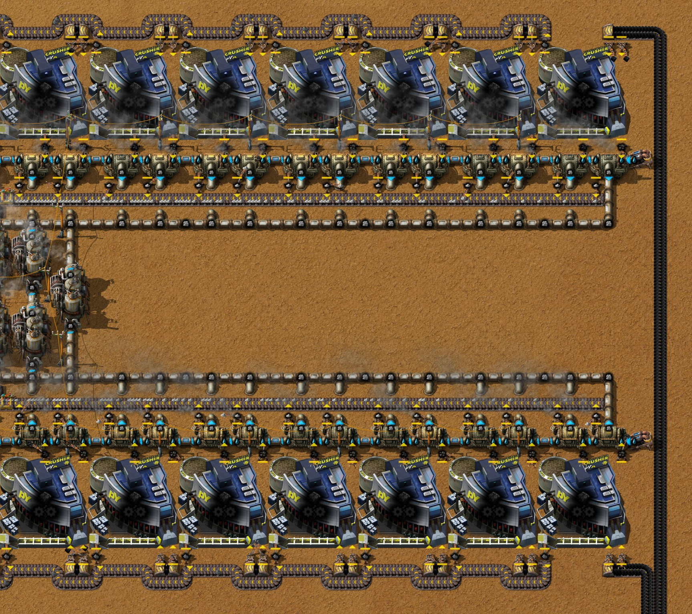
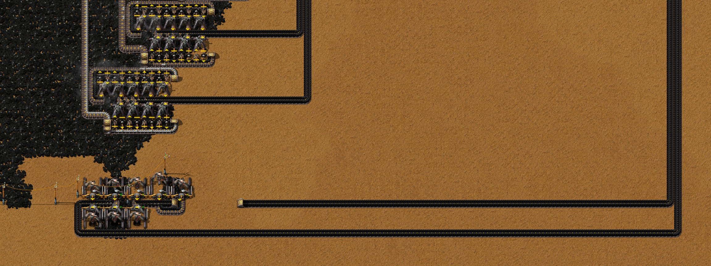
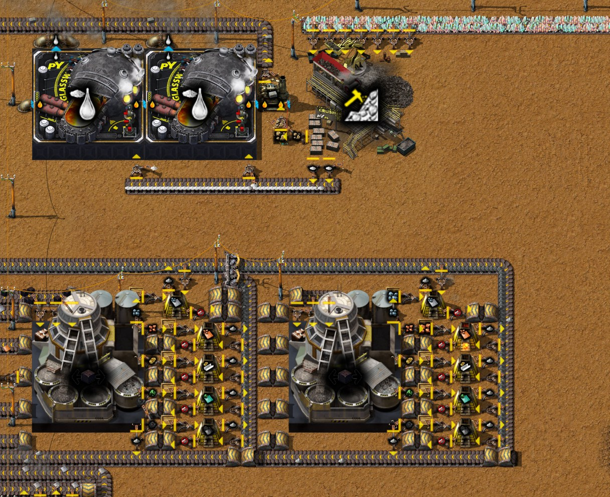

# Chapter 10 — Crushed-coal power

[中文版](10-crushed-coal-power.zh-CN.md) · [Index](../README.md) · Previous:
[chapter 9](09-py-science-pack-1.md)

This chapter follows the same recorded run from the save of 23:40 to the save of 25:47. Its subject
is the author's, **crushed-coal power** (碎煤发电): Raw coal - Stage 1 lets a Secondary crusher
split Raw coal into Crushed coal and Coal, which together hold 1.56 times the fuel value, so the
same two belts of Raw coal give 70 MW instead of 44. The author laid the block out, we measured the
draft, and the author built the finished block with our three findings in it. Around it the base
moved on to electric mining: Electric mining drills on Raw coal and copper, Fluid mining drills MK
02 on aluminium, Molten glass from Crushed quartz, and twelve technologies. The author exported the
block and the new glass block as blueprints. Times are game time. Numbers come from the game's
data, from the recorder's 10-minute production windows, from the save of 25:47
(`tools/inspect-save.ps1`), from runs of that save with the block alone and with the whole base
(`tools/power-probe`, `tools/rate-probe`) and from the blueprint bench (`tools/bp-bench.ps1`).

The result: the block works. Measured alone it gives 66.5 to 70.3 MW, about 50 MW more than its
own crushers and separators take, and with it the base's power is met in every step of the two
hours after the save; the Ash failure of chapter 9 does not come back. It falls short of its 70 MW
for three reasons, found by sampling every machine of the block on its own: **a Pipe to ground at
(−13.5, 154.5) faces the wrong way** (in the blueprint too), so one crusher never runs; **one Boiler
at the west end of each row slowly fills with Ash**, because a row's 15 Ash a second is exactly
what its belt carries; and in the base at full load **the Coal dust backs up**, since the base then
makes 8.26 a second and its Coal dust Boilers burn 7.40, so the lower row's crushers wait
(sections 4 and 5). **With two fixes the block runs full**, as the draft did: the pipe turned round,
and a second Ash inserter on the second Boiler from the west end of each row; then all 30 crushers
take 30 Raw coal a second and the block gives 70 MW, 51.7 MW of it to the base, with no Ash building
up over two hours (section 4). Research runs at half speed,
0.05 units a second, because the red science block lacks Stone bricks (section 5).

## The run at a glance

| Game time | What happened |
|---|---|
| 23:41–25:35 | Research, one technology every 8 to 10 minutes: Quartz processing - Stage 1 (23:41: Crushed quartz and Molten glass from it), Electric mining drill (23:49: the Electric mining drill and the Fluid mining drill MK 02), Advanced material processing (23:58: the Gas furnace), Crusher 2 (24:06: the Secondary crusher MK 01), Titanium processing - Stage 1 (24:15), Raw coal - Stage 1 (24:24: the crushed-coal recipe), Lead processing - Stage 1 (24:33), Nexelit processing - Stage 1 (24:43), Smelters - Stage 1 (24:52), Antimony processing - Stage 1 (25:02), Nickel processing - Stage 1 (25:12); then 23 minutes for Intermetallics - Stage 1 (25:35, 70 units), once the red science stock was used up (section 5) |
| 23:40–24:00 | Seven Glassworks taken up; the new Molten glass block at (−53, 349): a Jaw crusher for Quartz ore, two Glassworks and a Gas furnace for the Stone (section 6) |
| 24:00–24:10 | Six Fluid mining drills MK 02 on the aluminium field at y 41.5 (x −21.5 to 3.5); ten Burner mining drills and ten Stone furnaces there taken up |
| 24:10–24:20 | Ten Stone furnaces for Aluminium plates at (−48, 42); a first try of crushers and Boilers at y 186–188 |
| 24:20–24:30 | The Duralumin Smelter moved to (−53.5, 51.5) |
| 24:30–25:10 | The crushed-coal block laid out east of the base, x 108 to 266, y 151 to 197, by hand and by robots |
| 25:01 | The mods updated (configuration change) |
| 25:10–25:20 | The block built by robots in its place, x −57 to 41, y 142 to 186, with 19 Steam engines and two Offshore pumps; the draft in the east taken up; eight Electric mining drills on Raw coal at y 320.5 and 324.5 (section 3) |
| 25:20–25:30 | Two more Boilers and two Steam engines on Coal dust at (−46, 382) and (−46, 389) |
| 25:30–25:40 | A second Soot separator at (−40.5, 365.5) with five Stone furnaces (section 6) |
| 25:40–25:50 | Eight Electric mining drills on copper at x 50.5 to 68.5, y 34.5 and 38.5 |
| 25:47 | The save (end of the chapter); Mining machines - Stage 1 at 46 % |

Between the saves of 23:40 and 25:47 the base grew from 96 to 158 Boilers and from 28 to 49 Steam
engines; it gained 30 Secondary crushers MK 01, 4 Solid separators (13 to 17) and 16 Electric mining
drills, and lost 14 Burner mining drills (160 to 146) and five Glassworks (10 to 5). The author left
no chat notes in this part of the run.

Production per second (10-minute windows from the recorder):

| Window ending | Raw coal | Crushed coal | Ash | Molten glass | Aluminium plates | Duralumin | Red science | pY science pack 1 | Boards |
|---|---|---|---|---|---|---|---|---|---|
| 23:40 | 69.7 | 0 | 77.3 | 8.5 | 0.003 | 0 | 0.108 | 0.100 | 0.095 |
| 24:00 | 74.9 | 0 | 86.1 | 5.9 | 0.010 | 0 | 0.108 | 0.095 | 0.130 |
| 24:20 | 88.4 | 0 | 93.7 | 14.9 | 0.457 | 0 | 0.107 | 0.100 | 0.100 |
| 24:40 | 96.3 | 0 | 101.6 | 15.0 | 0.605 | 0.198 | 0.108 | 0.100 | 0.100 |
| 25:00 | 87.2 | 0 | 93.2 | 12.7 | 0.607 | 0.198 | 0.102 | 0.100 | 0.100 |
| 25:20 | 94.9 | 0 | 100.7 | 12.4 | 0.588 | 0.197 | 0.100 | 0.100 | 0.100 |
| 25:30 | 103.5 | 5.1 | 102.4 | 12.3 | 0.587 | 0.198 | 0.100 | 0.095 | 0.095 |
| 25:40 | 98.2 | 7.5 | 103.0 | 12.9 | 0.615 | 0.128 | 0.102 | 0.100 | 0.100 |

The pY science packs and the boards hold their 0.1 through the whole chapter: the Ash failure of
chapter 9 did not come back. Red science stays near 0.1 a second, half of what its block was built
for (section 5).

## 1. Why crush the Raw coal

Raw coal - Stage 1 unlocks one recipe, and Crusher 2 the machine for it (data):

| | Data |
|---|---|
| Recipe "crushed-coal", Secondary crusher MK 01 (speed 1, 450 kW) | 3 Raw coal → 1 Crushed coal + 2 Coal + 1 Coal dust at 30 %, 3 s |
| Fuel values | Raw coal 3 MJ, Crushed coal 6 MJ, Coal 4 MJ, Coal dust 3 MJ |
| Per Raw coal | 3 MJ burnt as it is; crushed, 2 MJ of Crushed coal + 2.67 MJ of Coal (+ 0.3 MJ of Coal dust) = 4.67 MJ, **1.56 times** as much |

A crusher takes one Raw coal a second. Thirty of them take two full belts (30 a second) and give
60 MW of Crushed coal and 80 MW of Coal: 140 MW of fuel, 283.7 Steam a second from the Boilers, 19
Steam engines (18.9), **70 MW**. The same two belts burnt raw give 44.4 MW (the station of chapter 3,
measured). The crushers take 14 MW of it (465 kW each while working, measured) and the three Ash
separators the block needs 4.6 MW: about 51 MW are left for the base, against 40 from the raw
station with its own separators. Each fuel item still burns to one Ash, so the block puts out as
much Ash as burning the Raw coal would, 30 a second. The Coal dust (0.1 a second per crusher, 3 for
the block) is a by-product; the author burns it in the Coal dust Boilers at y 382 (chapter 3), which
got two more Boilers and Steam engines at 25:20–25:30.

## 2. The block

The block stands east of the bus, x −60 to 46, y 142 to 186 (save).
It is two mirrored rows around a middle strip:

- **Raw coal** comes in from the east on two belts, along y 142 for the upper row and y 184 for the
  lower one. Each row has 15 Secondary crushers MK 01 (y 144 to 150 and 176 to 182).
- **Two Boilers per crusher** (y 152–153 and 173–174, 60 in all): one Mechanical inserter, filtered
  to Crushed coal, feeds one Boiler, and one filtered to Coal feeds the next. A crusher gives a third
  of its fuel value as Crushed coal and two thirds as Coal, so its Crushed coal Boiler can work at
  most 54 % of the time and its Coal Boiler 72 % (2 and 2.67 MW of 3.7). A third filtered inserter
  puts the Coal dust onto short belts that run west between the Raw coal belt's Underground belts
  (the Raw coal surfaces only where a crusher's inserter takes it) and on to the base's by-product
  belts at x −96.
- **Ash:** every Boiler has an inserter onto an Ash belt between the Boilers and the middle strip (y
  155 and 171), both running west. Halfway along each row (x −8.5 to −5.5) a Splitter and a
  side-loaded Underground belt move the Ash of the eastern half onto the belt's other lane, and the
  westmost Boiler of each row has a second Ash inserter. At the west end both belts turn into the
  middle strip and run back east (y 158 and 168) past **three Solid separators** (x −55 to −28, y
  160 to 167), 20 inserters on each belt, 40 in all. The separators' Iron oxide, Soot and Coal dust
  go into chests and leave west along y 161, 163 and 165.
- **19 Steam engines** east of the separators (x −26.5 to 0.5, y 160.5 to 166.5), with their Water
  from two Offshore pumps at the east end (44.5, 152.5) and (44.5, 174.5).

**From the draft to the block.** The author first laid the block out east of the base, at x 108
to 266 (24:30–25:10). We measured that draft in a copy of the save of 25:01, finishing it by script
(19 Steam engines, poles, water; `tools/power-probe`, research notes, Steam power): **70.0 MW at 30
Raw coal a second**, the crushers taking 13.95 MW and the separators 4.6 MW. The run showed three
things, and the author built all three into the block they then moved to its place at 25:10–25:20:

1. One crusher, the lower row's westmost, had no Coal dust inserter (the measurement added one).
   Every crusher of the block has one (33 Coal dust inserters: 30 crushers and 3 separators).
2. **Each row puts 15 Ash a second on its belt, a full Transport belt, and the inserters drop on the
   far lane only.** In the draft the lane switch halfway along each row was in the right place
   (counted item by item, both lanes carried 7.333 a second just before the last Boiler), but the
   last Boiler, with one inserter, could not get its own Ash onto a full lane and filled up with
   1,000 Ash after 95 minutes. A second Ash inserter on it, dropping onto the other lane (the
   author's idea), filled both lanes to 7.5 a second. The block has that second inserter on the
   westmost Boiler of each row.
3. Then all 30 Ash a second reached the three separators, and their 39 inserters took only 29.85: a
   seventh inserter under the third separator (or a fourth separator) made it 30.0 Raw coal a second,
   70.0 MW and no Ash building up in three hours. The block has 40.

The block cannot start itself: its crushers run on its own electricity. Here it is part of the
base's network, which starts it.

## 3. The Raw coal

The block's Raw coal comes from **eight Electric mining drills** (Electric mining drill, 23:49) on
the Raw coal field south of the block, at x −32.5 to −20.5, y 320.5 and 324.5 (save). An Electric
mining drill mines at speed 2 and Raw coal takes 0.5 s (data): **4 Raw coal a second per drill**,
twice a Burner mining drill (speed 1), for 1 MW of electricity. Four drills give 16 a second, a
full belt. The drills drop onto a belt along y 322 that splits: four of them feed a belt that turns
south to y 326 and runs east, the other four the belt that runs east along y 322. At x 45 and 46
both turn north and run about 180 tiles to the block, x 46 to the upper row, x 45 to the lower
(save).

The drills' belts end at the block, so the block takes as much Raw coal as its Boilers burn, and
the drills wait for the rest: in the 10 minutes after the save the drills stood "waiting for space"
54 % of the time and the crushers "output full" 46 % (section 5). The Burner mining drills of the
older stations keep their own belts (y 290 to 312).

## 4. The block alone

In the save the block is part of the base's network, so the base's demand sets how hard it runs
(section 5). To see what it can give, a copy of the save was run with the block cut off: the two
copper wires from its poles to the base's poles cut, its two Raw coal belts kept full by script,
the Coal dust and the separators' products taken off at its west edge, 20 Coal put into every
Boiler to start it, and an energy interface that takes whatever power the block has left
(`tools/power-probe`, three hours).

| Minutes | Power made | Crusher crafts per second (Raw coal) | Separators (Ash per second) | Net for the base |
|---|---|---|---|---|
| 0–30 | 70.3 MW | 9.63 (28.9) | 28.7 | 52.4 MW |
| 30–60 | 70.3 MW | 9.62 (28.9) | 28.6 | 52.4 MW |
| 60–180 | 66.5 MW | 9.50 (28.5) | 28.5 | 48.8 MW |
| Three hours | 67.8 MW | 9.54 (28.6) | 28.6 | 50.0 MW |

In the first hour the 19 Steam engines run at their full 3.70 MW each, about 3 MW more than the
crushers' fuel gives: the 1,000 Coal put in to start it (4 GJ) and, by the numbers, Steam the save
left in the block's pipes make up the difference. From then on the
power is exactly what the Raw coal gives: 28.5 Raw coal a second × 4.67 MJ ÷ 2 = 66.5 MW. **The block
falls short of its 30 Raw coal and 70 MW for two reasons**, found by sampling every Boiler and every
crusher on its own:

1. **One crusher never runs.** The Coal Boiler at (−13.5, 153) stands "output full" all the time:
   its Steam goes into a Pipe to ground at (−13.5, 154.5) that faces the same way as its partner
   below, so the two do not connect and the Steam has nowhere to go. The Boiler stops burning, its
   crusher at (−15.5, 147.5) fills up with Coal and stops, and the crusher's Crushed coal Boiler at
   (−16.5, 153) never gets fuel. The `crushed-coal-power` blueprint has the same Pipe to ground.
2. **The lower row's Ash fills one Boiler.** The Coal Boiler second from the west end, (−55.5, 174),
   holds 583 Ash after 30 minutes and 1,000 within the hour; from then on it burns only as fast as
   its inserter gets Ash out. Counted item by item, the lane its inserter drops onto (the far lane)
   already carries 6.67 Ash a second where it reaches that Boiler, 0.83 short of the 7.5 a lane can
   carry, and this Boiler adds 0.67: with the lane 98 % full, the Mechanical inserter
   finds a gap for only 0.52 a second. The other lane, carrying the eastern half's Ash, runs at 7.3.
   Each row makes 15 Ash a second, exactly what one Transport belt carries, so the belt has to be
   full to the last item at the west end. In the upper row the same Boiler stays at 56 Ash only
   because of the stopped crusher: its half of the row makes 1 Ash a second less.

**Fixes tried** (the block alone, as above):

- **The Pipe to ground at (−13.5, 154.5) turned to face north**, like the pair beside it at
  (−16.5, 154.5): all 30 crushers run, 9.89 crafts a second (29.7 Raw coal, fuel for 69.2 MW) over
  90 minutes, and the engines give their full 70.3 MW the whole time (the rest from the starting
  Coal and the stored Steam). **This is a fix to make in the game and in the
  blueprint.** But with the upper row's crusher back, the upper row's Coal Boiler at (−55.5, 153)
  fills with Ash like the lower one: 627 Ash at 30 minutes and 1,000 at 60 (the lower one 438 at
  90 minutes, more slowly this time).
- **The pipe turned and the westmost crusher's two fuel filters swapped** in each row (Coal to the
  westmost Boiler, which has the two Ash inserters, and Crushed coal, a third of the crusher's Ash,
  to the one before it): the lower row's Boilers hold no Ash in three hours; in the upper row the
  westmost Boiler, now on Coal, still keeps 0.17 Ash a second and is full after about 100 minutes.
  All 30 crushers made 10.000 crafts a second (30 Raw coal) from 30 to 90 minutes, 9.92 (29.8)
  once that Boiler was full: fuel for 69.4 MW, against 66.5 as built. The engines gave 70.3 MW for
  all three hours, 51.8 MW of it to the load.

**Where it stops, and the fix that runs it full.** Two more runs with the pipe turned took the
belt's far end out of the question: with the Ash taken off at the corner, so that nothing behind
the Boilers can hold the belt up, the upper row's Boiler at (−55.5, 153) still held 624 Ash after
30 minutes; with the two separator belts emptied at their dead ends instead, 627. So the Ash is
stuck at one drop, not downstream: that Boiler's single inserter has to put 0.67 Ash a second onto
a lane that already carries 6.67 of its 7.5, and it does not find enough gaps. **One more Ash
inserter on that Boiler, on the free tile west of the first one** ((−56.5, 154.5) in the upper row,
(−56.5, 172.5) in the lower, dropping onto the same lane a tile further on), and the block **runs
full**: from 30 minutes on all 30 crushers made 10.000 crafts a second (30 Raw coal) and the three
separators 3.000 (30 Ash, all three at 100 %), the 60 Boilers held the same 114 Ash at every step
of two hours, and the engines gave their full 70.3 MW, 51.7 MW of it to the load. That is the
draft's result (section 2: 30.0 Raw coal, 70.0 MW). With the filters swapped as well, the upper
row's westmost Boiler, now on Coal, filled again (335 Ash at 30 minutes), so the swap is not part
of the fix.

**Why one inserter is not enough there** (the author's explanation, which the numbers support). A
Mechanical inserter turns 0.013 of a turn a tick (data); measured, a round trip takes 76 ticks, so
it moves at most 0.789 items a second (`tools/inserter-rate-probe`, techniques). A Coal Boiler makes
0.67 Ash a second, 85 % of that, so its inserter can afford to wait at a full lane for a gap only
15 % of the time; a Crushed coal Boiler (0.33, 42 %) can wait much longer. The Boilers
upstream always find room, so the gaps they leave come in a fixed pattern set by the phases of their
drops, and whether the lane's spare 0.83 a second passes while the inserter is there to use it
depends on that pattern. The runs fit this: the lower row, the same in every run, filled that Boiler
at 583 Ash a half hour as built, at 138 once only the upper row's pipe was turned, and not at all
with the Ash taken off at the corner; the draft, with the same lane counts, never filled it. Two
inserters each need only 0.33 a second and can wait. A belt merging from the side has no such limit:
it takes any gap that passes and holds a few items meanwhile, which is why the westmost Boiler's
second inserter, feeding a short belt that side-loads the other lane, fills both lanes to 7.5 a
second. A short feeder belt that side-loads the Ash belt is the general fix for a Boiler on a nearly
full lane (the author's proposal; not measured, this block has no tile for it between the Boilers
and the Ash belt). Each row's 15 Ash a second is exactly what its belt carries, so the west end has
no other margin.

**Start phases, tested** (the next day, at the author's request). If the phase explanation holds,
the same block jams or not depending on how it started. Copies were run alone for 90 minutes after
a start in which the 30 crushers were stopped, emptied of work in progress and switched on one by
one in a random order, each 0 to 4 seconds after the one before (`stagger=`, seeded; the Boilers'
Ash cleared, 20 Coal in each to start). A start "jams" when a Boiler's Ash keeps growing; in the
others the Boiler holding the most Ash held the same count (12 to 161) at 30, 60 and 90 minutes.

| Block (alone, crushers started in a random order) | Starts that jam |
|---|---|
| As built at 25:47 (the pipe the wrong way, 29 crushers) | 1 of 3: the lower row's second Boiler from the west, 0.08 Ash a second (full after about 3.4 hours) |
| The pipe turned | 1 of 3: the upper row's, full within the hour |
| The pipe turned and a second Ash inserter on that Boiler | 0 of 3 |
| The author's update (blueprint of 2026-10-19, section 7; its separator poles reach the block only through the base's, so a wire was added) | 3 of 6: the second Boiler from the west, upper row twice and lower row once, full after 60 to 95 minutes; then 9.92 crafts a second |
| The update and a second Ash inserter at (−55.5, 154.5) and (−55.5, 172.5) | 0 of 6: 30 Raw coal a second, the separators at 100 %, 51.7 MW to the load |

The update's short belt and Splitter take care of the westmost Boiler, but the one before it, a Coal
Boiler with one inserter on the fullest lane, is the same as before; one more inserter on its free
tile makes the block run full whatever the start.

## 5. The base after the save

Copies of the save were run with the block as the author left it, inside the base's network:

| Run | Result |
|---|---|
| 10 minutes as saved (`tools/rate-probe`) | **99.6 MW used, all of it made** by the 49 Steam engines; nothing on "low power". The block's crushers worked 54 % of the time (5.4 crafts a second, 16 Raw coal) and stood "output full" 46 %: its Boilers were full of Steam, the base did not need more. |
| 30 minutes with a load (an energy interface that takes whatever power is left, at (−37, 167)) | The engines gave **161.2 MW**, 56.6 MW more than the base used, falling over the half hour (168.6, 162.5, 152.5 MW in the 10-minute steps). The block's crushers made 8.07 crafts a second (24.2 Raw coal), working 81 %, "output full" 19 %, **never short of Raw coal**. Some older Raw coal Boilers at y 230 to 260 filled with Ash (up to 1,000). |
| Two hours as saved (`tools/rate-probe`, power every 10 minutes) | Power used = power made in every step, nothing on "low power", **no Ash failure** (the Boilers at y 230 stood with a full Ash slot 1 % of the time). Power falls from 99.6 MW to 87 MW at 70 minutes and to 36 MW at the end, because the base's demand falls, not its supply (below). pY science pack 1 and red science stay at 0.050 and 0.100 a second. |

**What held the block back under load: the Coal dust.** The load run again with every crusher
sampled on its own and the Coal dust lanes counted: the upper row's crushers worked all the time,
except the one of section 4 that never runs; in the lower row the eight western crushers stood
"output full" 30 % (x −15.5) to 82 % (x −57.5) of the time, the east ones not at all. They could not
put out their Coal dust. With every Boiler of the base burning, the base makes 8.26 Coal dust a
second (5.84 from 11.7 Ash separations a second, 2.42 from the crushers), and the six Coal dust
Boilers at y 382 burn at most 7.40 (1.23 each; data). The surplus backs up along the Coal dust belt
at x −96, and the lower row's Coal dust belt, the last one to join it (a Splitter at y 184), was
full (4 items a tile) by 20 minutes and moved 0.8 to 0.9 a second; its 15 crushers make 1.5.
As saved the base makes less Coal dust (6.4 a second) than those Boilers burn (7.5), so the belt
backs up only when the base runs everything. A seventh Coal dust Boiler would burn 1.23 a second
more (data; not measured).

**Why the demand falls.** The boards (0.100 a second) have no user yet; their store is full after
about 70 minutes (the Chipshooter "output full" 47 % in that step), and from there the chain behind
them backs up: the Printed circuit board factory and the Formica pulp mill at 80 minutes, the
Methanal furnace and the Methane greenhouse at 90. The aluminium drills wait for space from 80
minutes and the copper screeners from 90. Each of them is an electric machine that stops, so the
power used falls with them, and the Raw coal used with it (79 → 24 a second). This is not a
failure: what stops makes products nobody uses yet, and the packs go on (techniques, principle 23).

**Research runs at half speed.** Five Labs could take 0.111 units a second; the research center
made 0.050 pY science packs a second and stood "output full" 64 % of the time, because the red
science comes at 0.100 a second, half its block's 0.2. The red science block's Empty planter box
assembler at (−42.5, −168.5) stood short of ingredients 80 % of the time: it holds Wood and Iron
plates but no Stone bricks, and the brick belt coming in from the west at y −167 carried 8 bricks.
The base makes 2.77 bricks a second (five Stone furnaces at y −3, four at y 19, the new Gas furnace),
but six Jaw crushers turn bricks back into Stone at about 2.0 a second (bricks-to-stone, 42 % working
at 0.8 a second), and 26,091 bricks lie in three chests at (−62.5 to −60.5, 18.5). Until about
25:15 the labs drew red science from a stock at 0.2 a second; from then on 0.1 (recorder). With
bricks for the red science block, research doubles.

## 6. Other changes

- **Molten glass from Crushed quartz** (Quartz processing - Stage 1). The seven Glassworks that
  melted Quartz ore (6 ore → 10 Molten glass, 5 s) went; the new block (x −60 to −36, y 343 to 354)
  has a Jaw crusher for the ore (5 Quartz ore → 1 Crushed quartz + 1 Stone at 50 %, 1 s) and two
  Glassworks (2 Crushed quartz → 30 Molten glass, 4 s): **15 Molten glass a second from 5 Quartz
  ore**, 3 per ore instead of 1.67, and two Glassworks burning fuel instead of seven (10 MW each,
  here Gasoline). Its Stone goes into a chest; a Gas furnace (Advanced material processing; speed
  4, 6 MW of fluid fuel, also Gasoline) beside it bakes Stone bricks, switched by a circuit wire to
  run only while that chest holds more than 500 Stone (blueprint). The recorder shows about 15
  Molten glass a second in the windows from 24:10 to 24:40 and 12 to 13 after; in the runs after
  the save the base took 8.3 a second, and the Glassworks stood "output full" 39 %.
- **Aluminium.** Six Fluid mining drills MK 02 (Electric mining drill; speed 1, 900 kW, Coal gas as
  mining fluid) at y 41.5 replaced the Burner mining drills: 6.1 Aluminium ore a second, and ten
  Stone furnaces at (−48, 42) make 0.61 plates a second from the window ending 24:30 (10 ore → 1
  plate, 6 s), against 0.003 to 0.010 in the windows to 24:10.
- **Duralumin.** The Smelter MK 01 of chapter 7 moved to (−53.5, 51.5), beside the new aluminium
  furnaces (4 Aluminium plates + 2 Copper plates → 1 Duralumin, 4 s, on Naphthalene oil). It made
  about 0.2 a second in the windows from 24:40 to 25:40 (recorder); at the save it waits for Aluminium plates (it holds 1
  of the 4), and 989 plates lie in a chest at (−59.5, 44.5). The base makes 0.61 plates a second, enough
  for 0.15 Duralumin a second at most.
- **A second Soot separator** at (−40.5, 365.5) with five Stone furnaces (x −35 to −33, y 361 to
  369), beside the one of chapter 9; the `soot-separation` blueprint changed with it (section 7).
  The base made 1.8 Soot a second in the runs; the two separators can take 4.
- **Two more Coal dust Boilers** and two Steam engines at (−46, 382) and (−46, 389) for the block's
  Coal dust (section 1).
- **Copper.** Copper ore fell from 7.2 a second (window to 24:40) to 5.2 (25:20) and 0.75 (25:30;
  recorder); only five
  Burner mining drills of chapter 7 are left on the copper field at the save, with 1,271 to 17,622
  ore under each. The author put eight Electric mining drills at x 50.5 to 68.5, y 34.5 and 38.5
  (25:40–25:50); in the runs after the save the copper ore is back at 15.2 a second, a full belt.
- **Research:** twelve technologies, all on pY science pack 1 and red science (table at the top),
  at 0.05 units a second (section 5).

## 7. The blueprints

The author exported the book at 20:35 (real time), with the save of 25:47;
`tools/bp-sync.js pull` reports two new designs and three changed ones:

- **`crushed-coal-power`** (new), "碎煤发电" (crushed-coal power), icons Secondary crusher and Raw
  coal: the block of section 2, x −60.5 to 44.5, y 142.5 to 185.5 in save coordinates, 30
  Secondary crushers MK 01, 60 Boilers, 19 Steam engines, 3 Solid separators, 271 Mechanical
  inserters, 2 Offshore pumps. Measured where it stands, alone (section 4). The file now holds the
  author's update of the next day (export of 2026-10-19, after the chapter's save): the pipe
  turned, the westmost Boilers moved a tile apart so that the westmost one's two Ash inserters drop
  onto a short belt, which a Splitter (filtered to the Deconstruction planner, so everything leaves
  by its one open side) merges with the Ash belt; the Coal dust along a belt at y 141.5; 39
  separator inserters. Tested with random start phases (section 4): it jams in 3 of 6 starts
  unless the second Boiler from the west gets a second Ash inserter; with it, 0 of 6.
- **`molten-glass`** (new), "15 [Molten glass]": the Jaw crusher, the two Glassworks, the Gas
  furnace and its Stone chest with the circuit wire (section 6). Not run on the bench, which cannot
  give the Glassworks their fluid fuel; measured where it stands (section 6).
- **`ash-separation`** (changed): the seventh inserter under the third separator (57 inserters
  instead of 56; section 2). Bench, Ash on both belts: 30 Ash a second, all three separators
  working 100 %.
- **`raw-coal-power-two-belts`** (changed): the same fix for its separators, a seventh inserter into
  the first one at (−54.5, 247.5) on a belt tile added for it, and the separators' output belts a
  tile longer (four belts).
- **`soot-separation`** (changed): Underground belts rerouted, a Splitter at (−47.5, 359) and two
  poles moved; the second separator beside it (section 6) is not in the blueprint.

Both changed stations ran without trouble in the two hours after the save (section 5).

## 8. Checklist

- Crush Raw coal before burning it: 1.56 times the fuel value. Two belts, 30 Secondary crushers and
  60 Boilers give 70 MW, about 51 MW after the crushers and separators, against 40 MW burnt raw.
- Two Boilers per crusher, one on Crushed coal (54 % busy at most) and one on Coal (72 %), and 19
  Steam engines for 30 crushers.
- A row of 15 crushers fills its Ash belt to the last item. Switch lanes halfway, give the westmost
  Boiler a way onto the other lane and the one before it a second Ash inserter (a Mechanical
  inserter moves at most 0.789 items a second; a short belt that side-loads takes any gap), and over an hour
  watch every Boiler there, not only the total: one Boiler that cannot put out its Ash costs its
  crusher.
- Measure a new power block alone: cut its wires to the base, keep its inputs full, take its
  outputs and sample every machine. In the base it runs below its capacity, and a fault such as a
  Pipe to ground turned the wrong way (one crusher lost, 2.3 MW) does not show.
- Every by-product needs a sink for the base at full load: here the Coal dust, 8.26 a second
  against 7.40 the Coal dust Boilers burn. The belt that joins last waits first.
- Electric mining drills give 4 Raw coal a second each: four fill a belt.
- Red science needs its Stone bricks: research runs at half speed without them.

## 9. How these facts were checked

- The run: the companion mod's recorder (run `2652821414-0`, last record 25:47), read with
  `tools/recorder-phases.js` (timeline in 10-minute slices) and `tools/recorder-log.js`
  (production per 10-minute window); no chat notes since 21:25 (`tools/recorder-summary.js`).
- The save of 25:47 (`Py-Exploration`, copied before reading; consistency check passed):
  `tools/inspect-save.ps1` (snapshot one second after loading), `tools/summarize-save.js`,
  `tools/trace-layout.js` (belt lines, inserters, what each crusher feeds); counts before and
  after from the saves of 23:40 and 25:47.
- **The draft** (save of 25:01): `tools/power-probe`, finished by script (research notes, Steam
  power, with the lane counts and the seventh inserter).
- **The block alone:** `tools/save-probe.ps1 -Probe power-probe -Ticks 651700 -Variant
  '60,10800,1800;box=-62:140:48:186;isolate=1;src=raw-coal@46.5:185.5|raw-coal@45.5:185.5;sink=-61.5:142.5|-61.5:184.5|-61.5:161.5|-61.5:163.5|-61.5:165.5;load=-61:139;prime=coal:20'`:
  the box's two copper wires to the base cut (`isolate=1`, new), Raw coal kept on its two belts,
  the Coal dust and the separators' products taken off at the west edge, 20 Coal in every Boiler
  to start, and a load that takes whatever power is left. Again for 30 minutes with every Boiler
  and crusher sampled on its own (`each=boiler|secondary-crusher-mk01`, new for Boilers) and the
  Ash lanes counted item by item (`lanes=`) at ten belt tiles; and with the fixes, the Pipe to
  ground turned (`turn=-13.5:154.5:north`, new) for 90 minutes and, with the two filters swapped
  (`filter=-57.5:151.5:coal|-54.5:151.5:crushed-coal|-57.5:175.5:coal|-54.5:175.5:crushed-coal`,
  new), for three hours; then with the pipe turned for 30 minutes each, the Ash taken off at the
  corner (`sink=-57.5:155.5|-57.5:171.5`) and at the separator belts' ends
  (`sink=-29.5:158.5|-29.5:168.5`), and for two hours with the second Ash inserters
  (`place=burner-inserter@-56.5:154.5:north:ash|burner-inserter@-56.5:172.5:south:ash`), also with
  the filters swapped. The draft's runs of the same day were compared with these lane by lane.
  Start phases: the save of 25:47 and the author's save of 2026-10-19 (its block identical to the
  updated blueprint, checked entity by entity), each run 95 minutes with
  `stagger=<seed>:4:secondary-crusher-mk01` (new) for 3 or 6 seeds, four copies at a time in
  separate work folders; `isolate=1` now also joins a pole group of the box left on its own.
- **The base after the save:** `tools/save-probe.ps1 -Probe rate-probe` for 10 minutes and two
  hours (power every 10 minutes), and `-Probe power-probe` for 30 minutes with the whole base as
  the box and the load at (−37, 167), once more with every crusher on its own and the Coal dust
  lanes counted at x −61.5 and −93.5.
- The blueprints: `tools/bp-sync.js pull` (the author's export of 20:35 real time), compared entity
  by entity with the files before; `tools/bp-bench.ps1 -Bench ash-separation -Variant both-belts`.
- Data: the dump of the author's mods (rebuilt 2026-10-18 for their mods of that day): recipes,
  fuel values, machine speeds and power, mining speeds and times, technology unlocks; English
  names from the mods' `locale/en`.
- The screenshots: taken by the author with the companion mod (`/pt-shots`), areas planned with
  `node tools/shots.js plan`.

Next: chapter 11 (to come).
