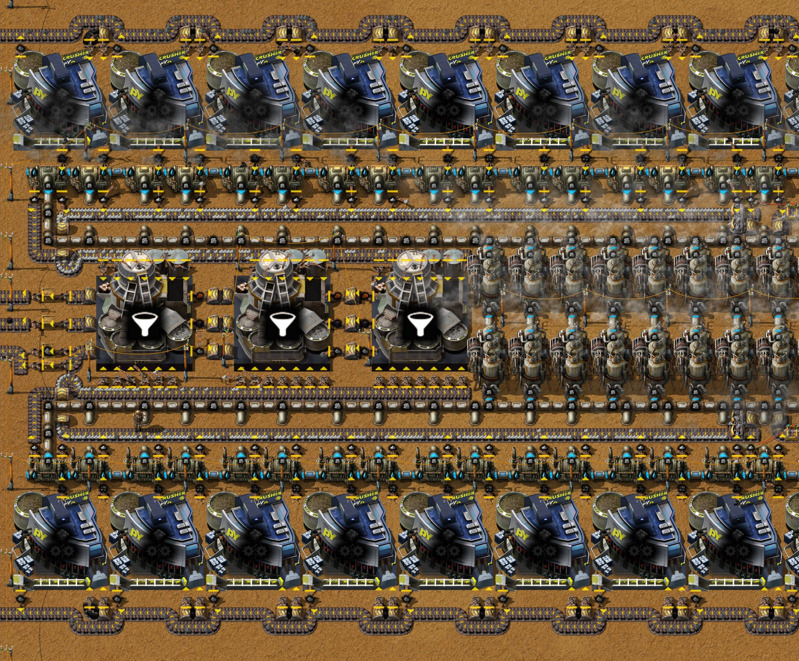

# 第十章 碎煤发电

[English](10-crushed-coal-power.md) · [目录](../README.zh-CN.md) · 上一章：
[第九章](09-py-science-pack-1.zh-CN.md)

本章接着同一局录像，从 23:40 的存档到 25:47 的存档。主题是作者定的：**碎煤发电**。原煤：阶段 1 让二级破碎机把原煤分成碎煤和煤矿，两者的燃料值合起来是原煤的 1.56 倍，所以同样两满带原煤能发 70 MW，而不是 44 MW。作者摆出模块，我们测了草稿，作者把我们的三处发现都做进了建成的模块。与此同时基地转向电力开采：原煤和铜矿用上电力采矿机，铝矿用上液压采矿机 MK2，熔融玻璃改用碎石英，研究了十二项科技。作者把模块和新的玻璃模块导出成蓝图。时间都是游戏时间。数字来自游戏数据、记录器每 10 分钟的产量窗口、25:47 的存档（`tools/inspect-save.ps1`）、在这个存档上单独测模块和测整个基地的运行（`tools/power-probe`、`tools/rate-probe`）以及蓝图测试台（`tools/bp-bench.ps1`）。

结果：模块能用。单独测量时它发电 66.5 到 70.3 MW，比它自己的破碎机和分离机所用的多约 50 MW；有了它，存档后两小时里基地每一段的用电都满足了，第九章的灰烬故障没有再出现。它达不到 70 MW 有三个原因，都是逐台记录模块里每台机器后找到的：**(−13.5, 154.5) 的一节地下管道方向装反了**（蓝图里也是），所以有一台破碎机从不工作；**每排西头有一台锅炉慢慢积满灰烬**，因为一排每秒 15 个灰烬正好是它那条带的运量；基地满负荷时**煤粉往回堵**，这时基地每秒产 8.26 个煤粉，煤粉锅炉只烧 7.40 个，下排的破碎机只好等着（第 4、5 节）。**改两处就能和草稿一样跑满**：把管道转过来，再给每排西起第二台锅炉加第二只灰烬机械臂；这样 30 台破碎机每秒吃 30 个原煤，模块发电 70 MW，其中 51.7 MW 给基地，两小时内不积灰（第 4 节）。研究只有一半速度，每秒 0.05 份，因为红瓶模块缺石砖（第 5 节）。

## 全程一览

| 游戏时间 | 发生了什么 |
|---|---|
| 23:41–25:35 | 研究，每 8 到 10 分钟一项：石英处理：阶段 1（23:41：碎石英，以及用它做熔融玻璃）、电力采矿机（23:49：电力采矿机和液压采矿机 MK2）、高等冶炼处理（23:58：燃气熔炉）、碎矿技术 2（24:06：二级破碎机 MK1）、钛处理：阶段 1（24:15）、原煤：阶段 1（24:24：碎煤配方）、铅处理：阶段 1（24:33）、蓝坷垃处理：阶段 1（24:43）、冶炼厂：阶段 1（24:52）、锑处理：阶段 1（25:02）、镍处理：阶段 1（25:12）；之后金属间化合物：阶段 1（25:35，70 份）用了 23 分钟，因为红瓶库存用完了（第 5 节） |
| 23:40–24:00 | 拆掉七台玻璃工厂；在 (−53, 349) 建新的熔融玻璃模块：一台颚式破碎机碎石英矿，两台玻璃工厂，一台燃气熔炉烧石矿（第 6 节） |
| 24:00–24:10 | 在铝矿 y 41.5 处（x −21.5 到 3.5）放六台液压采矿机 MK2；拆掉那里的十台热能采矿机和十台石炉 |
| 24:10–24:20 | 在 (−48, 42) 放十台炼铝板的石炉；在 y 186–188 第一次试摆破碎机和锅炉 |
| 24:20–24:30 | 硬铝冶炼厂搬到 (−53.5, 51.5) |
| 24:30–25:10 | 在基地东边 x 108 到 266、y 151 到 197 手摆和用机器人摆出碎煤发电模块 |
| 25:01 | 模组更新（配置变化） |
| 25:10–25:20 | 机器人把模块建到现在的位置，x −57 到 41、y 142 到 186，带 19 台蒸汽机和两台抽取泵；东边的草稿拆掉；在 y 320.5 和 324.5 放八台采原煤的电力采矿机（第 3 节） |
| 25:20–25:30 | 在 (−46, 382) 和 (−46, 389) 再加两台烧煤粉的锅炉和两台蒸汽机 |
| 25:30–25:40 | 在 (−40.5, 365.5) 加第二台烟煤分离机和五台石炉（第 6 节） |
| 25:40–25:50 | 在铜矿 x 50.5 到 68.5、y 34.5 和 38.5 放八台电力采矿机 |
| 25:47 | 存档（本章结束）；采矿设备：阶段 1 进度 46% |

从 23:40 到 25:47 两个存档之间，锅炉从 96 台增加到 158 台，蒸汽机从 28 台增加到 49 台；新增 30 台二级破碎机 MK1、4 台固体分离机（13 → 17）和 16 台电力采矿机，少了 14 台热能采矿机（160 → 146）和五台玻璃工厂（10 → 5）。这段时间作者没有留聊天留言。

每秒产量（记录器每 10 分钟的窗口）：

| 窗口结束 | 原煤 | 碎煤 | 灰烬 | 熔融玻璃 | 铝板 | 硬铝 | 红瓶 | pY科技包1型 | 电路板 |
|---|---|---|---|---|---|---|---|---|---|
| 23:40 | 69.7 | 0 | 77.3 | 8.5 | 0.003 | 0 | 0.108 | 0.100 | 0.095 |
| 24:00 | 74.9 | 0 | 86.1 | 5.9 | 0.010 | 0 | 0.108 | 0.095 | 0.130 |
| 24:20 | 88.4 | 0 | 93.7 | 14.9 | 0.457 | 0 | 0.107 | 0.100 | 0.100 |
| 24:40 | 96.3 | 0 | 101.6 | 15.0 | 0.605 | 0.198 | 0.108 | 0.100 | 0.100 |
| 25:00 | 87.2 | 0 | 93.2 | 12.7 | 0.607 | 0.198 | 0.102 | 0.100 | 0.100 |
| 25:20 | 94.9 | 0 | 100.7 | 12.4 | 0.588 | 0.197 | 0.100 | 0.100 | 0.100 |
| 25:30 | 103.5 | 5.1 | 102.4 | 12.3 | 0.587 | 0.198 | 0.100 | 0.095 | 0.095 |
| 25:40 | 98.2 | 7.5 | 103.0 | 12.9 | 0.615 | 0.128 | 0.102 | 0.100 | 0.100 |

整章里 pY科技包1型和电路板都保持每秒 0.1：第九章的灰烬故障没有再出现。红瓶一直在每秒 0.1 左右，是红瓶模块设计产量的一半（第 5 节）。

## 1. 为什么要先破碎原煤

原煤：阶段 1 解锁一个配方，碎矿技术 2 解锁做它的机器（数据）：

| | 数据 |
|---|---|
| 配方“碎煤”，二级破碎机 MK1（速度 1，450 kW） | 3 原煤 → 1 碎煤 + 2 煤矿 + 30% 概率 1 煤粉，3 秒 |
| 燃料值 | 原煤 3 MJ，碎煤 6 MJ，煤矿 4 MJ，煤粉 3 MJ |
| 每个原煤 | 直接烧是 3 MJ；破碎后是 2 MJ 碎煤 + 2.67 MJ 煤矿（另有 0.3 MJ 煤粉）= 4.67 MJ，**是直接烧的 1.56 倍** |

一台破碎机每秒吃一个原煤。三十台吃两满带（每秒 30 个），产出 60 MW 的碎煤和 80 MW 的煤矿：共 140 MW 燃料，锅炉每秒产 283.7 蒸汽，要 19 台蒸汽机（18.9），**发电 70 MW**。同样两满带原煤直接烧只有 44.4 MW（第三章的电站，实测）。破碎机自己用掉 14 MW（工作时每台 465 kW，实测），模块配的三台灰烬分离机用 4.6 MW：留给基地的约 51 MW，而直接烧原煤的电站扣掉它自己的分离机后约 40 MW。每个燃料仍然烧出一个灰烬，所以模块产出的灰烬和直接烧原煤一样多，每秒 30 个。煤粉（每台破碎机每秒 0.1 个，整个模块每秒 3 个）是副产物；作者把它送进 y 382 烧煤粉的锅炉（第三章），25:20–25:30 那里又加了两台锅炉和两台蒸汽机。

## 2. 模块

模块在总线东边，x −60 到 46、y 142 到 186（存档）。它是围着中间一条的上下两排，互为镜像：

- **原煤**从东边由两条带进来，上排走 y 142，下排走 y 184。每排 15 台二级破碎机 MK1（y 144 到 150 和 176 到 182）。
- **每台破碎机配两台锅炉**（y 152–153 和 173–174，共 60 台）：一只筛选碎煤的工业机械臂喂一台锅炉，一只筛选煤矿的喂旁边一台。破碎机产出的燃料值三分之一是碎煤、三分之二是煤矿，所以烧碎煤的锅炉最多 54% 时间在工作，烧煤矿的 72%（3.7 MW 中的 2 和 2.67 MW）。第三只筛选机械臂把煤粉放到一段段短传送带上，这些短带在原煤带的地下传送带之间往西走（原煤只在破碎机机械臂取料的地方冒出地面），一直送到基地 x −96 的副产物带。
- **灰烬**：每台锅炉有一只机械臂把灰烬放到锅炉和中间一条之间的灰烬带上（y 155 和 171），两条都往西走。每排正中（x −8.5 到 −5.5）有一个分流器和一个侧面汇入的地下传送带，把东半边的灰烬换到带子的另一道；每排最西边的锅炉多一只灰烬机械臂。两条带在西头拐进中间一条，再往东走（y 158 和 168），经过**三台固体分离机**（x −55 到 −28、y 160 到 167），每条带上 20 只上料机械臂，共 40 只。分离机产出的氧化铁、烟煤和煤粉先进箱子，再沿 y 161、163、165 往西送走。
- **19 台蒸汽机**在分离机东边（x −26.5 到 0.5、y 160.5 到 166.5），水来自东头的两台抽取泵 (44.5, 152.5) 和 (44.5, 174.5)。

**从草稿到模块。** 作者先在基地东边 x 108 到 266 摆出模块（24:30–25:10）。我们在 25:01 的存档副本里测过这份草稿，用脚本把它补完整（19 台蒸汽机、电线杆、水；`tools/power-probe`，见技巧笔记的“蒸汽发电”）：**每秒 30 原煤时发电 70.0 MW**，破碎机用 13.95 MW，分离机用 4.6 MW。那次测量发现三件事，作者在 25:10–25:20 把模块搬到现在的位置时三处都改了：

1. 有一台破碎机（下排最西边那台）没有煤粉机械臂（测量时补了一只）。现在每台破碎机都有（筛选煤粉的机械臂 33 只：30 台破碎机加 3 台分离机）。
2. **每排每秒往灰烬带上放 15 个灰烬，正好一满带，而机械臂只往远端那一道放。** 草稿里每排正中的换道位置是对的（逐个物品计数，最后一台锅炉之前两道都是每秒 7.333 个），但最后一台锅炉只有一只机械臂，它自己的灰烬放不上满了的那道，95 分钟后积满 1000 个灰烬。给它加第二只灰烬机械臂，放到另一道上（作者的主意），两道都到了每秒 7.5 个。现在每排最西边的锅炉都有这第二只机械臂。
3. 这样每秒 30 个灰烬全部到了三台分离机，但它们的 39 只上料机械臂每秒只取走 29.85 个：在第三台分离机下方加第 7 只机械臂（或者加第四台分离机）后，每秒 30.0 原煤、70.0 MW，三小时内灰烬不再堆积。现在的模块有 40 只。

模块不能自己启动：它的破碎机用的是它自己发的电。在基地里它接在基地电网上，由基地的电把它带起来。

## 3. 原煤

模块的原煤来自原煤矿上的**八台电力采矿机**（科技“电力采矿机”，23:49），在模块南边，x −32.5 到 −20.5、y 320.5 和 324.5（存档）。电力采矿机的采矿速度是 2，原煤开采时间 0.5 秒（数据）：**每台每秒 4 个原煤**，是热能采矿机（速度 1）的两倍，耗电 1 MW。四台就是每秒 16 个，一满带。采矿机都放到 y 322 的一条带上，这条带分成两路：四台的原煤往南拐到 y 326 再往东，另四台的沿 y 322 往东。两条带在 x 45 和 46 都拐向北，走大约 180 格到模块，x 46 进上排，x 45 进下排（存档）。

采矿机的带子到模块为止，所以模块的锅炉烧多少，模块就取多少原煤，其余时间采矿机等着：存档后的 10 分钟里，采矿机 54% 时间“等待空间”，破碎机 46% 时间“成品满”（第 5 节）。旧电站的热能采矿机仍用它们自己的带子（y 290 到 312）。

## 4. 单独测模块

存档里模块接在基地电网上，所以它跑多满由基地的需求决定（第 5 节）。为了看它最多能发多少电，在存档副本里把它单独拿出来：剪断它的电线杆和基地电线杆之间的两根铜线，用脚本保持两条原煤带满载，在西边缘拿走煤粉和分离机的产物，每台锅炉先放 20 个煤矿让它启动，再接一个电力接口吃掉模块剩下的所有电（`tools/power-probe`，三小时）。

| 分钟 | 发电 | 破碎机每秒合成次数（原煤） | 分离机（每秒灰烬） | 留给基地的净电 |
|---|---|---|---|---|
| 0–30 | 70.3 MW | 9.63（28.9） | 28.7 | 52.4 MW |
| 30–60 | 70.3 MW | 9.62（28.9） | 28.6 | 52.4 MW |
| 60–180 | 66.5 MW | 9.50（28.5） | 28.5 | 48.8 MW |
| 三小时 | 67.8 MW | 9.54（28.6） | 28.6 | 50.0 MW |

第一个小时里 19 台蒸汽机都满负荷，每台 3.70 MW，比破碎机产出的燃料多出约 3 MW：多出的部分来自启动时放进去的 1000 个煤矿（4 GJ），按数字推算还有存档时留在模块管道里的蒸汽。此后发电正好等于原煤所含的能量：每秒 28.5 原煤 × 4.67 MJ ÷ 2 = 66.5 MW。**模块达不到每秒 30 原煤、70 MW，原因有两个**，是逐台记录每台锅炉和每台破碎机后找到的：

1. **有一台破碎机从不工作。** (−13.5, 153) 那台烧煤矿的锅炉一直“成品满”：它的蒸汽进入 (−13.5, 154.5) 的一节地下管道，这节管道和下面那节朝向相同，两者接不上，蒸汽无处可去。锅炉不再烧燃料，它的破碎机 (−15.5, 147.5) 被煤矿塞满而停下，这台破碎机烧碎煤的锅炉 (−16.5, 153) 也就一直没有燃料。`crushed-coal-power` 蓝图里也是同样的地下管道。
2. **下排的灰烬塞满一台锅炉。** 西起第二台、烧煤矿的锅炉 (−55.5, 174)，30 分钟时积了 583 个灰烬，一小时内满 1000 个；此后它只能按机械臂取出灰烬的速度燃烧。逐个物品计数：它的机械臂放灰烬的那一道（远端那道）到这台锅炉时已经每秒有 6.67 个，离一道的上限 7.5 只差 0.83，而这台锅炉要再放 0.67 个：这一道 98% 满，工业机械臂每秒只找得到 0.52 个空位。另一道装着东半边的灰烬，每秒 7.3 个。每排每秒产 15 个灰烬，正好是一条基础传送带的运量，所以到西头时带子必须一个不差地装满。上排同一台锅炉只有 56 个灰烬，只是因为那台停着的破碎机：上排西半边每秒少了 1 个灰烬。

**试过的修法**（同样单独测模块）：

- **把 (−13.5, 154.5) 的地下管道转向朝北**，和旁边 (−16.5, 154.5) 那对一样：30 台破碎机全部工作，90 分钟内每秒 9.89 次（29.7 个原煤，燃料够 69.2 MW），蒸汽机一直满发 70.3 MW（差额来自启动煤矿和存下的蒸汽）。**这是游戏里和蓝图里都该改的一处。** 但上排那台破碎机恢复后，上排烧煤矿的锅炉 (−55.5, 153) 也和下排那台一样积满灰烬：30 分钟 627 个，60 分钟 1000 个（下排那台这次慢一些，90 分钟 438 个）。
- **转好管道，并互换每排最西那台破碎机的两只燃料机械臂的筛选**（煤矿给最西边、有两只灰烬机械臂的锅炉，碎煤给它前面那台，碎煤只占这台破碎机灰烬的三分之一）：下排的锅炉三小时内都不积灰；上排最西边那台锅炉换成烧煤矿后，每秒仍积下 0.17 个灰烬，约 100 分钟后积满。30 到 90 分钟之间 30 台破碎机每秒 10.000 次（30 个原煤），那台锅炉满了以后每秒 9.92 次（29.8 个）：燃料够 69.4 MW，按原样建只有 66.5 MW。三小时里蒸汽机一直发 70.3 MW，其中 51.8 MW 给了负载。

**卡在哪里，以及跑满的修法。** 管道转好后又做了两次对照，排除了下游的影响：在转弯处直接把灰烬拿走、锅炉后面不再有任何东西能拖住带子时，上排 (−55.5, 153) 那台锅炉 30 分钟仍积了 624 个灰烬；改为在两条分离机带的末端清走余灰，是 627 个。所以灰烬卡在一个落点上，与下游无关：这台锅炉只有一只机械臂，要往一道已有每秒 6.67 个（上限 7.5）的带上放每秒 0.67 个，找不到足够的空位。**给这台锅炉在第一只机械臂西边的空格再加一只灰烬机械臂**（上排 (−56.5, 154.5)，下排 (−56.5, 172.5)，往同一道的下一格放），模块就**跑满**了：从 30 分钟起 30 台破碎机每秒 10.000 次（30 个原煤），三台分离机每秒 3.000 次（30 个灰烬，三台都 100%），两小时里每一段 60 台锅炉里都是同样的 114 个灰烬，蒸汽机满发 70.3 MW，其中 51.7 MW 给负载。这就是草稿的结果（第 2 节：每秒 30.0 原煤、70.0 MW）。如果再互换筛选，上排最西那台锅炉改烧煤矿后又会积满（30 分钟 335 个），所以互换不属于这个修法。

**为什么那里一只机械臂不够**（作者的解释，数据支持）。工业机械臂每 tick 转 0.013 圈（数据）：取放一个来回 77 tick，所以每秒最多搬 0.78 个（草稿里分离机的上料机械臂实测 0.765 个）。烧煤矿的锅炉每秒出 0.67 个灰烬，占这个上限的 87%，它的机械臂在满带边等空位的时间最多只能占 13%；烧碎煤的锅炉（0.33，43%）等得起得多。上游的锅炉总能放下灰烬，所以它们留下的空位按各自放灰的相位排成固定的图案，这一道每秒剩下的 0.83 个空位能不能正好在机械臂伸过来时经过，取决于这个图案。几次测量都符合这一点：下排在每次测量里都一样，那台锅炉按原样建时每半小时积 583 个灰烬，只修上排管道后是 138 个，在转弯处拿走灰烬那次完全不积；草稿在同样的分道流量下一直没积满。两只机械臂各自只需每秒 0.33 个，等得起。从侧面插入的传送带没有这种限制：它能抓住每一个经过的空位，同时在带上存几个灰烬，所以最西那台锅炉的第二只机械臂经一段短带侧插另一道，能把两道都填到每秒 7.5 个。对落在快满的那一道上的锅炉，用一段短带侧插灰烬带是通用的修法（作者的提议；没有实测，这个模块里锅炉和灰烬带之间没有空格放这段短带）。每排每秒 15 个灰烬正好是带子的运量，所以西头没有别的余量。

## 5. 存档之后的基地

下面几次测量都让模块保持作者留下的样子，接在基地电网里，在存档副本中运行：

| 测量 | 结果 |
|---|---|
| 原样 10 分钟（`tools/rate-probe`） | **用电 99.6 MW，全部由 49 台蒸汽机发出**；没有机器缺电。模块的破碎机 54% 时间在工作（每秒 5.4 次，16 个原煤），46% 时间“成品满”：它的锅炉蒸汽是满的，基地不需要更多电。 |
| 加负载 30 分钟（在 (−37, 167) 放一个电力接口，吃掉所有剩余电力） | 蒸汽机发电 **161.2 MW**，比基地用电多 56.6 MW，半小时内在下降（每 10 分钟依次 168.6、162.5、152.5 MW）。模块的破碎机每秒 8.07 次（24.2 原煤），81% 时间工作、19% 时间“成品满”，**从不缺原煤**。y 230 到 260 的一些旧原煤锅炉积满了灰烬（最多 1000 个）。 |
| 原样 2 小时（`tools/rate-probe`，每 10 分钟记一次电力） | 每一段用电都等于发电，没有机器缺电，**没有灰烬故障**（y 230 的锅炉只有 1% 时间灰烬槽满）。发电从 99.6 MW 降到 70 分钟时的 87 MW，最后降到 36 MW，原因是基地的需求在降，不是供电不足（见下）。pY科技包1型和红瓶一直是每秒 0.050 和 0.100。 |

**负载下拖住模块的是煤粉。** 又跑了一次负载测试，逐台记录破碎机，并数煤粉带的两道：上排的破碎机一直在工作，只有第 4 节说的那台从不工作；下排西边八台破碎机有 30%（x −15.5）到 82%（x −57.5）的时间“成品满”，东边的完全没有。它们是煤粉送不出去。基地里所有锅炉都在烧时，全基地每秒产 8.26 个煤粉（每秒 11.7 次灰烬分离产 5.84 个，破碎机产 2.42 个），而 y 382 的六台煤粉锅炉每秒最多烧 7.40 个（每台 1.23 个；数据）。多出来的煤粉沿 x −96 的煤粉带往回堵，下排的煤粉带是最后一条汇入的（y 184 的分流器），20 分钟内就满了（每格 4 个），每秒只走 0.8 到 0.9 个，而这一排 15 台破碎机每秒产 1.5 个。原样运行时基地产的煤粉（每秒 6.4 个）比这些锅炉烧的（7.5 个）少，所以只有基地全开时这条带才会堵。再加一台煤粉锅炉每秒能多烧 1.23 个（数据；未实测）。

**需求为什么下降。** 电路板（每秒 0.100）还没有用户；它的库存大约 70 分钟时存满（那一段芯片射出机 47% 时间“成品满”），接着它后面的链一路往回堵：80 分钟时是印刷电路板工厂和塑料装饰板的纸浆厂，90 分钟时是甲醛高压炉和产甲烷的温室。铝矿采矿机从 80 分钟起等待空间，铜筛选机从 90 分钟起。它们都是用电的机器，停下来用电就跟着降，原煤的消耗也随之下降（每秒 79 → 24）。这不是故障：停下的都是还没人用的产品，科技包照常生产（技巧笔记，原则 23）。

**研究只有一半速度。** 五台研究中心每秒能吃 0.111 份；科研枢纽每秒做 0.050 个 pY科技包1型，64% 时间“成品满”，因为红瓶每秒只来 0.100 个，是红瓶模块 0.2 的一半。红瓶模块里做空种植箱的组装机 (−42.5, −168.5) 80% 时间缺原料：机器里有木材和铁板，没有石砖，从西边 y −167 进来的石砖带上只有 8 个石砖。基地每秒产 2.77 个石砖（y −3 的五台石炉、y 19 的四台、新的燃气熔炉），但六台颚式破碎机又把石砖还原成石矿，每秒约 2.0 个（石砖还原，42% 时间工作，每台每秒 0.8 个），另有 26091 个石砖存在 (−62.5 到 −60.5, 18.5) 的三个箱子里。大约 25:15 以前研究中心靠库存每秒吃 0.2 个红瓶，之后只有 0.1 个（记录器）。只要红瓶模块有石砖，研究速度就能翻倍。

## 6. 其他变化

- **用碎石英做熔融玻璃**（石英处理：阶段 1）。原来熔化石英矿的七台玻璃工厂（6 石英矿 → 10 熔融玻璃，5 秒）拆掉了；新模块（x −60 到 −36、y 343 到 354）有一台颚式破碎机碎石英矿（5 石英矿 → 1 碎石英 + 50% 概率 1 石矿，1 秒）和两台玻璃工厂（2 碎石英 → 30 熔融玻璃，4 秒）：**每秒 5 个石英矿出 15 熔融玻璃**，每个矿 3 单位，原来是 1.67；烧燃料的玻璃工厂也从七台变成两台（每台 10 MW，这里烧汽油）。石矿进一个箱子；旁边一台燃气熔炉（高等冶炼处理；速度 4，6 MW 流体燃料，也烧汽油）用它烧石砖，电路线让它只在箱子里石矿多于 500 个时工作（蓝图）。记录器里 24:10 到 24:40 的窗口每秒约 15 熔融玻璃，之后 12 到 13；存档后的测量里基地每秒用 8.3，玻璃工厂 39% 时间“成品满”。
- **铝。** y 41.5 的六台液压采矿机 MK2（科技“电力采矿机”；速度 1，900 kW，用煤气作采矿流体）取代了热能采矿机：每秒 6.1 个铝矿，(−48, 42) 的十台石炉从截至 24:30 的窗口起每秒出 0.61 块铝板（10 矿 → 1 板，6 秒），此前截至 24:10 的窗口只有 0.003 到 0.010。
- **硬铝。** 第七章的冶炼厂 MK1 搬到 (−53.5, 51.5)，挨着新的炼铝石炉（4 铝板 + 2 铜板 → 1 硬铝，4 秒，烧萘油）。24:40 到 25:40 的窗口里它每秒做约 0.2 个（记录器）；存档时它在等铝板（只有 4 块中的 1 块），而 (−59.5, 44.5) 的箱子里放着 989 块铝板。基地每秒产 0.61 块铝板，最多够每秒 0.15 个硬铝。
- **第二台烟煤分离机**在 (−40.5, 365.5)，带五台石炉（x −35 到 −33、y 361 到 369），在第九章那台旁边；`soot-separation` 蓝图也随之改了（第 7 节）。存档后的测量里基地每秒产 1.8 个烟煤，两台分离机每秒能处理 4 个。
- **再加两台烧煤粉的锅炉**和两台蒸汽机，在 (−46, 382) 和 (−46, 389)，烧模块的煤粉（第 1 节）。
- **铜。** 铜矿产量从每秒 7.2 个（截至 24:40 的窗口）降到 5.2（25:20）和 0.75（25:30；记录器）；存档时铜矿上只剩第七章的五台热能采矿机，每台下面还有 1271 到 17622 个矿。作者在 x 50.5 到 68.5、y 34.5 和 38.5 放了八台电力采矿机（25:40–25:50）；存档后的测量里铜矿回到每秒 15.2 个，一满带。
- **研究**：十二项科技，都用 pY科技包1型和红瓶（见开头的表），每秒 0.05 份（第 5 节）。

## 7. 蓝图

作者在现实时间 20:35 导出蓝图书，与 25:47 的存档同时；`tools/bp-sync.js pull` 报告两张新蓝图、三张改动：

- **`crushed-coal-power`**（新），“碎煤发电”，图标是二级破碎机和原煤：第 2 节的模块，存档坐标 x −60.5 到 44.5、y 142.5 到 185.5，30 台二级破碎机 MK1、60 台锅炉、19 台蒸汽机、3 台固体分离机、271 只工业机械臂、2 台抽取泵。在原地单独测量（第 4 节）。
- **`molten-glass`**（新），“15 [熔融玻璃]”：颚式破碎机、两台玻璃工厂、燃气熔炉和接了电路线的石矿箱（第 6 节）。没有上测试台，因为测试台供不了玻璃工厂的流体燃料；在原地测量（第 6 节）。
- **`ash-separation`**（改动）：第三台分离机下方的第 7 只机械臂（机械臂从 56 只变 57 只；第 2 节）。测试台上两条带都供灰：每秒 30 个灰烬，三台分离机都 100% 工作。
- **`raw-coal-power-two-belts`**（改动）：给它的分离机做了同样的修改，在 (−54.5, 247.5) 给第一台加第 7 只上料机械臂，为此多铺一格传送带；分离机的出料带各延长一格（四格传送带）。
- **`soot-separation`**（改动）：地下传送带改道，(−47.5, 359) 加了一个分流器，挪了两根电线杆；旁边的第二台分离机（第 6 节）不在蓝图里。

两座改动过的电站在存档后的两小时里都运转正常（第 5 节）。

## 8. 清单

- 原煤先破碎再烧：燃料值是原来的 1.56 倍。两满带原煤、30 台二级破碎机、60 台锅炉发电 70 MW，扣掉破碎机和分离机后约 51 MW，直接烧只有 40 MW。
- 每台破碎机配两台锅炉，一台烧碎煤（最多 54% 时间在工作），一台烧煤矿（72%）；30 台破碎机配 19 台蒸汽机。
- 一排 15 台破碎机产的灰烬正好把灰烬带装满。在中间换道，给最西那台锅炉一条通往另一道的路，给它前面那台加第二只灰烬机械臂（工业机械臂每秒最多搬 0.78 个；侧插的短带能抓住任何空位），并且观察西头每一台锅炉一小时以上，不要只看总数：一台锅炉的灰烬送不出去，它的破碎机就跟着停。
- 新电站要单独测：剪断它和基地的电线，保持输入满载，拿走产物，逐台记录每台机器。在基地里它本来就跑不满，一节装反的地下管道这样的毛病（少一台破碎机，2.3 MW）看不出来。
- 每种副产物的去处都要按基地满负荷来算：这里是煤粉，每秒产 8.26 个，煤粉锅炉只烧 7.40 个。最后汇入的那条带最先堵。
- 电力采矿机每台每秒采 4 个原煤：四台就是一满带。
- 红瓶要有石砖：没有石砖，研究只有一半速度。

## 9. 这些事实是怎样核实的

- 游戏过程：助手模组的记录器（运行 `2652821414-0`，最后一条记录 25:47），用 `tools/recorder-phases.js`（每 10 分钟一段的时间线）和 `tools/recorder-log.js`（每 10 分钟窗口的产量）读取；21:25 以后没有聊天留言（`tools/recorder-summary.js`）。
- 25:47 的存档（`Py-Exploration`，先复制再读；一致性检查通过）：`tools/inspect-save.ps1`（载入一秒后拍快照）、`tools/summarize-save.js`、`tools/trace-layout.js`（带线、机械臂、每台破碎机喂哪台锅炉）；前后的数量对比来自 23:40 和 25:47 两个存档。
- **草稿**（25:01 的存档）：`tools/power-probe`，用脚本补完整（技巧笔记“蒸汽发电”，包括分道计数和第 7 只机械臂）。
- **单独测模块**：`tools/save-probe.ps1 -Probe power-probe -Ticks 651700 -Variant '60,10800,1800;box=-62:140:48:186;isolate=1;src=raw-coal@46.5:185.5|raw-coal@45.5:185.5;sink=-61.5:142.5|-61.5:184.5|-61.5:161.5|-61.5:163.5|-61.5:165.5;load=-61:139;prime=coal:20'`：剪断区域与基地之间的两根铜线（新选项 `isolate=1`），两条原煤带保持满带，煤粉和分离机的产物在西边缘拿走，每台锅炉先放 20 个煤矿启动，再加一个吃掉所有剩余电力的负载。又跑了 30 分钟，逐台记录每台锅炉和破碎机的状态（`each=boiler|secondary-crusher-mk01`，锅炉是新支持的），并在十格传送带上逐个物品数灰烬的两道（`lanes=`）；再试修法：转动地下管道（`turn=-13.5:154.5:north`，新选项）跑 90 分钟，加上互换两只筛选（`filter=-57.5:151.5:coal|-54.5:151.5:crushed-coal|-57.5:175.5:coal|-54.5:175.5:crushed-coal`，新选项）跑三小时；之后在转好管道的前提下各跑 30 分钟：在转弯处拿走灰烬（`sink=-57.5:155.5|-57.5:171.5`）、在分离机带末端拿走灰烬（`sink=-29.5:158.5|-29.5:168.5`）；再加第二只灰烬机械臂（`place=burner-inserter@-56.5:154.5:north:ash|burner-inserter@-56.5:172.5:south:ash`）跑两小时，另一组同时互换筛选。和同一天草稿的测量逐道对比。
- **存档之后的基地**：`tools/save-probe.ps1 -Probe rate-probe` 测 10 分钟和两小时（每 10 分钟记一次电力），以及 `-Probe power-probe` 以全基地为区域、负载放在 (−37, 167) 测 30 分钟，又测了一次，逐台记录破碎机，并在 x −61.5 和 −93.5 数煤粉带的两道。
- 蓝图：`tools/bp-sync.js pull`（作者现实时间 20:35 的导出），逐个实体和原文件对比；`tools/bp-bench.ps1 -Bench ash-separation -Variant both-belts`。
- 数据：作者模组的数据导出（2026-10-18 按当天的模组重建）：配方、燃料值、机器速度和功率、采矿速度和开采时间、科技解锁；英文名来自模组的 `locale/en`。
- 截图：作者用助手模组拍摄（`/pt-shots`），区域用 `node tools/shots.js plan` 规划。

下一章：第十一章（待续）。
