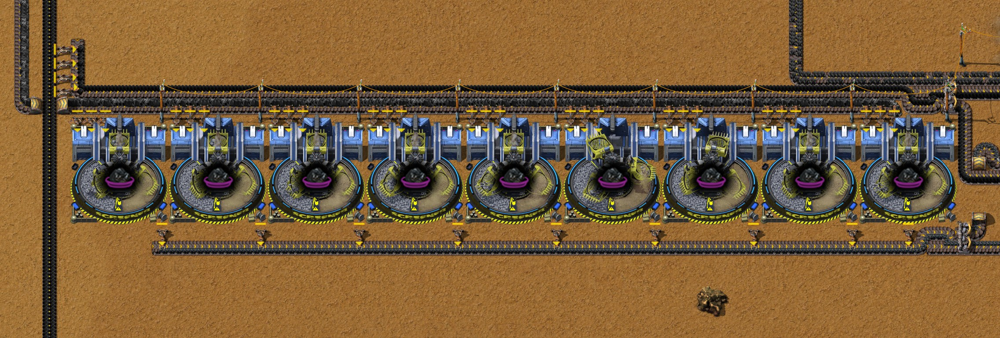
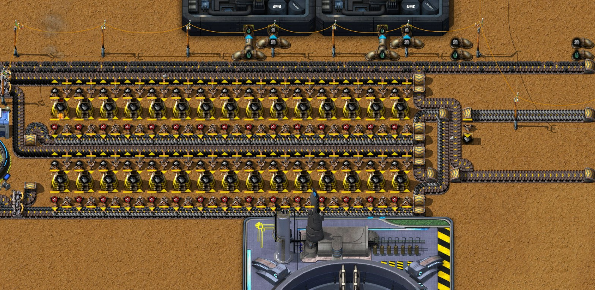
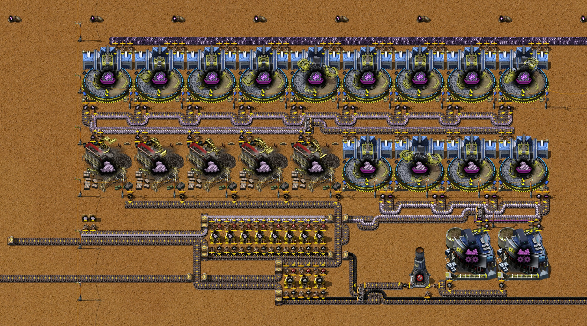
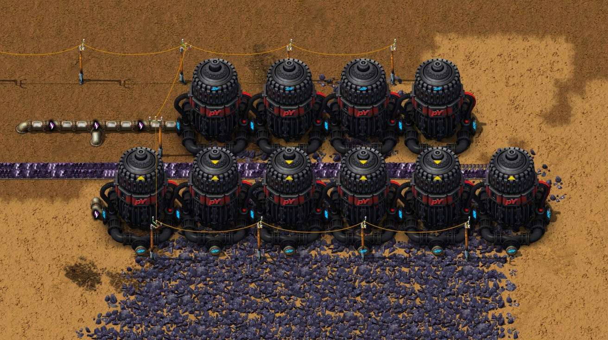
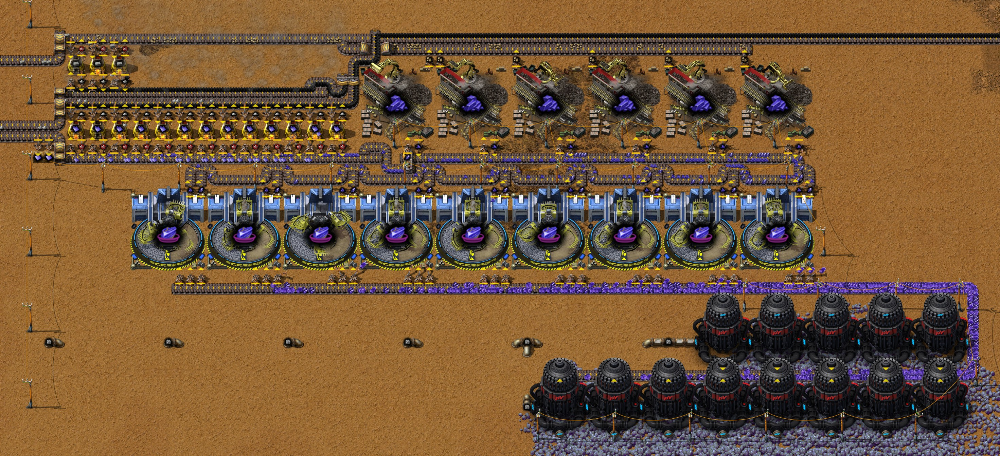

# 第十一章 铅矿、钛矿和锡矿冶炼改良

[English](11-lead-titanium-tin-smelting.md) · [目录](../README.zh-CN.md) · 上一章：
[第十章](10-crushed-coal-power.zh-CN.md)

本章接着同一局录像，从 25:47 的存档写到 28:02 的存档。主题是作者定的：**铅矿、钛矿和锡矿冶炼改良**。三项“阶段 1”处理科技让矿石先筛选再冶炼，所以一块板要的矿少得多，一台石炉出的板多得多。铅和钛从 26:04 建到 27:39 的存档（第 2 到 5 节），锡从 27:32 建到 28:02 的存档（第 6 节）。与此同时，三处矿场的采矿机都换成了液压采矿机 MK2，还研究了采矿产能 1 和 2。时间都是游戏时间。数字来自游戏数据、记录器每 10 分钟的产量窗口、27:39 和 28:02 的存档（`tools/inspect-save.ps1`），以及在这两个存档上各跑的一小时：一次按原样，一次把新模块的板拿走（`tools/rate-probe`）。作者还没有导出新模块的蓝图。

结果：**铅每块板要 2 个矿（原来 6 个），钛 5.2 个（原来 10 个），锡 6 个（原来 10 个）。** 板被拿走时，铅模块每秒产 **2.9 块铅板**（第五章的旧冶炼列：0.49 块），钛模块用 6 个矿每秒产 **1.15 块钛板**（第七章：0.275 块），锡模块用 13.5 个矿每秒产 **2.23 块锡板**（第五章：0.75 块）。三个模块每一步都留够了一满带矿石的余量；锡矿场差不多填满一条带，每秒 13.5 个：八台采矿机共用带上的一条车道，其中几台等在那里作后备（第 6 节）。存档时三个模块都是满的：钛还没有用户，电路板生产线每秒只用 0.267 块铅板和 0.31 块锡板。**铅和钛两个模块共用一路乙炔，满速时不够两边用**：采铅的采矿机要每秒 60，采钛的要 20，乙炔模块最多产 49.75。溢流阀让铅优先，所以一旦铅模块的产出全被用掉，采钛的采矿机 20 分钟内就停了。只要铅的用户每秒取不超过约 1.8 块，两边都能全速（第 4 节）。另外，红瓶模块拿到石砖之后，研究速度翻倍到每秒 0.1 份（第 7 节）。

## 全程一览

| 游戏时间 | 发生了什么 |
|---|---|
| 25:51–25:56 | 机器人重建碎煤发电模块的西头（在 (−57, 153) 和 (−57, 174) 拆下又放回六台锅炉）：这是作者在[第十章](10-crushed-coal-power.zh-CN.md#4-单独测模块)之后做的修正 |
| 26:02 | 研究完成采矿设备：阶段 1；接着研究采矿产能 1 |
| 26:04–26:16 | **铅模块**：在 y −70.5 处（x −226.5 到 −170.5）放一排九台自动筛选机 MK1，并把[第五章](05-tin-zinc-smelting.zh-CN.md#7-铅用乙炔作采矿流体)的十三台炼铅石炉改建成两排、每排十五台（x −163 到 −135）；筛选机和石炉就地手搓，大约一半由机器人放下。改建期间铅矿停产（截至 26:20 的窗口每秒 0.12 个） |
| 26:27–26:28 | 六台采铅的采矿机换成液压采矿机 MK2 |
| 26:32 | 研究完成采矿产能 1（每台采矿机多出 10% 矿石）；接着研究采矿产能 2 |
| 26:33 | 在 (−41.5, 382) 和 (−38.5, 382) 再加两台烧煤粉的锅炉和两台蒸汽机，带一台自己的抽取泵（第 7 节） |
| 26:35–26:36 | 机器人拆走[第七章](07-copper-screening-titanium-duralumin.zh-CN.md#3-钛)的十二台炼钛石炉 |
| 26:40–27:10 | 铅模块全速运转：每秒 6.4 到 6.6 个铅矿、最多 2.9 块铅板，乙炔模块开到每秒 50；之后铅板把库存填满，采矿机慢下来 |
| 26:43–27:08 | 在**钛模块**的位置东边先摆好它（x −25 到 58，y 419 到 471）：13 台筛选机、五台颚式破碎机 MK1、两台二级破碎机 MK1、十一台石炉，一部分手放、一部分机器人放，挪了又挪 |
| 27:05 | 研究完成采矿产能 2；接着研究锡处理：阶段 1 |
| 27:12–27:20 | 机器人把钛模块整体西移到位，x −61 到 0，y 417 到 452，紧挨钛矿运输带的末端；放三个装钛板的箱子 |
| 27:22 | 研究完成锡处理：阶段 1；接着研究原油工业机械：阶段 1 |
| 27:22–27:27 | 采钛的采矿机换成十台液压采矿机 MK2；拆掉它们的原煤带和灰烬带 |
| 27:32–27:44 | 开始建**锡模块**，y 472 到 496（x −59 到 10）：九台筛选机、六台颚式破碎机、16 台石炉；拆掉第五章的十二台炼锡石炉 |
| 27:39 | 前半部分的存档；原油工业机械：阶段 1 进度 62% |
| 27:45 | 研究完成原油工业机械：阶段 1；接着研究堆肥技术 |
| 27:46–27:49 | 机器人把锡模块又拆了下来 |
| 27:50–27:53 | 16 台采锡的液压采矿机 MK1 手动换成 13 台 MK2 |
| 27:53–27:56 | 机器人把锡模块重新放下，重新排布并往南挪，放在 y 494 和 y 518 的矿石带之间（x −62 到 11） |
| 27:54 | 研究完成堆肥技术；接着研究水生动物：阶段 1 |
| 27:56–28:01 | 手动铺传送带、电线杆和两个装板的箱子；模块开始运转 |
| 28:02 | 研究完成水生动物：阶段 1，接着研究组装 2；存档 |

每秒产量（记录器每 10 分钟的窗口）。到截至 27:30 的窗口之前钛矿都是 0：旧的炼钛列在 24:10 前就把箱子装满了，采矿机停着。乙炔用得比产得多的部分来自装满的管道。

| 窗口结束 | 铅矿 | 1级铅 | 铅板 | 乙炔 产 / 用 | 钛矿 | 3级钛 | 钛板 | pY科技包1型 | 电路板 |
|---|---|---|---|---|---|---|---|---|---|
| 25:50 | 1.61 | 0 | 0.27 | 14.3 / 14.2 | 0 | 0 | 0 | 0.065 | 0.100 |
| 26:00 | 1.58 | 0 | 0.27 | 14.7 / 14.7 | 0 | 0 | 0 | 0.050 | 0.100 |
| 26:10 | 0.74 | 0 | 0.12 | 6.0 / 6.2 | 0 | 0 | 0 | 0.050 | 0.100 |
| 26:20 | 0.12 | 0 | 0.02 | 0 / 0 | 0 | 0 | 0 | 0.050 | 0.100 |
| 26:30 | 1.41 | 0.63 | 1.40 | 13.8 / 13.7 | 0 | 0 | 0 | 0.050 | 0.100 |
| 26:40 | 6.56 | 1.09 | 2.11 | 48.5 / 59.0 | 0 | 0 | 0.08 | 0.050 | 0.100 |
| 26:50 | 6.38 | 1.28 | 2.90 | 50.0 / 56.8 | 0 | 0 | 0 | 0.050 | 0.100 |
| 27:00 | 5.52 | 1.09 | 1.78 | 49.2 / 49.2 | 0 | 0 | 0 | 0.050 | 0.100 |
| 27:10 | 3.84 | 0.61 | 0.34 | 47.7 / 33.3 | 0 | 0 | 0 | 0.050 | 0.100 |
| 27:20 | 0.59 | 0.10 | 0.27 | 7.2 / 4.2 | 0 | 0.22 | 0.17 | 0.050 | 0.100 |
| 27:30 | 0.58 | 0.10 | 0.28 | 17.0 / 12.2 | 2.09 | 0.32 | 0.87 | 0.050 | 0.100 |

从 25:47 到 27:39 两个存档之间，基地新增 31 台自动筛选机 MK1（9 → 40：铅九台、钛 13 台、锡九台）、11 台颚式破碎机 MK1（25 → 36；其中六台是锡的）、两台二级破碎机 MK1（30 → 32）、16 台液压采矿机 MK2（6 → 22，MK1 从 45 台减到 28 台）、20 台石炉（132 → 152）、第二台燃烧器，以及两台锅炉和两台蒸汽机（存档快照）。到 28:02 的存档，16 台采锡的采矿机换成了 13 台液压采矿机 MK2（22 → 35；MK1 从 28 台减到 12 台）；锡模块的其余部分是挪过去的，不是新增的。这段时间作者没有留聊天留言。

## 1. 科技

本章的配方来自第十章那段时间研究的科技，每项 50 或 55 份，每份 1 个 pY科技包1型加 2 个机自科技包（数据；记录器）：

- **钛处理：阶段 1**（24:15；前置为碎矿技术 2 和铜处理：阶段 1）解锁五个配方：筛选钛矿、破碎 2级钛、把 1级钛筛成 3级钛、重新破碎钛废料、把 3级钛炼成钛板（第 3 节）。
- **铅处理：阶段 1**（24:33）解锁两个：筛选铅矿、冶炼 1级铅（第 2 节）。
- **锡处理：阶段 1**（27:22）解锁三个：筛选锡矿、破碎 2级锡、把 1级锡炼成锡板（第 6 节）。

另有两类研究让采矿机更强：

- **液压采矿机 MK2**（来自电力采矿机这项科技，23:49）采矿速度是 MK1 的两倍（1 对 0.5），而且用电（900 kW），不再烧燃料（400 kW）。造一台要一台 MK1、两台电力采矿机、10 块简易电路板、50 个小部件、10 块钢材、20 块铝板和一个内燃机（数据）。作者把六台采铅的（26:27）、采钛的（27:22–27:27）和采锡的（27:50–27:53）都换成了它。
- **采矿产能 1 和 2**（26:32 和 27:05）各加 10%：现在每台采矿机每个采矿周期出 1.2 个矿（数据）。多出的矿不耗采矿流体，因为采矿机按周期耗流体：截至 26:40 的窗口里（采矿产能 1）采铅的采矿机每秒采 6.56 个铅矿、用 59.0 乙炔，即每个周期（1.1 个矿）10 乙炔（记录器）。

采矿设备：阶段 1（26:02）解锁八种机器（洗涤塔、浮选槽、水力分级机、冲击式破碎机、离心机、甲醇洗涤机、混合器和球磨机，都是 MK1），每种都要金属间化合物；目前一台也没建。到 27:40 左右研究速度一直是每秒 0.05 份，受红瓶限制（[第十章](10-crushed-coal-power.zh-CN.md#5-存档之后的基地)），之后翻了一倍（第 7 节）。

## 2. 铅

| 步骤 | 机器（数据） | 配方（数据） | 单台每秒 |
|---|---|---|---|
| 采矿 | 液压采矿机 MK2，5 × 5，900 kW，速度 1 | 铅矿：每周期 1 秒，每 10 个矿 100 乙炔 | 1 个周期：1.2 个矿（产能 +20%），10 乙炔 |
| 筛选 | 自动筛选机 MK1，7 × 7，300 kW，速度 1 | 5 铅矿 → 1 个 1级铅，3 秒 | 吃 1.667 个矿 |
| 冶炼 | 石炉，速度 1 | 4 个 1级铅 → 10 块铅板，40 秒 | 吃 0.1 个 1级铅，出 0.25 块板 |

现在一块铅板**只要 2 个铅矿，原来要 6 个**（旧配方：6 个矿 → 1 块板，10 秒，[第五章](05-tin-zinc-smelting.zh-CN.md#7-铅用乙炔作采矿流体)），乙炔也就只要三分之一：每块板 20，算上产能加成 16.7，原来 60。一台石炉出的板是原来的 2.5 倍（每秒 0.25 块，原来 0.1 块）。

模块（x −234 到 −82，y −78 到 −65；截图见下）：

- **矿场。** 原来那六台采矿机的位置，y −151.5（x −308.5 到 −283.5），现在是液压采矿机 MK2：每秒 6 个周期，满速**每秒 7.2 个铅矿**，要**每秒 60 乙炔**。矿石照旧沿 x −234 向南，再沿 y −76 向东。
- **九台筛选机**在 y −70.5 排成一排（x −226.5 到 −170.5），每台用三只机械臂（有一台两只）从那条带上取矿，把 1级铅放到下方 y −66 的带上，向东送去石炉。九台最多吃每秒 15 个矿；7.2 个只需要 4.3 台。
- **三十台石炉**分两排，每排十五台（x −163 到 −135，y −74 和 y −68），每排都是第五章那种冶炼列：上方的带送原煤（灰烬也由带过滤的机械臂放上这条带运走），下方的带运 1级铅和铅板。1级铅的带分给两排。三十台每秒能吃 3 个 1级铅；矿场的 1.44 个只要 14.4 台，产**每秒 3.6 块铅板**。
- **铅板**两排汇到一条沿 y −73.5 向东的带上。(−129.5, −72.5) 的一只工业机械臂把板放进 (−129.5, −71.5) 的木箱；其余沿 x −82 向北、再沿 y −235 向东送到电路板生产线，那里每秒用 0.267 块铅板。
- **用电**：筛选机 9 × 300 kW，采矿机 6 × 900 kW，共 8.1 MW（数据）；石炉和原来的采矿机烧的是原煤。

所以这个模块的上限不在机器，而在乙炔：第五章的乙炔模块每秒最多产 49.75，这些采矿机要 60（第 4 节）。

**实测**：在存档副本里把铅板从带上和箱子里拿走（第 5 节）。前十分钟管道里还有乙炔，采矿机每秒采 7.06 个铅矿，是满速。之后管道空了，模块只能拿到乙炔模块的产量，每秒 47.7 到 48.8：**每秒 5.80 到 5.95 个铅矿、2.85 到 3.08 块铅板**，这一小时里采矿机有 12% 的时间缺乙炔。作者填库存那段时间记录器也是这样：截至 26:50 的窗口每秒 6.38 个铅矿、2.90 块板，乙炔产 50、用 56.8。筛选机工作 42% 的时间，石炉 46%：和钛模块（第 3 节）一样，铅模块也有一满带矿石（每秒 15 个）的余量，那要每秒 125 乙炔。

按存档原样，模块只产电路板生产线用掉的量，每秒 0.26 到 0.28 块铅板，采矿机 92% 的时间在等出口；(−129.5, −71.5) 的箱子里有 1,600 块板，石炉也都满了。

## 3. 钛

| 步骤 | 机器（数据） | 配方（数据） | 单台每秒 |
|---|---|---|---|
| 采矿 | 液压采矿机 MK2 | 钛矿：每周期 2 秒，每 10 个矿 40 乙炔 | 0.5 个周期：0.6 个矿，2 乙炔 |
| 筛选矿石 | 自动筛选机 MK1 | 5 钛矿 → 1 个 1级钛 + 50% 概率 1 个 2级钛，3 秒 | 吃 1.667 个矿 |
| 破碎 2级钛 | 颚式破碎机 MK1，7 × 7，1 MW | 1 个 2级钛 → 1 个石矿 + 50% 概率 1 个 1级钛，3 秒 | 吃 0.333 个 2级钛 |
| 筛选 1级钛 | 自动筛选机 MK1 | 3 个 1级钛 → 1 个 3级钛 + 50% 概率 1 个钛废料，3 秒 | 吃 1 个 1级钛 |
| 重碎废料 | 二级破碎机 MK1，6 × 6，450 kW | 1 个钛废料 → 1 个碎石 + 30% 概率 1 个 3级钛，3 秒 | 吃 0.333 个废料 |
| 冶炼 | 石炉 | 5 个 3级钛 → 10 块钛板，25 秒 | 吃 0.2 个 3级钛，出 0.4 块板 |

5 个钛矿得到 1 个 1级钛和 0.5 个 2级钛；破碎 2级钛再得 0.25 个 1级钛（和 0.5 个石矿）；这 1.25 个 1级钛筛出 0.417 个 3级钛和 0.208 个废料；重碎废料再得 0.0625 个 3级钛（和 0.208 个碎石）。合计 0.479 个 3级钛，也就是 **5 个矿出 0.958 块钛板：每块板 5.2 个矿，原来要 10 个**（旧配方：40 个矿 → 4 块板，60 秒，第七章）。一台石炉每秒出 0.4 块板，原来 0.067 块，是六倍。

模块（x −61 到 0，y 417 到 452，在钛矿运输带的西端）：

- **矿场。** 十台液压采矿机 MK2 放在第七章十一台 MK1 的位置（x 264.5 到 289.5，y 414.5 和 420.5）：每秒 5 个周期，满速**每秒 6 个钛矿**，用**每秒 20 乙炔**。它们用电，不再需要原煤；那条原煤带和灰烬带都拆了（(260.5, 412.5) 和 (261.5, 412.5) 两个箱子里还有 1,032 个原煤）。矿石照旧沿 y 417 向西，现在直接送进模块。
- **九台筛选机**在 y 422.5（x −57.5 到 −1.5），每台用三只机械臂从上方那条带取矿，把 1级钛和 2级钛放到下方 y 429 一条向东的带上。九台最多吃每秒 15 个矿；6 个只需要 3.6 台。
- **五台颚式破碎机**在 y 434.5（x −57.5 到 −29.5），用带过滤的机械臂从那条带取 2级钛，把 1级钛放回去；石矿放到 y 439 的带上。筛选机每秒产 0.6 个 2级钛，需要 1.8 台破碎机。
- **四台筛选机**在 y 434.5（x −22.5 到 −1.5），从分流器后面取 1级钛，每秒 1.5 个（它们能吃 4 个），把 3级钛和废料放到 y 439 和 441 两条向西的带上。
- **两台二级破碎机**在 y 446.5（x −8.5 和 −1.5）取废料，每秒 0.25 个（它们能吃 0.667 个），把 3级钛放回去；碎石送进 (−15.5, 449.5) 的一台**燃烧器**，它烧原煤，把碎石销毁（碎石 → 20% 概率 1 个灰烬，1.5 秒，速度 5：每秒 3.3 个；数据，[第九章](09-py-science-pack-1.zh-CN.md#3-甲酸钳尾刀虫一个笼子和屠宰场)）。
- **八台石炉**在 y 444（x −43 到 −29），从 y 441 的带上取 3级钛，把钛板放回这条带：每秒 0.575 个 3级钛需要 2.9 台，产**每秒 1.15 块钛板**。钛板沿 y 443 向西进 (−60.5, 441.5) 和 (−59.5, 441.5) 两个木箱。
- **三台石炉**在 y 450（x −33 到 −29），把破碎机每秒 0.6 个石矿烧成 0.3 块石砖，沿 y 449 向西、再沿 x −75 向北送上总线的石砖带。
- **用电**：13 台筛选机 × 300 kW、5 台破碎机 × 1 MW、2 台二级破碎机 × 450 kW、10 台采矿机 × 900 kW，共 18.8 MW（数据）。

每个矿出的板差不多翻倍，采矿机快 2.2 倍：这个模块能出**第七章的 4.2 倍钛板**（每秒 1.15 块，原来 0.275 块），乙炔却不到两倍（每秒 20，原来那些采矿机采 2.75 个矿用 11；每块板 17.4，原来 40）。

**实测**：在存档副本里把钛板一到就拿走（第 5 节）。十台采矿机一直在工作，每个 10 分钟段都是**每秒 6.00 个钛矿**；模块每秒产 1.47 到 1.51 个 1级钛、0.55 到 0.60 个 3级钛，**每秒 1.10 到 1.18 块钛板**（第一段之后；第一段还在清空满着的石炉）：正是上面的算数。机器状态显示还剩多少余量：矿石筛选机工作 40% 的时间，颚式破碎机 35%，3级钛筛选机 37%，其余时间等原料。**每一步都按一满带矿石配好了**：每秒 15 个钛矿能让九台矿石筛选机满负荷，需要 4.5 台颚式破碎机（有五台）、3.75 台 3级钛筛选机（有四台）、7.2 台石炉（有八台）和 1.9 台二级破碎机（有两台），每秒出 2.9 块板。十台采矿机只填满那条带的 40%；满带要 25 台，乙炔每秒 50。

**按存档原样，钛板还没有用户**。存档时两个箱子（3,200 块）和八台石炉都满了，作者身上还有 2,028 块。按原样跑一小时，筛选机 20 分钟内堵满，矿石带 30 分钟内堵满，采矿机只工作了这一小时的 27%：这是产品还没有用户时的堵塞（techniques 原则 23），它把乙炔让给了铅（第 4 节）。

## 4. 两边共用的乙炔

采铅和采钛的采矿机共用第五章乙炔模块出来的一条乙炔管道（四台气化炉；测试台上每秒 49.75）。采铅的在前；(−108.5, −74.5) 的溢流阀只在铅那一侧超过 80% 满时才把乙炔放给钛（[第七章](07-copper-screening-titanium-duralumin.zh-CN.md#3-钛)）。满速时六台采铅的要每秒 60，十台采钛的要 20：一共 80，而产量只有 49.75。三种负荷下的实测（第 5 节）：

| 负荷 | 每秒乙炔 | 气化炉 | 铅 | 钛 |
|---|---|---|---|---|
| 按存档原样：铅板每秒用 0.267 块，钛的库存已满 | 采钛时 24，之后 4 | “输出已满” 77% | 0.58 个矿 | 开始 6.0 个矿，第 20 分钟起为 0：模块堵满 |
| 钛板全部拿走，铅板每秒拿走约 1.1 块（第一次试，见第 9 节） | 33 到 38 | 工作 73% | 2.1 到 2.3 个矿 | 6.0 个矿、1.15 块板，整整一小时 |
| 所有板全部拿走 | 管道排空后（约 20 分钟）47.7 到 48.8 | 工作 97% | 5.8 到 5.95 个矿，2.9 块板 | 第 20 分钟起为 0：采矿机这一小时 73% 的时间“缺少所需流体” |

所以只要采铅的每秒最多拿走 29.75，钛就能保住它的 20：也就是每秒 2.975 个周期、3.57 个铅矿、**约 1.8 块铅板**。现在基地每秒用 0.267 块，钛还没有用户。如果铅的用户增长到超过这个数，钛会悄无声息地停掉；办法是加乙炔。再放一个作者的 `acetylene` 模块（每秒 49.75）就够两边全速；缺的每秒 30 乙炔大约要每秒 2.8 个焦炭（每 10 乙炔 0.94 个焦炭，第五章）。作者暂时不处理：基地现在用的铅远远没到这个数。

## 5. 27:39 存档后的一小时

在存档副本里测量（`tools/rate-probe`，先预热一分钟，再测一小时，每 10 分钟一段；每秒数，取每段的平均）。按存档原样：

| 存档后分钟 | 铅矿 | 铅板 | 钛矿 | 钛板 | 乙炔产量 | 电路板 | 用电（MW） |
|---|---|---|---|---|---|---|---|
| 0–10 | 0.59 | 0.27 | 6.00 | 0 | 24.0 | 0.100 | 113.6 |
| 10–20 | 0.58 | 0.26 | 3.90 | 0 | 17.2 | 0.100 | 111.5 |
| 20–30 | 0.59 | 0.27 | 0 | 0 | 4.2 | 0.100 | 93.9 |
| 30–40 | 0.57 | 0.26 | 0 | 0 | 4.0 | 0.100 | 92.5 |
| 40–50 | 0.57 | 0.26 | 0 | 0 | 4.5 | 0.100 | 85.0 |
| 50–60 | 0.56 | 0.28 | 0 | 0 | 4.0 | 0.100 | 75.6 |

铅板和钛板一到就全部拿走（每刻清空一格传送带，每秒清空装板的箱子）：

| 存档后分钟 | 铅矿 | 铅板 | 钛矿 | 钛板 | 乙炔 产 / 用 | 电路板 | 用电（MW） |
|---|---|---|---|---|---|---|---|
| 0–10 | 7.06 | 5.77 | 6.00 | 1.37 | 50.0 / 78.0 | 0.100 | 128.9 |
| 10–20 | 6.95 | 3.50 | 3.92 | 1.18 | 50.0 / 69.3 | 0.100 | 129.7 |
| 20–30 | 5.95 | 3.08 | 0 | 0.18 | 48.8 / 48.8 | 0.100 | 110.8 |
| 30–40 | 5.85 | 2.88 | 0 | 0 | 48.0 / 47.8 | 0.100 | 107.4 |
| 40–50 | 5.86 | 2.90 | 0 | 0 | 47.8 / 48.0 | 0.100 | 101.5 |
| 50–60 | 5.80 | 2.85 | 0 | 0 | 47.7 / 47.7 | 0.100 | 87.6 |

- **前 20 分钟靠库存**：管道里的乙炔（每秒用 78、产 50），以及带上和石炉里的 1级铅（一开始每秒 5.8 块铅板）。
- **两次测量中钛模块都停了**：原样那次是因为钛板没处去，拿走板那次是因为乙炔被采铅的拿走了（第 4 节）。第一次试时铅只被拿走约每秒 1.1 块，钛就跑满了整整一小时：第一段之后每段都是每秒 6.00 个钛矿、1.10 到 1.18 块钛板。
- **基地其余部分不受影响**：每次测量的每一段电路板都是每秒 0.100 块，用电最多 130 MW 时也没有一台电力机器报告电力不足（两个新模块满速最多用 26.9 MW；数据）。后面几段用电下降，是因为别处的库存逐渐填满（第十章）。
- 只拿走铅板时，铅和第二张表一样（第 30 分钟起每秒 2.88 到 2.90 块），钛和第一张表一样。

## 6. 锡

| 步骤 | 机器（数据） | 配方（数据） | 一台机器每秒 |
|---|---|---|---|
| 采矿 | 液压采矿机 MK2 | 锡矿：每周期 1 秒，每 10 个矿 100 蒸汽 | 1 个周期：1.2 个矿、10 蒸汽 |
| 筛选 | 自动筛选机 MK1 | 5 个锡矿 → 1 个 1级锡 + 50% 概率 1 个 2级锡，3 秒 | 吃 1.667 个矿 |
| 破碎 2级锡 | 颚式破碎机 MK1 | 1 个 2级锡 → 50% 概率 1 个 1级锡 + 1 个石矿，4 秒 | 吃 0.25 个 2级锡 |
| 冶炼 | 石炉 | 15 个 1级锡 → 10 块锡板，50 秒 | 吃 0.3 个 1级锡，出 0.2 块板 |

5 个锡矿出 1 个 1级锡和 0.5 个 2级锡；破碎 2级锡再得 0.25 个 1级锡（和 0.5 个石矿）。一共 1.25 个 1级锡，**5 个矿出 0.833 块锡板：每块板 6 个矿，原来 10 个**（旧配方：40 个矿 → 4 块板，60 秒，[第五章](05-tin-zinc-smelting.zh-CN.md#3-锡用蒸汽作采矿流体)）。一台石炉每秒出 0.2 块板，原来 0.067 块，是原来的三倍。锡在熔炉前只要两种机器，钛要四种。

作者先在 y 472 到 496 建了这个模块，又让机器人拆下来，往南重新放下（27:46–27:56），重新排布，让筛选机紧挨矿石带。存档时的模块（x −62 到 25，y 494 到 532；截图见下）：

- **矿场**：13 台液压采矿机 MK2 放在第五章 16 台 MK1 的位置：五台在 y 523.5（x 2.5 到 22.5），八台在 y 529.5（x −12.5 到 22.5），都把矿放到两排之间的一条带上（y 526）。这条带向东，沿 x 25 向北，再沿 y 518 向西从筛选机下面经过。每秒 13 个周期可出 15.6 个矿，比一条带能装的（15 个）还多；15 个矿要每秒 125 蒸汽。蒸汽来自第五章的蒸汽模块，走同一条管道，经过 (−103.5, 498.5) 的止回阀。
- **九台筛选机**在 y 513.5（x −48.5 到 7.5），每台用三只机械臂从下面的矿石带取矿，再用两只过滤机械臂把 1级锡和 2级锡放到上面的一条带上（y 508）。这条带向东，到头后向北拐，沿 y 506 往西回来。九台每秒最多吃 15 个矿。
- **六台颚式破碎机**在 y 501.5（x −27.5 到 7.5），从这条带上取 2级锡，用一只过滤机械臂把 1级锡放回去；它们的石矿放到 y 496 的带上。一满带矿石每秒出 1.5 个 2级锡，正好是六台破碎机吃的量。
- **(−26.5, 507) 有一个过滤分流器**，把 2级锡分到北边的出口，而那里没有接带；其余的都往南去石炉。所以 2级锡到不了石炉：它停在分流器上，由最西边那台破碎机的机械臂从那里取走。
- **十三台石炉**在 y 504（x −57 到 −33），布局同第五章的冶炼列：1级锡和锡板在下面的带上（y 506；出料机械臂设为“除灰烬外”），原煤和灰烬在上面的带上（y 501）。一满带矿石每秒出 3.75 个 1级锡，要 12.5 台石炉，**每秒 2.5 块锡板**。
- **锡板**沿 y 504 向西，经过 (−60.5, 506.5) 和 (−59.5, 506.5) 两个木箱（3,200 块，存档时已满），再沿 x −78 向北 733 格到 y −232，向东送到电路板生产线的焊料组装机和电子厂；它们每秒用 0.31 块锡板。
- **三台石炉**在 y 498（x −57 到 −53），把破碎机的石矿（每秒 1.5 个要 2.4 台）烧成石砖，沿 y 497 向西、沿 x −75 向北：作者把钛模块的石砖带向南接到了这里（x −74.5 处十格传送带）。
- **燃料和灰烬**：原来给旧采矿机送燃料的 x 70 原煤带（第五章）现在只供这 16 台石炉；灰烬沿 x −93 向北送到灰烬环线。
- **用电**：筛选机 9 × 300 kW，破碎机 6 × 1 MW，采矿机 13 × 900 kW，共 20.4 MW（数据）。

**实测**：在 28:02 存档的副本里各跑一小时，一次按原样，一次把锡板从带上和两个箱子里拿走（`tools/rate-probe`，每秒数，取每 10 分钟一段的平均）：

| 存档后分钟 | 原样：锡矿 | 锡板 | 拿走板：锡矿 | 1级锡 | 锡板 | 用电（MW），原样 / 拿走 |
|---|---|---|---|---|---|---|
| 0–10 | 13.48 | 2.22 | 13.48 | 3.31 | 2.22 | 136.9 / 136.9 |
| 10–20 | 13.48 | 2.22 | 13.48 | 3.35 | 2.22 | 137.0 / 137.0 |
| 20–30 | 13.48 | 2.17 | 13.48 | 3.30 | 2.22 | 129.7 / 129.7 |
| 30–40 | 6.81 | 0.47 | 13.48 | 3.37 | 2.23 | 111.3 / 125.7 |
| 40–50 | 0.76 | 0.12 | 13.48 | 3.36 | 2.23 | 97.1 / 123.8 |
| 50–60 | 1.00 | 0.12 | 13.48 | 3.38 | 2.23 | 98.2 / 122.4 |

- **拿走板时模块一直平稳：每秒 13.48 个锡矿、2.22 到 2.23 块锡板**，和上面的算数一致（13.48 个矿出 3.37 个 1级锡、2.25 块板）；探针每秒拿走 2.228 块。这一小时里采矿机工作 86% 的时间，筛选机 90%，颚式破碎机 89%，石炉 86%。没有 2级锡越过分流器：探针拿走的只有锡板。没有一台采矿机缺蒸汽（观察的两台每一段都存着 161）；蒸汽模块的锅炉这一小时工作 80% 到 90% 的时间，27:39 之后那一小时锡矿采矿机停着，只有 26% 到 29%。
- **这是第五章的三倍**（每秒 2.23 块对 0.75 块），矿只多用了 0.8 倍。每块板的蒸汽减半：5 个采矿周期、每周期 1.2 个矿，50 蒸汽；原来是 10 个矿、100 蒸汽。折合锅炉烧的原煤是 8.3 个而不是 16.5 个（每 10 蒸汽 1.65 个原煤，第五章），而且采矿机不再烧燃料。
- **按存档原样**，模块全速跑了 30 分钟，锡板在往电路板生产线的长带上越堆越满（两个箱子存档时已满）；从第 40 分钟起只产电路板生产线用掉的量。和铅、钛一样，这是库存在填满，不是故障（techniques 原则 23）。
- 基地其余部分：每一段电路板都是每秒 0.100 块，研究每秒 0.100 个 pY科技包1型（第 7 节），用电最多 137 MW 时也没有一台电力机器报告电力不足。

**上限在矿石带的一条车道**。采矿机把矿放到两排之间的带上，每排放在自己那一侧的车道，一条车道每秒最多 7.5 个。北排五台每秒出 6 个，还有余量；南排八台本可出 9.6 个，却只能往它那条车道上放 7.5 个：合计每秒 13.5 个，正是实测的 13.48。把锡板拿走后每分钟采样一次、共十分钟：北排的采矿机每次都在工作，南排最东边那台（它那条车道上的最后一台）每次都在等出口，它前面两台时而等待。所以模块每秒出 2.23 块板，而不是筛选机、破碎机和石炉在一满带矿石下能出的 2.5 块；要多出矿，只能在带的北侧加采矿机。

作者认为这只是小瑕疵，多放的采矿机是有意的，和以前的热能采矿机一样（techniques 原则 8）：车道上前面几台采矿机下面的矿采完后，等着的那几台会自动接上。作者原以为采矿机现在用电，多放会略微费电；其实它们等待时不耗电。采矿机没有待机耗电（MK2 没有设，引擎只给加工机器自动加待机耗电；数据），所以等出口的采矿机一点电也不用：拿走锡板的那一小时里，基地的液压采矿机 MK2 共用 15.9 MW，正是在工作的那些要的量（六台采铝的一直工作，采锡的 86%，采铅的 7%，采钛的不工作，每台 900 kW）。

## 7. 其他变化

- **碎煤发电模块的修正**（25:51–25:56）：机器人按作者更新后的蓝图重建两排的西头，西起第二台锅炉有了第二只灰烬机械臂（[第十章](10-crushed-coal-power.zh-CN.md#7-蓝图)）。
- **再加两台煤粉锅炉**（26:33），带两台蒸汽机和一台自己的抽取泵，在 y 382 那排煤粉锅炉的东头（x −41.5 和 −38.5）：现在共八台，每秒最多烧 9.9 个煤粉（每台 1.23；数据）。第十章发现基地满负荷时每秒产 8.26 个煤粉，六台只能烧 7.40。存档后的一小时里基地每秒产 5.6 个煤粉，八台锅炉 59% 的时间在工作：煤粉不再往回堵。
- **研究速度翻倍**：到截至 27:40 的窗口为止，研究一直是每秒 0.05 份（从 26:00 起每个窗口的 pY科技包1型产量都是每秒 0.05），红瓶模块每秒产 0.10 个机自科技包，只有它能力 0.2 的一半。从截至 27:50 的窗口起，红瓶模块每秒产 0.20 个，科研枢纽每秒 0.09 到 0.10 个科技包（记录器）；28:02 存档后的一小时里是 0.100（探针）：原油工业机械：阶段 1（80 份）用了 23 分钟，堆肥技术和水生动物：阶段 1（各 50 份）分别用了 9 分钟和 8 分钟。第十章发现红瓶模块缺石砖，并预计拿到石砖后研究会翻倍；进红瓶模块的石砖带（y −167）当时只有 8 块石砖，27:39 的存档里有 113 块，28:02 有 128 块。新增的石砖里有钛模块的每秒 0.3 块（27:20 起）和锡模块的每秒 0.67 块（28:00 起）；整个基地的石砖收支没有追查。

## 8. 清单

- 先筛选再冶炼：铅每块板 2 个矿（原来 6 个），钛 5.2 个（原来 10 个），锡 6 个（原来 10 个）；一台石炉出板是原来的 2.5 倍（铅）、6 倍（钛）或 3 倍（锡）。
- 钛这条链有五步，要安排两种副产品：石矿（烧成石砖，这里送上总线）和碎石（燃烧器销毁）。锡只有两步，副产品只有石矿。
- 过滤分流器的过滤一侧不接带，就能把那种物品拦住：这里它让 2级锡上不了石炉的带，留在最后一台破碎机够得着的地方。
- 带两侧的采矿机各自只填自己那一侧的车道，每秒最多 7.5 个：一侧八台、另一侧五台，只能出 13.5 个矿，而不是 15.6 个。多出的采矿机是前面的采完后接上的后备，等出口时不耗电。
- 像作者这样，每一步都按一满带矿石来配：以后只要加采矿机。
- 液压采矿机 MK2 采得快一倍，也不用燃料带。采矿流体按周期消耗，所以采矿产能多出来的矿是白送的。
- 把同一个来源上所有采矿机的采矿流体加起来算：两个各自够用的模块合起来可能超过它的产量（第 4 节）。
- 产品还没有用户时库存填满不是故障；测这种模块要把产出拿走。

## 9. 这些事实是怎样核实的

- 录像：伴随模组的记录器（运行 `2652821414-0`，最后一条记录 28:02），用 `tools/recorder-phases.js`（10 分钟一段和 1 分钟一段，看建造顺序）和 `tools/recorder-log.js`（每 10 分钟窗口的产量）读取；21:25 之后没有聊天留言（`tools/recorder-summary.js`）。游戏在 27:39 更新到 Factorio 2.1.23（记录器里的配置变化），测量用的是同一版本。
- 27:39 和 28:02 的存档（`Py-Exploration`，读之前先复制到 `C:\tmp\ch11`；一致性检查通过）：`tools/inspect-save.ps1`、`tools/summarize-save.js`、`tools/trace-layout.js`（带线、每台机器取什么放什么）、`tools/render-area.js`；两个快照逐个实体比较，看两次存档之间改了什么。
- 数据：配方、机器、矿石的采矿时间和流体、科技（`tools/q.js`，2026-10-18 的数据导出）。
- 存档后的一小时：`tools/save-probe.ps1 -Probe rate-probe -Ticks 219700 -Variant '60,3600,600,<物品>'`，一次按存档原样，一次把产出拿走。后者给探针加了两个伪实体（新）：`sink@x:y` 每刻清空那一格的传送带，`empty@x:y` 每秒清空那一格的箱子，并打印各拿走了多少。钛：`sink@-60.5:443.5`、`empty@-60.5:441.5`、`empty@-59.5:441.5`；铅：`sink@-126.5:-73.5`、`empty@-129.5:-71.5`。第一次试的时候铅的清空点偏了一格（那里没有带），只剩铅箱子前那只机械臂在取：每秒 0.82 块铅板，这是机械臂的上限，不是模块的。锡，用 28:02 的存档：`sink@-65.5:504.5`、`empty@-60.5:506.5`、`empty@-59.5:506.5`。
- 锡的车道：同一存档拿走锡板后跑十分钟，每分钟一段，在两排的八台采矿机上设观察点（`@x:y`）。
