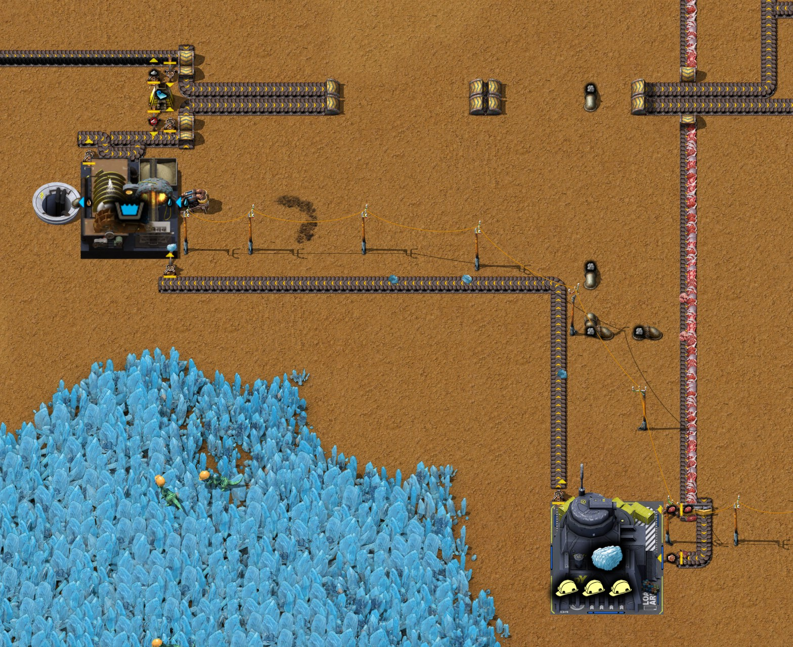
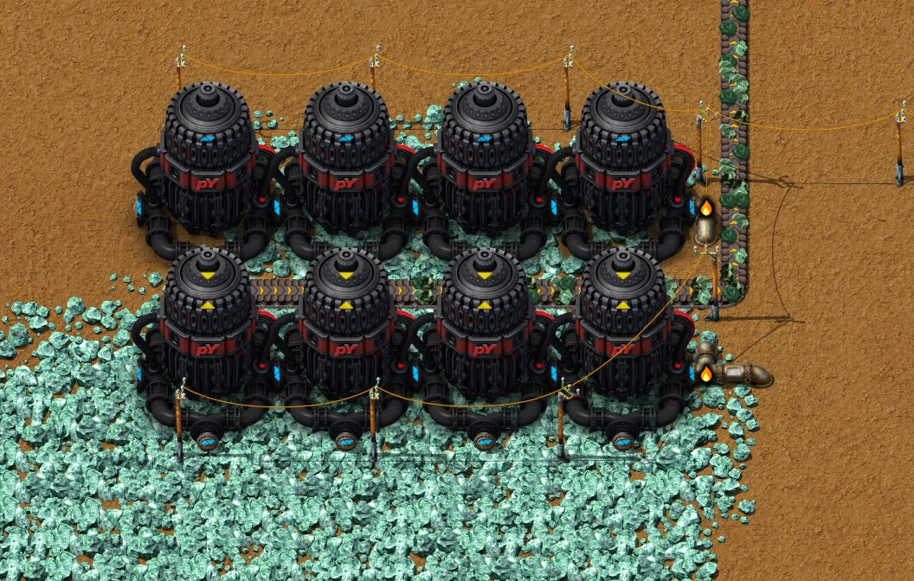
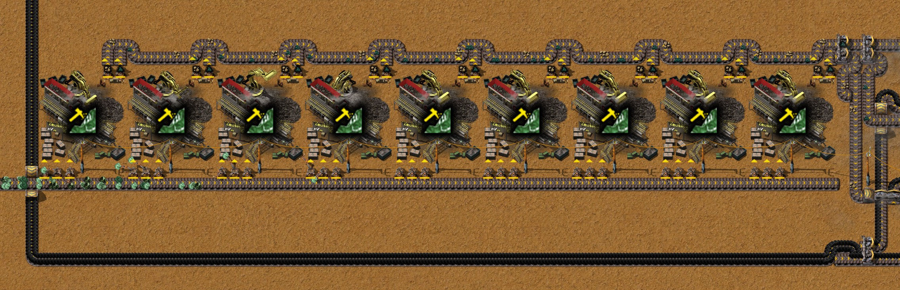
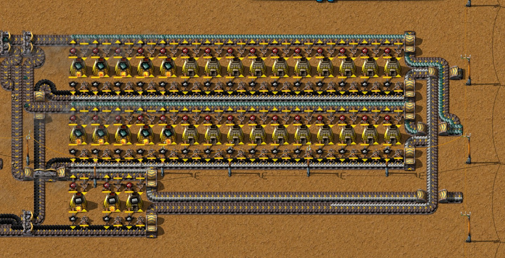

# 第十二章 蓝坷垃开采与镍矿冶炼

[English](12-nexelit-nickel.md) · [目录](../README.zh-CN.md) · 上一章：
[第十一章](11-lead-titanium-tin-smelting.zh-CN.md)

本章接着同一局录像，从 28:02 的存档讲到 29:51 的存档。主题是作者定的：**蓝坷垃开采与镍矿冶炼**，这是火车要用的
两种新材料（[火车与机器人](../research/trains-and-robots.zh-CN.md)）。蓝坷垃来自挖矿站：挖矿兽吃了食物去挖（第 2、3 节）；
镍来自一片用合成气的液压采矿机 MK2，像[第十一章](11-lead-titanium-tin-smelting.zh-CN.md)的铅和锡一样先破碎再冶炼（第 4 节）。
时间都是游戏时间。数字来自游戏数据、记录器每 10 分钟的产量窗口、29:51 的存档（`tools/inspect-save.ps1`），以及该存档
跑一小时的结果：一次按存档原样，一次把两种新板材都拿走（`tools/rate-probe`）。作者还没有导出新模块的蓝图。

结论：**三只挖矿兽每秒约出 0.1 块蓝坷垃板**，正好是钳尾刀虫屠宰场喂得起的量：每秒 0.1 肉和 0.1 内脏给出 0.3 个天然
蓝坷垃，每 3 个洗净、冶炼成 1 块板。三只挖矿兽其实吃得下更多（每秒 0.217 份），从屠宰场来的传送带上还存着肉的时候，
最多每秒 0.145 块。**镍模块每秒出 0.96 块镍板**，原料是每秒 4.8 个镍矿：瓶颈在八台采矿机，九台颚式破碎机和三十台
石炉都按一满带（每秒 15 矿，3 块板）配的。两种板材都放在一条尽头不通的传送带上：目前都还没有用户。

## 全程一览

| 游戏时间 | 发生了什么 |
|---|---|
| 28:02 | 研究完水生动物：阶段 1，下一项组装 2；第十一章的存档 |
| 28:04–28:10 | 在 (14, −188) 和 (−170, −222) 试放挖矿站，又都收起 |
| 28:10–28:20 | 开始沿 x −98 铺运肉和内脏的带，从屠宰场（y −379）往南。机器人拆掉中心附近 14 台热能采矿机（第 6 节）；作者在铜矿上换了两台电力采矿机，位于 (51.5, 38.5) 和 (55.5, 38.5) |
| 28:15 | 研究完组装 2；下一项生物室升级 |
| 28:16–28:37 | **第一只挖矿兽的样本**：植被采集器 MK1 和孵化器 MK1 做生态样本，数据阵列仪做通用地球DNA样本，基因实验室 MK1 做苔藓基因样本（在 (−14 到 45, 77 到 88) 一带）；十个 DNA 样本做完就收起 |
| 28:24 | 研究完生物室升级（T.U.R.D. 选了催化细胞渗透：挖矿兽在生物室里要做四倍时间，挖得快 35%）；下一项微生物学：阶段 1 |
| 28:38–28:48 | 生物室 MK1 放在 (6.5, −254.5)，做出第一只挖矿兽（480 秒），然后收起 |
| 28:41–28:48 | **挖矿站**放在 (−102.5, 537.5)，运肉的带一直铺到这里（从 y −379 到 538，916 格）；洗涤机 MK1、它的抽取泵和渗水坑在 (−132, 516)；一台炼蓝坷垃板的石炉在 (−130, 509)；板材（x −89）和灰烬（x −93）各有一条带往北 |
| 28:47 | 研究完微生物学：阶段 1；下一项分离技术 |
| 28:53 | [火车与机器人](../research/trains-and-robots.zh-CN.md)和 [T.U.R.D. 选择](../research/turd-choices.zh-CN.md)用的存档：一只挖矿兽在干活 |
| 28:54–29:01 | 再做样本，给第二、三只挖矿兽（第二台植被采集器、孵化器和数据阵列仪） |
| 29:00 | 研究完分离技术；下一项鱼：阶段 1 |
| 29:00–29:20 | **镍模块**在 x −230 到 −130、y 13 到 32：y 21.5 一排九台颚式破碎机 MK1，33 台石炉，就地手搓，约一半由机器人放置，29:20 又由机器人重新排了一次 |
| 29:25–29:51 | 生物室又放回 (6.5, −254.5)：第二、三只挖矿兽 |
| 29:26–29:27 | **镍矿场**：八台液压采矿机 MK2（就地手搓）放在 (−256, 96) 的镍矿上 |
| 29:30–29:38 | 一条合成气管从 x −107.5 的流体总线接到采矿机；总线上 (−107.5, 179.5) 的止回阀换成溢流阀 |
| 29:43 | 研究完鱼：阶段 1；下一项铸造：阶段 1。做样本的机器收起 |
| 29:45–29:47 | 手搓五台锑矿采矿机 MK1（用掉 25 台电力采矿机和 10 个内燃机） |
| 29:51 | 收起生物室；存档 |

每秒产量（记录器每 10 分钟的窗口）：

| 窗口截至 | 天然蓝坷垃 产/用 | 清洁蓝坷垃 | 蓝坷垃板 | 肉 产/用 | 内脏 产/用 | 镍矿 | 1级镍 | 镍板 |
|---|---|---|---|---|---|---|---|---|
| 28:50 | 0.023 / 0.015 | 0.005 | 0 | 0.100 / 0.008 | 0.100 / 0.010 | 0 | 0 | 0 |
| 29:00 | 0.087 / 0.090 | 0.030 | 0.030 | 0.100 / 0.013 | 0.100 / 0.058 | 0 | 0 | 0 |
| 29:10 | 0.070 / 0.070 | 0.023 | 0 | 0.057 / 0 | 0.057 / 0.070 | 0 | 0 | 0 |
| 29:20 | 0.070 / 0.070 | 0.023 | 0.030 | 0 / 0 | 0 / 0.070 | 0 | 0 | 0 |
| 29:30 | 0.072 / 0.075 | 0.025 | 0.030 | 0 / 0 | 0 / 0.072 | 0.027 | 0 | 0 |
| 29:40 | 0.110 / 0.105 | 0.035 | 0.030 | 0.063 / 0.002 | 0.063 / 0.108 | 4.80 | 0.877 | 0.777 |
| 29:50 | 0.143 / 0.145 | 0.048 | 0.060 | 0.100 / 0 | 0.100 / 0.143 | 4.80 | 0.960 | 0.958 |

石炉一次炼 18 个清洁蓝坷垃（一分钟一炉），所以蓝坷垃板以每个窗口 18 块为一档。截至 29:20 和 29:30 的两个窗口里没有做出
笼装钳尾刀虫（笼子为 0），屠宰场就没有肉、内脏和甲酸，没有甲酸也就没有 pY科技包1型；挖矿站靠带上已有的内脏撑着。原因没有追查。

从 28:02 到 29:51 的存档，基地多了 9 台颚式破碎机 MK1（36 到 45）、34 台石炉（152 到 186）、8 台液压采矿机 MK2（35 到 43）、
一个挖矿站、3 只挖矿兽、一台洗涤机、一个渗水坑和一台抽取泵；热能采矿机少了 20 台（145 到 125）。

## 1. 科技

蓝坷垃处理：阶段 1（24:43，挖矿兽和挖矿站、洗涤机做清洁蓝坷垃的配方、蓝坷垃板）和镍处理：阶段 1（25:12，1级镍和镍板）
早就研究了，见[第十一章](11-lead-titanium-tin-smelting.zh-CN.md#1-科技)。本章期间：

| 研究完成 | 科技 | 在这里的用处 |
|---|---|---|
| 28:15 | 组装 2 | 轴 MK1、制动器 MK1、变速箱 MK1（火车用） |
| 28:24 | 生物室升级 | T.U.R.D. 选了催化细胞渗透（[T.U.R.D. 选择](../research/turd-choices.zh-CN.md)） |
| 28:47 | 微生物学：阶段 1 | 养鱼场的前置 |
| 29:00 | 分离技术 | 养鱼场的前置 |
| 29:43 | 鱼：阶段 1 | 养鱼场 |

存档时的队列：铸造：阶段 1（59%）、焦炭处理：阶段 1、热气：阶段 1、硼、铁处理：阶段 1、地热能：阶段 1（[地热发电](../research/geothermal.zh-CN.md)）。
研究速度约每秒 0.1 单位（存档后一小时每秒 0.093 个 pY科技包1型）。

## 2. 挖矿兽

挖矿兽在生物室 MK1 里做：30 苔藓基因样本、10 通用地球DNA样本、10 培养皿、50 钛板、1,000 盐水。作者的 T.U.R.D. 选择
（催化细胞渗透）让它要做 480 秒而不是 120 秒，挖得快 35%（[T.U.R.D. 选择](../research/turd-choices.zh-CN.md)）。费时的是样本：

| 样本 | 机器 | 配方 |
|---|---|---|
| 生态样本 | 孵化器 MK1 | 1 生态容器 + 15 原生植被，10 秒 |
| 通用地球DNA样本 | 数据阵列仪 | 1 铁箱 + 15 机自科技包（红瓶）+ 10 生态样本，25 秒 |
| 苔藓基因样本 | 基因实验室 MK1 | 2 培养皿 + 20 苔藓，10 秒 |

生态容器是 1 铅板、1 钢材、1 玻璃、2 钛板；原生植被来自植被采集器 MK1。所以一只挖矿兽要 100 个生态样本（1,500 原生植被、
100 个生态容器），十个 DNA 样本还要 150 个红瓶。作者专门为此建了这些机器，用完就收起：DNA 样本做了 30 个、用了 30 个
（截至 28:40、29:30、29:50 的窗口各用 10 个），生态容器是手搓的（28:07 搓 100 个，28:53 搓 201 个）。生物室也只在干活时
放在 (6.5, −254.5)。

## 3. 挖矿站和蓝坷垃板

- **食物。** 沿 x −98 的带从 (−31.5, −354.5) 的屠宰场运来肉和内脏，916 格。两只过滤机械臂，一只取肉、一只取内脏，放进
  (−102.5, 537.5) 的挖矿站。挖矿兽走出去挖，带着天然蓝坷垃回来：一趟 13.8 秒（用一只实测，[火车与机器人](../research/trains-and-robots.zh-CN.md)），
  三只每秒 0.217 趟。按数据，每趟吃一份食物：一个肉换 2 个天然蓝坷垃，一个内脏换 1 个。
- **洗涤。** 挖矿站把天然蓝坷垃放到一条往西的带上，送到 (−132, 516) 的洗涤机 MK1：3 天然蓝坷垃 + 100 水 → 1 清洁蓝坷垃 + 100 泥浆，3 秒。
  水来自它自己的抽取泵，泥浆进渗水坑。一台洗涤机每秒能处理 1 个天然蓝坷垃。
- **冶炼。** (−130, 509) 的一台石炉：18 清洁蓝坷垃 → 18 蓝坷垃板，60 秒，所以每秒最多 0.3 块；燃料是西边来的一条带上的原煤。
  灰烬沿 x −93 往北并入基地的灰烬带；板材沿 x −89 往北到 (−88.5, 188.5)，带在那里断了：324 格只用一条车道，能存约 1,300 块。

所以每块板要 3 个天然蓝坷垃，和[火车与机器人](../research/trains-and-robots.zh-CN.md)的估算一致。卡住挖矿站的是食物，不是挖矿兽：
屠宰场每秒最多 0.1 肉和 0.1 内脏（八个围场；而且只在 pY科技包1型取走它的甲酸时才转，见[火车与机器人](../research/trains-and-robots.zh-CN.md)），
即每秒 0.3 个天然蓝坷垃、**0.1 块蓝坷垃板**。三只挖矿兽每秒吃得下 0.217 份：全是肉的话每秒 0.43 个天然蓝坷垃、0.145 块板。
超过 0.2 的部分都是从那条 916 格带上的库存里来的。

## 4. 镍

- **矿场。** 八台液压采矿机 MK2，两排各四台，在 x −270.5 到 −255.5、y 75.5 和 81.5，位于 (−256, 96) 的镍矿上（3,040 万；采矿机下
  共 1,370 万）。镍矿的采矿流体是合成气，每个矿 4 个（数据里写的是每十个 40）。一台 MK2 每秒采 0.5 个镍矿（速度 1，采矿时间 2），
  有采矿产能 2 时 0.6：八台**每秒 4.8 个矿**，用 19.2 合成气。合成气从 x −107.5 的流体总线来，走约 160 格地下管道；作者把总线上
  (−107.5, 179.5) 的止回阀换成了溢流阀（输入侧满 80% 才往下游放）。
- **矿石带。** 采矿机放在 y 78 的带上，带在 x −252 转向北，在 y 26 转向东，从破碎机下面经过。
- **破碎。** y 21.5 一排九台颚式破碎机 MK1，x −229.5 到 −173.5，每台三只机械臂从矿石带取料：5 镍矿 → 1 1级镍 + 0.5 石矿，3 秒。
  九台每秒吃 15 个矿，正好一满带。每台用两只过滤机械臂把石矿和 1级镍放出来，一起在一条带上往东走。
- **冶炼。** y 18 和 24 两排各十五台石炉（x −163 到 −135），每排夹在两条带之间，是作者的老式熔炉列布局（[第一章](01-landing-to-red-science.zh-CN.md)）：
  上面一条带一条车道送 1级镍、另一条车道收镍板，下面一条带送原煤、收灰烬。镍板：1 个 1级镍 → 1 块镍板，10 秒：三十台每秒 3 块。
  y 30 还有三台石炉把石矿炼成石砖（2 石矿一块）。
- **产物去向。** 镍板、灰烬和石砖各自停在一条后面什么都没有的带上，分别在 (−129.5, 23.5)、(−129.5, 18.5) 和 (−129.5, 29.5)。

所以**每块镍板要 5 个镍矿**，这个按每秒 15 矿建的模块现在只拿到 4.8：三十台石炉里约十台在干活（截图里每排前五台在烧），破碎机只用了三分之一的时间。
再加十七台采矿机就能填满。每块板还附带 0.5 石矿（0.25 块石砖）和 2 MJ 原煤（石炉 200 kW），即 0.67 个原煤、0.67 个灰烬。

## 5. 存档后的一小时

29:51 的存档跑一小时（`tools/rate-probe`），一次按存档原样，一次把镍板从带尽头 (−129.5, 23.5) 拿走、蓝坷垃板从 (−88.5, 188.5) 拿走：

| | 按存档原样 | 拿走板材 |
|---|---|---|
| 镍矿 | 前 50 分钟每秒 4.80，之后采矿机等出口 | 整小时每秒 4.80 |
| 镍板 | 前 30 分钟每秒 0.92–0.94，30–40 分钟 0.73，然后 0.07，再后 0 | 整小时每秒 0.96（拿走 1.11，含带上的库存） |
| 炼镍石炉 | 76% 的时间输出已满 | 96% 的时间在工作 |
| 天然蓝坷垃 | 每秒 0.343 | 每秒 0.343 |
| 挖矿站吃掉的肉 / 内脏 | 每秒 0.128 / 0.087 | 同左 |
| 蓝坷垃板 | 每秒 0.115 | 每秒产 0.115，拿走 0.105 |
| 屠宰场 | 肉、内脏各每秒 0.093；49% 的时间输出已满 | 同左 |
| 电力 | 头十分钟 108 MW，最后十分钟 59 MW（平均 87.4 MW），始终够用 | 108 MW 降到 70 MW（平均 89.1 MW） |

- **镍**：按原样，板材带和石炉的输出格大约 40 分钟就满，模块停下：镍板目前没人用。拿走板材后整小时每秒 0.96 块；破碎机 68% 的时间在等矿。
- **蓝坷垃**：挖矿站每秒吃 0.215 份，就是三只挖矿兽的 0.217：头 20 分钟吃肉（每秒 0.217，带上的库存），30 到 50 分钟吃内脏，最后又吃肉。
  这期间屠宰场每秒只产 0.093 肉和 0.093 内脏，所以带上的库存在减少；吃完以后，挖矿站只能拿到屠宰场产的那些，每秒约 0.09 块板。
- **电力**两次都整小时下降，因为库存在填满（是基地需求下降，不是电不够）。镍模块运行时多用约 10 MW：八台 MK2 采矿机 7.2 MW（每台 900 kW），
  颚式破碎机 2.9 MW（破碎时每台 1 MW，三分之一的时间在破碎）。

在产物没有用户之前，以后会让镍模块停下的事（作者的原则：没人用的产品堵住是正常的，见[技巧](../research/techniques.zh-CN.md)第 23 条）：

- **灰烬没有出路。** 两条燃料带的灰烬车道在存档时就满了；之后每台在干活的石炉自己留着灰烬（存档时里面有 36 到 52 个）。石炉的燃烧产物格
  能放 1,000 个，一台忙着的石炉 15 秒出一个灰烬：大约够干四小时。
- **石砖**也一样：带已满，第一台炼砖石炉里已有 117 块。炼砖石炉的输出格能放 1,000 块；按现在矿量每秒 0.24 块，三台约够三小时，之后
  石矿倒堵回破碎机，破碎机停下。

## 6. 其他变化

- **拆掉热能采矿机**：机器人在 28:18–28:19 拆了 14 台，29:34 又拆了 6 台，连同机械臂：15 台在中心附近的铁矿上（x 39 到 57，y −16 和 −13），
  5 台在 (53 到 57, 27 到 30) 的铜矿上。它们下面的矿快采完了：存档时剩下的 35 台铁矿采矿机里有 2 台下面不足 1,000。
- **两台电力采矿机**在铜矿上换了位置，在 (51.5, 38.5) 和 (55.5, 38.5)（28:19）。
- **锑矿采矿机**：29:45–29:47 手搓了五台锑矿采矿机 MK1（每台用五台电力采矿机和两个内燃机），给下一个模块用：[氧化锑](../research/antimony-oxide.zh-CN.md)。

## 7. 清单

- 蓝坷垃不用矿场：一个挖矿站、几只挖矿兽和食物。3 个天然蓝坷垃（一个半肉，或三个内脏）经洗涤机和石炉变成一块板。
- 决定产量的是食物，不是挖矿兽的数量：三只每秒吃 0.217 份，屠宰场只给 0.2。
- 一只挖矿兽要十个通用地球DNA样本：100 个生态样本和 150 个红瓶。做样本的机器为这一批建，做完收起。
- 镍：液压采矿机 MK2 用合成气（每个矿 4 个），颚式破碎机里 5 矿 → 1 个 1级镍，石炉里 1 → 1 块板。和铅、锡一样，每一步都按每秒 15 矿建；以后再加采矿机。
- 燃料的副产物也要有出路：灰烬和石砖会在熔炉自己的格子里攒几个小时，然后熔炉就停了。

## 8. 这些事实是怎样核实的

- 录像：伴随模组的记录器（运行 `2652821414-0`，最后一条记录 29:51），用 `tools/recorder-phases.js`（10 分钟一段）、`tools/recorder-summary.js`
  和 `tools/recorder-log.js`（产量窗口、看机器放在哪的每分钟记录）读取；这一段没有聊天留言。
- 29:51 的存档（`Py-Exploration`，读之前先复制到 `C:\tmp\ch12`；一致性检查通过）：`tools/inspect-save.ps1 -Ticks 3700`、`tools/summarize-save.js`、
  `tools/trace-layout.js`（带线、每台机器取什么放什么、流体段）、`tools/render-area.js`；灰烬和石砖的数量来自快照里熔炉的格子。
- 数据：配方、机器、采矿时间和流体（`tools/q.js`，2026-10-18 的数据导出）。
- 存档后的一小时：`tools/save-probe.ps1 -Probe rate-probe -Ticks 219700 -Variant '60,3600,600,<物品>'`，一次按存档原样，一次加
  `+sink@-129.5:23.5;sink@-88.5:188.5`（两条板材带每刻清空）。
- 截图：作者在存档后用助手模组拍摄（`/pt-shots`），区域用 `node tools/shots.js plan` 规划。

下一章：第十三章（待续）。
