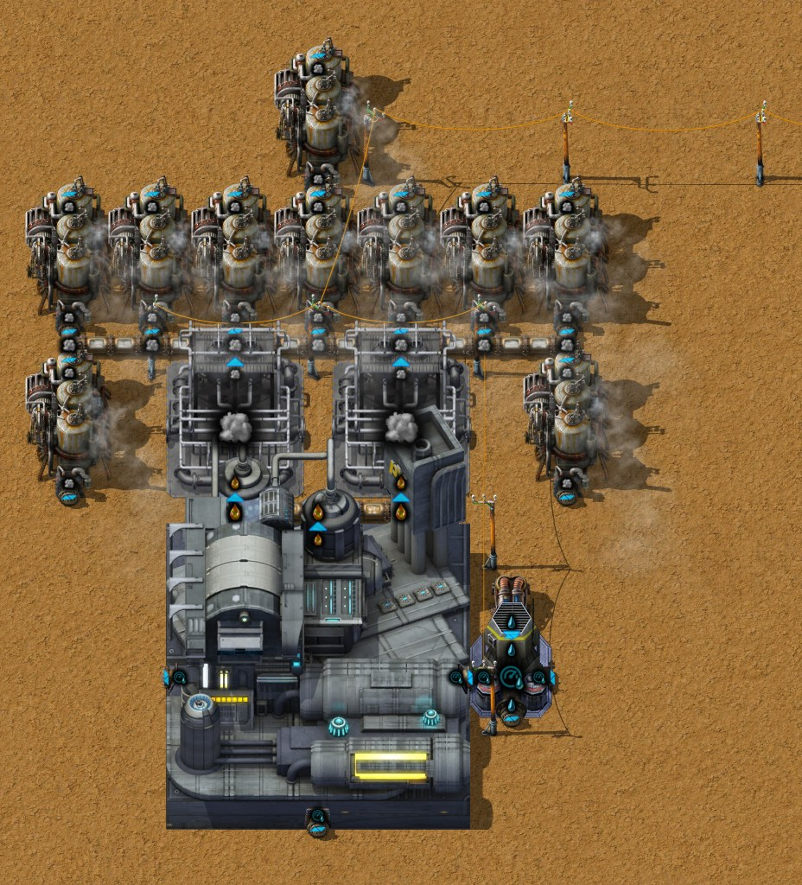
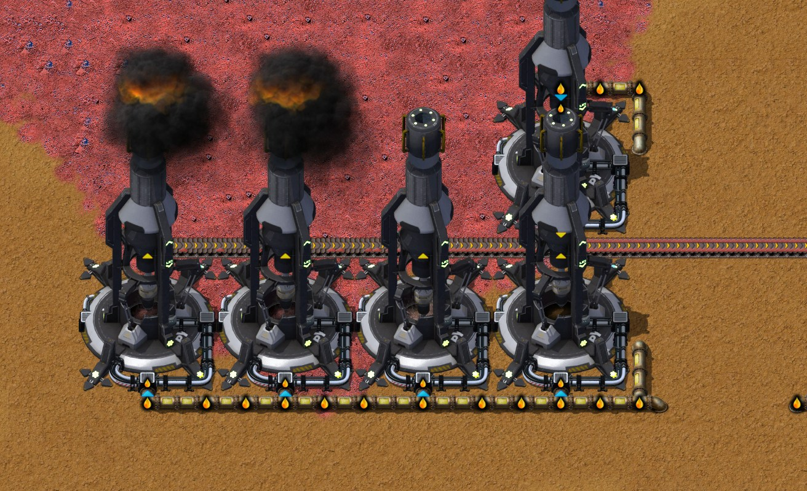

# Chapter 13 — Geothermal power and antimony oxide

[中文版](13-geothermal-antimony-oxide.zh-CN.md) · [Index](../README.md) · Previous:
[chapter 12](12-nexelit-nickel.md)

This chapter follows the same recorded run from the save of 29:51 to the save of 32:40. Its
subject is the author's, **geothermal power and antimony oxide** (地热发电和氧化锑制备). The author
began the antimony block first, then put it aside when Geothermal Power was researched (chat note
at 30:28: "地热发电已解锁，先去做电力，锑矿处理暂时搁置", geothermal unlocked, power first, antimony on
hold), built three geothermal sites, took up the coal-fired power blocks, and then finished the
antimony block. In the second half they tidied the base and began an Intermetallics line, which
waits for Duralumin made in quantity: the author leaves that for the next chapter. Times are game
time. Numbers come from the game's data, from the recorder's 10-minute production windows, from
the save of 32:40 (`tools/inspect-save.ps1`), from load tests of the power (`tools/power-probe`)
and from an hour of the save, as it stands and with fixes (`tools/rate-probe`). The author has not
exported blueprints of the new blocks; their Factory Planner plan "金属间化合物" (Intermetallics)
was written by the companion and is quoted below.

The result:

- **Three geothermal sites give 231 MW**, 147 MW more than the base used in a load test; one
  site alone 76.4 MW (74.9 net) from one fissure and ten Steam engines, no fuel. The coal power
  blocks of chapters 3, 7 and 10 are gone, and the base mines a fifth of the Raw coal it did (12 to
  21 a second instead of 78 to 89).
- **The antimony block made 0.39 Antimony oxide a second** in its first full window, the 0.4 of
  the author's plan (for 0.2 Intermetallics a second). At the save it makes 0.19: each Basic oxygen
  furnace burns Raw coal and has one Mechanical inserter for its Ash, which takes out less than
  half of what the furnace makes, and after about twenty minutes their burnt-result slots were
  full. A second Ash inserter brings it to about 0.3; beyond that the Hydrogen needs a way out and
  the plastic needs more Aromatics than the Tar line makes. Since the plastic was put first
  (31:45), the zinc drills have had almost no Aromatics.
- **Moving the Coke Boilers at 32:37 cut their Steam pipe**: its last Pipe to ground stands 17
  tiles from its partner, and a Pipe to ground reaches 10. In the hour after the save the Tar line
  jams on its own Coke at once, Aromatics fall from 17 to 3 a second, and the antimony block stops
  after half an hour for want of plastic. One more Pipe-to-ground pair puts it right.
- **The Intermetallics line is begun**: three Smelters and the plates on belts nearby. It waits
  for Duralumin made in quantity, which is the next chapter's work.

## The run at a glance

| Game time | What happened |
|---|---|
| 29:51 | The save of chapter 12; Casting - Stage 1 under research |
| 29:57 | Casting - Stage 1 researched; Coke processing - Stage 1 next |
| 30:02 | The five Antimony drills MK 01 placed on the Antimony field at (−576, −256), in a row at y −272.5 |
| 30:05 | Coke processing - Stage 1 researched; Hot air - Stage 1 next |
| 30:10–30:25 | **The antimony block begun north of the base** (x −165 to −115, y −476 to −450): screeners and Jaw crushers handcrafted and placed |
| 30:14 | Hot air - Stage 1 researched (the Regenerative heat exchanger); Geothermal Power - Stage 1 next |
| 30:24 | Geothermal Power - Stage 1 researched (the Geothermal plant); Boron next |
| 30:28 | Chat note: geothermal unlocked, power first, antimony on hold |
| 30:30–30:40 | **The first geothermal site** on the fissure at (−808.5, 286.5): Geothermal plant, Pressure pump MK 01, Offshore pump, two Regenerative heat exchangers, ten Steam engines; a line of Small electric poles to the base |
| 30:32 | Boron researched; Iron processing - Stage 1 next |
| 30:40–30:50 | **Robots take up the old Raw coal Boiler stations** (x −60 to −18, y 217 to 273: 48 Boilers, 24 Steam engines, 6 Solid separators) and the 36 Burner mining drills on Raw coal south of them |
| 30:45 | **The second geothermal site** at (570.5, 1050.5), the same layout |
| 30:47 | Iron processing - Stage 1 researched; Zinc processing - Stage 1 next |
| 30:53 | **The third geothermal site** at (1252.5, 720.5), the same layout |
| 30:55–31:28 | The antimony block finished where it was begun: more screeners, crushers, a Secondary crusher, two Electrolyzers MK 01, four Basic oxygen furnaces MK 01 (31:28) |
| 31:04 | Zinc processing - Stage 1 researched; Aluminium processing - Stage 1 next |
| 31:21 | Aluminium processing - Stage 1 researched; Chromium processing - Stage 1 next |
| 31:30–31:32 | **The antimony block moved whole** by robots (cut and paste) to x −184 to −125, y 35 to 73, beside the fluid bus |
| 31:39 | Chromium processing - Stage 1 researched; Electric energy distribution 1 next |
| 31:40–31:50 | **Robots take up the crushed-coal block** of [chapter 10](10-crushed-coal-power.md) (30 Secondary crushers, 60 Boilers, 19 Steam engines, 3 Solid separators) |
| 31:50–32:00 | The Antimony drills moved to the field's south edge (x −572.5 to −551.5, y −241.5 and −249.5); a 700-tile ore belt to the block and a Gasoline pipe (underground) to the drills |
| 32:00 | **The antimony block runs**: first Antimony oxide in the window ending 32:10 |
| 32:08 | Electric energy distribution 1 researched (Medium electric pole); Rubber next |
| 32:00–32:35 | Belts north to y −162 for Nexelit plates, Nickel plates, Antimony oxide and Titanium plates; robots take up the seven Electric mining drills on Raw coal at y 320 (32:25) |
| 32:26 | Rubber researched; Laboratory equipment next |
| 32:37 | The twenty Coke Boilers of the Tar line (y −260 and −257) moved eight tiles west by robots |
| 32:38–32:40 | **The Intermetallics line begun**: two Smelters MK 01 for Iron nexelit antimony special alloy at y −276.5 and one for Vitreloy at (−135.5, −292.5); three Advanced foundries MK 01 crafted for the Intermetallics (in the inventory) |
| 32:40 | The save |

Production per second (10-minute windows from the recorder):

| Window ending | Raw coal mined | Ash made | Steam made | Geothermal water | Antimony ore | Antimony (grade 4) | Antimony oxide | Plastic bars | Aromatics made / used | Zinc ore |
|---|---|---|---|---|---|---|---|---|---|---|
| 30:30 | 88.9 | 100.1 | 632 | 0 | 0 | 0 | 0 | 0 | 17.2 / 17.2 | 5.27 |
| 30:40 | 78.4 | 89.8 | 600 | 52.5 | 0 | 0 | 0 | 0 | 17.3 / 17.3 | 5.24 |
| 30:50 | 34.7 | 48.9 | 432 | 208.5 | 0 | 0 | 0 | 0 | 17.2 / 17.2 | 5.22 |
| 31:00 | 25.3 | 37.8 | 375 | 271.0 | 0 | 0 | 0 | 0 | 17.2 / 17.2 | 5.20 |
| 31:30 | 16.4 | 24.6 | 286 | 269.0 | 0 | 0 | 0 | 0 | 17.3 / 17.3 | 5.18 |
| 31:50 | 13.6 | 21.0 | 264 | 266.0 | 0 | 0 | 0 | 0.065 | 14.5 / 15.3 | 3.71 |
| 32:00 | 18.8 | 23.7 | 270 | 240.7 | 1.28 | 0 | 0 | 0.345 | 17.3 / 17.3 | 0.06 |
| 32:10 | 14.0 | 20.5 | 231 | 206.7 | 5.98 | 1.30 | 0.115 | 0.195 | 17.2 / 9.8 | 0.02 |
| 32:20 | 12.0 | 21.0 | 236 | 206.7 | 4.97 | 1.73 | 0.102 | 0.102 | 17.2 / 11.0 | 1.77 |
| 32:30 | 20.9 | 30.7 | 321 | 327.0 | 5.77 | 3.75 | **0.393** | 0.397 | 17.3 / 19.8 | 0.03 |
| 32:40 | 20.5 | 31.5 | 330 | 341.0 | 5.98 | 3.42 | 0.330 | 0.328 | 17.2 / 16.4 | 0.02 |

Geothermal water is what the Geothermal plants mine and the heat exchangers turn into Steam (two
water a Steam). Raw coal and Ash fall to a fifth as the coal power goes; Steam falls too, because
the geothermal Steam is twice as hot (500 °C) and so does twice the work a unit. The zinc drills
stop when the plastic for the antimony block starts (section 5).

Between the saves of 29:51 and 32:40 the base gained 3 Geothermal plants, 3 Pressure pumps MK 01
(two more stood before), 6 Regenerative heat exchangers, 30 Steam engines at the sites, 5 Antimony
drills, 4 Basic oxygen furnaces, 2 Electrolyzers, 11 Automated screeners MK 01, 3 Jaw crushers
and 3 Smelters MK 01, and lost 108 Boilers (160 to 52), 43 other Steam engines (51 to 8 outside
the sites), 30 Secondary crushers (one new one stands in the antimony block), 9 Solid separators,
41 Burner mining drills (125 to 84) and 8 Electric mining drills (16 to 8).

## 1. Technology

| Researched | Technology | What it gives here |
|---|---|---|
| 29:57 | Casting - Stage 1 | Casting unit MK 01, Sand casting |
| 30:05 | Coke processing - Stage 1 | Coal to Coke |
| 30:14 | Hot air - Stage 1 | **Regenerative heat exchanger** |
| 30:24 | Geothermal Power - Stage 1 | **Geothermal plant**, the Steam recipe of the heat exchanger |
| 30:32 | Boron | Borax washing and the boron chemicals |
| 30:47 | Iron processing - Stage 1 | Molten iron, Iron plates from it |
| 31:04 | Zinc processing - Stage 1 | Zinc (grade 1 and 2), Zinc plates from them |
| 31:21 | Aluminium processing - Stage 1 | Powdered and Molten aluminium, Aluminium plates from them |
| 31:39 | Chromium processing - Stage 1 | Chromite (grade 1), Chromite sand, Chromium |
| 32:08 | Electric energy distribution 1 | Medium electric pole |
| 32:26 | Rubber | Rubber, Belts, Long-handed inserter, Rubber stoppers |

Antimony processing - Stage 1 (Antimony drill, the screening chain, Basic oxygen furnace),
Electrolysis and Intermetallics - Stage 1 (Vitreloy, Iron nexelit antimony special alloy,
Intermetallics) were researched before this chapter. Queue at the save: Laboratory equipment
(75 %), Genetics - Stage 2, Ralesia, Auogs - Stage 1, Melamine, Moss farm upgrade, Battery - Stage 1.

## 2. Geothermal power

How geothermal power works is in [geothermal](../research/geothermal.md) (measured in a lab map
before the author built it). In short: a Geothermal plant is an 11 × 11 mining drill (1 MW) placed
on a geothermal fissure; it mines with Pressurized water as its mining fluid and gives Geothermal
water at 3000 °C. A Regenerative heat exchanger turns 600 Geothermal water into 300 Steam at 500 °C
in 2.5 s, and a Steam engine takes 15 of that Steam a second for 7.64 MW, about twice what it makes
from a Boiler's 250 °C Steam.

**The author's sites.** All three are the same: on the fissure a Geothermal plant; beside it an
Offshore pump feeding a Pressure pump MK 01 (Water → Pressurized water); above it two Regenerative
heat exchangers and ten Steam engines; a line of Small electric poles to the base. The three
fissures are the ones listed in [geothermal](../research/geothermal.md#3-the-fissures-on-the-map),
780 to 1,110 tiles from the centre of the base:

| Site | Fissure | Built |
|---|---|---|
| West | (−808.5, 286.5), 224.9 M | 30:30–30:40 |
| South-east | (570.5, 1050.5), 313.2 M | 30:45 |
| East | (1252.5, 720.5), 378.6 M | 30:53 |

**Measured.** The west site alone, cut off from the base, with a load that takes all it can give
(`tools/power-probe`, ten minutes): **76.39 MW** from its ten engines, of which the site itself uses
1.53 MW (Geothermal plant 1.00, heat exchangers 0.40, Pressure pump 0.13): **74.86 MW net**. The
plant worked 100 % of the time, its mining productivity (+20 %) giving 300 Geothermal water a
second; the two heat exchangers made 150 Steam a second between them (one makes at most 120, so two
are needed; they worked 63 % of the time), exactly what ten engines take. So ten engines are the
right number for one fissure at this research. A plant takes 2.5 from its fissure a second (the
productivity is free), so even the smallest, 225 million, lasts 25,000 hours.

The whole base with a load (`tools/power-probe`, ten minutes): the engines gave **231.0 MW**
(229.2 from the three sites and the rest from the Coal dust station at y 382, which mostly stood
without fuel), the base used 84.0 MW and the load took the other **147.0 MW**. Before this chapter
the base's engines gave 161 MW in the same test ([chapter 10](10-crushed-coal-power.md)), with
70 MW of it from crushed coal.

**The coal power taken up.** With the three sites running, robots took up:

- the two Raw coal power stations at y 217 to 273, built from the same design in chapters
  [3](03-ash-separation-raw-coal-power.md) and [7](07-copper-screening-titanium-duralumin.md)
  (48 Boilers, 24 Steam engines, 6 Solid separators), and the 36 Burner mining drills on Raw coal
  at y 280 to 310 that fed them (30:40–30:50);
- the crushed-coal block of [chapter 10](10-crushed-coal-power.md) (30 Secondary crushers, 60
  Boilers, 19 Steam engines, 3 Solid separators; 31:40–31:50) and the seven Electric mining drills on
  Raw coal at y 320 that fed it (32:25).

Raw coal mined fell from 78 to 89 a second to 12 to 21, and Ash from 90 to 100 a second to 20 to
31 (production table above). What still burns: the 24 Raw coal Boilers at y 106 and 115 (the
steam block of [chapter 5](05-tin-zinc-smelting.md)) and the 20 Coke Boilers at y −260 and −257
([chapter 6](06-simple-circuit-boards.md)), whose Steam goes to the Tar line and not to engines,
and the eight Coal dust Boilers and Steam engines at y 382.

## 3. The antimony block

**What it is for.** The author's Factory Planner plan "金属间化合物" (written by the companion at
32:40) makes **0.2 Intermetallics a second** in three Advanced foundries MK 01: 0.2 Iron nexelit
antimony special alloy (two Smelters MK 01) and 0.2 Vitreloy (one Smelter MK 01) a second, which
take 0.1 and 0.3 Antimony oxide: **0.4 Antimony oxide a second**. That is four times the 0.1 a
second that [antimony oxide](../research/antimony-oxide.md) found enough for the first trains and
robots, and about a third of a block for a full belt of ore (1.1 a second). The block follows the
plan's machine counts, each rounded up:

| Step | Machines (plan) | Recipe |
|---|---|---|
| Ore | 5 Antimony drills MK 01 (4.55) | about 1.2 ore a second each (Mining productivity 2), burning any fluid fuel at 1 MW |
| Screening | 3 Automated screeners MK 01 at y 66 (2.73) | 10 ore → 5 Antimony (grade 1), 3 (grade 2), 2 Stone, 0.3 Iron oxide, 5 s |
| Crushing | 3 Jaw crushers MK 01 at y 66 (2.73) | 5 grade 1 → 10 grade 2, 0.4 Stone, 5 s |
| Screening | 8 Automated screeners MK 01 at y 54 (7.09) | 10 grade 2 → 5 grade 4, 0.8 grade 3, 3 Gravel, 10 s |
| Crushing | 1 Secondary crusher MK 01 at (−181.5, 42.5) (0.57) | 5 grade 3 → 4 grade 4, 5 s |
| Plastic | 1 Biofactory MK 01 at (−173.5, 41.5) (0.6) | 50 Aromatics + 100 Syngas → 1 Plastic bar, 1.5 s |
| Oxygen | 2 Electrolyzers MK 01 at (−167, 42) and (−161, 42) (2) | 300 Water → 200 Hydrogen + 100 Oxygen, 10 s, 10 MW |
| Oxide | 4 Basic oxygen furnaces MK 01 at y 42.5 (4) | 10 grade 4 + 50 Oxygen + 1 Plastic bar → 1 Antimony oxide, 10 s, burning 5 MW |
| Stone | 3 Stone furnaces at y 70 (2.09) | Stone bricks |

- **Mine.** The drills stand on the south edge of the Antimony field at (−576, −256) (24.2 M; 2.6 M
  under the drills) and burn Gasoline (1.2 MJ: 0.83 a second each), which comes from the fluid
  bus through about 450 tiles of underground pipe and a Check valve at (−428.5, −237.5). The ore
  travels 700 tiles by belt to the block.
- **Block.** At x −184 to −125, y 35 to 73, beside the fluid bus (x −107.5 to −113.5), which brings
  the Aromatics and Syngas for the plastic and takes the Hydrogen away. The Electrolyzers have their
  own Offshore pump. A Burner at (−134.5, 64.5) destroys the Gravel; the Furnaces' Ash joins the
  base's Ash belt at x −94.
- **Output.** The Antimony oxide goes east and then north along x −86.5 to y −162.5, where the belt
  ends beside the Nickel and Nexelit plate belts (section 6).

Per Antimony oxide that is 13.64 ore, 50 Oxygen (50 MJ of electricity), one Plastic bar (50
Aromatics, 100 Syngas) and 50 MJ of fuel in the furnace: 16.7 Raw coal, which leave 16.7 Ash. The
plan puts the block's electricity at 27 MW at 0.4 a second, 20.7 MW of it the Electrolyzers.

**What it made.** The block started at 32:00 and made **0.393 Antimony oxide a second** in the
window ending 32:30, the plan's 0.4, then 0.330 in the last window. At the save three of the four
furnaces stood with their burnt-result slot full, and an hour of the save makes only 0.19 a
second (section 4).

## 4. What holds the antimony block back

**Ash.** A Basic oxygen furnace burns 5 MW; on Raw coal (3 MJ) that is 1.67 Raw coal and so 1.67
Ash a second while it works. Each of the author's four has one Mechanical inserter for its Ash
(filtered to Ash) onto a belt that joins the base's Ash belt, and a Mechanical inserter takes at
most 0.789 items a second out of a machine ([techniques](../research/techniques.md#inserters)).
The rest stays in the furnace's burnt-result slot, which holds 1,000 Ash. Working all the time, a
furnace keeps 0.88 Ash a second, so the slot is full after about 19 minutes; from then on it works
only when the inserter has made room, 47 % of the time: 0.047 oxide a second, **0.19 for the
four**. That is what the record and the save show: 0.39 in the window ending 32:30, 0.33 in the
last, three full slots at the save, and 0.187 to 0.193 a second in the hour after it.

A second Ash inserter fixes it. The first three furnaces have a free tile on their top edge, two
east of the middle, from which an inserter can drop onto a new belt tile that side-loads the Ash
belt; with that, the block made 0.26 a second in the first half hour and 0.30 in the second
(section 7). The fourth furnace, at x −133.5, has no such tile (its top edge leads only to the
oxide belt) and stays at half. Other ways: a fuel with more energy per Ash (Coke, 5 MJ, makes 1.0
Ash a second; Crushed coal, 6 MJ, 0.83), or a biomass fuel, which leaves no Ash at all (a Log is 4
MJ).

**Then Hydrogen and Aromatics.** With all four furnaces clear (in the probe the fourth one's
second inserter dropped on the oxide belt, which was emptied at its end), two more limits show:

- The two Electrolyzers make 40 Hydrogen a second at 0.4 oxide. It goes south on the bus through
  the Overflow valve at (−112.5, 179.5) to a Pump at (−112.5, 347), which puts it into the pipe
  that brings Gasoline to two Glassworks and a Steel furnace, fluid-fuel machines: that is its
  only way out. With four clear furnaces the Electrolyzers stood with their Hydrogen full and the
  furnaces short of Oxygen, 0.28 a second; with an Exhaust pipe on the Hydrogen beside the
  Electrolyzers, 0.32. At 0.28 or less it makes no difference (the same 0.283 a second with or
  without the Exhaust pipe, three furnaces fixed).
- The plastic: 17.2 Aromatics a second make at most 0.34 oxide (section 5). After half an hour, as
  the Tar line slowed to 12 to 15 Aromatics a second (section 7), the Biofactory was short of
  Aromatics half the time and the block made 0.25.

So the block as designed can make about 0.3 Antimony oxide a second with a second Ash inserter on
each furnace and an outlet for its Hydrogen, and not the plan's 0.4 while the Tar line's 17.2
Aromatics are all it gets.

## 5. Aromatics: the plastic before the zinc

The Tar line makes **17.2 Aromatics a second** (every window of this chapter; Light oil →
Aromatics + Gasoline in a Destructive distillation column). Until 31:40 all of it went to the
twelve Fluid mining drills MK 01 on the Zinc field at (432, 240): Zinc ore takes Aromatics as its
mining fluid, 4 an ore (the data's 40 per ten), and their 5.2 ore a second (4.33 mined, the rest
from Mining productivity, which takes no fluid) need 17.3.

The antimony block's plastic takes **50 Aromatics a Plastic bar**, one bar an oxide: 20 a second
at the plan's 0.4 oxide, more than the Tar line makes. At 31:45 the author replaced the two Check
valves on the bus at (−113.5, 179.5) (Aromatics) and (−112.5, 179.5) (Hydrogen) with Overflow
valves, which pass fluid on south only once the north side is 80 % full: the plastic, north of
the valve, comes first, and the zinc field gets what is left. From the window ending 32:00 Zinc
ore fell from 5.2 a second to almost nothing (0.02 to 1.8), Zinc plates from 0.33 a second to 0
at 32:10, and at the save all twelve zinc drills stood "missing required fluid".

Zinc plates go into the Copper-zinc batteries of the Simple circuit boards
([chapter 6](06-simple-circuit-boards.md)). Nothing is short yet: at the save the board
machines stood "output full" and the board store held 2,000. But the two cannot both run as
planned on 17.2 Aromatics: the oxide at 0.4 alone needs 20, the zinc drills at full 17.3. With the
block held to 0.19 a second by its Ash (section 4), the plastic takes 9.5 and the zinc drills get
the other 7.7: about 2.3 Zinc ore a second in the first half hour with the Tar line working
(section 7).

## 6. Tidying the base and the Intermetallics line

- **Plates to one place.** From 32:00 the author ran belts north to y −162.5 for the plates the
  Intermetallics take: Nexelit plates (x −88.5, from the Dig site of
  [chapter 12](12-nexelit-nickel.md)), Nickel plates (x −87.5, from the nickel block), Antimony
  oxide (x −86.5) and Titanium plates (x −82.5; the titanium block's two store chests at
  (−60.5, 441.5) and (−59.5, 441.5) lost their inserters, so the plates now go on). All four end
  there, full at their ends, about 110 tiles short of the Smelters.
- **The Smelters.** Two Smelters MK 01 at (−148.5, −276.5) and (−135.5, −276.5) set to Iron
  nexelit antimony special alloy (7 Iron plates + 2 Nexelit plates + 1 Antimony oxide → 2, 20 s)
  and one at (−135.5, −292.5) set to Vitreloy (3 each of Titanium, Copper and Nickel plates,
  Duralumin and Antimony oxide → 2, 10 s). A Smelter MK 01 burns fluid fuel at 10 MW; the plan
  feeds them Gasoline (1,000 and 500 a minute). None has fuel or ingredients yet; the three
  Advanced foundries MK 01 for the Intermetallics (1 Vitreloy + 1 alloy → 1, 15 s) are still in
  the inventory.
- **Duralumin.** The Vitreloy takes 3 Duralumin for 2: 0.3 Duralumin a second for the plan, 1.2
  Aluminium plates and 0.6 Copper plates. The only Duralumin so far is the batch of
  [chapter 7](07-copper-screening-titanium-duralumin.md): one Smelter at (−53.5, 51.5), out of
  Aluminium plates since, 250 Duralumin in its chest and 266 in the author's inventory. Making it
  in quantity is the next chapter's work (the author).
- **Nexelit.** The alloy takes 0.2 Nexelit plates a second for the plan; the Dig site makes about
  0.1, held by its food ([chapter 12](12-nexelit-nickel.md)).
- **The Coke Boilers moved.** At 32:37 robots moved the twenty Coke Boilers of the Tar line eight
  tiles west. Their Steam pipe moved with them, so its last Pipe to ground now stands at
  (−137.5, −258.5) and its partner stayed at (−120.5, −258.5): 17 tiles apart, and a Pipe to
  ground reaches 10 (data). The two no longer join (in the save they
  are separate fluid segments), and the Coke Boilers' Steam has nowhere to go. What follows is in
  the next section.

## 7. The hour after the save

An hour of the save of 32:40 (`tools/rate-probe`), as saved and with three what-ifs placed when the
save loads. "Pipe joined": a Pipe-to-ground pair at (−128.5, −258.5) and (−127.5, −258.5) that
joins the Coke Boilers' Steam pipe to its old partner again. In the last two runs the Antimony
oxide is also taken off the end of its belt at (−86.5, −162.5), so the block does not stop when
that belt is full.

| Per second (first half hour / second half hour) | As saved | Pipe joined | + second Ash inserter on three furnaces | + on all four, Hydrogen vented |
|---|---|---|---|---|
| Antimony oxide | 0.19 / 0.03 | 0.19 / 0.13 | 0.26 / 0.30 | 0.32 / 0.26 |
| Aromatics made | 3.1 / 0.06 | 17.3 / 12.6 | 17.3 / 12.7 | 17.3 / 12.6 |
| Tar made (hour) | 3.9 | 35.4 | 35.6 | 35.4 |
| Gasoline made (hour) | 2.5 | 23.9 | 24.0 | 23.9 |
| Zinc ore (hour) | 0.02 | 1.34 | 0.56 | 0.02 |
| Power used (hour) | 50.4 MW | 64.8 MW | 73.3 MW | 73.8 MW |

- **As saved, the Tar line stops at once.** The Coke Boilers stood "output full" for the whole
  hour, burning nothing. Coke is a by-product of the Tar line (the pitch refining, the Anthracene
  oil cracking and the Coal gas distillers make it), and the Coke Boilers were where its surplus
  went; at the save the three pitch-refining columns already held 92 to 98 Coke in their output
  (a stack is 100, against 4 in the save of 29:51) and stood "output full" 92 % of the hour, the
  Tar refining behind them 90 %. Aromatics fell from 17.2 to 3 a second and then to nothing,
  Gasoline from 27 to 2.5. The antimony block went on for half an hour on the Plastic bars on its
  belt, then stopped; its drills had the Gasoline stored in their 450-tile pipe.
- **With the pipe joined** the Tar line ran at its old rate (40 Tar, 17.2 Aromatics, 27 Gasoline a
  second) for 35 minutes, the Coke Boilers working 75 % of the hour. After that it slowed as the
  base's stores filled (the steel foundries stood "output full" all hour, so less Coke was used):
  a jam from things nobody uses, not a fault. The oxide stays at 0.19 (Ash) until its belt is full.
- **The power** the base uses falls in every run as stores fill; it never came near the 231 MW
  the engines can give.

## 8. Checklist

- Geothermal at this stage: one Geothermal plant on a fissure, a Pressure pump MK 01 with its
  Offshore pump, two Regenerative heat exchangers, ten Steam engines: about 75 MW net per fissure,
  no fuel. Three fissures replaced all the coal power with room to spare.
- When the coal power goes, so does its Raw coal: check what else the old mines and Boilers fed
  (here the Tar line's Steam still comes from Boilers).
- A Basic oxygen furnace on Raw coal makes 1.67 Ash a second while it works; one Mechanical
  inserter takes 0.79. Give it two, or a fuel with more energy per Ash. Its burnt-result slot holds
  1,000 Ash, so the fault shows only after about twenty minutes.
- Every Antimony oxide takes a Plastic bar: 50 Aromatics. Count it against everything else that
  uses Aromatics, such as the zinc drills' mining fluid.
- A Pipe to ground reaches 10 tiles. When a block is moved, check that its pipes still join the
  rest: nothing warns about a pair that is too far apart.
- The Electrolyzers' Hydrogen needs a way out, or they stop and the Oxygen with them.

## 9. How these facts were checked

- Recording: the companion's recorder (run `2652821414-0`, last line 32:40), read with
  `tools/recorder-phases.js` (5-minute slices), `tools/recorder-summary.js` and `tools/recorder-log.js`
  (production windows, minute lines for where machines went); one chat note (30:28). The author's
  Factory Planner factory "金属间化合物" (written at 32:40), read with `tools/planner-summary.js`.
- Save of 32:40 (`Py-Exploration`, copied to `C:\tmp\ch13` first; consistency check passed):
  `tools/inspect-save.ps1 -Ticks 3700`, `tools/summarize-save.js`, `tools/trace-layout.js` (belts,
  what each machine takes and gives, fluid segments), `tools/render-area.js`; the save of 29:51
  for what changed.
- Data: recipes, machines, fuels, mining fluids, the Pipe to ground's reach and the valves
  (`tools/q.js`, data export of 2026-10-18); the Mechanical inserter's 0.789 a second from
  [techniques](../research/techniques.md) (`tools/inserter-rate-probe`).
- Power: `tools/save-probe.ps1 -Probe power-probe` with a load (an energy interface that takes
  whatever is left), ten minutes: the west site alone (`box=-820:263:-794:293;isolate=1;load=-815:277`)
  and the whole base (`load=-59:163`).
- The hour after the save: `tools/save-probe.ps1 -Probe rate-probe -Ticks 219700` with a timeline
  of the antimony and Tar line fluids, as saved and with the what-ifs of section 7 placed when the
  save loads (`+pipe-to-ground@-128.5:-258.5:east;pipe-to-ground@-127.5:-258.5:west`, the Ash
  inserters as `burner-inserter@-152.5:38.5:south:ash;transport-belt@-152.5:37.5:north` and the
  same at x −145.5 and −138.5 (the fourth, for the last column, at x −132.5, where its belt tile
  leads onto the oxide belt), `py-gas-vent@-168.5:36.5:south`, `sink@-86.5:-162.5`). For this
  chapter the rate-probe's placements learned a fourth field, an inserter's filter or a machine's
  recipe (`name@x:y:dir:item`).
- The screenshots: taken by the author with the companion mod (`/pt-shots`) at 32:51, eleven
  minutes after the save, areas planned with `node tools/shots.js plan`. By then the author had
  joined the Steam pipe and put up the Duralumin Smelter (chapter 14).

Next: chapter 14 (to come).
