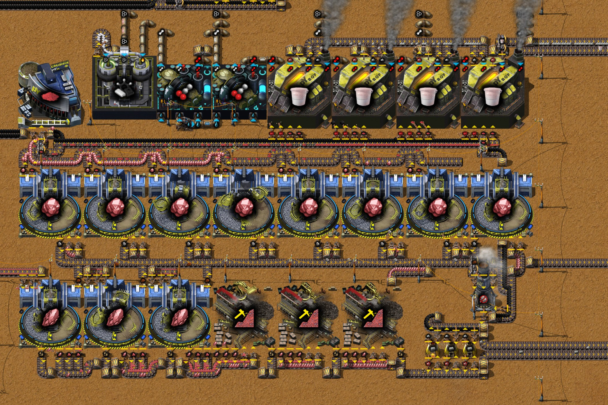
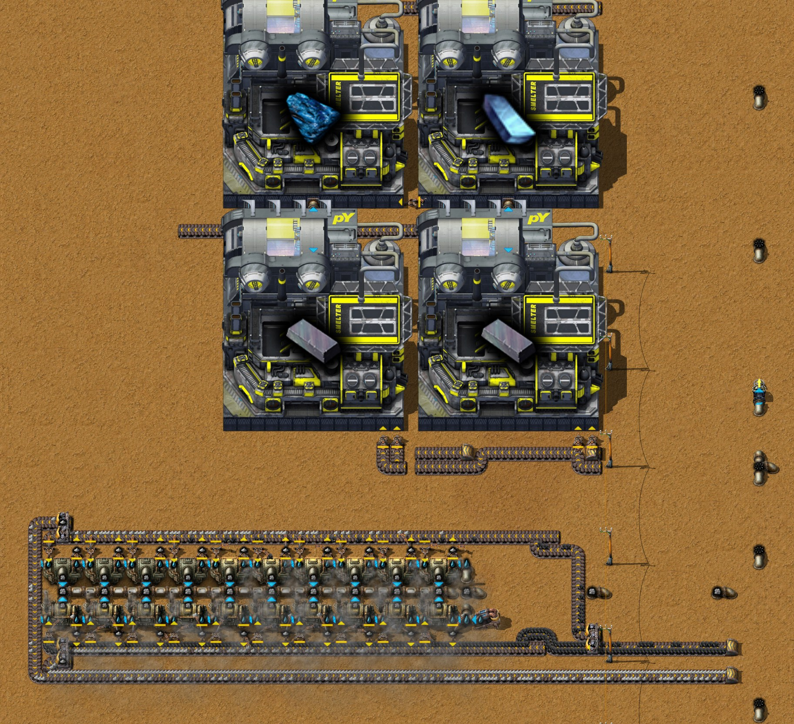

# 第十三章 地热发电和氧化锑制备

[English](13-geothermal-antimony-oxide.md) · [目录](../README.zh-CN.md) · 上一章：
[第十二章](12-nexelit-nickel.zh-CN.md)

本章接着同一局录像，从 29:51 的存档讲到 32:40 的存档。主题是作者定的：**地热发电和氧化锑制备**。作者先动手做锑矿模块，
研究完地热能后把它放下（30:28 的留言：“地热发电已解锁，先去做电力，锑矿处理暂时搁置”），建了三座地热站，拆掉烧煤的发电区，
再回来把锑矿模块做完。后半段作者整理了基地，开始搭金属间化合物产线；这条线要等硬铝量产，作者留到下一章。时间都是游戏时间。
数字来自游戏数据、记录器每 10 分钟的产量窗口、32:40 的存档（`tools/inspect-save.ps1`）、发电的负载测试（`tools/power-probe`），
以及该存档跑一小时的结果：按存档原样，和加上几处修正（`tools/rate-probe`）。作者还没有导出新模块的蓝图；助手模组写出了作者
在工厂规划器里的方案“金属间化合物”，下文会引用。

结论：

- **三座地热站一共 231 MW**，负载测试里比基地用的多出 147 MW；一座单独 76.4 MW（净 74.9），一个裂隙配十台蒸汽机，不烧燃料。
  第三、七、十章的烧煤发电区都拆了，基地开采的原煤只剩原来的五分之一（每秒 12 到 21 个，原来 78 到 89）。
- **锑矿模块在第一个完整窗口里每秒出 0.39 个氧化锑**，正是作者方案里的 0.4（供每秒 0.2 个金属间化合物）。存档时只有 0.19：
  每台氧气顶吹转炉烧原煤，只有一个工业机械臂取灰烬，取走的不到转炉产生的一半，约二十分钟后废料槽就满了。每台再加一个取灰烬的
  机械臂能到约 0.3；再往上，氢要有出路，塑料要的芳烃也比焦油线产的多。自从作者让塑料优先（31:45），锌矿采矿机几乎拿不到芳烃。
- **32:37 挪焦炭锅炉时把它们的蒸汽管弄断了**：最后一个地下管道离它的另一端 17 格，而地下管道最远连 10 格。存档后一小时里，
  焦油线马上被自己的焦炭堵住，芳烃从每秒 17 掉到 3，锑矿模块半小时后因为没有塑料停下。再补一对地下管道就好了。
- **金属间化合物产线开了个头**：三台冶炼厂，板材用传送带送到附近。它要等硬铝量产，那是下一章的事。

## 全程一览

| 游戏时间 | 发生了什么 |
|---|---|
| 29:51 | 第十二章的存档；正在研究铸造：阶段 1 |
| 29:57 | 研究完铸造：阶段 1；下一项焦炭处理：阶段 1 |
| 30:02 | 五台锑矿采矿机 MK1 放在 (−576, −256) 的锑矿上，排在 y −272.5 |
| 30:05 | 研究完焦炭处理：阶段 1；下一项热气：阶段 1 |
| 30:10–30:25 | **锑矿模块先在基地北边开工**（x −165 到 −115，y −476 到 −450）：筛选机和颚式破碎机就地手搓、放下 |
| 30:14 | 研究完热气：阶段 1（回热式交换器）；下一项地热能：阶段 1 |
| 30:24 | 研究完地热能：阶段 1（地热发电机）；下一项硼 |
| 30:28 | 留言：地热发电已解锁，先做电力，锑矿暂时搁置 |
| 30:30–30:40 | **第一座地热站**，在 (−808.5, 286.5) 的裂隙上：地热发电机、压力泵 MK1、抽取泵、两台回热式交换器、十台蒸汽机；一条小型电线杆线路接回基地 |
| 30:32 | 研究完硼；下一项铁处理：阶段 1 |
| 30:40–30:50 | **机器人拆掉老的原煤发电站**（x −60 到 −18，y 217 到 273：48 台锅炉、24 台蒸汽机、6 台固体分离机）和它们南边原煤上的 36 台热能采矿机 |
| 30:45 | **第二座地热站**，在 (570.5, 1050.5)，布局相同 |
| 30:47 | 研究完铁处理：阶段 1；下一项锌处理：阶段 1 |
| 30:53 | **第三座地热站**，在 (1252.5, 720.5)，布局相同 |
| 30:55–31:28 | 锑矿模块在原地做完：更多筛选机、破碎机、一台二级破碎机、两台电解槽 Mk1、四台氧气顶吹转炉 Mk1（31:28） |
| 31:04 | 研究完锌处理：阶段 1；下一项铝处理：阶段 1 |
| 31:21 | 研究完铝处理：阶段 1；下一项铬处理：阶段 1 |
| 31:30–31:32 | **锑矿模块整体搬家**：机器人剪切粘贴到 x −184 到 −125、y 35 到 73，流体总线旁边 |
| 31:39 | 研究完铬处理：阶段 1；下一项电能分配 1 |
| 31:40–31:50 | **机器人拆掉[第十章](10-crushed-coal-power.zh-CN.md)的碎煤发电模块**（30 台二级破碎机、60 台锅炉、19 台蒸汽机、3 台固体分离机） |
| 31:50–32:00 | 锑矿采矿机挪到矿的南边（x −572.5 到 −551.5，y −241.5 和 −249.5）；一条 700 格的矿石带通到模块，一条汽油管（地下管道）通到采矿机 |
| 32:00 | **锑矿模块开工**：截至 32:10 的窗口里出了第一批氧化锑 |
| 32:08 | 研究完电能分配 1（中型电线杆）；下一项橡胶 |
| 32:00–32:35 | 往北铺到 y −162 的几条带：蓝坷垃板、镍板、氧化锑、钛板；机器人拆掉 y 320 原煤上的七台电力采矿机（32:25） |
| 32:26 | 研究完橡胶；下一项实验室设备 |
| 32:37 | 机器人把焦油线的二十台焦炭锅炉（y −260 和 −257）往西挪了八格 |
| 32:38–32:40 | **金属间化合物产线开头**：y −276.5 两台冶炼厂 MK1 做铁-蓝坷垃-锑特种合金，(−135.5, −292.5) 一台做玻璃体；手搓了三台做金属间化合物的高级铸造厂 MK1（在背包里） |
| 32:40 | 存档 |

每秒产量（记录器每 10 分钟的窗口）：

| 窗口截至 | 原煤开采 | 灰烬产出 | 蒸汽产出 | 地热水 | 锑矿 | 4级锑 | 氧化锑 | 塑料 | 芳烃 产/用 | 锌矿 |
|---|---|---|---|---|---|---|---|---|---|---|
| 30:30 | 88.9 | 100.1 | 632 | 0 | 0 | 0 | 0 | 0 | 17.2 / 17.2 | 5.27 |
| 30:40 | 78.4 | 89.8 | 600 | 52.5 | 0 | 0 | 0 | 0 | 17.3 / 17.3 | 5.24 |
| 30:50 | 34.7 | 48.9 | 432 | 208.5 | 0 | 0 | 0 | 0 | 17.2 / 17.2 | 5.22 |
| 31:00 | 25.3 | 37.8 | 375 | 271.0 | 0 | 0 | 0 | 0 | 17.2 / 17.2 | 5.20 |
| 31:30 | 16.4 | 24.6 | 286 | 269.0 | 0 | 0 | 0 | 0 | 17.3 / 17.3 | 5.18 |
| 31:50 | 13.6 | 21.0 | 264 | 266.0 | 0 | 0 | 0 | 0.065 | 14.5 / 15.3 | 3.71 |
| 32:00 | 18.8 | 23.7 | 270 | 240.7 | 1.28 | 0 | 0 | 0.345 | 17.3 / 17.3 | 0.06 |
| 32:10 | 14.0 | 20.5 | 231 | 206.7 | 5.98 | 1.30 | 0.115 | 0.195 | 17.2 / 9.8 | 0.02 |
| 32:20 | 12.0 | 21.0 | 236 | 206.7 | 4.97 | 1.73 | 0.102 | 0.102 | 17.2 / 11.0 | 1.77 |
| 32:30 | 20.9 | 30.7 | 321 | 327.0 | 5.77 | 3.75 | **0.393** | 0.397 | 17.3 / 19.8 | 0.03 |
| 32:40 | 20.5 | 31.5 | 330 | 341.0 | 5.98 | 3.42 | 0.330 | 0.328 | 17.2 / 16.4 | 0.02 |

地热水是地热发电机采出来、交换器变成蒸汽的东西（两份地热水一份蒸汽）。烧煤发电撤掉后原煤和灰烬都降到五分之一；蒸汽也少了，
因为地热蒸汽有 500°C，每份做的功约是锅炉蒸汽的两倍。锌矿采矿机在锑矿模块的塑料开工时停了（第 5 节）。

从 29:51 到 32:40 的存档，基地多了 3 台地热发电机、3 台压力泵 MK1（之前另有两台）、6 台回热式交换器、地热站上的 30 台蒸汽机、
5 台锑矿采矿机、4 台氧气顶吹转炉、2 台电解槽、11 台自动筛选机 MK1、3 台颚式破碎机和 3 台冶炼厂 MK1；少了 108 台锅炉
（160 到 52）、地热站以外的 43 台蒸汽机（51 到 8）、30 台二级破碎机（锑矿模块里新放了一台）、9 台固体分离机、41 台热能采矿机
（125 到 84）和 8 台电力采矿机（16 到 8）。

## 1. 科技

| 研究完成 | 科技 | 在这里的用处 |
|---|---|---|
| 29:57 | 铸造：阶段 1 | 铸造设施 Mk1、砂型铸造 |
| 30:05 | 焦炭处理：阶段 1 | 煤转焦炭 |
| 30:14 | 热气：阶段 1 | **回热式交换器** |
| 30:24 | 地热能：阶段 1 | **地热发电机**，交换器的蒸汽配方 |
| 30:32 | 硼 | 硼砂洗涤和几种硼化合物 |
| 30:47 | 铁处理：阶段 1 | 熔融铁，以及用它做铁板 |
| 31:04 | 锌处理：阶段 1 | 1级锌、2级锌，以及用它们做锌板 |
| 31:21 | 铝处理：阶段 1 | 铝粉、熔融铝，以及用它们做铝板 |
| 31:39 | 铬处理：阶段 1 | 1级铬、铬砂、铬 |
| 32:08 | 电能分配 1 | 中型电线杆 |
| 32:26 | 橡胶 | 橡胶、传动皮带、加长机械臂、橡胶塞 |

锑处理：阶段 1（锑矿采矿机、筛选破碎那一串、氧气顶吹转炉）、电解和金属间化合物：阶段 1（玻璃体、铁-蓝坷垃-锑特种合金、
金属间化合物）在本章之前就研究了。存档时的队列：实验室设备（75%）、遗传学：阶段 2、若雷莎、剑背龟、三聚氰胺、
苔藓农场升级、电池：阶段 1。

## 2. 地热发电

地热发电的机制见[地热发电](../research/geothermal.zh-CN.md)（作者动手前在实验地图上测过）。简单说：地热发电机是放在地热裂隙上的
11×11 采矿机（1 MW），用高压水作采矿流体，采出 3000°C 的地热水。回热式交换器 2.5 秒把 600 地热水变成 300 个 500°C 的蒸汽，
一台蒸汽机每秒吃 15 个这种蒸汽发 7.64 MW，大约是吃锅炉 250°C 蒸汽时的两倍。

**作者的地热站。** 三座完全一样：裂隙上一台地热发电机；旁边一台抽取泵供一台压力泵 MK1（水 → 高压水）；上面两台回热式交换器
和十台蒸汽机；一条小型电线杆线路接回基地。三个裂隙就是[地热发电](../research/geothermal.zh-CN.md#3-作者地图上的裂隙)里
列出的那几个，离基地中心 780 到 1,110 格：

| 地热站 | 裂隙 | 建造时间 |
|---|---|---|
| 西 | (−808.5, 286.5)，2.249 亿 | 30:30–30:40 |
| 东南 | (570.5, 1050.5)，3.132 亿 | 30:45 |
| 东 | (1252.5, 720.5)，3.786 亿 | 30:53 |

**实测。** 把西边那座从基地断开，挂一个能吃掉全部余电的负载（`tools/power-probe`，十分钟）：十台蒸汽机发 **76.39 MW**，
地热站自己用 1.53 MW（发电机 1.00、交换器 0.40、压力泵 0.13）：**净 74.86 MW**。发电机 100% 时间在干活，采矿产能（+20%）让它
每秒出 300 地热水；两台交换器一共每秒出 150 蒸汽（一台最多 120，所以要两台；它们 63% 的时间在干活），正好是十台蒸汽机吃的量。
所以在这个研究进度下，一个裂隙配十台蒸汽机正合适。发电机每秒从裂隙里消耗 2.5（产能那部分不消耗），最小的 2.25 亿也能用
25,000 小时。

整个基地挂负载（`tools/power-probe`，十分钟）：蒸汽机一共发 **231.0 MW**（三座地热站 229.2，其余来自 y 382 的煤粉发电站，
它大多时候没有燃料），基地自己用 84.0 MW，负载吃掉其余的 **147.0 MW**。本章之前同样的测试里基地的蒸汽机发 161 MW
（[第十章](10-crushed-coal-power.zh-CN.md)），其中 70 MW 来自碎煤。

**拆掉的烧煤发电。** 三座地热站运转后，机器人拆掉了：

- y 217 到 273 的两座原煤发电站，[第三章](03-ash-separation-raw-coal-power.zh-CN.md)和[第七章](07-copper-screening-titanium-duralumin.zh-CN.md)
  用同一个设计建的（48 台锅炉、24 台蒸汽机、6 台固体分离机），以及 y 280 到 310 给它们供原煤的 36 台热能采矿机（30:40–30:50）；
- [第十章](10-crushed-coal-power.zh-CN.md)的碎煤发电模块（30 台二级破碎机、60 台锅炉、19 台蒸汽机、3 台固体分离机；
  31:40–31:50），以及 y 320 给它供原煤的七台电力采矿机（32:25）。

原煤开采从每秒 78 到 89 降到 12 到 21，灰烬从每秒 90 到 100 降到 20 到 31（见上面的产量表）。还在烧的：y 106 和 115 的
24 台原煤锅炉（[第五章](05-tin-zinc-smelting.zh-CN.md)的蒸汽区）和 y −260、−257 的 20 台焦炭锅炉（[第六章](06-simple-circuit-boards.zh-CN.md)），
它们的蒸汽给焦油线用，不发电；还有 y 382 的八台煤粉锅炉和蒸汽机。

## 3. 锑矿模块

**做什么用。** 作者在工厂规划器里的方案“金属间化合物”（助手模组在 32:40 写出）用三台高级铸造厂 MK1 每秒做 **0.2 个金属间化合物**：
每秒 0.2 个铁-蓝坷垃-锑特种合金（两台冶炼厂 MK1）和 0.2 个玻璃体（一台冶炼厂 MK1），它们分别要 0.1 和 0.3 个氧化锑：
**每秒 0.4 个氧化锑**。这是[氧化锑](../research/antimony-oxide.zh-CN.md)算出的、对第一批火车和机器人足够的每秒 0.1 的四倍，
约为按一满带矿（每秒 1.1 个）配的模块的三分之一。模块按方案的机器数建，每项向上取整：

| 步骤 | 机器（方案） | 配方 |
|---|---|---|
| 采矿 | 5 台锑矿采矿机 MK1（4.55） | 每台每秒约 1.2 个矿（采矿产能 2），烧任意流体燃料，1 MW |
| 筛选 | y 66 的 3 台自动筛选机 MK1（2.73） | 10 锑矿 → 5 个 1级锑、3 个 2级锑、2 石矿、0.3 氧化铁，5 秒 |
| 破碎 | y 66 的 3 台颚式破碎机 MK1（2.73） | 5 个 1级锑 → 10 个 2级锑、0.4 石矿，5 秒 |
| 筛选 | y 54 的 8 台自动筛选机 MK1（7.09） | 10 个 2级锑 → 5 个 4级锑、0.8 个 3级锑、3 碎石，10 秒 |
| 破碎 | (−181.5, 42.5) 的 1 台二级破碎机 MK1（0.57） | 5 个 3级锑 → 4 个 4级锑，5 秒 |
| 塑料 | (−173.5, 41.5) 的 1 台生物工厂 MK1（0.6） | 50 芳烃 + 100 合成气 → 1 塑料，1.5 秒 |
| 氧 | (−167, 42) 和 (−161, 42) 的 2 台电解槽 Mk1（2） | 300 水 → 200 氢 + 100 氧，10 秒，10 MW |
| 氧化锑 | y 42.5 的 4 台氧气顶吹转炉 Mk1（4） | 10 个 4级锑 + 50 氧 + 1 塑料 → 1 个氧化锑，10 秒，烧燃料 5 MW |
| 石矿 | y 70 的 3 台石炉（2.09） | 石砖 |

- **矿场。** 采矿机放在 (−576, −256) 那片锑矿（2420 万；采矿机底下 260 万）的南边，烧汽油（1.2 MJ：每台每秒 0.83），
  汽油从流体总线经约 450 格地下管道送来，中间在 (−428.5, −237.5) 有一个止回阀。矿石沿 700 格传送带送到模块。
- **模块。** 在 x −184 到 −125、y 35 到 73，紧挨流体总线（x −107.5 到 −113.5），塑料要的芳烃和合成气从总线来，氢回到总线。
  电解槽有自己的抽取泵。(−134.5, 64.5) 的燃烧器烧掉碎石；转炉的灰烬在 x −94 并入基地的灰烬带。
- **产物。** 氧化锑往东再沿 x −86.5 往北，到 y −162.5 为止，那里和镍板、蓝坷垃板的带并排（第 6 节）。

每个氧化锑要 13.64 个矿、50 氧（50 MJ 电）、一块塑料（50 芳烃、100 合成气）和转炉里 50 MJ 燃料：16.7 个原煤，留下 16.7 个灰烬。
方案算出每秒 0.4 个时模块用电 27 MW，其中 20.7 MW 是电解槽。

**实际产量。** 模块 32:00 开工，截至 32:30 的窗口里每秒出 **0.393 个氧化锑**，正是方案的 0.4；最后一个窗口 0.330。存档时四台转炉
有三台废料槽是满的，存档跑一小时每秒只有 0.19（第 4 节）。

## 4. 锑矿模块卡在哪

**灰烬。** 氧气顶吹转炉烧 5 MW；烧原煤（3 MJ）时，工作中每秒烧 1.67 个原煤，也就出 1.67 个灰烬。作者的四台各有一个取灰烬的
工业机械臂（过滤为灰烬），放到一条并入基地灰烬带的带上，而工业机械臂从机器里每秒最多取 0.789 个
（[技巧](../research/techniques.zh-CN.md#机械臂)）。其余的留在转炉的废料槽里，废料槽能装 1,000 个灰烬。一直工作的话，
每秒多留 0.88 个，约 19 分钟就满；之后只有机械臂腾出位置时转炉才干活，47% 的时间：每台每秒 0.047 个，**四台 0.19**。
记录和存档正是这样：截至 32:30 的窗口 0.39，最后一个窗口 0.33，存档时三台废料槽满，存档后一小时每秒 0.187 到 0.193。

再加一个取灰烬的机械臂就解决了。前三台转炉上沿正中往东两格有空位，那里的机械臂可以放到一格新带上，侧面汇入灰烬带；这样模块
前半小时每秒 0.26，后半小时 0.30（第 7 节）。第四台（x −133.5）没有这样的空位（它上沿只通到氧化锑的带），仍是一半。
别的办法：换每个灰烬能量更多的燃料（焦炭 5 MJ，每秒出 1.0 个灰烬；碎煤 6 MJ，0.83），或者生物质燃料，根本不出灰烬
（原木 4 MJ）。

**然后是氢和芳烃。** 四台转炉都通畅后（实测里第四台多加的机械臂放到了氧化锑的带上，那条带在尽头被清空），又冒出两个限制：

- 每秒 0.4 个时，两台电解槽每秒出 40 氢。氢沿总线往南过 (−112.5, 179.5) 的溢流阀，到 (−112.5, 347) 的一台泵，泵把它送进给
  两台玻璃工厂和一台钢炉送汽油的那条管：这些机器烧流体燃料，这是氢唯一的出路。四台转炉都通畅时，电解槽的氢满了停着，
  转炉缺氧，每秒 0.28；在电解槽旁边的氢管上加一个排气管，0.32。每秒 0.28 及以下时没有区别（修好三台时，有没有排气管都是
  每秒 0.283）。
- 塑料：每秒 17.2 芳烃最多做 0.34 个氧化锑（第 5 节）。半小时后焦油线降到每秒 12 到 15 芳烃（第 7 节），生物工厂一半时间缺芳烃，
  模块每秒 0.25。

所以照现在的设计，每台转炉加一个取灰烬的机械臂、给氢一个出口，模块每秒能出约 0.3 个氧化锑；只靠焦油线那 17.2 芳烃，到不了
方案的 0.4。

## 5. 芳烃：塑料先于锌矿

焦油线每秒出 **17.2 芳烃**（本章每个窗口都是；破坏性蒸馏塔里轻油 → 芳烃 + 汽油）。31:40 之前它全给了 (432, 240) 锌矿上的
十二台液压采矿机 MK1：锌矿的采矿流体是芳烃，每个矿 4 个（数据里每十个矿 40），它们每秒 5.2 个矿（4.33 个是采出来的，其余来自
采矿产能，不耗流体）要 17.3。

锑矿模块的塑料**每块要 50 芳烃**，每个氧化锑一块：方案的每秒 0.4 个就是每秒 20，比焦油线产的还多。31:45 作者把总线上
(−113.5, 179.5)（芳烃）和 (−112.5, 179.5)（氢）的两个止回阀换成了溢流阀：只有北边装到 80% 才往南放。阀门北边的塑料于是
优先，锌矿只拿剩下的。从截至 32:00 的窗口起，锌矿从每秒 5.2 个掉到几乎为零（0.02 到 1.8），锌板从每秒 0.33 块在 32:10 降到 0，
存档时十二台锌矿采矿机全是“缺少所需流体”。

锌板用在简易电路板的铜锌电池里（[第六章](06-simple-circuit-boards.zh-CN.md)）。目前还不缺：存档时做电路板的机器都是“成品满”，
电路板仓库里有 2,000 块。但 17.2 芳烃供不起两边按计划运转：氧化锑每秒 0.4 个就要 20，锌矿采矿机满负荷要 17.3。模块被灰烬卡在
每秒 0.19 时（第 4 节），塑料用 9.5，锌矿采矿机拿到其余 7.7：焦油线正常时前半小时每秒约 2.3 个锌矿（第 7 节）。

## 6. 整理基地和金属间化合物产线

- **板材送到一处。** 从 32:00 起作者铺了几条往北到 y −162.5 的带，送金属间化合物要的板材：蓝坷垃板（x −88.5，来自
  [第十二章](12-nexelit-nickel.zh-CN.md)的挖矿站）、镍板（x −87.5，来自镍模块）、氧化锑（x −86.5）和钛板（x −82.5；钛模块
  (−60.5, 441.5) 和 (−59.5, 441.5) 两个仓库箱的机械臂拆了，钛板就继续往前走）。四条带都在那里结束，尽头是满的，离冶炼厂约 110 格。
- **冶炼厂。** (−148.5, −276.5) 和 (−135.5, −276.5) 两台冶炼厂 MK1 设成铁-蓝坷垃-锑特种合金（7 铁板 + 2 蓝坷垃板 + 1 氧化锑 → 2，
  20 秒），(−135.5, −292.5) 一台设成玻璃体（钛板、铜板、镍板、硬铝、氧化锑各 3 → 2，10 秒）。冶炼厂 MK1 烧流体燃料，10 MW；
  方案给它们烧汽油（每分钟 1,000 和 500）。三台都还没有燃料和原料；做金属间化合物的三台高级铸造厂 MK1（1 玻璃体 + 1 合金 → 1，
  15 秒）还在背包里。
- **硬铝。** 玻璃体每做 2 个要 3 个硬铝：方案每秒要 0.3 个硬铝，也就是 1.2 块铝板和 0.6 块铜板。目前的硬铝只有
  [第七章](07-copper-screening-titanium-duralumin.zh-CN.md)那一批：(−53.5, 51.5) 一台冶炼厂，此后一直缺铝板，箱子里 250 个硬铝，
  作者背包里 266 个。量产硬铝是下一章的事（作者说的）。
- **蓝坷垃。** 方案里合金每秒要 0.2 块蓝坷垃板；挖矿站每秒约出 0.1，受食物限制（[第十二章](12-nexelit-nickel.zh-CN.md)）。
- **焦炭锅炉挪了位置。** 32:37 机器人把焦油线的二十台焦炭锅炉往西挪了八格。蒸汽管跟着挪，于是它最后一个地下管道现在在
  (−137.5, −258.5)，另一端还留在 (−120.5, −258.5)：相隔 17 格，而地下管道最远连 10 格（数据）。两段不再相连（存档里是两个流体段），
  焦炭锅炉的蒸汽没地方去。后果见下一节。

## 7. 存档后的一小时

32:40 的存档跑一小时（`tools/rate-probe`），一次按原样，另外三次在读档时加上修正。“接上管子”：在 (−128.5, −258.5) 和
(−127.5, −258.5) 放一对地下管道，把焦炭锅炉的蒸汽管重新接到原来的另一端。后两次还在 (−86.5, −162.5) 把氧化锑从带的尽头拿走，
免得带满了模块停下。

| 每秒（前半小时 / 后半小时） | 原样 | 接上管子 | + 三台转炉各加一个取灰烬机械臂 | + 四台都加，氢排掉 |
|---|---|---|---|---|
| 氧化锑 | 0.19 / 0.03 | 0.19 / 0.13 | 0.26 / 0.30 | 0.32 / 0.26 |
| 芳烃产出 | 3.1 / 0.06 | 17.3 / 12.6 | 17.3 / 12.7 | 17.3 / 12.6 |
| 焦油产出（一小时） | 3.9 | 35.4 | 35.6 | 35.4 |
| 汽油产出（一小时） | 2.5 | 23.9 | 24.0 | 23.9 |
| 锌矿（一小时） | 0.02 | 1.34 | 0.56 | 0.02 |
| 用电（一小时） | 50.4 MW | 64.8 MW | 73.3 MW | 73.8 MW |

- **按原样，焦油线马上停。** 焦炭锅炉整小时“成品满”，什么也不烧。焦炭是焦油线的副产物（沥青精炼、蒽油裂解和煤制煤气的蒸馏塔
  都出焦炭），多余的焦炭原本就去焦炭锅炉；存档时三台沥青精炼的蒸馏塔出口已有 92 到 98 个焦炭（一组 100，29:51 的存档里是 4），
  一小时里 92% 时间“成品满”，后面的焦油底层精炼 90%。芳烃从每秒 17.2 掉到 3，再到零，汽油从 27 掉到 2.5。锑矿模块靠带上的
  塑料撑了半小时，然后停下；它的采矿机靠 450 格管道里存的汽油还在开。
- **接上管子后**焦油线按原来的速度（每秒 40 焦油、17.2 芳烃、27 汽油）跑了 35 分钟，焦炭锅炉一小时里 75% 时间在烧。之后随着
  基地的仓库装满而变慢（炼钢的铸造厂整小时“成品满”，焦炭用得少了）：这是没人用的东西堵住，不是故障。氧化锑一直是 0.19
  （灰烬），直到它的带满。
- **用电** 每一次都随仓库装满而下降，离蒸汽机能发的 231 MW 远得很。

## 8. 要点

- 这个阶段的地热：一个裂隙上一台地热发电机、一台压力泵 MK1 带抽取泵、两台回热式交换器、十台蒸汽机：每个裂隙净约 75 MW，
  不烧燃料。三个裂隙就顶替了全部烧煤发电，还有富余。
- 拆烧煤发电时，原煤也跟着没了：查一查老矿场和锅炉还供着什么（这里焦油线的蒸汽仍来自锅炉）。
- 氧气顶吹转炉烧原煤，工作中每秒出 1.67 个灰烬，一个工业机械臂只取 0.79。配两个，或者换每个灰烬能量更多的燃料。
  它的废料槽能装 1,000 个灰烬，所以问题要二十分钟后才显出来。
- 每个氧化锑要一块塑料：50 芳烃。把它和其他用芳烃的地方一起算，比如锌矿的采矿流体。
- 地下管道最远连 10 格。搬动模块后，检查管道是否还接得上别处：一对隔得太远的地下管道不会有任何提示。
- 电解槽的氢要有出路，否则电解槽停下，氧也就没了。

## 9. 这些数字怎么核对的

- 录像：助手模组的记录器（运行 `2652821414-0`，最后一行 32:40），用 `tools/recorder-phases.js`（5 分钟一段）、
  `tools/recorder-summary.js` 和 `tools/recorder-log.js`（产量窗口、每分钟一行的机器位置）读取；一条留言（30:28）。作者在工厂规划器里的
  “金属间化合物”（32:40 写出），用 `tools/planner-summary.js` 读取。
- 32:40 的存档（`Py-Exploration`，先复制到 `C:\tmp\ch13`；一致性检查通过）：`tools/inspect-save.ps1 -Ticks 3700`、
  `tools/summarize-save.js`、`tools/trace-layout.js`（传送带、每台机器的进出、流体段）、`tools/render-area.js`；和 29:51 的存档比对变化。
- 数据：配方、机器、燃料、采矿流体、地下管道的距离和各种阀门（`tools/q.js`，2026-10-18 导出的数据）；工业机械臂每秒 0.789 个
  来自[技巧](../research/techniques.zh-CN.md)（`tools/inserter-rate-probe`）。
- 发电：`tools/save-probe.ps1 -Probe power-probe` 加负载（一个能量接口，吃掉所有余电），十分钟：西边地热站单独
  （`box=-820:263:-794:293;isolate=1;load=-815:277`）和整个基地（`load=-59:163`）。
- 存档后一小时：`tools/save-probe.ps1 -Probe rate-probe -Ticks 219700`，记录锑和焦油线各流体的时间线，按原样，以及读档时放上第 7 节的
  修正（`+pipe-to-ground@-128.5:-258.5:east;pipe-to-ground@-127.5:-258.5:west`；取灰烬的机械臂写成
  `burner-inserter@-152.5:38.5:south:ash;transport-belt@-152.5:37.5:north`，x −145.5 和 −138.5 同样（最后一列的第四个在 x −132.5，它那格
  带通到氧化锑的带上）；`py-gas-vent@-168.5:36.5:south`；`sink@-86.5:-162.5`）。为本章，rate-probe 的放置多了第四个字段：机械臂的过滤
  物品或机器的配方（`name@x:y:dir:item`）。
- 截图：作者在 32:51（存档后 11 分钟）用助手模组拍摄（`/pt-shots`），区域用 `node tools/shots.js plan` 规划。
  这时作者已经接上了蒸汽管，也放好了做硬铝的冶炼厂（第十四章）。

下一章：[第十四章](14-intermetallics-trains.zh-CN.md)。
