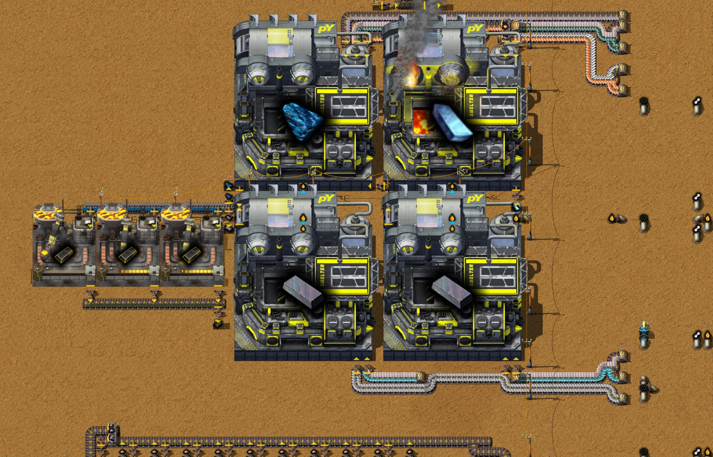
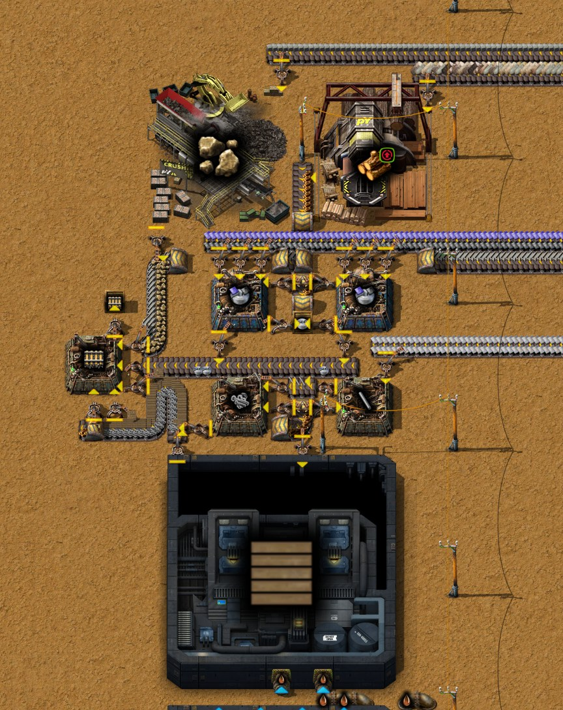

# Chapter 14 — Intermetallics and train preparation 0

[中文版](14-intermetallics-trains.zh-CN.md) · [Index](../README.md) · Previous:
[chapter 13](13-geothermal-antimony-oxide.md)

This chapter follows the same recorded run from the save of 32:40 to the save of 34:59. Its
subject is the author's, **Intermetallics and train preparation 0** (金属间化合物与火车准备0).
The author finished the Intermetallics line begun in chapter 13, with Duralumin made on it, built a
fish block for the Fish oil of the Gearbox and a block for rails, researched the two train
technologies and handcrafted the first Locomotive and Cargo wagons. After the save they fixed the
fish block (35:00 to 35:10) and saved again at 35:07. Times are game time. Numbers come from the game's data, from the
recorder's 10-minute production windows, from the save of 34:59 (`tools/inspect-save.ps1`) and
from hours of the save run as it stands and with what-ifs (`tools/rate-probe`). The author's
Factory Planner plans were written by the companion and are quoted below; they have not exported
blueprints of the new blocks.

The result:

- **The Intermetallics line is a supermarket.** It made the plan's 0.167 Intermetallics a second
  for a window, and its products wait in chests for the author to take a few: the trains and the
  buildings need only a little of them, and no other line takes them, so it need not run at full
  rate (the author).
- **Run without a pause it would not keep that rate**, for a reason outside the line: the Duralumin
  needs a whole Aluminium plate a second, 100 Coal gas for the aluminium drills, which get the Coal
  gas first. The Coal gas comes with Tar, and the Tar has one user that takes 40 a second; so when
  the drills run, the Gasifiers get almost no Coal gas, the Syngas falls from 45 a second to 3, and
  the plastic, the Antimony oxide and then the Intermetallics stop (25 minutes at full rate in the
  hour after the save). A Tailings pond on the Tar pipe would let both run (measured: 0.167 to the
  end of the hour).
- **The fish block made Fish oil for only a few minutes** (enough for 5 Gearboxes): its
  Electrolyzer's Hydrogen had no way out, so it made no Oxygen for the Fish farm, and its Composter
  was stuck on a Wood recipe, so the Slaughterhouse could not get rid of Skin and Bones. The author
  fixed both at 35:00 to 35:10, and the block now makes the plan's 4 Fish and 25 Fish oil a
  minute (measured, an hour of the save of 35:07).
- **Rails come at 0.4 a second** as planned. The first Locomotive, two Cargo wagons, a Train stop
  and signals were handcrafted at 34:55; the slow part is the Shafts, 50 s each by hand.

## The run at a glance

| Game time | What happened |
|---|---|
| 32:40 | The save of chapter 13; Laboratory equipment under research |
| 32:40–32:41 | **The Coke Boilers' Steam pipe joined again**: a Pipe-to-ground pair at x −129.5 / −128.5, y −258.5 (chapter 13, section 6) |
| 32:45 | Laboratory equipment researched; Genetics - Stage 2 next |
| 32:41–32:50 | **The Intermetallics line's four Smelters MK 01** placed by robots: Vitreloy (−149.5, −292.5), Duralumin (−135.5, −292.5), Iron nexelit antimony special alloy (−149.5 and −135.5, −276.5). The chapter-7 Duralumin Smelter at (−53.5, 51.5) is taken up |
| 32:51 | The screenshots of chapter 13 (`/pt-shots`) |
| 32:52 | Factory Planner "金属间化合物" updated: the Duralumin added (0.167 Intermetallics a second) |
| 32:55–32:58 | **Three Advanced foundries MK 01 for the Intermetallics** at (−172 / −166 / −160, −280) |
| 33:00–33:05 | Robots lay 350 belts: Aluminium plates go north on x −80 from the aluminium furnaces (y 42) to the Duralumin Smelter (y −297), about 340 tiles |
| 33:05 | Genetics - Stage 2 researched; Ralesia next |
| 33:15–33:30 | Robots take up 18 Burner mining drills on iron ore east of the base (x 19 to 57, y −58 to −13) with their belts; six Electric mining drills in their place (y −43.5 and −47.5) |
| 33:23 | A Tailings pond for the Aromatics the plastic does not take, at (−139, −38) |
| 33:28 | Ralesia researched; Auogs - Stage 1 next |
| 33:20–33:50 | **First Intermetallics**: 0.167 a second in the window ending 33:30, the plan's rate; then less, and none from 34:00 (sections 3 and 4) |
| 33:37–33:38 | Factory Planner "变速箱 MK1" (Gearbox) and "鱼油" (Fish oil) |
| 33:44–34:13 | **The fish block** at x −168 to −130, y −341 to −304 (section 5); robots move it once (34:08) |
| 33:54 | Auogs - Stage 1 researched; Melamine next |
| 34:21 | Melamine researched; **Trains & railway - Stage 1 moved to the front** of the queue (Cooling tower 1 and Energy generation 1 taken out of it) |
| 34:23–34:26 | The Gearbox Thermal assembler MK 01 at (−139.5, −304.5), fed from chests |
| 34:25–34:40 | Solder (100) and Shafts MK 01 (20) handcrafted |
| 34:33 | Factory Planner "铁轨" (Rails) |
| 34:36 | Trains & railway - Stage 1 researched; Automated rail transportation next |
| 34:39–34:46 | **The rail block** at x −146 to −130, y −220 to −196 (section 6) |
| 34:40 | A Tailings pond for Creosote at (−139, −15); the Creosote Sinkhole and its Overflow valve taken out |
| 34:53 | Automated rail transportation researched; Moss farm upgrade next |
| 34:55–35:00 | **Handcrafted: a Locomotive, two Cargo wagons, a Train stop, 20 Rail signals, 15 Chain signals** (and the 8 Brakes MK 01 for them) |
| 34:59 | The save (`Py-Exploration`, 35.0 h) |
| 35:00–35:10 | **The fish block fixed**: its Hydrogen piped to the base's Hydrogen pipe, a second Composter for the Wood (section 5) |
| 35:07 | The screenshots of this chapter (`/pt-shots`) and a second save |

Production per second (10-minute windows from the recorder):

| Window ending | Intermetallics | Vitreloy | Duralumin | Aluminium plates | Antimony oxide | Plastic bars | Syngas | Coal gas |
|---|---|---|---|---|---|---|---|---|
| 32:40 | 0 | 0 | 0 | 0.002 | 0.330 | 0.328 | 45.0 | 32.5 |
| 32:50 | 0 | 0 | 0 | 0.443 | 0.205 | 0.225 | 27.2 | 43.9 |
| 33:00 | 0 | 0 | 0 | 0.690 | 0.355 | 0.010 | 3.0 | 61.0 |
| 33:10 | 0 | 0.003 | 0.017 | 0.693 | 0.150 | 0.012 | 3.9 | 60.6 |
| 33:20 | 0.022 | 0.197 | 0.043 | 0.660 | 0.065 | 0.013 | 5.1 | 59.6 |
| 33:30 | **0.167** | 0.167 | 0.250 | 0.453 | 0.270 | 0.083 | 18.1 | 50.4 |
| 33:40 | 0.147 | 0.167 | 0.250 | 0.567 | 0.070 | 0.043 | 12.1 | 54.5 |
| 33:50 | 0.105 | 0.167 | 0.250 | 0.698 | 0.007 | 0.008 | 3.5 | 60.8 |
| 34:00 | 0.003 | 0.017 | 0.032 | 0.705 | 0.012 | 0.010 | 3.4 | 60.8 |
| 34:10 | 0 | 0.010 | 0.005 | 0.702 | 0.008 | 0.008 | 3.2 | 61.1 |
| 34:20 | 0 | 0.053 | 0.162 | 0.502 | 0.057 | 0.060 | 14.7 | 53.0 |
| 34:30 | 0 | 0 | 0 | 0.323 | 0.108 | 0.112 | 24.5 | 46.8 |
| 34:40 | 0 | 0 | 0.167 | 0.305 | 0.133 | 0.142 | 24.3 | 46.4 |
| 34:50 | 0 | 0 | 0 | 0.350 | 0.242 | 0.242 | 24.2 | 46.5 |

Read across a row: whenever the Aluminium plates go up to 0.7 a second, the Syngas falls to 3, and
the Plastic and Antimony oxide behind it stop. Section 4 explains why.

Between the saves of 32:40 and 34:59 the base gained 3 Advanced foundries MK 01 (now 11), 6
Electric mining drills (now 14), 2 Tailings ponds (now 4), the fish block's 2 Fish farms MK 01,
Plankton farm MK 01, Slaughterhouse, Composter, Washer, Electrolyzer and Glassworks, 6 Thermal
assemblers MK 01 (now 33), its first 2 Thermal assemblers MK 02, and a Tar processing unit for Treated
wood; it lost 18 Burner mining drills (84 to 66). The Smelters stayed at four: the chapter-7 Duralumin
Smelter moved onto the new line.

## 1. Technology

| Researched | Technology | What it gives here |
|---|---|---|
| 32:45 | Laboratory equipment | Equipment chassis and Laboratory instrument (for the gene recipes) |
| 33:05 | Genetics - Stage 2 | Plasmids, Retrovirus, cDNA |
| 33:28 | Ralesia | Ralesia seeds, the Ralesia plantation |
| 33:54 | Auogs - Stage 1 | The Auog and the Auog paddock (5 Intermetallics each) |
| 34:21 | Melamine | Urea decomposition (Ammonia, Cyanic acid), Melamine |
| 34:36 | Trains & railway - Stage 1 | **Rail, Locomotive, Cargo wagon** |
| 34:53 | Automated rail transportation | **Train stop, Rail signal, Chain signal** |

Seven technologies in 2 h 13 min of research, 787 units: 0.099 units a second, the 0.1 that the
red science line allows since chapter 11. The first five were queued in chapter 13 on the way to
Battery - Stage 1 and robots ([trains and robots](../research/trains-and-robots.md)); at 34:21 the
author put the train technologies first. Queue at the save: Moss farm upgrade (22 %), Battery -
Stage 1, Machine Components - Stage 1, Circuit network, Cybersyn train network, Fluid wagon.

## 2. The Intermetallics line

Intermetallics go into every train vehicle (5 a Locomotive, 5 a Cargo wagon), into the Auog
paddock and the Ralesia plantation just researched, and into 25 buildings in all
([antimony oxide](../research/antimony-oxide.md)). The author's Factory Planner plan
"金属间化合物", updated at 32:52, makes **0.167 a second** (10 a minute):

| Step | Recipe (data) | Machines in the plan | Built |
|---|---|---|---|
| Intermetallics | 1 Iron nexelit antimony special alloy + 1 Vitreloy → 1, 15 s | Advanced foundry MK 01 × 2.51 | 3 |
| Alloy | 7 Iron plates + 2 Nexelit plates + 1 Antimony oxide → 2, 20 s | Smelter MK 01 × 1.67 | 2 |
| Vitreloy | 3 each of Antimony oxide, Titanium, Nickel and Copper plates and Duralumin → 2, 10 s | Smelter MK 01 × 0.84 | 1 |
| Duralumin | 4 Aluminium plates + 2 Copper plates → 1, 4 s | Smelter MK 01 × 1 | 1 |
| Antimony oxide | the antimony block of chapter 13 (0.334 a second) | | |

It takes per second 1.0 Aluminium plate, 0.75 Copper, 0.58 Iron, 0.25 each of Titanium and Nickel
plates, 0.167 Nexelit plates and 0.334 Antimony oxide. The Smelters burn Gasoline (10 MW each, 8.3
Gasoline a second while they work).

How it is built: the plates come in from the east on short belts and the inserters along the
Smelters' edges take them. The Duralumin Smelter at (−135.5, −292.5) hands its Duralumin straight
to the Vitreloy Smelter beside it (and a little into a chest). Vitreloy and alloy go onto one belt
west along y −285, past a buffer chest for each (an inserter in, an inserter out), to the three
Advanced foundries. Their Intermetallics go east on y −276 to a chest at (−157.5, −273.5) that
takes one stack, 100. With the chest full the foundries stop: at the save it held 100, the belt
51 more, and the author had 64 in the inventory.

**A supermarket, not a production line.** The author, after the save: the base needs only a little
of the line's three products, none of them goes on to another line, so it does not have to run at
full rate; the planned rate is really that of a supermarket. That is how it is built: each product
waits in a chest (Vitreloy and alloy in their buffer chests, the Intermetallics in its one-stack
chest, a little Duralumin in another), and the line stops when they are full.

It did reach the plan: 0.167 Intermetallics a second in the window ending 33:30, with the
Duralumin Smelter working all the time (0.250 a second). Then it fell to 0.147, 0.105 and nothing
by 34:00, before the chest was full. The record shows why in the Antimony oxide column: the
oxide stopped, and the Plastic bars before it. For a supermarket that does not matter; sections 3
and 4 explain it, because the same pipes feed the plastic and the nickel drills.

## 3. Aluminium for the Duralumin

The Duralumin is the only new step that needs a new raw material in quantity: 4 Aluminium plates
each, a whole plate a second for the line. The base's aluminium is still the block begun in
[chapter 4](04-aluminium-glass-logs.md), its drills since replaced: six Fluid mining drills MK 02 on Aluminium ore at y 41.5
(x −21.5 to 3.5), ten Stone furnaces at y 42 beside them (10 ore → 1 plate, 6 s each: at most 1.67
plates a second), two store chests at (−60.5 / −59.5, 44.5) that were full (1,600 each). In this
chapter the author ran a belt from that block 340 tiles north on x −80 to the Duralumin Smelter,
so the plates now flow whenever the line takes them.

Aluminium ore can only be mined with **Coal gas** as the mining fluid: 10 Coal gas an ore
([mining drills](../research/mining-drills.md)). With ten ore to a plate in a Stone furnace, one
Aluminium plate is **100 Coal gas**, and the Duralumin's plate a second is 100 Coal gas a second. In
the windows the aluminium furnaces made 0.7 plates a second (7 ore, 70 Coal gas) whenever the line
or the chests took them; the base's Coal gas went from 32 a second to 61.

## 4. What stops it at full rate: Coal gas, Tar and one Overflow valve

The base's Coal gas comes mainly from the three Destructive distillation columns of the coke block
(Raw coal: 10 → 60 Coal gas + 30 Tar + 3 Coal, 2 s), and it has two users, in a fixed order since
[chapter 6](06-simple-circuit-boards.md): the aluminium drills take it first; only what passes the
Overflow valve at (−129.5, −168.5), which opens while its near side is over 80 % full, goes to the
three Gasifiers that make the Syngas (50 Coal gas + 100 Water → 70 Syngas + 30 Tar + 1 Ash, 3 s).
Both the columns and the Gasifiers make Tar, into one Tar pipe, and that pipe's only users are the
Tar line's two Tar processing units (Tar refining, 100 Tar every 5 s): **40 Tar a second in all**.
A column or a Gasifier with no room for its Tar stops.

So the columns and Gasifiers together can make only 40 Tar a second, and with it only so much Coal
gas and Syngas. With the aluminium drills idle, all the Coal gas, about 32 a second, goes past the
valve and becomes 45 Syngas: the windows up to 32:40. With the drills mining 7 ore a second they
take 70 Coal gas first; making that much costs the columns 35 Tar a second, which leaves the
Gasifiers room for about 5 Tar, 12 Syngas at most: **3 to 5 Syngas a second** were made in the
windows from 33:00, the Gasifiers short of Coal gas or full of Tar. Then down the line:

- The plastic Biofactory of the antimony block needs 100 Syngas a bar, 33 a second for 0.334
  oxide. With 3 it stops (Plastic bars 0.010 a second), and the nickel drills, whose mining fluid
  is Syngas too, go short as well.
- The Basic oxygen furnaces use the bars on the belt, then stop: oxide 0.007 a second at 33:50.
- The Smelters use the oxide on its belt, then stop: Intermetallics 0 from 34:00.

When the Duralumin Smelter stops, the aluminium belt fills, the drills wait, the Syngas comes
back (14 to 24 a second from 34:20) and the oxide with it, and so on in turns. The Antimony oxide
column of the windows table is that cycle.

**Measured.** An hour of the save with the Intermetallics chest emptied every second (as if the
author took them), and two what-ifs (section 8 has the whole table):

| Per second (first half hour / second half hour) | Intermetallics taken | + the six aluminium drills stopped | + a Tailings pond on the Tar pipe |
|---|---|---|---|
| Intermetallics | 0.140 / 0.109 | 0.140 / 0.080 | **0.140 / 0.167** |
| Antimony oxide | 0.144 / 0.013 | 0.377 / 0.221 | 0.388 / 0.382 |
| Aluminium plates | 0.556 / 0.699 | 0.014 / 0.004 | 0.556 / 0.700 |
| Syngas (hour) | 9.3 | 43.5 | 61.4 |
| Coal gas (hour) | 57.1 | 31.0 | 95.9 |
| Tar made (hour) | 40.0 | 38.4 | 86.8 |

- **As built**, the oxide stops after about 17 minutes; the line runs at the plan's 0.167 for 25
  minutes more on the oxide already on its belt, and stops at 50.
- **With the aluminium drills stopped** the Syngas stays at 45 and the oxide at 0.38, which shows
  the cause; but then the Duralumin lives on the plates already on the 340-tile belt, and at about
  45 minutes the line stops for want of aluminium.
- **A Tailings pond on the Tar pipe** gives the extra Tar somewhere to go: the columns and Gasifiers
  run together (Coal gas 96, Syngas 61, Tar 87 a second, 47 of it into the pond), and the line
  makes **0.167 Intermetallics a second to the end of the hour**, oxide 0.39. The pond was placed
  at (−158, −188), north of the first Gasifier, one of its two south connections on the Tar pipe
  at (−159.5, −178.5); the area was free of buildings in the save. A pond holds 1,000,000, so at 47
  a second it is full in about six hours.

After those six hours the Tar needs a lasting way out. Two from the data, not measured: Tar is a
fluid fuel (0.2 MJ), and a Smelter burns 10 MW, so one Smelter on Tar instead of Gasoline takes 50
Tar a second while it works (and saves 8.3 Gasoline); or the casting route that Aluminium
processing - Stage 1 (31:21) unlocked makes a plate from 2 ore instead of 10 (ore to Powdered
aluminium in a Ball mill, Molten aluminium in an Electric arc furnace with Borax and Graphite, 100
of it and a Sand casting → 50 plates in a Casting unit), which is a fifth of the Coal gas, but a
block of its own.

**Gasoline next.** The four Smelters burn Gasoline, and with the line at full rate (the Tailings
pond run) the base used 66 Gasoline a second against 27 made, 39 a second out of the store: the
author's Gasoline Tailings pond at (−139, 3) held 658,264 at the save (736,300 at 32:40), about
4.7 hours at that rate. Tar as the Smelters' fuel would answer both at once (by the data).

None of this needs doing while the line is a supermarket (the author): taking a few hundred
Intermetallics now and then keeps the aluminium drills idle most of the time. It is what a
full-rate line would need.

## 5. Fish oil for the Gearbox

A Locomotive needs a Gearbox MK 01, and a Gearbox needs 20 Fish oil (2 Shafts MK 01 + 4 Duralumin
+ 5 Steel + 4 Titanium plates + 20 Fish oil, 10 s). Fish oil comes from rendering Fish in a
Slaughterhouse (8 Fish → 100 Fish oil + 2 Bones + 2 Meat + 3 Skin + 5 Guts, 30 s), and Fish from a
Fish farm, since Fish in the water do not come back ([techniques](../research/techniques.md#fish-and-nexelit)):
one farm breeds eggs (12 Fish + 50 Phytoplankton + 100 Saline water → 25 eggs), another breeds Fish
(10 eggs + 60 Oxygen + 3 Small lamps + 10 Biomass + 100 Saline water → 10 Fish), each with Fish
as modules. The author's plan "鱼油" (33:38) makes **26 Fish oil a minute** from one breeding farm
(4 Fish a minute), with the Oxygen from an Electrolyzer, the Biomass from composting the Skin and
Bones, Saline water from a Washer and Phytoplankton from Tin (grade 1).

The block at x −168 to −130, y −341 to −304 follows it: an Offshore pump; a Jaw crusher (Stone
bricks to Stone) and a Washer for the Saline water; a Plankton farm; the egg farm at (−158.5,
−311.5) and the Fish farm at (−146.5, −311.5); the Electrolyzer at (−148, −321) above it; Thermal
assemblers for Copper cable and Small lamps, with Glass from a Glassworks; a Wood workshop; the
Composter at (−138.5, −323.5); the Slaughterhouse at (−134.5, −311.5), whose Fish oil goes by
pipe to the Gearbox assembler at (−139.5, −304.5) (Shafts, Duralumin, Steel and Titanium from
chests, filled by hand), and whose Meat and Guts go onto belts; a Sinkhole for the farms' Waste
water. The first Fish came in the window ending 34:30, the first Fish oil in the one ending
34:50, and five Gearboxes were made before the save. At the save the Fish farm was short of
Oxygen, the Electrolyzer full of Hydrogen, the Slaughterhouse full (4 Bones, 6 Skin in its output)
and the Composter held 2 Wood and 20 Biomass. In the hour after the save it made no Fish at all.

Two faults, one behind the other:

1. **The Hydrogen has no way out.** An Electrolyzer makes 2 Hydrogen for every Oxygen. This one
   sends its Hydrogen along y −317.5, under the belts, to a Pipe to ground at (−129.5, −317.5)
   with nothing on its far side. Its Hydrogen box filled (500), and an Electrolyzer that cannot put
   out its Hydrogen makes no Oxygen either. With an Exhaust pipe on that end (placed at (−128.5,
   −317.5) in the probe) the Electrolyzer worked, the Fish farm got its Oxygen and made Fish for
   15 minutes; then it stood full, because of the second fault.
2. **The Composter is stuck on Wood.** A Composter is a furnace: it works one recipe at a time,
   chosen by what is put in, and takes nothing else until that input is used up. It gets Skin and
   Bones from the Slaughterhouse and, from a belt, Wood through an inserter that a wire switches on
   while the Composter holds **Biomass = 0** (read with the new `tools/wire-probe`). A Wood batch is
   5 Wood → 30 Biomass in 3 s, and the inserter brings Wood until the first Biomass appears, so it
   overshoots: 2 Wood were left at the save, and the Composter waits for 3 more that do not come
   while it holds Biomass. It takes no Skin or Bones; they fill the Slaughterhouse's output, the
   Slaughterhouse stops taking Fish, the Fish farm's output fills, and the block stands. It
   cannot clear itself: whenever the Biomass is used up, the Wood comes back and overshoots again.

**Measured with both fixed** (an hour; Exhaust pipe on the Hydrogen, the Wood inserter stopped, the
two Wood taken out of the Composter once, and a Sinkhole on the Fish oil pipe so that the oil has
somewhere to go): **0.067 Fish a second (4 a minute) and 0.42 Fish oil a second (25 a minute)**,
about the plan's numbers, the whole hour, the Fish farm working all the time. Skin and Bones alone
made 0.063 Biomass a second against 0.067 used, about 95 %, as the data says (a round of eggs and
breeding takes 25 Biomass, and rendering its 13 spare Fish gives 24.4 back): the Wood tops it up,
but it needs a Composter of its own. 25 Fish oil a minute is a Gearbox every 48 seconds, far more
than the hand-fed Shafts allow. Without an outlet the oil simply waits in its pipe and the Gearbox
assembler, and the block runs again whenever a Gearbox is made: a jam on a product not yet used,
not a fault.

**The author's fix (35:00 to 35:10).** The Hydrogen pipe now goes on from (−129.5, −317.5) east
to x −112.5 and from there south, underground, into the bus's Hydrogen pipe on that line (where it
crosses the Gasoline pipe, near y −136, the Gasoline's Check valve moved one tile); that pipe takes
the Hydrogen south to the fluid-fuel machines ([chapter 13](13-geothermal-antimony-oxide.md),
section 4). The Wood inserter is gone, and a second Composter at (−172.5, −322.5) takes the Wood
alone; its Biomass goes on a belt along y −318.5 to an inserter at (−151.5, −317.5) into the Fish
farm, switched by a wire. The first Composter now takes only Skin and Bones. In the save of 35:07
the Electrolyzer holds Oxygen instead of Hydrogen and the Fish farm is working. An hour of that
save, with a Sinkhole taking the Fish oil: **0.067 Fish and 0.42 Fish oil a second**, the Fish farm
working all the time. The Wood Composter stood the whole hour with its Biomass belt full: Skin and
Bones gave 0.063 Biomass a second of the 0.067 used, and the Biomass already on the belt the rest.

## 6. Rails, and the first train by hand

A rail (Trains & railway - Stage 1) is 1 Stone + 4 Bolts + 2 Treated wood + 1 Steel + 5 Solder → 3
rails, 0.5 s. The author's plan "铁轨" (34:33) makes 24 a minute, 0.4 a second, and the block
built from it at x −146 to −130, y −220 to −196 has:

- a Wood workshop (Logs → Wood) and a Jaw crusher (Stone bricks → Stone);
- two **Thermal assemblers MK 02** for Solder (4 Lead + 2 Tin plates → 1, 6 s; speed 2, so 0.33 a
  second each), from Lead and Tin plates on a belt along y −215; their Solder goes onto a belt to
  the rail machine and into a chest of 100 for handcrafting;
- Thermal assemblers MK 01 for Iron sticks and Bolts, and a Tar processing unit for Treated wood
  (100 Creosote + 1 Wood → 2, 2 s);
- the rail Thermal assembler at (−145.5, −208.5), putting its rails into a chest.

It makes what the plan says: **0.400 rails a second** all through the hour after the save (Solder
0.75), held by its Solder, and the 16-slot chest takes about 67 minutes of it.

**The vehicles.** Locomotive and Cargo wagon are made in an assembler or by hand (data):

| | Locomotive | Cargo wagon |
|---|---|---|
| Intermetallics | 5 | 5 |
| Duralumin | 25 | 10 |
| Brakes MK 01 (each 20 Duralumin, 2 Vitreloy, 10 Ceramic, 10 Glass, 10 Copper plates, 5 Steel, 10 Small parts; 20 s) | 4 | 2 |
| Shafts MK 01 (each 5 alloy, 5 Solder, 5 Small parts; 50 s) | 4 | 2 |
| Gearbox MK 01 (2 Shafts, 4 Duralumin, 5 Steel, 4 Titanium plates, 20 Fish oil; 10 s) | 1 | – |
| Also | 10 boards, 30 Steel, 20 Pipes, 2 Steam engines, 20 Small parts | 20 Iron plates, 20 Steel, 50 Titanium plates, 10 Small parts |

At 34:55 the author handcrafted one Locomotive, two Cargo wagons, a Train stop, 20 Rail signals and
15 Chain signals (the eight Brakes for them first). That set took 15 Intermetallics, 209 Duralumin
(160 of it in the Brakes) and 10 Shafts. The Shafts are the slow part: no machine makes them yet,
and by hand each is 50 s, 500 s for this set; the author handcrafted 20 between 34:25 and 34:40.
Left in the inventory at the save: 64 Intermetallics, 84 Vitreloy, 80 Duralumin, 4 Gearboxes, 2
Shafts, 63 rails.

## 7. The rest of the base

- **The two fixes from chapter 13 are in.** The Coke Boilers' Steam pipe was joined at 32:40 (a
  Pipe-to-ground pair at x −129.5 / −128.5), and each Basic oxygen furnace has a second Ash inserter
  (the burnt-result slots held 205, 62, 8 and 0 Ash at the save, against three full ones at 32:40).
  As saved, the antimony block made 0.23 oxide a second over the hour, held by the Syngas (section 4).
- **Two Tailings ponds as stores**: Aromatics at (−139, −38), 83,629 at the save (the Tar line makes
  17.2 a second and the plastic and the zinc drills take less), and Creosote at (−139, −15), 19,258,
  in place of the chapter-6 Sinkhole. With these the Tar line no longer stops on them.
- **Iron**: the 18 Burner mining drills east of the base became six Electric mining drills. Two of
  the six stand on almost nothing (492 and 526 ore left under them at the save) and will stop soon.
- **Steel**: the eight Advanced foundries of the steel block run again (all eight stood full at
  32:40); the trains take a lot of it.
- **Power**: the base used 135 MW at the start of the hour after the save and 146 MW on average
  with the Intermetallics line at full rate, against the 231 MW of the geothermal sites.

## 8. The hour after the save

An hour of the save of 34:59 (`tools/rate-probe`), as saved and with what-ifs set when the save
loads. "Taken": the Intermetallics chest at (−157.5, −273.5) is emptied every second, as if the
author took what the line makes.

| Per second (first half hour / second half hour) | As saved | Taken | Taken, aluminium drills stopped | Taken, Tailings pond on the Tar pipe |
|---|---|---|---|---|
| Intermetallics | 0 / 0 (chest full) | 0.140 / 0.109 | 0.140 / 0.080 | 0.140 / 0.167 |
| Antimony oxide | 0.226 / 0.241 | 0.144 / 0.013 | 0.377 / 0.221 | 0.388 / 0.382 |
| Aluminium plates | 0.427 / 0.022 | 0.556 / 0.699 | 0.014 / 0.004 | 0.556 / 0.700 |
| Duralumin | 0.087 / 0 | 0.250 / 0.161 | 0.250 / 0.113 | 0.250 / 0.250 |
| Syngas (hour) | 29.8 | 9.3 | 43.5 | 61.4 |
| Coal gas (hour) | 39.7 | 57.1 | 31.0 | 95.9 |
| Tar made (hour) | 38.0 | 40.0 | 38.4 | 86.8 |
| Gasoline used (hour; 25.6 to 27.3 made) | 33.8 | 41.6 | 56.9 | 66.4 |
| Rails | 0.400 / 0.400 | 0.400 / 0.400 | 0.400 / 0.400 | 0.400 / 0.400 |
| Power used (hour) | 121.0 MW | 122.2 MW | 131.3 MW | 146.1 MW |

As saved, the line stands with its chest full, the aluminium belt fills in half an hour, and from
then on the Syngas and the oxide are back: the base waits for the author to take Intermetallics.
In every run the Fish farm made no Fish (section 5).

Two more hours for the fish block: with only the Exhaust pipe on its Hydrogen, 0.067 Fish a second
for 15 minutes and then none (the Slaughterhouse full of Skin and Bones); with both fixes and a
Sinkhole taking the Fish oil, 0.067 Fish and 0.42 Fish oil a second for the whole hour; and the
same in the save of 35:07 with the author's own fix (section 5).

## 9. Checklist

- A product's line is only as steady as the shared fluids behind it. Here Aluminium ore, Syngas,
  Plastic, Antimony oxide and the Intermetallics hang on one pipe of Coal gas and one Tar pipe with
  a fixed user: follow each byproduct to where it ends before building a line on it.
- An Overflow valve sets an order, not a share: whatever is before it takes everything first.
- When a Tar pipe is full, everything that makes Tar stops. A Tailings pond (1,000,000) on that
  pipe buys hours; a lasting user (a fuel, more refining) ends it.
- Count the Gasoline of Smelters (10 MW each: 8.3 a second at work) against what the Tar line makes.
- An Electrolyzer makes no Oxygen once its Hydrogen has nowhere to go; Skin and Bones from
  rendering cover about 95 % of a Fish farm's Biomass.
- A furnace-type machine (the Composter is one) takes one recipe at a time and only that recipe's
  ingredient. Feeding it two kinds of input with a circuit can leave it waiting for the one it
  started with: give each input its own machine.
- A Locomotive and two Cargo wagons by hand: 15 Intermetallics, 209 Duralumin, 10 Shafts (500 s of
  handcrafting), 20 Fish oil.

## 10. How these facts were checked

- Recording: the companion's recorder (run `2652821414-0`, to 34:59), read with
  `tools/recorder-phases.js` (5-minute slices) and the minute and production lines of its activity
  log; no chat notes this chapter. The author's Factory Planner factories "金属间化合物" (32:52),
  "鱼油" (33:38), "变速箱 MK1" (33:37) and "铁轨" (34:33), read with `tools/planner-summary.js`.
- Save of 34:59 (`Py-Exploration`, copied to `C:\tmp\ch14` first; consistency check passed):
  `tools/inspect-save.ps1 -Ticks 3700`, `tools/summarize-save.js`, `tools/trace-layout.js`,
  `tools/render-area.js`; the save of 32:40 for what changed. Tiles free for the Tailings pond: the
  save's entities, checked over the pond's 18 × 18. The save of 35:07 for the author's fix of the
  fish block.
- Data: recipes, mining fluids, fuel values, the Composter and the Exhaust pipe (`tools/q.js`, data
  export of 2026-10-18).
- The Composter's Wood inserter: the new `tools/wire-probe` (`save-probe.ps1 -Probe wire-probe
  -Variant "x:y;..."`), which prints an entity's circuit and logistic conditions, what its wires
  connect to and the signals on them.
- The hours after the save: `tools/save-probe.ps1 -Probe rate-probe -Ticks 219700` with timelines
  of the products and fluids above; what-ifs `empty@-157.5:-273.5` (the Intermetallics chest),
  `tailings-pond@-158:-188`, `py-gas-vent@-128.5:-317.5:south`, `py-sinkhole@-134.5:-304.5:south`
  (a sink for the Fish oil). For this chapter the rate-probe learned two more: `off@x:y` stops the
  machine or inserter on a tile (here the six aluminium drills, the Composter's Wood inserter) and
  `clear@x:y` empties a machine's input and output slots once (the Composter's two Wood).
- The screenshots: taken by the author with the companion mod (`/pt-shots`) at 35:07, after the
  fix of the fish block, areas planned with `node tools/shots.js plan`.

Next: [chapter 15](15-train-preparation-1.md).

