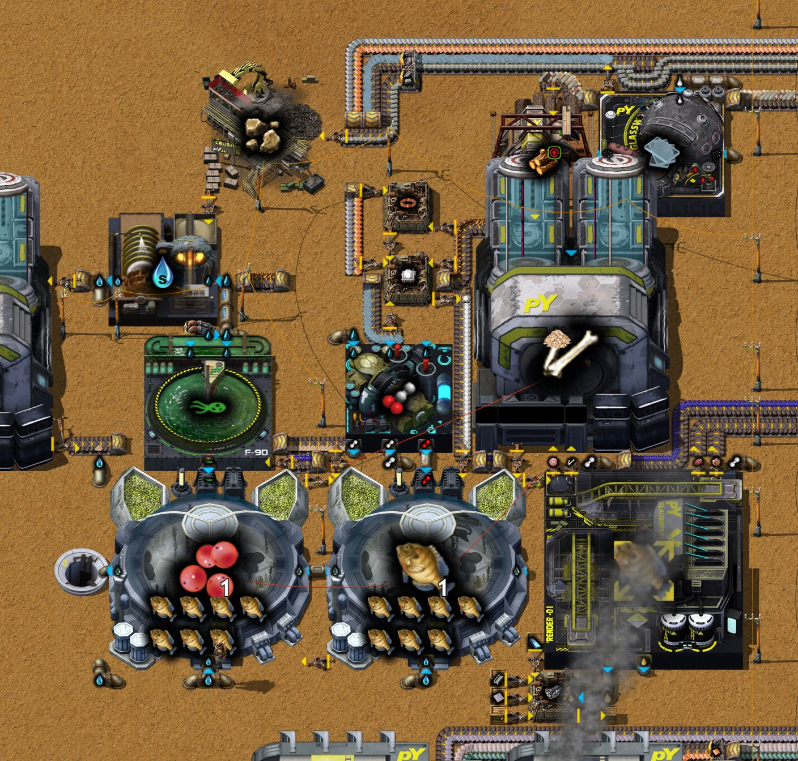

# 第十四章 金属间化合物与火车准备

[English](14-intermetallics-trains.md) · [目录](../README.zh-CN.md) · 上一章：
[第十三章](13-geothermal-antimony-oxide.zh-CN.md)

本章接着同一局录像，从 32:40 的存档讲到 34:59 的存档。主题是作者定的：**金属间化合物与火车准备**。作者把第十三章开头的
金属间化合物产线做完，硬铝也在这条线上做；又建了给变速箱供鱼油的养鱼模块和一个铁轨模块，研究了两项火车科技，手搓了第一台内燃机车
和货运车厢。作者会先修好本章的问题再往下走。时间都是游戏时间。数字来自游戏数据、记录器的 10 分钟产量窗口、34:59 的存档
（`tools/inspect-save.ps1`），以及按存档原样和加上假设改动各跑数小时的实测（`tools/rate-probe`）。作者的工厂规划器方案由助手模组
写出，下文引用；新模块的蓝图作者还没导出。

结论：

- **金属间化合物产线能达到方案的每秒 0.167 个，但每次只能维持几分钟。** 硬铝每秒要整整一块铝板，石炉十个铝矿出一块板，
  也就是铝矿采矿机每秒要 100 煤气，而煤气先给它们。煤气和焦油是一起出来的，焦油只有一个用户，每秒只收 40；所以铝矿采矿机一开工，
  气化炉就几乎拿不到煤气，合成气从每秒 45 掉到 3，塑料、氧化锑、最后金属间化合物相继停产。存档后一小时的实测里，把金属间化合物
  不断取走，产线满速跑了 25 分钟就停了。
- **在焦油管上加一个尾矿池**，两边就都能运转：金属间化合物整小时每秒 0.167，氧化锑 0.39。尾矿池大约六小时装满；按这个速度，
  冶炼厂烧的汽油库存只够约 4.7 小时。让冶炼厂烧多出来的焦油，两个问题可以一起解决（按数据推算，未实测）。
- **养鱼模块只产了几分钟鱼油**（够做 5 个变速箱）：电解槽的氢没有出口，于是不再给养鱼场产氧；堆肥机卡在木材配方上，
  屠宰场的皮肤和骨头送不出去。
- **铁轨按方案每秒 0.4 根。** 第一台内燃机车、两节货运车厢、一个车站和一批信号在 34:55 手搓；慢的是轴，手搓一根 50 秒。

## 过程一览

| 游戏时间 | 发生了什么 |
|---|---|
| 32:40 | 第十三章的存档；正在研究实验室设备 |
| 32:40–32:41 | **焦炭锅炉的蒸汽管重新接上**：在 y −258.5、x −129.5 / −128.5 补了一对地下管道（第十三章第 6 节） |
| 32:45 | 实验室设备研究完成；下一项遗传学：阶段 2 |
| 32:41–32:50 | **金属间化合物产线的四台冶炼厂 MK1** 由机器人放好：玻璃体 (−149.5, −292.5)、硬铝 (−135.5, −292.5)、铁-蓝坷垃-锑特种合金（−149.5 和 −135.5，y −276.5）。第七章那台做硬铝的冶炼厂 (−53.5, 51.5) 拆掉 |
| 32:51 | 第十三章的截图（`/pt-shots`） |
| 32:52 | 工厂规划器“金属间化合物”更新：加上硬铝（每秒 0.167 个金属间化合物） |
| 32:55–32:58 | **三台做金属间化合物的高级铸造厂 MK1**，位于 (−172 / −166 / −160, −280) |
| 33:00–33:05 | 机器人铺了 350 格传送带：铝板从铝矿的石炉（y 42）沿 x −80 往北送到硬铝冶炼厂（y −297），约 340 格 |
| 33:05 | 遗传学：阶段 2 研究完成；下一项若雷莎 |
| 33:15–33:30 | 机器人拆掉基地东边铁矿上的 18 台热能采矿机（x 19 到 57，y −58 到 −13）和它们的传送带；原地换上六台电力采矿机（y −43.5 和 −47.5） |
| 33:23 | 在 (−139, −38) 放了一个尾矿池，装塑料用不完的芳烃 |
| 33:28 | 若雷莎研究完成；下一项剑背龟 |
| 33:20–33:50 | **第一批金属间化合物**：截至 33:30 的窗口每秒 0.167 个，正是方案的速度；随后变少，从 34:00 起没有（第 3、4 节） |
| 33:37–33:38 | 工厂规划器“变速箱 MK1”和“鱼油” |
| 33:44–34:13 | **养鱼模块**，位于 x −168 到 −130、y −341 到 −304（第 5 节）；机器人整体挪过一次（34:08） |
| 33:54 | 剑背龟研究完成；下一项三聚氰胺 |
| 34:21 | 三聚氰胺研究完成；**列车与铁路：阶段 1 提到队列最前**（冷却塔 1 和能源发电 1 移出队列） |
| 34:23–34:26 | 做变速箱的热能组装机 MK1 放在 (−139.5, −304.5)，原料从箱子取 |
| 34:25–34:40 | 手搓焊料（100）和轴 MK1（20） |
| 34:33 | 工厂规划器“铁轨” |
| 34:36 | 列车与铁路：阶段 1 研究完成；下一项自动化铁路交通 |
| 34:39–34:46 | **铁轨模块**，位于 x −146 到 −130、y −220 到 −196（第 6 节） |
| 34:40 | 在 (−139, −15) 放尾矿池装木榴油；拆掉原来的木榴油渗水坑和它的溢流阀 |
| 34:53 | 自动化铁路交通研究完成；下一项苔藓农场升级 |
| 34:55–35:00 | **手搓：一台内燃机车、两节货运车厢、一个车站、20 个常规铁路信号、15 个联锁铁路信号**（先手搓了它们要的 8 个制动器 MK1） |
| 34:59 | 存档（`Py-Exploration`，35.0 小时） |

每秒产量（记录器的 10 分钟窗口）：

| 窗口截至 | 金属间化合物 | 玻璃体 | 硬铝 | 铝板 | 氧化锑 | 塑料 | 合成气 | 煤气 |
|---|---|---|---|---|---|---|---|---|
| 32:40 | 0 | 0 | 0 | 0.002 | 0.330 | 0.328 | 45.0 | 32.5 |
| 32:50 | 0 | 0 | 0 | 0.443 | 0.205 | 0.225 | 27.2 | 43.9 |
| 33:00 | 0 | 0 | 0 | 0.690 | 0.355 | 0.010 | 3.0 | 61.0 |
| 33:10 | 0 | 0.003 | 0.017 | 0.693 | 0.150 | 0.012 | 3.9 | 60.6 |
| 33:20 | 0.022 | 0.197 | 0.043 | 0.660 | 0.065 | 0.013 | 5.1 | 59.6 |
| 33:30 | **0.167** | 0.167 | 0.250 | 0.453 | 0.270 | 0.083 | 18.1 | 50.4 |
| 33:40 | 0.147 | 0.167 | 0.250 | 0.567 | 0.070 | 0.043 | 12.1 | 54.5 |
| 33:50 | 0.105 | 0.167 | 0.250 | 0.698 | 0.007 | 0.008 | 3.5 | 60.8 |
| 34:00 | 0.003 | 0.017 | 0.032 | 0.705 | 0.012 | 0.010 | 3.4 | 60.8 |
| 34:10 | 0 | 0.010 | 0.005 | 0.702 | 0.008 | 0.008 | 3.2 | 61.1 |
| 34:20 | 0 | 0.053 | 0.162 | 0.502 | 0.057 | 0.060 | 14.7 | 53.0 |
| 34:30 | 0 | 0 | 0 | 0.323 | 0.108 | 0.112 | 24.5 | 46.8 |
| 34:40 | 0 | 0 | 0.167 | 0.305 | 0.133 | 0.142 | 24.3 | 46.4 |
| 34:50 | 0 | 0 | 0 | 0.350 | 0.242 | 0.242 | 24.2 | 46.5 |

横着看每一行：铝板一涨到每秒 0.7，合成气就掉到 3，后面的塑料和氧化锑随之停产。原因见第 4 节。

从 32:40 到 34:59 两次存档之间，基地多了 3 台高级铸造厂 MK1（共 11 台）、6 台电力采矿机（共 14 台）、2 个尾矿池（共 4 个），
养鱼模块的 2 台养鱼场 MK1、浮游植物农场 MK1、屠宰场、堆肥机、洗涤机、电解槽和玻璃工厂，6 台热能组装机 MK1（共 33 台）、
最早的 2 台热能组装机 MK2，以及一台做处理过的木材的焦油处理设施；少了 18 台热能采矿机（84 降到 66）。冶炼厂仍是四台：
第七章做硬铝的那台挪到了新产线上。

## 1. 科技

| 研究完成 | 科技 | 在这里给了什么 |
|---|---|---|
| 32:45 | 实验室设备 | 设备底座和实验室设备（基因配方要用） |
| 33:05 | 遗传学：阶段 2 | 质粒、逆转录病毒、互补脱氧核糖核酸 cDNA |
| 33:28 | 若雷莎 | 若雷莎种子、若雷莎种植园 |
| 33:54 | 剑背龟 | 剑背龟和剑背龟牧场（各要 5 个金属间化合物） |
| 34:21 | 三聚氰胺 | 尿素分解（氨、氰酸）、三聚氰胺 |
| 34:36 | 列车与铁路：阶段 1 | **铁轨、内燃机车、货运车厢** |
| 34:53 | 自动化铁路交通 | **车站、常规铁路信号、联锁铁路信号** |

2 小时 13 分钟研究了七项科技，共 787 个单位：每秒 0.099 个，正是第十一章起红瓶产线所能支撑的 0.1。前五项是第十三章为了
电池：阶段 1 和机器人排进队列的（[火车与机器人](../research/trains-and-robots.zh-CN.md)）；34:21 作者把火车科技提到了前面。
存档时的队列：苔藓农场升级（22%）、电池：阶段 1、机器零件：阶段 1、信号网络、Cybersyn 列车协同控制网络、液罐车厢。

## 2. 金属间化合物产线

<!--  -->

每辆列车车辆都要金属间化合物（内燃机车 5 个，货运车厢 5 个），刚研究的剑背龟牧场和若雷莎种植园也要，一共有 25 种建筑用它
（[氧化锑](../research/antimony-oxide.zh-CN.md)）。作者的工厂规划器方案“金属间化合物”（32:52 更新）每秒做 **0.167 个**（每分钟 10 个）：

| 步骤 | 配方（数据） | 方案里的机器 | 实建 |
|---|---|---|---|
| 金属间化合物 | 1 铁-蓝坷垃-锑特种合金 + 1 玻璃体 → 1，15 秒 | 高级铸造厂 MK1 × 2.51 | 3 |
| 合金 | 7 铁板 + 2 蓝坷垃板 + 1 氧化锑 → 2，20 秒 | 冶炼厂 MK1 × 1.67 | 2 |
| 玻璃体 | 氧化锑、钛板、镍板、铜板、硬铝各 3 → 2，10 秒 | 冶炼厂 MK1 × 0.84 | 1 |
| 硬铝 | 4 铝板 + 2 铜板 → 1，4 秒 | 冶炼厂 MK1 × 1 | 1 |
| 氧化锑 | 第十三章的锑矿模块（每秒 0.334） | | |

每秒要 1.0 块铝板、0.75 块铜板、0.58 块铁板、钛板和镍板各 0.25 块、0.167 块蓝坷垃板和 0.334 个氧化锑。冶炼厂烧汽油
（每台 10 MW，工作时每秒 8.3 汽油）。

搭法：板材从东边的短带进来，冶炼厂边上的机械臂从带上取。位于 (−135.5, −292.5) 的硬铝冶炼厂把硬铝直接递给旁边的玻璃体
冶炼厂（另有少量进箱子）。玻璃体和合金上同一条沿 y −285 往西的带，路过各自的一个缓冲箱（一个机械臂进、一个机械臂出），
到三台高级铸造厂。它们的金属间化合物沿 y −276 往东送进 (−157.5, −273.5) 的箱子，箱子只放一组，100 个。箱子满了铸造厂就停：
存档时箱子里 100 个，带上还有 51 个，作者背包里 64 个。

这条线确实达到过方案：截至 33:30 的窗口每秒 0.167 个金属间化合物，硬铝冶炼厂一直在工作（每秒 0.250）。之后掉到 0.147、0.105，
34:00 前就没了，那时箱子还没满。记录里的氧化锑一栏说明了原因：氧化锑停了，它前面的塑料也停了。

## 3. 硬铝要的铝

新步骤里只有硬铝要大量新的原料：每个 4 块铝板，整条线每秒一整块。基地的铝还是[第四章](04-aluminium-glass-logs.zh-CN.md)
开始的那片铝矿：y 41.5 上六台液压采矿机 MK2（x −21.5 到 3.5），旁边 y 42 的十台石炉（10 个矿 → 1 块板，每块 6 秒：
最多每秒 1.67 块），以及 (−60.5 / −59.5, 44.5) 两个已经装满的储存箱（各 1,600）。本章作者从那里铺了一条带，沿 x −80 往北
340 格送到硬铝冶炼厂，于是只要产线要，铝板就会流过去。

铝矿只能用**煤气**作采矿流体：每个矿 10 煤气（[采矿机](../research/mining-drills.zh-CN.md)）。石炉十个矿出一块板，所以一块铝板
就是 **100 煤气**，硬铝每秒要的一块铝板就是每秒 100 煤气。窗口里，只要产线或储存箱在取，铝矿的石炉就每秒出 0.7 块板
（7 个矿，70 煤气）；基地的煤气从每秒 32 涨到了 61。

## 4. 合成气为什么停：煤气、焦油和一个溢流阀

基地的煤气主要来自炼焦模块的三台破坏性蒸馏塔（原煤：10 → 60 煤气 + 30 焦油 + 3 煤矿，2 秒），从[第六章](06-simple-circuit-boards.zh-CN.md)
起它有两个用户，顺序是固定的：铝矿采矿机先拿；只有越过 (−129.5, −168.5) 那个溢流阀的部分（近端超过 80% 满时才放行）才去
三台做合成气的气化炉（50 煤气 + 100 水 → 70 合成气 + 30 焦油 + 1 灰烬，3 秒）。蒸馏塔和气化炉都出焦油，进同一根焦油管，
而这根管唯一的用户是焦油线的两台焦油处理设施（焦油底层精炼，每 5 秒 100 焦油）：**合计每秒 40 焦油**。焦油出不去的蒸馏塔或
气化炉就停。

所以蒸馏塔和气化炉加起来每秒只能出 40 焦油，煤气和合成气也就只能出这么多。铝矿采矿机闲着时，全部煤气（每秒约 32）都越过阀门，
变成 45 合成气：32:40 之前的窗口就是这样。铝矿采矿机每秒采 7 个矿时先拿走 70 煤气；蒸馏塔为此要出每秒 35 焦油，只给气化炉留下
约 5 焦油的空间，也就是最多 12 合成气：从 33:00 起的窗口里**每秒只出了 3 到 5 合成气**，气化炉不是缺煤气就是焦油满了。
再往下：

- 锑矿模块做塑料的生物工厂每块塑料要 100 合成气，每秒 0.334 个氧化锑就是每秒 33。只有 3 时它停了（塑料每秒 0.010），
  用合成气作采矿流体的镍矿采矿机也跟着缺。
- 氧气顶吹转炉用完带上的塑料就停：33:50 氧化锑每秒 0.007。
- 冶炼厂用完带上的氧化锑就停：从 34:00 起金属间化合物为 0。

硬铝冶炼厂一停，铝板带就会堆满，铝矿采矿机等待，合成气回来（34:20 起每秒 14 到 24），氧化锑也回来，如此轮流。窗口表里的
氧化锑一栏就是这个循环。

**实测。** 存档跑一小时，每秒清空金属间化合物的箱子（就像作者随时取走），再加两个假设改动（完整的表在第 8 节）：

| 每秒（前半小时 / 后半小时） | 取走金属间化合物 | + 停掉六台铝矿采矿机 | + 焦油管上加尾矿池 |
|---|---|---|---|
| 金属间化合物 | 0.140 / 0.109 | 0.140 / 0.080 | **0.140 / 0.167** |
| 氧化锑 | 0.144 / 0.013 | 0.377 / 0.221 | 0.388 / 0.382 |
| 铝板 | 0.556 / 0.699 | 0.014 / 0.004 | 0.556 / 0.700 |
| 合成气（一小时） | 9.3 | 43.5 | 61.4 |
| 煤气（一小时） | 57.1 | 31.0 | 95.9 |
| 焦油产量（一小时） | 40.0 | 38.4 | 86.8 |

- **按现状**，氧化锑大约 17 分钟后停；产线靠带上已有的氧化锑再按方案的 0.167 跑 25 分钟，第 50 分钟停下。
- **停掉铝矿采矿机**后，合成气保持每秒 45，氧化锑 0.38，原因就此坐实；但硬铝只能吃那条 340 格带上已有的铝板，大约第 45 分钟
  产线因缺铝停下。
- **焦油管上加一个尾矿池**，多出的焦油有了去处：蒸馏塔和气化炉同时运转（煤气每秒 96、合成气 61、焦油 87，其中 47 进尾矿池），
  产线**一直到这一小时结束都保持每秒 0.167 个金属间化合物**，氧化锑 0.39。尾矿池放在 (−158, −188)，第一台气化炉的北边，
  它南侧两个接口之一接在 (−159.5, −178.5) 的焦油管上；存档里那块地方没有建筑。尾矿池装 1,000,000，按每秒 47 大约六小时装满。

六小时之后，焦油需要一个长期的出路。下面两个出自数据，没有实测：焦油是流体燃料（0.2 MJ），冶炼厂烧 10 MW，所以一台冶炼厂
改烧焦油而不是汽油，工作时每秒吃 50 焦油（还省下 8.3 汽油）；或者用铝处理：阶段 1（31:21 研究完成）解锁的铸造路线，2 个矿
一块板而不是 10 个（球磨机把矿磨成铝粉，电弧炉加硼砂和石墨做成熔融铝，100 熔融铝加一个砂型铸造在铸造设施里出 50 块板），
煤气只要五分之一，但那是一整个新模块。

**接下来是汽油。** 四台冶炼厂烧汽油；产线满速时（尾矿池那次实测），基地每秒用 66 汽油，只产 27，每秒从库存里拿 39：作者在
(−139, 3) 装汽油的尾矿池存档时有 658,264（32:40 时 736,300），按这个速度约 4.7 小时。冶炼厂改烧焦油可以同时解决这两件事。

## 5. 给变速箱的鱼油

<!--  -->

内燃机车要一个变速箱 MK1，变速箱要 20 鱼油（2 轴 MK1 + 4 硬铝 + 5 钢材 + 4 钛板 + 20 鱼油，10 秒）。鱼油来自屠宰场分解鱼
（8 鱼 → 100 鱼油 + 2 骨头 + 2 肉 + 3 皮肤 + 5 内脏，30 秒），鱼来自养鱼场，因为水里的鱼采了不会再生
（[技巧](../research/techniques.zh-CN.md#鱼和蓝坷垃)）：一台养鱼场养鱼卵（12 鱼 + 50 浮游植物 + 100 盐水 → 25 鱼卵），另一台养鱼
（10 鱼卵 + 60 氧 + 3 照明灯 + 10 生物质 + 100 盐水 → 10 鱼），都用鱼当插件。作者的方案“鱼油”（33:38）用一台养鱼的养鱼场
（每分钟 4 条鱼）每分钟出 **26 鱼油**，氧来自电解槽，生物质来自皮肤和骨头的堆肥，盐水来自洗涤机，浮游植物用 1级锡养。

位于 x −168 到 −130、y −341 到 −304 的模块照方案建：一台抽取泵；一台颚式破碎机（石砖磨成石矿）和一台洗涤机出盐水；一台浮游植物
农场；(−158.5, −311.5) 养鱼卵的养鱼场和 (−146.5, −311.5) 养鱼的养鱼场；养鱼场上面 (−148, −321) 的电解槽；做铜缆和照明灯的热能
组装机，玻璃来自一台玻璃工厂；一台木材工坊；(−138.5, −323.5) 的堆肥机；(−134.5, −311.5) 的屠宰场，鱼油用管道送到 (−139.5,
−304.5) 做变速箱的组装机（轴、硬铝、钢材和钛板从手动装填的箱子取），肉和内脏上带；一个渗水坑排养鱼场的废水。第一批鱼出现在截至
34:30 的窗口，第一批鱼油在截至 34:50 的窗口，存档前做了五个变速箱。存档时养鱼场缺氧，电解槽装满了氢，屠宰场满了（输出里 4 个骨头、
6 个皮肤），堆肥机里有 2 个木材和 20 个生物质。存档后一小时里一条鱼都没出。

两个毛病，一个挡在另一个后面：

1. **氢没有出口。** 电解槽每出 1 份氧就出 2 份氢。这台把氢沿 y −317.5 从传送带下面送到 (−129.5, −317.5) 的一个地下管道，
   而它的另一头什么都没有。氢的流体箱满了（500），电解槽送不出氢，也就不再出氧。在那一头接一个排气管（实测时放在 (−128.5, −317.5)）
   后电解槽恢复工作，养鱼场拿到氧，出了 15 分钟的鱼；然后又满了，因为第二个毛病。
2. **堆肥机卡在木材上。** 堆肥机是熔炉类机器：一次只做一种配方，由放进去的东西决定，在这份原料用完前不收别的。它从屠宰场拿皮肤和
   骨头，又通过一个机械臂从带上拿木材，这个机械臂由导线控制，只在堆肥机里**生物质 = 0** 时启用（用新工具 `tools/wire-probe` 读出）。
   一批木材是 5 木材 → 30 生物质，3 秒；机械臂一直送到第一份生物质出现才停，所以会多送：存档时剩下 2 个木材，堆肥机等着另外 3 个，
   但只要里面有生物质，木材就不会来。它不收皮肤和骨头；皮肤和骨头堆满屠宰场的输出，屠宰场不再收鱼，养鱼场的输出满了，整个模块停下。
   它自己解不开：每当生物质用完，木材又会送进来，又会多送。

**两处都修好后实测**（一小时；氢接排气管，木材机械臂停用，把堆肥机里的两个木材取出一次，再在鱼油管上接一个渗水坑让鱼油有去处）：
**每秒 0.067 条鱼（每分钟 4 条）和 0.42 鱼油（每分钟 25）**，基本就是方案的数字，整小时如此，养鱼场一直在工作。单靠皮肤和骨头，
每秒出 0.063 生物质，用掉 0.067，约 95%，和数据算的一致（一轮养卵加养鱼要 25 生物质，分解多出的 13 条鱼能回来 24.4）：木材可以补上
差额，但要给它一台单独的堆肥机。每分钟 25 鱼油就是每 48 秒一个变速箱，远多于手搓的轴所能配上的。没有出口时鱼油就在管道和变速箱
组装机里等着，每做一个变速箱模块就再转起来：这是产品暂时没人用造成的堵，不是故障。

## 6. 铁轨，以及手搓的第一列车

<!--  -->

铁轨（列车与铁路：阶段 1）：1 石矿 + 4 螺栓 + 2 处理过的木材 + 1 钢材 + 5 焊料 → 3 根，0.5 秒。作者的方案“铁轨”（34:33）
每分钟 24 根，即每秒 0.4 根；照它在 x −146 到 −130、y −220 到 −196 建的模块有：

- 一台木材工坊（原木 → 木材）和一台颚式破碎机（石砖 → 石矿）；
- 两台做焊料的**热能组装机 MK2**（4 铅板 + 2 锡板 → 1，6 秒；速度 2，每台每秒 0.33），铅板和锡板来自沿 y −215 的带；焊料一部分
  上带送去做铁轨，一部分进一个装 100 的箱子，留着手搓；
- 做铁棒和螺栓的热能组装机 MK1，以及一台做处理过的木材的焦油处理设施（100 木榴油 + 1 木材 → 2，2 秒）；
- 做铁轨的热能组装机 (−145.5, −208.5)，铁轨放进一个箱子。

它的产量和方案一样：存档后一小时里一直是**每秒 0.400 根铁轨**（焊料 0.75），受焊料限制；16 格的箱子大约 67 分钟装满。

**车辆。** 内燃机车和货运车厢可以在组装机里做，也可以手搓（数据）：

| | 内燃机车 | 货运车厢 |
|---|---|---|
| 金属间化合物 | 5 | 5 |
| 硬铝 | 25 | 10 |
| 制动器 MK1（每个 20 硬铝、2 玻璃体、10 陶瓷、10 玻璃、10 铜板、5 钢材、10 小部件；20 秒） | 4 | 2 |
| 轴 MK1（每根 5 合金、5 焊料、5 小部件；50 秒） | 4 | 2 |
| 变速箱 MK1（2 轴、4 硬铝、5 钢材、4 钛板、20 鱼油；10 秒） | 1 | – |
| 其他 | 10 简易电路板、30 钢材、20 管道、2 蒸汽机、20 小部件 | 20 铁板、20 钢材、50 钛板、10 小部件 |

34:55 作者手搓了一台内燃机车、两节货运车厢、一个车站、20 个常规铁路信号和 15 个联锁铁路信号（先手搓了它们要的 8 个制动器）。
这一套用了 15 个金属间化合物、209 个硬铝（其中 160 个在制动器里）和 10 根轴。慢的是轴：还没有机器做，手搓每根 50 秒，这一套
就是 500 秒；作者在 34:25 到 34:40 之间手搓了 20 根。存档时背包里还有 64 个金属间化合物、84 个玻璃体、80 个硬铝、4 个变速箱、
2 根轴和 63 根铁轨。

## 7. 基地的其他变化

- **第十三章的两处修正都做了。** 焦炭锅炉的蒸汽管在 32:40 接上（x −129.5 / −128.5 一对地下管道），每台氧气顶吹转炉都加了第二个
  取灰烬的机械臂（存档时废料槽里分别是 205、62、8 和 0 个灰烬，32:40 时有三台是满的）。按存档原样，锑矿模块这一小时每秒出
  0.23 个氧化锑，受合成气限制（第 4 节）。
- **两个尾矿池当仓库**：(−139, −38) 装芳烃，存档时 83,629（焦油线每秒出 17.2，塑料和锌矿采矿机用得更少）；(−139, −15) 装木榴油，
  19,258，替掉了第六章的渗水坑。有了它们，焦油线不会再因为这两样停下。
- **铁**：基地东边的 18 台热能采矿机换成了六台电力采矿机。其中两台下面几乎没矿了（存档时分别剩 492 和 526），很快会停。
- **钢**：炼钢模块的八台高级铸造厂又开工了（32:40 时八台都是满的）；列车要用很多钢。
- **电**：存档后一小时开始时基地用 135 MW，产线满速时平均 146 MW，地热站能给 231 MW。

## 8. 存档后的一小时

34:59 的存档跑一小时（`tools/rate-probe`），按原样以及载入时加上假设改动。“取走”：每秒清空 (−157.5, −273.5) 的金属间化合物箱子，
就像作者随时把产出拿走。

| 每秒（前半小时 / 后半小时） | 原样 | 取走 | 取走，停掉铝矿采矿机 | 取走，焦油管上加尾矿池 |
|---|---|---|---|---|
| 金属间化合物 | 0 / 0（箱子满） | 0.140 / 0.109 | 0.140 / 0.080 | 0.140 / 0.167 |
| 氧化锑 | 0.226 / 0.241 | 0.144 / 0.013 | 0.377 / 0.221 | 0.388 / 0.382 |
| 铝板 | 0.427 / 0.022 | 0.556 / 0.699 | 0.014 / 0.004 | 0.556 / 0.700 |
| 硬铝 | 0.087 / 0 | 0.250 / 0.161 | 0.250 / 0.113 | 0.250 / 0.250 |
| 合成气（一小时） | 29.8 | 9.3 | 43.5 | 61.4 |
| 煤气（一小时） | 39.7 | 57.1 | 31.0 | 95.9 |
| 焦油产量（一小时） | 38.0 | 40.0 | 38.4 | 86.8 |
| 汽油用量（一小时；产量 25.6 到 27.3） | 33.8 | 41.6 | 56.9 | 66.4 |
| 铁轨 | 0.400 / 0.400 | 0.400 / 0.400 | 0.400 / 0.400 | 0.400 / 0.400 |
| 用电（一小时） | 121.0 MW | 122.2 MW | 131.3 MW | 146.1 MW |

按原样，产线箱子满着不动，铝板带半小时装满，此后合成气和氧化锑都回来了：基地在等作者把金属间化合物取走。每一次实测里
养鱼场都没出鱼（第 5 节）。

养鱼模块另测了两小时：只给氢接排气管时，前 15 分钟每秒 0.067 条鱼，之后没有（屠宰场被皮肤和骨头堵满）；两处都修好、再用渗水坑
接走鱼油时，整小时每秒 0.067 条鱼、0.42 鱼油（第 5 节）。

## 9. 要点

- 一条产品线稳不稳，取决于它背后共用的流体。这里的铝矿、合成气、塑料、氧化锑和金属间化合物都挂在一根煤气管和一根只有固定用户的
  焦油管上：在一条副产品上建产线之前，先跟着每种副产品走到它的尽头。
- 溢流阀定的是先后，不是分配：阀前面的用户先把所有的都拿走。
- 焦油管满了，所有出焦油的机器都停。焦油管上加一个尾矿池（1,000,000）能撑几小时；要彻底解决得有长期的用户（当燃料、多加精炼）。
- 冶炼厂烧的汽油（每台 10 MW：工作时每秒 8.3）要和焦油线的汽油产量对一对账。
- 电解槽的氢没有出路，就不再出氧；分解鱼得到的皮肤和骨头能满足养鱼场约 95% 的生物质。
- 熔炉类的机器（堆肥机就是）一次只做一种配方，只收这个配方的原料。用电路给它喂两种原料，可能让它一直等着先开始的那一种：
  每种原料给一台自己的机器。
- 手搓一台内燃机车和两节货运车厢：15 个金属间化合物、209 个硬铝、10 根轴（500 秒手搓）、20 鱼油。

## 10. 这些事实是怎么核实的

- 录像：助手模组的记录器（运行 `2652821414-0`，到 34:59），用 `tools/recorder-phases.js`（5 分钟分段）和活动日志里的每分钟记录与
  产量记录读取；本章没有聊天留言。作者的工厂规划器方案“金属间化合物”（32:52）、“鱼油”（33:38）、“变速箱 MK1”（33:37）和
  “铁轨”（34:33），用 `tools/planner-summary.js` 读取。
- 34:59 的存档（`Py-Exploration`，先复制到 `C:\tmp\ch14`；一致性检查通过）：`tools/inspect-save.ps1 -Ticks 3700`、
  `tools/summarize-save.js`、`tools/trace-layout.js`、`tools/render-area.js`；对照 32:40 的存档看变化。尾矿池那块地是否空着：
  按存档里的实体，查遍尾矿池的 18 × 18。
- 数据：配方、采矿流体、燃料值、堆肥机和排气管（`tools/q.js`，2026-10-18 导出的数据）。
- 堆肥机的木材机械臂：新工具 `tools/wire-probe`（`save-probe.ps1 -Probe wire-probe -Variant "x:y;..."`），输出实体的电路条件和物流条件、
  导线连到哪里以及线上的信号。
- 存档后的几小时：`tools/save-probe.ps1 -Probe rate-probe -Ticks 219700`，带上面这些产品和流体的时间线；假设改动 `empty@-157.5:-273.5`
  （金属间化合物箱子）、`tailings-pond@-158:-188`、`py-gas-vent@-128.5:-317.5:south`、`py-sinkhole@-134.5:-304.5:south`（鱼油的出口）。
  本章 rate-probe 又多了两种：`off@x:y` 让某一格的机器或机械臂停下（这里是六台铝矿采矿机和堆肥机的木材机械臂），`clear@x:y`
  把一台机器的输入和输出槽清空一次（堆肥机里的两个木材）。

下一章：第十五章（待续）。
