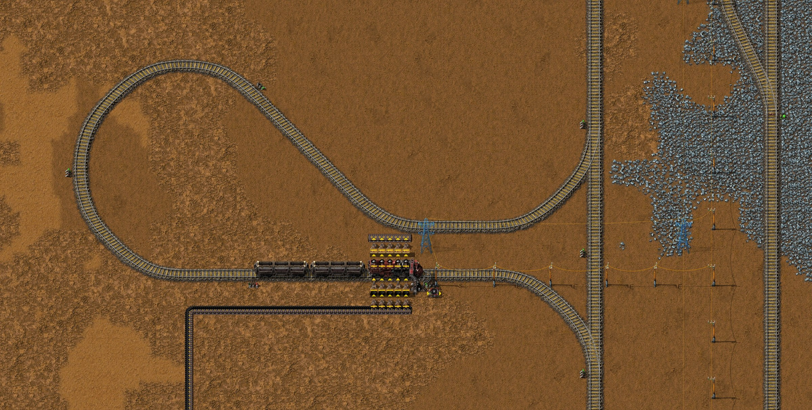
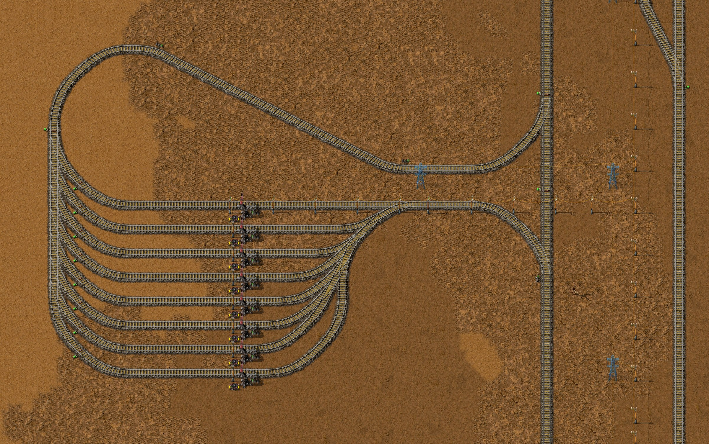
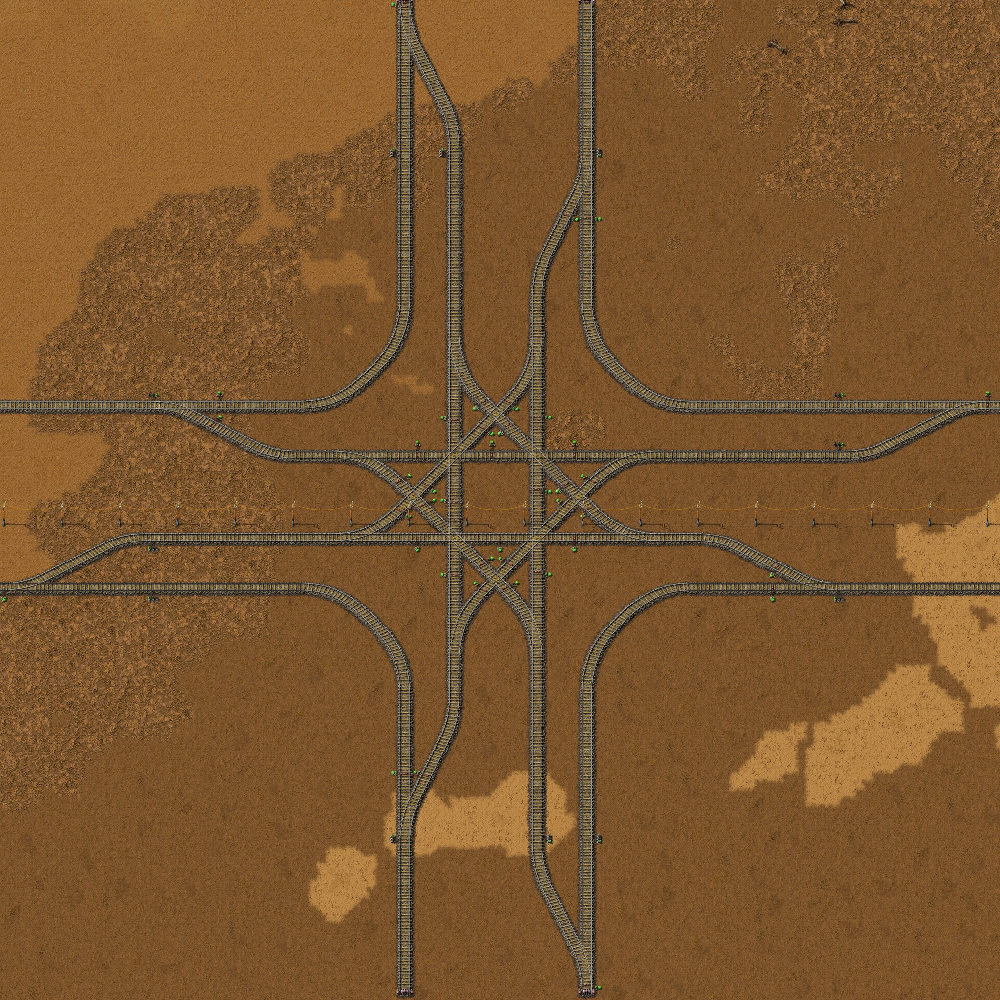

# 第十五章 火车准备 1

[English](15-train-preparation-1.md) · [目录](../README.zh-CN.md) · 上一章：
[第十四章](14-intermetallics-trains.zh-CN.md)

本章接着同一局录像，从 35:07 的存档讲到 41:05 的存档。主题是作者定的：**火车准备 1**。这段时间基地几乎没有新增，作者在设计
铁路：选定列车，设计十字路口、换道结构和 240 格网格的各块蓝图，再做 Cybersyn 用的加油站和车库，并在基地东边一大片原煤矿旁
铺下了第一段铁路网。大部分设计是边测边改的：作者画一张蓝图，在引擎里实测，作者再修改。时间都是游戏时间。数字来自游戏数据、
记录器的 10 分钟产量窗口、41:05 的存档（`tools/inspect-save.ps1` 和新工具 `tools/trains-probe`）、Cybersyn 模组的源码，以及在引擎里
对作者蓝图的实测（`tools/junction-bench` 和 `tools/train-probe`）；完整结果见 [Py 下的铁路](../research/py-railway.zh-CN.md)
和[平交铁路路口](../research/rail-junctions.zh-CN.md)。

结论：

- **列车是一台内燃机车加两节货运车厢**（21 格，40 个货格）。Py 取消了限速，它能跑到 245 km/h；满满一箱原煤（150 个，450 MJ）
  够开 750 秒，约 50 km。货物不算重量。两台机车快一倍，但刹停要 610 格。
- **道路是四线，每个方向两条车道，先按双线建**在外侧车道上。作者的三种十字路口里普通十字路口最好；在每个入口外侧和每个出口
  各放一个换道后，混合车流每分钟通过 36.8 到 38.5 列，不会锁死。初期双线版每分钟 32 到 33 列。
- **加油站 22.6 秒加满一列车**并取走全部灰烬；**车库**每条线停一列，共 8 条，可以按模块逐条扩建。两者都接在主线旁的接口上，
  所以都要设列车数量上限：没有空位的车会停在主线上等。
- **Cybersyn 还送不了货。** 请求物品的车站需要常量运算器，而 Py 里除了 Cybersyn 自己的运算器，每种运算器都要电池。作者下一步做电池。
- **地图上**：基地东边八个双线十字路口（x 480 到 1680）、加油站、车库，两列车停着，没有时刻表。铁路还没有连到基地。
- **不管它的话，存档 40 分钟内就会停下来**（实测）：研究因为缺石矿停了，用合成气和氢做燃料、给研究做熔融玻璃的玻璃工厂满了，
  两种气体堵回炼焦模块和焦油线，焦炭、乙炔和芳烃跟着停。作者 41:08 发现缺石矿并补上，游戏里基地一直在运转。第十三章起停着的锌，作者在存档后把一个溢流阀换成止回阀，已经恢复。

## 过程一览

| 游戏时间 | 发生了什么 |
|---|---|
| 35:07 | 第十四章截图后的存档 |
| 35:10–35:40 | 在基地东边铺下第一批铁轨，手放加机器人放，又拆掉一部分 |
| 35:21 | 苔藓农场升级研究完成（T.U.R.D. 升级，还没选）；下一项电池：阶段 1 |
| 35:40–36:10 | 信号：手搓并放下 55 个常规铁路信号和 50 个联锁铁路信号 |
| 36:20 | 电池：阶段 1 研究完成；下一项机器零件：阶段 1 |
| 36:20–37:30 | 在 x 730 到 1130、y −35 到 50 一带建了又拆了几个十字路口，边建边试 |
| 36:54 | 机器零件：阶段 1；下一项信号网络 |
| 37:31 | 信号网络；下一项 Cybersyn 列车协同控制网络 |
| 37:40–38:20 | **铁路网用蓝图放下**，沿 y −240；接下来两个半小时由机器人建成 |
| 37:51 | Cybersyn 列车协同控制网络；下一项液罐车厢 |
| 38:06 | 液罐车厢。模组：加了 Blueprint Sandboxes，去掉 Cargo Bays and Unloaders；38:11 加了 Ore Eraser |
| 38:30–39:10 | 在 (1473, −81) 建供货站：传送带、24 个机械臂、一个分流器；内燃机车和货运车厢放了又拆，试了几次 |
| 38:42 | 能源发电 1；39:31 不可再生能源：阶段 1 |
| 39:20–39:40 | **加油站**，位于 (1407, −159) |
| 39:40–39:50 | 在原煤矿上放一台电力采矿机（1376.5, −83.5），铺一条带送到加油站 |
| 39:50–40:10 | 机器人建好网格的方格部分：x 1440 到 1680、y −240 到 0 |
| 40:00 和 41:00 | 手搓：两台内燃机车、四节货运车厢 |
| 40:10–40:40 | **车库**，位于 (1619, −131 到 −159)，八条线 |
| 40:20 | 煤炭发电：阶段 1；下一项再生能源：阶段 1（队列里还有高级运算器） |
| 40:40–40:50 | 重建供货站 |
| 40:50–41:05 | 基地里：(−136.5, −230.5) 一台焦油处理设施 MK1 用萘油做木榴油，配一个底流阀 |
| 41:05 | 存档（`Py-Exploration`，41.1 小时） |
| 41:05–41:07 | 截图；**总线上 (−113.5, 179.5) 的芳烃溢流阀换成止回阀**：锌矿采矿机重新运转；41:07 存档 |

这段时间没有聊天留言。大部分铁路蓝图是作者在 2026-10-24 到 10-25（现实时间）陆续拿去实测的，下面各节按这个顺序讲，
而不是按游戏时间。

## 1. 科技

| 研究完成 | 科技 | 在这里给了什么 |
|---|---|---|
| 35:21 | 苔藓农场升级 | T.U.R.D. 升级；存档里还没选（第 10 节） |
| 36:20 | 电池：阶段 1 | **电池**（化工厂，10 秒：玻璃、2 三聚氰胺、铅锑合金、3 螺栓、3 石墨、3 锌板、30 氰酸 → 1），以及一个要用电池的简易电路板配方 |
| 36:54 | 机器零件：阶段 1 | 机械零件1型、功能箱 MK1、电子器件 MK1、控制面板 MK1 |
| 37:31 | 信号网络 | 算术、判断、常量运算器（**每个要一个电池**）、电闸、程控扬声器、显示器 |
| 37:51 | Cybersyn 列车协同控制网络 | **Cybersyn 协同控制运算器**（5 铜缆 + 5 简易电路板：不要电池） |
| 38:06 | 液罐车厢 | 液罐车厢 |
| 38:42 | 能源发电 1 | 熔融盐、电锅炉、盐岩采矿机 |
| 39:31 | 不可再生能源：阶段 1 | 换热器 MK1、高压汽轮机 MK1、蒸汽降温 |
| 40:20 | 煤炭发电：阶段 1 | 燃煤发电机 MK1、热熔盐、高压蒸汽 |

六小时约 1,950 个单位：每秒 0.09 个，正是第十一章起红瓶产线所能支撑的速度。存档时再生能源：阶段 1 进度 64%（它的高空风力发电机 MK1
要 100 个电池）；后面是高级运算器（选择运算器，用判断运算器做，所以又要电池）、仓储、建设机器人、冷却塔 1、驯化：阶段 1 和纤维板。

## 2. 选车：一台内燃机车加两节货运车厢

作者比较了三种编组，问它们装满原煤能开多远、能跑多快。Py 取消了所有车辆的限速，所以速度只由功率、重量和空气阻力决定
（[Py 下的铁路](../research/py-railway.zh-CN.md)）。燃料格全满：3 × 50 原煤 × 3 MJ = 每台机车 450 MJ。在引擎里实测：最高速度、加速和
刹车在 10,000 格直轨上测（`tools/train-probe`），续航让每列车在作者的双线网格上绕一个街区（一圈 850 格，经过四个路口）一直跑到燃料
烧完（`tools/junction-bench` 的 `run` 模式）。

| 编组 | 长度 | 货格 | 最高速度 | 0 → 200 km/h | 从最高速度刹停 | 一箱燃料 |
|---|---|---|---|---|---|---|
| **1 内燃机车 + 2 货运车厢** | 21 格 | 40 | 245 km/h | 15.1 秒 | 145 格 | **50.4 km** |
| 2 内燃机车 + 2 货运车厢 | 28 格 | 40 | 518 km/h | 6.5 秒 | 610 格 | 106.1 km |
| 1 内燃机车 + 4 货运车厢 | 35 格 | 80 | 216 km/h | 34.6 秒 | 122 格 | 44.2 km |
| 1 内燃机车 + 4 高级货运车厢 | 21 格 | 80 | 228 km/h | 22.5 秒 | 59 格 | 46.7 km |

- **内燃机车只要在开，就按满功率 600 kW 烧燃料**，最高速度时也一样：没有限速，它一直在牵引。所以一箱燃料总是 750 秒的行驶时间，
  距离就是这段时间乘以速度。停着（手动模式）一点不烧。
- **货物不算重量**：两节车厢装满原煤的 1+2 和空车跑得完全一样。
- **燃料只决定续航**：数据里原煤、煤矿、碎煤、焦炭都没有速度加成。碎煤（6 MJ，一组 100）装满一台机车是 1,800 MJ，同样的速度开四倍远
  （实测）。
- **反向的机车在列车前进时既不牵引也不烧燃料**，只增加重量（230 对 245 km/h）。
- **在作者的路口里**三种都不会锁死；2+2 每分钟通过的列数多，1+4 车厢多（[Py 下的铁路](../research/py-railway.zh-CN.md)）。

**作者选了 1+2。** 它只要一台内燃机车（每台要 5 个金属间化合物、25 个硬铝和四个制动器 MK1，第十四章），后面的设计也都按它的 21 格做。
列车与铁路：阶段 2（pY2）带来 3.5 格长的高级货运车厢：四节在同样 21 格里装两倍的货，[Py 下的铁路](../research/py-railway.zh-CN.md)
里那种站台布局两种车厢都能用。

## 3. 道路：四线、换道和十字路口

作者的道路是四线：每个方向两条车道，靠右行驶，车道间距 6 格（内侧车道离道路中线 5 格，外侧 11 格）。作者画了三种平交十字路口
（普通十字路口、苜蓿、环岛），每个入口和出口都有一个换道结构（同方向两条车道之间的 X），问哪种最好，或者有没有更好的。
新工具 `tools/junction-bench` 来测：它把路口的铁轨和信号建到空地图上，向引擎查询闭塞区和路径，再让一节机车加两节货运车厢的列车
从每条车道以最高 200 km/h 进场，开往随机出口，测 15 分钟（[平交铁路路口](../research/rail-junctions.zh-CN.md)）。

实测发现：

- **换道结构会让两列车锁死。** X 前两条车道都没有联锁信号。内侧车道上要换到外侧的车停在内侧车道的闭塞区里，外侧车道上要换到
  内侧的车停在外侧车道的闭塞区里，两车各自需要对方所在的闭塞区。苜蓿在混合车流下第一分钟内就这样锁死了。
- **环岛北口有五个信号装反了**，环道上的常规信号让列车可以停在环上：四列车各等下一段环道，环就锁死。
- **平交的苜蓿没有任何好处**：它的环形匝道是为了用桥越过交叉；平交时每个左转都要两次穿过核心。占地是普通的 2.8 倍，也最慢。
- **普通十字路口最好**：路径最短（左转 81 到 84 格，环岛 109 到 122，苜蓿 235 到 240），每分钟通过的列数最多（原样约 30），
  所有测试中都没有锁死。

修正背后的规则，每条都实测过：

1. **进口联锁，内部联锁，出口常规。** 从列车路径第一次和别的路径共用轨道之前，到越过最后一个这样的点，遇到的每个信号都是联锁信号；
   离开处是常规信号，它后面的闭塞区要停得下一整列车（21 格）。路口内部只在等待的列车整列停得下、又不挡别的路径的地方用常规信号。
2. **换道在第一个道岔之前就做决定**：X 之前两条车道各放一个联锁信号。有了它们，X 也是最快的形状：一半列车换道时每分钟 20.7 列，
   `\/`（两个单向换道一前一后）17.3 列，`\` 和 `/` 拉开、中间留等待位 15.4 列。
3. **环岛的环道上不放常规信号。**

作者采用了普通十字路口，每个出口一个换道；后来又把入口的换道挪到路口外侧：他的车站从外侧车道分出去，从车站开出来的车要在
路口之前进到内侧车道。他的换道结构起初缺了入口那两个联锁信号，四次里有三次锁死；补上之后，混合车流每分钟 **36.8、38.5、38.3 列**，
从不锁死（最初画的路口约 30 列）。每个换道里有三个信号去掉后没有任何损失，作者把它们去掉了；其余每个信号都是必需的（去掉内侧
车道右转弯道上的联锁信号，四个入口会同时锁死）。

## 4. 网格和初期双线版

作者的城市街区相距 240 格，蓝图都按 240 格对齐：十字路口（120 × 120）、网格的边（两个路口和之间 120 格的连接段，每条车道
中间一个常规信号），以及四个路口围成的整个方格。每种都有一个**初期双线版**：每个方向一条轨道，放在外侧车道的位置上，以后加内侧
车道时什么都不用挪。同样的混合车流实测：

| 蓝图 | 每分钟列数 | |
|---|---|---|
| 十字路口（四线） | 36.8、38.5、38.3 | 无死锁 |
| 十字路口-初期（双线） | 32.2、33.0、32.5 | 无死锁 |
| 棋盘格-铁轨（四个四线路口围成的方格，整体） | 66.1、70.8 | 无死锁 |
| 棋盘格-铁轨-初期（同上，双线） | 57.8、58.5 | 无死锁 |

双线版每个出口只有一条轨道，要走三个方向的车，出口信号之后的闭塞区一直延伸到连接段中间的信号，有 78.5 格。在每条出口轨道上、
出口信号之后 25 格再加一个常规信号，双线方格能到每分钟 64.3 和 62.5 列（四线方格加了没有提升）。作者还没加。

## 5. 车站接在哪里：接口

车站在街区里面、道路旁边。作者的「棋盘格-边-车站定位」是双线网格边，连接段两侧各有一对接口：一条从主线分出去的进站线和一条
汇回主线的出站线，相距 6 格。车站是一个能接上这对接口的环线；下面的加油站和车库都是这样做的。

主线在分岔之前是一个联锁信号，分出去的支线上没有信号。所以车站的第一个等待位和分岔处的主线属于同一个闭塞区，车站满了时，
下一列车就停在那个联锁信号前，**也就是主线上**，直到站里有空位。由此得出接在这些接口上的每个车站都要遵守的规则：
**列车数量上限不能超过站内能停的列数**。Cybersyn 派往一个车站的列车数不会超过它的列车数量上限。

## 6. 加油站

作者的「加油站-1」，给 1+2 列车用：单向环线，22 格站台，一个设为加油站模式的 Cybersyn 协同控制运算器。机车停的位置一侧有 5 个工业机械臂，
从 5 个限 1 格的木箱给机车加燃料，木箱由传送带供料；另一侧 5 个筛选灰烬的机械臂把机车剩余物格里的灰烬取到箱子里，再卸到另一条
传送带上。游戏里燃料带来自原煤矿上 (1376.5, −83.5) 的一台电力采矿机。

用 `tools/junction-bench` 的新模式 `station` 实测：把整张蓝图连同所有设置（筛选、箱子限格）一起建出来，让带 70 原煤和 80 灰烬的
列车用 Cybersyn 派车去加油站时写的时刻表（停到 100 tick 无活动）开进来：

- **每列车停 22.6 秒，离开时 150 原煤、0 灰烬。** 无活动条件会等机械臂干完：燃料和灰烬的进出都算活动。
- 每列车都整列停在站台闭塞区内；四列车接连进站，每分钟服务 1.7 列。
- Cybersyn 接受这列车：它的自动允许列表（读自源码）在加油站拒绝任何有车厢停在机械臂旁的列车，这里的机械臂只在机车旁。
- **环线能容纳三列车**：站台一列，等待两列。第四列停在了主线上：一列路过的列车跟在四列加油车后面用了 66.7 秒，跟在三列后面
  35.9 秒，单独 24.9 秒。作者把车站的列车数量上限设为 3。
- 作者还给车站起了名字（蓝图里没名字的车站每次放下都会得到一个随机名字），又加了一根小型电线杆：Py 的远程输电塔只给周围 2 格供电，
  原来供不到运算器。
- 五个灰烬箱每个装 16,000 灰烬，合起来约够一千次加油。

列车燃料剩一半及以下时才去加油（Cybersyn 默认的燃料阈值：75 个原煤），也就是至少开了 375 秒，所以这样一个加油站大约够十列车
用（由两次实测推算）。

## 7. 车库

用 Cybersyn 时，空车在车库里等。作者的「车库-1」也是接在同样接口上的环线：入口和环线中间各一个常规信号，形成两个等待位；然后分到
八条车库线上（进口联锁、出口常规，每条线一个「车库」车站和一个车库模式的运算器），再汇合到出口。用同样的方法实测，列车用 Cybersyn
给车库的时刻表（唯一一条记录是车库名，停到 100 tick 无活动），主线上有一列路过的列车跟在后面（单独 34.1 秒）：

| 车库 | 派去的列车 | 结果 |
|---|---|---|
| 初稿：4 条线，上限 2 | 8 | **只停进一列。** 第二列占了同一个车站的第二个名额，在入口等这条线，一直不动；后面所有车，包括路过的那列，都停在主线上 |
| 上限 1 | 4 | 每条线一列，间隔 4 秒；路过的车通过了 |
| 上限 1 | 5 | 停进四列；第五列发现所有车站都满了，停在原地，也就是主线上 |
| 8 条线，入口没有信号 | 8 | 全部停进，最后一列 65.2 秒；路过的车 81.5 秒 |
| **8 条线，入口和环线中间各一个常规信号（定稿）** | 8 | **44.4 秒全部停进**；路过的车 59.8 秒 |

- **每条车库线上限 1。** 每条线只停得下一列 1+2。Cybersyn 自带的命令 `/cybersyn-abolish-same-depot` 也会把车库站设为 1（读自源码）。
- **车库线不能少于列车数**：没有空位的车会停在主线上。
- **车库站后面不留等待位。** Cybersyn 的车库绕行（默认开启）让正在回车库的列车就已经可以接单（读自源码）：停在已停车辆后面等待的那列
  可能被派单，然后只能等前面那列开走。
- **加线**：「车库扩展模块」就是最下面一条线的复制品，放在它下方 4 格。测到 27 条线（19 个模块）：在网格边上建出来不碰任何东西，每列车
  都能停进，远处的线进站稍慢（间隔 10 秒，近处 5 秒）。

## 8. Cybersyn 怎么运行，为什么要等电池

作者以前只用过两站之间往返的固定列车。用 Cybersyn（2.1.2 版，读自源码）时，列车没有自己的线路：它们空车在车库里等，模组每次给一列车
写一份只管一次运输的时刻表。

- **车站旁放一个 Cybersyn 协同控制运算器**，车站就进了网络；运算器的模式决定车站的角色：**站台**（输入就是本站库存：正信号是可供应的
  存货，负信号是要请求的缺口）、**车库**、**加油站**，以及两种可选的辅助模式。
- **调度器**每秒运行 30 次，每次处理几个车站：读取车站的输入（会算上列车正在送来或取走的量），然后一次匹配一种物品：优先级最高的请求站
  （其次是最久没收到货的），优先级最高、离它直线最近、存货达到阈值的供应站，以及同一网络里装得下阈值、两站都允许的空闲列车，
  **先挑最大的**，再挑最近的。
- **它写的时刻表**：供应站，等到这一单装够；请求站，等到卸空；回车库。卸完后燃料剩一半及以下的车去加油站；燃料够的车可以在回车库的路上
  接下一单（车库绕行）。列车必须空车回车库。
- **默认请求阈值是 2,000 个物品**，列车必须装得下才会被选中：1+2 只有 40 格，堆叠小于 50 的物品永远派不出车，除非给车站单独设阈值，
  或者勾选「堆栈阈值」。

**现在能用的部分。** 红绿线随蒸汽动力解锁，Cybersyn 协同控制运算器不要电池，所以车库、加油站和供货站（箱子直接接到运算器上）都能建。
请求站不行：它的需求是一个负信号，即想要的数量减去现有的，只有常量运算器做得出来。Py 里常量、算术、判断运算器每个都要一个电池；
模组里没有别的可建实体能给出常量信号。没有请求站就没有运输，所以**在基地做出电池之前，Cybersyn 一列车也不会派**。作者试做过一个
供货站（「固体供货站-1」，直接从传送带装车）：运算器没接线，报告不出存货；还勾选了「Circuit condition」（电路条件），装满的列车会一直等
一个没人发的信号（实测：120 秒时已装满，到 180 秒仍停着）。作者决定等有了电池再做供货站。

## 9. 41:05 时游戏里有什么

作者在基地东边、(1413, −76) 那片原煤矿旁（4.807 亿，检查工具列出的原煤矿里最大的一片）铺下了铁路网的第一段，全是双线：

- **八个十字路口**：沿 y −240 六个，位于 x 480、720、960、1200、1440 和 1680；网格的方格在 y 0 由 (1440, 0) 和 (1680, 0) 两个路口
  围起来。路口之间是 120 格的连接段，每条轨道中间一个常规信号。总共 3,557 根直轨、140 根半对角铁轨和 492 根弯轨（5,313 个铁轨物品），
  333 个联锁信号和 135 个常规信号。
- **供电**：约 500 根小型电线杆沿道路接到基地的电网；沿两条南北道路规划的 31 座远程输电塔还只是虚影。
- **车站**接在 x 1440 那条路的接口上：西侧是加油站，燃料来自原煤矿上的一台电力采矿机；东侧是放弃的供货站。x 1680 那条路上是车库，
  八条线全空。十个 Cybersyn 协同控制运算器都有电，都在工作。
- **两列车**，都是一台内燃机车加两节货运车厢，都是空车、没有时刻表：一列停在加油站站台，手动模式，燃料满箱；一列停在供货站，
  一点燃料都没有（用新工具 `tools/trains-probe` 从存档读出）。作者背包里还有一台内燃机车、两节货运车厢和 926 根铁轨。
- **还没有连到基地**：最西边的轨道在 x 421 处结束。

## 10. 基地的其他变化

- **铁轨**：第十四章的铁轨模块在大多数窗口里每秒 0.4 根，35:07 之后共 6,174 根；37:00 到 38:10 的窗口里一根没有（焊料和处理过的木材
  也没有），之后又恢复到 0.4。铁路网用了 5,313 根。
- **木榴油**：40:50 作者在 (−136.5, −230.5) 加了一台焦油处理设施 MK1，用萘油做木榴油（50 → 30，2 秒，数据），产物经 (−129.5, −224.5) 的
  底流阀进木榴油管（底流阀只在出口一侧低于 80% 时放行，第六章）。铁轨要的处理过的木材要用木榴油：作者更新的方案“铁轨”（37:23）
  每分钟 800。这些窗口里焦油线每秒出 23.2 萘油，用掉 15 到 17。
- **苔藓农场升级**已研究（35:21），存档里还没选。四个选项（读自 pyalienlife 源码）：孢子灭菌（每个苔藓配方多要一个氯水，氯水由高压水、
  氯和塑料做；苔藓多 40%，时间少四分之一）、粗基质再生（苔藓配方还出粗颗粒，农场耗能多 50%）、内置生物反应器（不产生污染，解锁两个把
  精炼气体还原的配方，农场要用生物反应器来建）、高密度培植（苔藓不再需要泥浆）。
- **锌**：12 台锌矿采矿机从第十三章起一直因缺芳烃停着，基地每秒出的锌板不到 0.02 块。作者找到了原因：总线上 (−113.5, 179.5) 的芳烃
  溢流阀只在近端超过 80% 满时放行，而它上游的芳烃尾矿池 (−139, −38) 让这根管道永远到不了 80%。存档后作者马上把它换成了止回阀。
  41:07 的存档里 12 台中有 11 台在工作；这份存档跑一小时，每秒 7.2 个锌矿、0.72 块锌板，40 分钟后锌板把炉子后面的空间装满
  （还没有用户）。每个电池要 3 块；41:05 时基地的箱子里有 2,141 块，约够 700 个电池。
- **模组**：38:06 加了 Blueprint Sandboxes（在基地之外单独设计蓝图的地方），去掉了 Cargo Bays and Unloaders；38:11 加了 Ore Eraser。
- **工厂规划器里的方案**：“铁板”（39:34），用铸造路线每分钟 810 块铁板，原料是铁矿、硼砂和木材，氧气由 10.8 台电解槽供应（112 MW）；
  “物流科技包（绿瓶）”（39:56），一台科研枢纽 MK1 每分钟 3 个，用每分钟 0.75 个电池、0.5 个动物样本、0.5 个异星样本和 0.25 个固态肉菌。

## 11. 存档后的一小时

41:05 的存档在没有玩家的情况下跑一小时（`tools/rate-probe`），撑不住：

| 每秒（10 分钟一段） | 10 分钟 | 20 | 30 | 40 | 50 | 60 |
|---|---|---|---|---|---|---|
| 煤气产量 | 41.3 | 37.1 | 10.1 | 0 | 0 | 0 |
| 焦油产量 | 29.0 | 25.9 | 6.4 | 0 | 0 | 0 |
| 焦炭产量 | 9.1 | 7.7 | 1.9 | 0 | 0 | 0 |
| 用电（MW） | 75.2 | 61.3 | 41.3 | 28.4 | 25.4 | 24.4 |

41:07 的存档（作者已换上止回阀）也一样；停掉新的木榴油设施也没有区别。游戏里其实已经开始往这条路上走：截至 40:30 的窗口
焦油每秒 48，存档前的三个窗口降到 31、25、17。

是什么让它停下，从机器的流体箱读出；原因是作者找到的：

1. **煤气没有去处。** 炼焦模块第一级的蒸馏塔（原煤 → 60 煤气 + 30 焦油 + 3 煤矿）存档时就已经“输出已满”，煤气箱是满的。煤气的
   用户是铝矿采矿机（只有金属间化合物产线取铝板时才用）和溢流阀之后的三台气化炉。合成气有一个大用户：y 348.5 的玻璃工厂把它
   和氢当燃料烧（第八章），做的熔融玻璃变成瓶子，进 pY 科技包 1 型。**研究因为缺石矿停了。** 作者的解释：石矿来自破碎，是电路板
   和金属间化合物产线的副产物，这两条线都停了。记录器里看得到：40:40 起石矿从每秒 8 降到 4.3，红瓶用量从 0.2 降到 0.01，熔融玻璃
   从 10 降到 2.9，合成气从 34 降到 11；存档里研究中心“缺少科技包”。没有煤矿，下一级蒸馏塔就不出焦炭和焦油；没有焦炭，给焦油线
   供蒸汽的 20 台焦炭锅炉熄火，烧焦炭的乙炔（铅矿采矿机）、碳化钙等也跟着停；没有焦油，就没有芳烃（锌、塑料）和木榴油（铁轨要的
   处理过的木材）。
2. **氢没有去处。** 在煤气管上加一个排气管（(−101.5, −168.5)）后，炼焦模块重新运转，焦油被它唯一的用户限制在每秒 40（第十四章），
   40 分钟后又全部停下：沥青精炼的蒸馏塔（100 沥青 + 100 蒸汽 → 10 氢 + 轻油、萘油、蒽油和焦炭）“输出已满”，输出箱里是氢；
   沥青堵回焦油精炼，焦油堵回炼焦模块。这次实测里基地前十分钟每秒用掉 9.5 氢，之后一点都不用：同样是那几台玻璃工厂不再烧了。

煤气管上一个排气管、沥青精炼旁的氢管上再一个（(−161.5, −130.5)），整小时都能运转：每秒煤气 54、焦油 34、焦炭 10、沥青 48，
结束时用电 49 MW，第二次实测也一样。两个都要：只有第一个时 40 分钟就停了。排气管只是在存档副本里做的测试。**作者的修法是补石矿**：
41:08 的留言是“发现缺石矿”，到 41:30，石矿上的 8 台电力采矿机和烧石砖的 12 台石炉让研究重新运转（第十六章）。石矿升到每秒 17–19，
熔融玻璃 14–15，合成气 47–51，游戏里基地始终没有停：到 43:40 焦油一直在每秒 34 到 50，43:42 的存档也能跑满一小时（每秒煤气 27
到 39、焦油 34、焦炭 9.5）。产品没人取时模块停下，在这个基地里是正常的；这两种气体不一样，因为整个基地都要的焦炭和焦油是同几台
机器出的，而它们的出路是研究。

## 12. 蓝图

本章的铁路蓝图都已放进蓝图书（`/pt-book`），每张带着实测结果，详情见[蓝图列表](../blueprints/README.zh-CN.md#铁路)：换道结构、四线和
双线十字路口、网格的边和方格、带车站接口的网格边（棋盘格-边-车站定位）及其小型电线杆、加油站（加油站-1）、车库（车库-1）及其
扩展模块。

第十一到十四章的模块也随本章导入了：铅、钛、锡的筛选，蓝坷垃和镍，地热站，氧化锑，金属间化合物，变速箱用的鱼油，铁轨模块，以及
焦炭锅炉（焦炭销毁）。每张都和它所在章节存档里实测的模块逐个实体比对过，完全一致，所以说明里写的是那一章的数字。超市「初期超市-2」和
简易电路板模块有一点改动（一个箱子的限格；两个把玻璃和陶瓷取出来的箱子）。蓝图书现在有 45 张。

## 13. 要点

- Py 里内燃机车只要在动就按满功率烧燃料：一箱燃料是固定的行驶时间（原煤 750 秒），距离取决于速度。货物不算重量；反向的机车不出力。
- 平交路口：进口联锁，内部联锁，出口常规；内部只在整列车停得下、又不挡别人的地方用常规信号；换道在第一个道岔之前两条车道都要有
  联锁信号。
- 接在支线上、主线信号是联锁信号的车站，必须容得下派给它的每一列车：列车数量上限设为站内能停的列数。车库每列车一条线，上限 1。
- Py 里 Cybersyn 的每个请求站都要一个常量运算器，也就是要电池。车库、加油站和供货站不需要。
- 和基地需要的东西从同一台机器出来的气体，必须始终有出路：这里是煤气（和焦炭、焦油一起出）和氢（焦油线）。它们的出路是给研究烧的
  玻璃工厂，所以研究一停，焦炭也停。

## 14. 这些事实是怎么核实的

- 录像：助手模组的记录器（运行 `2652821414-0`，到 41:05），用 `tools/recorder-phases.js`（10 分钟分段）、`tools/recorder-summary.js`
  和活动日志里的产量记录读取；这段时间没有聊天留言。工厂规划器方案“铁轨”（37:23）、“铁板”（39:34）、“物流科技包（绿瓶）”（39:56），
  用 `tools/planner-summary.js` 读取。
- 41:05 和 41:07 的存档（`Py-Exploration`，先复制到 `C:\tmp\ch15`；一致性检查通过）：`tools/inspect-save.ps1 -Ticks 3700`、`tools/summarize-save.js`、
  `tools/render-area.js`。列车和车站用新工具 `tools/trains-probe`（`save-probe.ps1 -Probe trains-probe`）：每列车的状态、时刻表、燃料和货物，
  每个车站的名字和列车数量上限。T.U.R.D. 选择用 `tools/turd-probe`。
- 数据：配方、燃料值、车辆、电线杆供电范围（`tools/q.js`，2026-10-18 导出的数据）；选项名称来自 zh-CN 语言文件（aotixpy）。
- 列车：`tools/train-probe`（直轨）和 `tools/junction-bench` 的 `run` 模式（一列车在网格上绕一个街区，直到燃料烧完）。
- 路口、换道、网格：`tools/junction-bench` 的 `map`（闭塞区、路径、每条路径上的信号）、`traffic`（每条车道都发车的混合车流，15 分钟，
  几个随机种子）和 `edit` 模式；车站：`station` 模式（整张蓝图连同所有设置，列车用 Cybersyn 的加油站、车库或装货时刻表，主线上有路过的列车）
  和 `build` 模式（重叠、电线杆覆盖）。
- Cybersyn：cybersyn 2.1.2 的源码（`scripts/central-planning.lua`、`train-events.lua`、`factorio-api.lua`、`layout.lua`、`settings.lua`）。
- 第十一到十四章的蓝图：每张都和第十一到十五章的存档快照逐个实体比对。
- 存档后的一小时：两份存档都用 `tools/save-probe.ps1 -Probe rate-probe -Ticks 219700`，带这些产物的时间线，以及一座沥青精炼塔和两台焦油精炼
  设施的流体箱（`@x:y`）；假设改动 `off@-136.5:-230.5`（新的木榴油设施）、`py-gas-vent@-101.5:-168.5:south` 和
  `py-gas-vent@-161.5:-130.5:south`；记录器 40:20 到 42:00 的石矿、科技包、熔融玻璃和合成气窗口，以及 43:42 的存档用同样方法跑一小时。
- 截图：作者 41:05 用助手模组拍摄（`/pt-shots`），区域用 `node tools/shots.js plan` 规划。

下一章：第十六章（待续）：电池。
