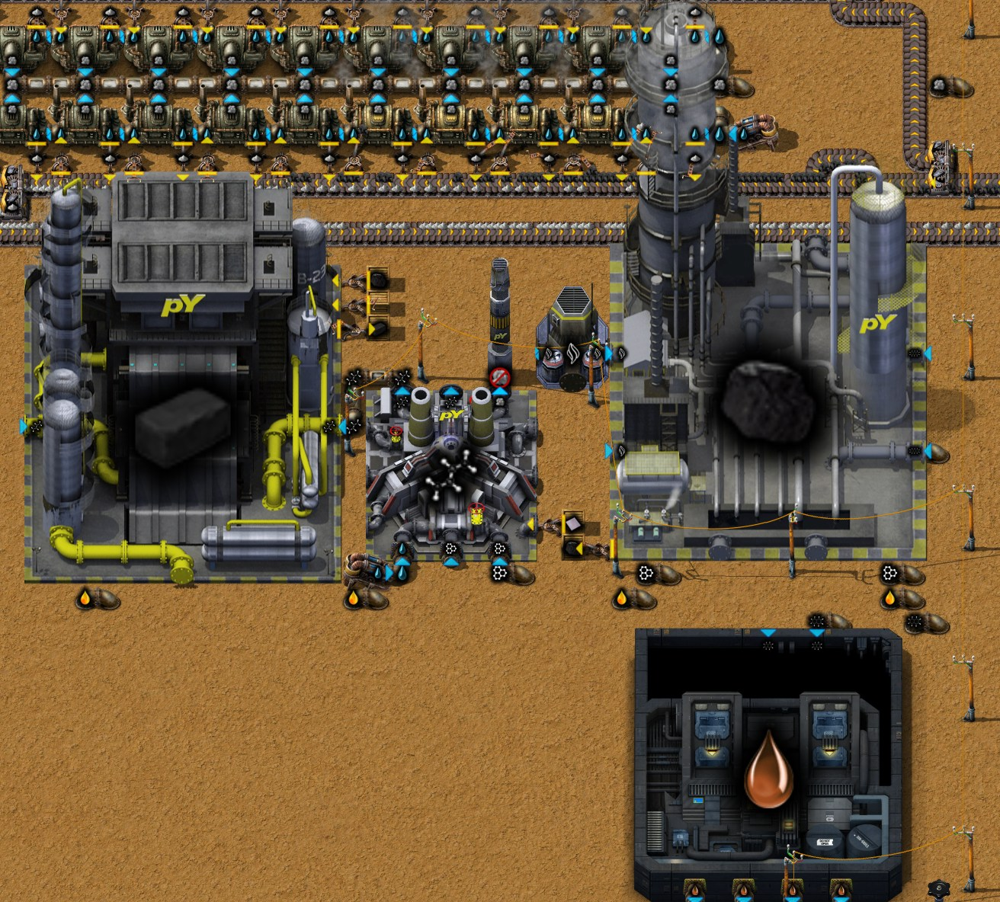
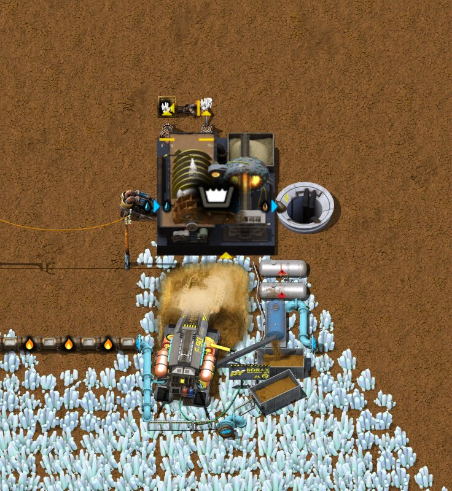
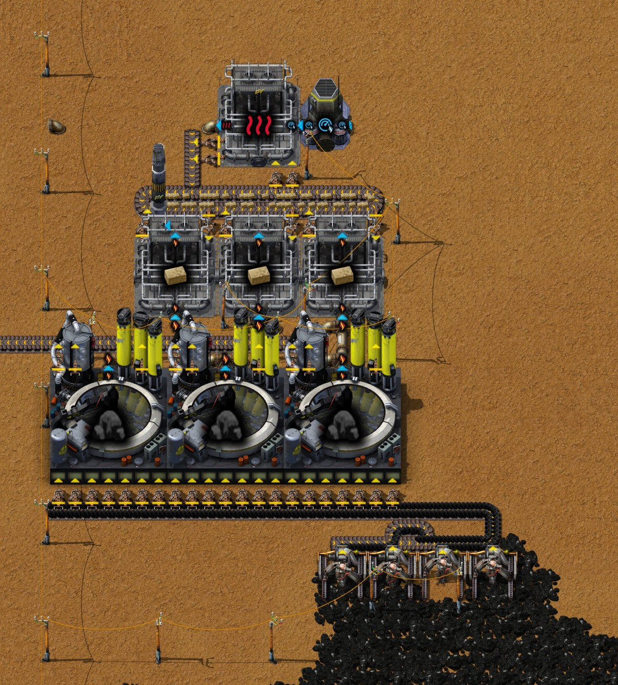
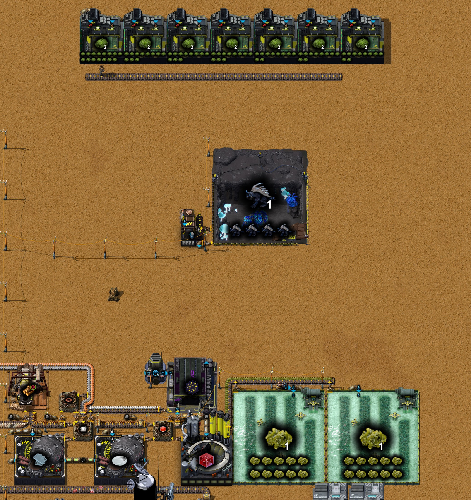
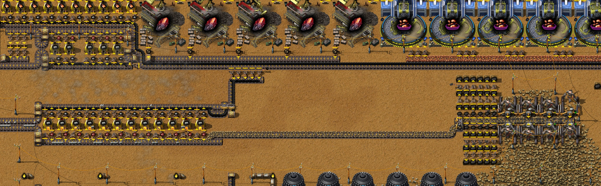

# 第十六章 剑背龟

[English](16-auogs.md) · [目录](../README.zh-CN.md) · 上一章：[第十五章](15-train-preparation-1.zh-CN.md)

本章接着同一局录制的游戏，从 41:05 的存档写到 43:42 的存档。作者给这一章定的主题是**剑背龟**。电池要用三聚氰胺和氰酸；这一阶段两样都只能
来自尿素，尿素来自剑背龟的粪肥，而剑背龟牧场里要有剑背龟才会运转。所以在电池产线之前，作者先把造第一只剑背龟要的东西都备齐，造出一只，
再用它繁育。途中基地还要一点橡胶、三氧化二硼和热气，研究用的石矿也出现了短缺。文中时间都是游戏时间。数字来自游戏数据、记录器的 10 分钟
产量窗口、作者的工厂规划器草案，以及 41:07 和 43:42 的存档（`tools/inspect-save.ps1`，以及各跑一小时的 `tools/rate-probe`）；关于橡胶的分析
见[火车和机器人](../research/trains-and-robots.zh-CN.md)第 7 节。

结论：

- **难的是第一只剑背龟。** 生物室用 3 个 cDNA 和几种样本造它；3 个 cDNA 要 9 个实验室设备，也就是 45 个橡胶和 4.5 个三氧化二硼；它的逆转录病毒
  要 150 热气，样本要 145 瓶红瓶。之后的剑背龟都由幼崽长成，完全不用橡胶。
- **一只就够了。** 生物室从 43:11 运转到 43:17；靠它造出的这一只，繁育复合体和牧场到 43:42 一共出了 69 只幼崽、46 只剑背龟。作者背包里有 33 只，
  地上那个牧场里有 4 只；电池草案大约要 26 只。
- **橡胶只做小产线。** 看了分析之后，作者把草案从每分钟 60 个减到 15 个（一个橡胶要 100 芳烃，基地每秒约产 17）。它做了 69 个橡胶，乳胶靠手放。
- **三氧化二硼**：在铁路网西端开采天然硼砂，另搭几台电解槽专门做它；做了 30 个之后电解槽又拆掉了。
- **热气**来自一个新模块：高压炉把原煤炼成焦炭，热的焦炉煤气加热石砖，石砖再加热高压空气。有用户时实测每秒 9.3 热气，另外让基地每秒多出 5 个
  焦炭。只有 3 个逆转录病毒要用热气，所以它现在满着停着。
- **石矿**：研究缺石矿。作者在 41:10–41:30 补上石矿，也顺带解决了第十五章实测的停摆；43:42 的存档在没有玩家的情况下能跑满一小时。

## 过程一览

| 游戏时间 | 发生了什么 |
|---|---|
| 41:05 | 第十五章结尾的存档 |
| 41:05–41:07 | 芳烃溢流阀换成止回阀（第十五章）；41:07 存档 |
| 41:08 | 留言：“发现缺石矿” |
| 41:10–41:30 | **研究用的石矿**：石矿区 (14, 30) 上 8 台电力采矿机，(−46, 30) 处 12 台石炉烧石砖；基地东边铁矿上的热能采矿机换成电力采矿机 |
| 41:20–41:30 | 原生植被矿区 (28, 75) 上 4 台植被采集器；放下数据阵列仪；手搓 24 个生态容器、5 个剑背龟数据集、照明灯和镀锡电线 |
| 41:30–41:50 | (−57, −396) 处的基因实验室和孵化器；数据阵列仪移到 (−56, −418) |
| 41:39 | 再生能源：阶段 1 完成；接着研究高级运算器 |
| 41:50–42:00 | (−40, −390) 处的佐纳细菌产线：海藻生长池、做琼脂的高压炉、做空培养皿的玻璃工厂、压力泵、孵化器 |
| 42:00–42:10 | (−33, −399) 处做质粒的生物工厂 |
| 42:10–42:20 | **三氧化二硼**：(436, −40) 处天然硼砂上的晶体矿石采矿机，配洗涤机和渗水坑，合成气用管道向东送 400 格；(−107, −101) 处的电解槽和高压炉 |
| 42:17 | 高级运算器完成，接着研究仓储；42:24 仓储完成，接着研究建设机器人 |
| 42:25 | 留言：“理清思路！还需要橡胶和热气，少量” |
| 42:20–42:40 | 拆掉电解槽（三氧化二硼已做 30 个）；用蓝图在 (−50, 262) 建**热气模块** |
| 42:40–43:00 | (−150, −244) 处的**橡胶线**：转化炉、做真空的压力泵、多用途裂解器、重油精炼厂 |
| 42:50–43:10 | 手搓 12 个实验室设备；热气模块旁的孵化器做逆转录病毒，基因实验室做 cDNA |
| 43:10 | 建设机器人完成；接着研究冷却塔 1 |
| 43:11–43:17 | (−17, −399) 处的**生物室**：第一只剑背龟 |
| 43:12–43:40 | (−49, −422) 处的繁育复合体、做水桶的灌装机，剑背龟牧场放下又挪动 |
| 43:20–43:40 | 为电池产线手搓：4 台洗涤机、2 台混合器、2 台生物反应器、4 个储液罐、1 个尾矿池；7 台苔藓农场 |
| 43:40 | 7 台苔藓农场放在 y −440 |
| 43:42 | 存档（`Py-Exploration`，43.7 小时） |

## 1. 为什么剑背龟要在电池之前

电池（电池：阶段 1；化工厂，10 秒）要玻璃、2 个三聚氰胺、1 个铅锑合金、3 个螺栓、3 个石墨、3 块锌板和 30 氰酸（数据）。在现在的研究进度下，
氨和氰酸都只有一个配方：尿素分解（20 尿素 → 30 氨 + 30 氰酸），三聚氰胺两样都要。尿素由生物反应器用液体肥料和佐纳细菌做，液体肥料来自粪肥，
粪肥来自剑背龟牧场。

作者在工厂规划器里的电池草案（43:11）每分钟 6 个电池，要 6.46 个剑背龟牧场、每个 4 只剑背龟，大约 26 只。草案每分钟还多出 180 氨，没有用户：
和第十五章的两种气体一样，它需要出路，否则尿素分解停下，电池也跟着停。

**牧场里要有剑背龟才会运转。** 剑背龟牧场 MK1 的制作速度是 0.5，4 个模块槽只能放剑背龟，基础效果是 −100% 速度（数据）：一只都没有就停着，
每多一只加 0.5。繁育幼崽的繁育复合体 MK1 也一样，只有 2 个槽，幼崽配方也不接受别的模块。所以第一只剑背龟只能来自生物室。

## 2. 第一只剑背龟

一只剑背龟要什么（数据；机器按作者实际用的写）：

| 产物 | 机器 | 原料 |
|---|---|---|
| 剑背龟（300 秒） | 生物室 | 2 个通用地球DNA样本、5 个生态样本、3 个 cDNA、1 个剑背龟数据集、1 个熊DNA样本、1,000 水 |
| 熊DNA样本（300 秒） | 数据阵列仪 | 1 个通用地球DNA样本、100 瓶红瓶、5 个剑背龟数据集 |
| 通用地球DNA样本（25 秒） | 数据阵列仪 | 1 个铁箱、15 瓶红瓶、10 个生态样本 |
| 生态样本（10 秒） | 孵化器 | 1 个生态容器、15 原生植被 |
| cDNA（10 秒） | 基因实验室 | 1 个逆转录病毒、1 个质粒、1 个实验室设备、5 个生态样本、5 个孵化培养皿、5 个苔藓基因样本、3 个瓶子、4 个基础基质 |
| 逆转录病毒（5 秒） | 孵化器 | 4 个钳尾刀虫茧、1 钢材、1 个培养皿、1 个瓶子、1 个实验室设备、50 热气 |
| 质粒（8 秒） | 生物工厂 | 20 佐纳细菌、1 个孵化培养皿、1 个瓶子、1 个实验室设备 |
| 2 个实验室设备（7 秒） | 手搓 | 3 个光学装置、2 个设备底座、5 个小部件、10 个橡胶 |
| 3 个光学装置（3 秒） | 玻璃工厂 | 1 个三氧化二硼、100 熔融玻璃 |

每个 cDNA 里有 3 个实验室设备：它自己 1 个，逆转录病毒和质粒里各 1 个。**一只剑背龟：9 个实验室设备，也就是 45 个橡胶和 13.5 个光学装置，
光学装置要 4.5 个三氧化二硼；3 个逆转录病毒要 150 热气；另要 50 个生态样本和 145 瓶红瓶。** 两份存档之间作者的产量计数正好是一只剑背龟的量：
3 个 cDNA、3 个逆转录病毒、3 个质粒、3 个通用地球DNA样本、1 个熊DNA样本、50 个生态样本、6 个剑背龟数据集；12 个实验室设备（多 3 个）、
45 个光学装置、30 个三氧化二硼、69 个橡胶。

这套作坊是临时的。基因实验室、孵化器、数据阵列仪、生物室和繁育复合体放在 (−50, −400) 一带，做逆转录病毒时放在热气模块旁的 (−65, 256)；
43:42 时都已收回背包。佐纳细菌产线留着：电池产线做尿素还要用它。

## 3. 橡胶：一条小产线

一个橡胶（重油精炼厂，4 秒）要 50 聚丁二烯、2 个炭黑和 1 个乳胶；聚丁二烯（多用途裂解器，2 秒）用 200 芳烃、1,000 水和 1 块钛板做 100，
另出 1,000 蒸汽；炭黑（转化炉，2 秒）用 200 蒽油和 100 真空做 4 个。所以一个橡胶要 100 芳烃、100 蒽油、50 真空、半块钛板和 1 个乳胶（数据）。

作者的第一版草案（42:23）每分钟 60 个，每秒要 100 芳烃；基地每秒产 17.2（记录器，41:40–42:20）。看了研究笔记里的分析，草案减到每分钟 15 个
（42:45）：一台精炼厂，转化炉和裂解器只开四分之一的时间。目前橡胶只用几次：第一只剑背龟要 45 个，以后绿瓶大约每瓶 1 个。

它建在蒽油附近的 (−150, −244)：精炼厂在 (−160.5, −244.5)，裂解器在 (−149.5, −242.5)，配一台自己的抽取泵和一个排它蒸汽的排气管，还有做真空的
压力泵和 (−136.5, −245.5) 处的转化炉。钛板和乳胶靠手放进箱子。它做了 69 个橡胶，60 个用在 12 个实验室设备上；43:42 时乳胶箱是空的，出口箱里
有 9 个橡胶。

## 4. 三氧化二硼

这条链（数据）：天然硼砂（晶体矿石采矿机 MK1，要用合成气）→ 硼砂（洗涤机，加水；另出泥浆）→ 乙硼烷（电解槽，硼砂加氢）→ 硼酸（电解槽，乙硼烷
加水）→ 三氧化二硼（高压炉，200 硼酸加 1 个焦炭）。按作者的草案，一个三氧化二硼要 2.67 个天然硼砂和 66.7 氢。

最近的天然硼砂在 x 400–464、y −48 到 −16（约 1900 万），在铁路网西端。作者在 (435.5, −40.5) 放了一台晶体矿石采矿机，配洗涤机、抽取泵和排泥浆的
渗水坑，合成气从镍矿采矿机的管道沿 y −25.5 向东接了 400 格。三台电解槽和一台高压炉放在总线旁的 (−107, −101)。采矿机挖了 493 个天然硼砂，出了
30 个三氧化二硼，42:20–42:30 电解槽和高压炉又拆掉了。背包里还剩 15 个三氧化二硼；采矿机和洗涤机留着，已经满了。

光学装置由玻璃工厂做：1 个三氧化二硼加 100 熔融玻璃出 3 个（加热气是 4 个）；一共做了 45 个。

## 5. 热气模块

作者的蓝图“11.25 热气”，备注“启动后把木箱拆除”：

- 3 台高压炉：10 原煤 → 4 焦炭 + 20 焦炉煤气（250 °C，2 秒），原煤来自 (−39, 281) 处的 4 台电力采矿机；
- 3 台回热式交换器：5 石砖加 100 至少 250 °C 的焦炉煤气 → 有点热的石砖（8 秒），煤气降到 100 °C 后从排气管排掉；
- 再一台：20 有点热的石砖 + 150 高压空气 → 150 热气 + 20 石砖（2 秒），石砖再循环回去；高压空气来自压力泵。

木箱里放的是启动循环用的石砖。**实测**（对 43:42 存档用 `tools/rate-probe`，在热气管道上放一个排气管当用户）：每秒 9.25 到 9.5 热气，标签写的是
11.25；每秒 25 焦炉煤气、1.25 块有点热的石砖；基地的焦炭产量从每秒 9.7 升到 14.7。做热气的交换器 88% 的时间在等石砖（它一次要 20 块），高压炉
83% 的时间在工作。

只有 3 个逆转录病毒要用热气，一共 150 单位，所以 43:42 时这个模块满着停着。热气还能改进两个作者已有的配方（热气：阶段 1）：50 熔融玻璃加 50 热气
出 7 块玻璃而不是 5 块，光学装置出 4 个而不是 3 个。

## 6. 繁育

繁育复合体 MK1（21 × 21 格）出幼崽：20 原生植被、10 苔藓和 5 个水桶 → 2 到 5 只剑背龟幼崽和空桶（15 秒）。牧场把幼崽养大：4 只幼崽加同样的食物
→ 2 到 4 只剑背龟（160 秒）。里面有 n 只剑背龟时，两种机器的速度都是 0.5 × n：放满 4 只的牧场大约每 80 秒把 4 只幼崽养成 3 只剑背龟（数据）。

生物室从 43:11 放到 43:17，刚好够造一只剑背龟（300 秒）。之后是繁育复合体、做水桶的灌装机和牧场。记录器里的幼崽和剑背龟产量：截至 43:20 的
窗口是 4 和 1，截至 43:30 是 28 和 8，截至 43:40 是 37 和 38。从一只到 47 只大约用了 25 分钟。

43:42 时 (−26, −419) 处有一个牧场，里面 4 只剑背龟，在养幼崽，已经满了：没人把剑背龟取走。背包里有 33 只剑背龟和 6 个牧场。y −440 的 7 台苔藓
农场已经放下但还没通电：它们的苔藓是给牧场产粪肥用的（草案是 6.46 台苔藓农场，每台 15 个苔藓）。

## 7. 石矿、研究和第十五章的停摆

作者 41:08 的留言是缺石矿。记录器里能看到它的影响：

| 每秒，截至 | 40:30 | 40:50 | 41:10 | 41:30 | 41:50 |
|---|---|---|---|---|---|
| 石矿产量 | 8.4 | 6.3 | 4.7 | 16.7 | 17.8 |
| 红瓶用量 | 0.185 | 0.137 | 0.010 | 0.080 | 0.213 |
| 熔融玻璃产量 | 9.6 | 8.1 | 2.9 | 5.9 | 15.0 |
| 合成气用量 | 32.8 | 27.2 | 14.3 | 19.2 | 51.5 |

作者的解释：研究用的石矿来自破碎，是电路板和金属间化合物产线的副产物，这两条线都停了；研究还要用玻璃，给它做熔融玻璃的玻璃工厂烧合成气和氢
（第八章），是合成气最大的用户。修法：在石矿区 x 0–28、y 18–41 放 8 台电力采矿机，y 30 的 12 台石炉把石矿烧成石砖。

这也结束了第十五章的停摆。41:05 的存档是在研究停着的时候存的，所以副本在没有玩家时 40 分钟内炼焦模块就停了。游戏里作者在存档后 3 分钟发现缺石矿，
到 41:30 补上：玻璃工厂重新烧合成气，气化炉接走煤气，从截至 41:20 的窗口起，焦油到 43:40 一直在每秒 34 到 50。

## 8. 43:42 时游戏里有什么

- **研究**：已完成 119 项；冷却塔 1 完成 72%，之后是驯化：阶段 1、纤维板、地砖：阶段 1、真菌学：阶段 1、淀粉：阶段 1 和白白鼠：阶段 1：这是通往
  绿瓶的路，绿瓶要固态肉菌（白白鼠）和真菌学。建设机器人已完成；作者背包里还有那 100 台pY建设机器人 MK4。
- **北边的剑背龟区**（y −380 到 −445）：牧场、佐纳细菌产线和新的苔藓农场。
- **电池产线的材料**在背包里：4 台洗涤机、2 台混合器、2 台生物反应器、4 个储液罐和 1 个尾矿池（43:20–43:40 手搓）。
- **锌**：y 199 的 12 台锌冶炼石炉从 41:15 左右开始出板；从 41:30 起每个窗口每秒 0.34 到 0.72 块，42:00 起约 0.4（记录器）。
- **没有变化**：铁路网还是 41:05 的样子，没有连到基地；T.U.R.D. 选择（苔藓农场升级仍未选）。

## 9. 存档后的一小时

43:42 的存档在没有玩家的情况下跑一小时（`tools/rate-probe`）：

| 每秒（10 分钟一段） | 10 分钟 | 20 | 30 | 40 | 50 | 60 |
|---|---|---|---|---|---|---|
| 煤气产量 | 39.4 | 38.4 | 26.8 | 27.6 | 27.7 | 27.2 |
| 焦油产量 | 33.9 | 34.2 | 33.9 | 34.3 | 34.3 | 34.2 |
| 焦炭产量 | 9.7 | 9.8 | 9.4 | 9.5 | 9.5 | 9.5 |
| 合成气用量 | 13.3 | 23.8 | 37.6 | 37.8 | 37.8 | 37.5 |
| 用电（MW） | 91.6 | 86.5 | 84.0 | 79.8 | 78.0 | 77.2 |

撑得住。气化炉一半时间“输出已满”（53%），卡在焦油上，也就是第十四章找到的焦油管道上限，不是合成气。锌冶炼 20 分钟后装满（锌板还没有用户），
牧场一直满着，热气模块停着：这些都是在等用户的模块，在这个基地里是正常的。

## 10. 蓝图

- **新增**：`hot-air`（“11.25 热气”），第 5 节的热气模块，有用户时实测每秒 9.3 热气。蓝图书现在有 46 张蓝图。
- 仍在等待：作者的供货站“固体供货站-1”（第十五章），等电池让 Cybersyn 能发请求之后再导入。

## 11. 要点

- 在 Py 里，同一种动物的第一只很贵，之后的很便宜：一只剑背龟要 45 个橡胶、4.5 个三氧化二硼、150 热气和 145 瓶红瓶；繁育复合体和牧场用它在 25 分钟
  里又繁育出 46 只。
- 牧场和繁育复合体自身速度是 −100%，里面放了对应的动物才运转；有一只就能起步。
- 只用几次的中间产物，做一条小产线（橡胶，每分钟 15 个）或临时产线（做三氧化二硼的电解槽，用完拆掉）。
- 研究会卡住炼焦模块：给研究做玻璃的玻璃工厂烧的是合成气。
- 排气管和渗水坑按 20,000 一批排空；它们显示“缺少原料”只是在攒下一批。

## 12. 这些事实是怎么核实的

- 41:07 和 43:42 的存档（`Py-Exploration`，先复制到 `C:\tmp\ch15` 和 `C:\tmp\ch16`；一致性检查通过）：`tools/inspect-save.ps1 -Ticks 3700` 和
  `tools/summarize-save.js`；比较两份存档里剑背龟链的产量计数；T.U.R.D. 选择用 `tools/save-probe.ps1 -Probe turd-probe` 读出。
- 记录器：`tools/recorder-phases.js` 按 10 分钟和 2 分钟切片，以及石矿、科技包、熔融玻璃、合成气、剑背龟和幼崽的窗口。
- 作者的工厂规划器草案“电池”（43:11）、“橡胶”（42:23 和 42:45）、“热气”（42:25）和“三氧化二硼”（42:13）：`tools/planner-summary.js`。
- 热气模块：对 43:42 存档用 `tools/rate-probe`，以 `py-gas-vent@-61.5:253.5:north` 作为用户（另外三个方向接不上）。
- 存档后的一小时：`tools/save-probe.ps1 -Probe rate-probe -Ticks 219700`。
- 数据事实：`tools/q.js`、`tools/recipe-tree.js battery-mk01 --techs save`，以及数据里各机器的效果接收和模块类别。
- 截图：作者用助手模组拍摄（`/pt-shots`），区域用 `node tools/shots.js plan` 规划。

下一章：第十七章（待续）：电池。

