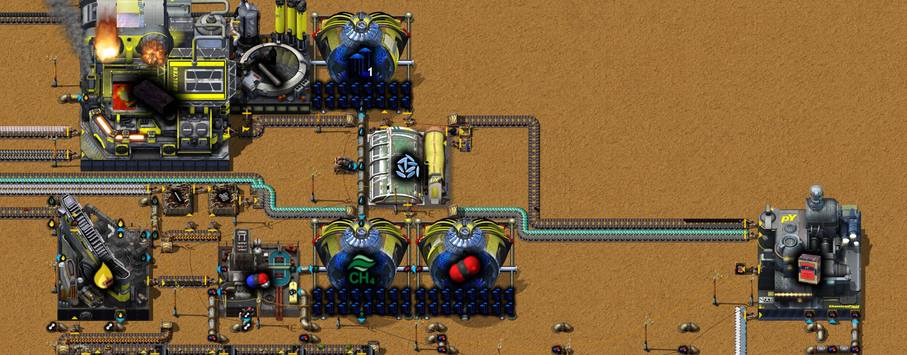
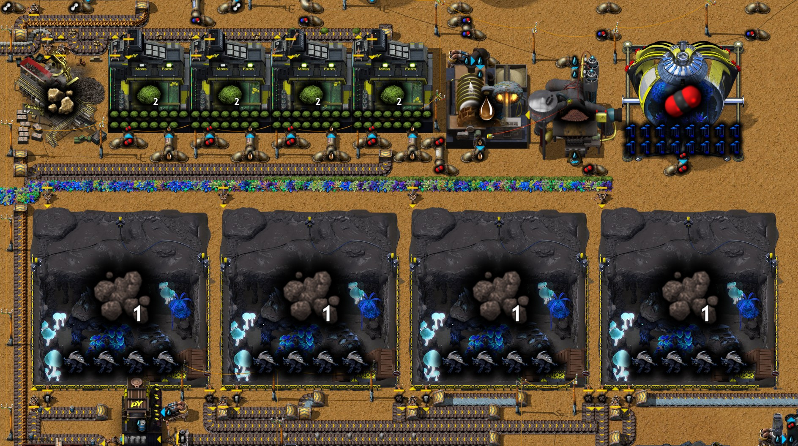
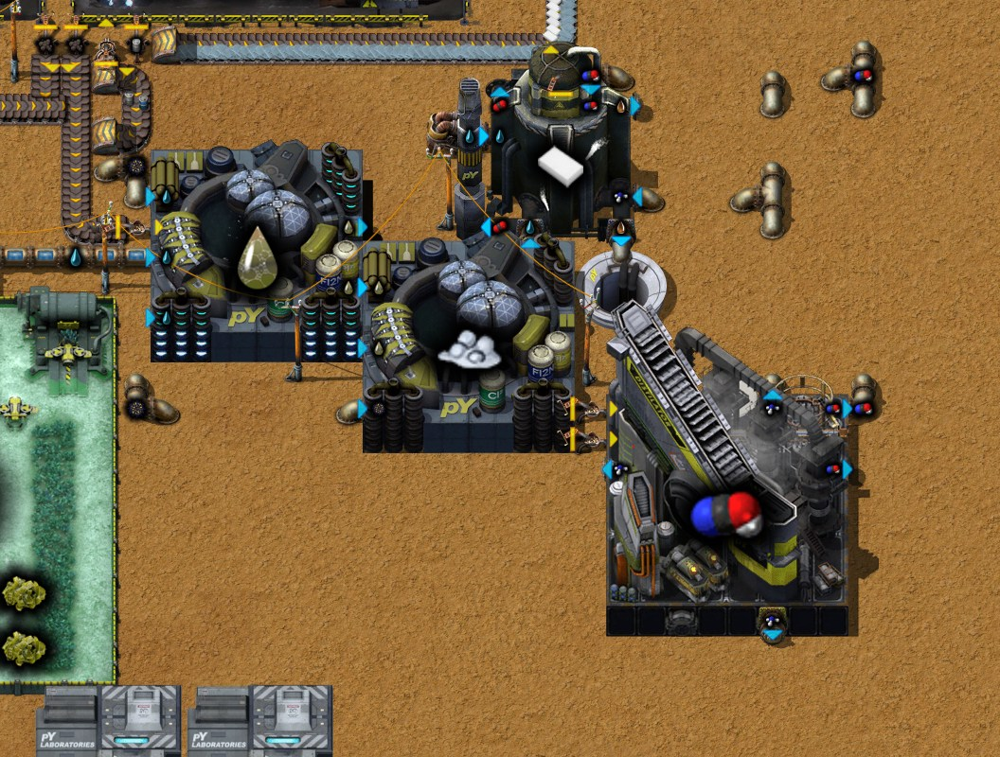

# 第十七章 电池

[English](17-batteries.md) · [目录](../README.zh-CN.md) · 上一章：[第十六章](16-auogs.zh-CN.md)

本章接着同一局录制的游戏，从 43:42 的存档写到 45:20 的存档。作者给这一章定的主题是**电池**。有了第十六章的剑背龟，作者在基地北边建起电池产线，
发现更好的配方后又重建了一次，并把总线延伸过去。文中时间都是游戏时间。数字来自游戏数据、记录器、作者在工厂规划器里的草案“电池”（44:53），
以及 43:42 和 45:20 的存档（`tools/inspect-save.ps1`，以及跑一小时和三小时的 `tools/rate-probe`，含假设测试）。

结论：

- **产线每分钟做 6 个电池，正好是化工厂的上限。** 第一个电池出现在 45:10 之后；45:20 时箱子里有 32 个。从存档接着跑，前 40 分钟保持每分钟 6 个，
  之后约 5.3 个：最后两个剑背龟牧场常常等水桶。往这两个牧场里各多放 5 个水桶，就能整整一小时保持每分钟 6 个。
- **作者的重新设计：把氨转成氰酸。** 第一版草案每分钟多出 180 氨没有用户。熄焦塔能用这些氨、甲烷和一点煤矿做氰酸（作者 44:07 的留言）；
  这样不再有多余的氨，一个电池要的尿素从 21.3 降到 11.3，牧场从 6.46 个降到 3.43 个。作者建了 4 个，放了 16 只剑背龟。
- **总线向北延伸**到产线：铅板、锌板、焦炭、氧化锑的传送带，汽油、熔融玻璃、蒸汽的管道。产线的氢、煤气和焦油经止回阀送回总线；
  做三聚氰胺产生的二氧化碳和泥浆就地排掉。
- **电池接下来的用处**：每个运算器 1 个（Cybersyn 的请求要用运算器），每个 pY建设机器人和机器人指令平台 2 个，每 12 个物流科技包 3 个。
- **不管它的话，存档一小时内就会停下来，而且不会自己恢复**，研究也跟着停。原因不在电池产线：基地北边原煤矿上存放灰烬的 6 个木箱满了
  （其中两个是在两份存档之间装满的），于是焦油精炼区的蒸汽断了，焦炭、焦油、乙炔和科技包也随之停下。清空这些箱子，或者给蒸汽补量
  （作者提出的测试），基地就能一直运转。

## 过程一览

| 游戏时间 | 发生了什么 |
|---|---|
| 43:42 | 第十六章结尾的存档 |
| 43:40–44:00 | 为电池产线布置剑背龟区：苔藓农场、一排剑背龟牧场、月落草温室、洗涤机和土壤挖掘机；43:55–44:00 机器人按蓝图重建，牧场移到 y −408 |
| 43:52 | 冷却塔 1 完成；接着研究驯化：阶段 1 |
| 44:00–44:05 | 手搓 100 个空桶；(−51, −398) 处的灌装机 |
| 44:07 | 留言：“发现氨可以转化为氰酸，重新设计” |
| 44:05–44:20 | 做液体肥料和尿素的生物反应器，(4, −385) 处做尿素分解的破坏性蒸馏塔；机器人再次重建这一角：y −423 的 4 台苔藓农场、做二氧化碳的月落草温室 |
| 44:18 | 驯化：阶段 1 完成；接着研究纤维板 |
| 44:25–44:35 | (−1, −397) 处做三聚氰胺的流化床反应器，配排气管和渗水坑；(−57, −434) 处用木材制煤矿的破坏性蒸馏塔；做铁棒和螺栓的组装机 |
| 44:35–44:45 | (−50, −450) 处做石墨的高压炉和做铅锑合金的冶炼厂 |
| 44:45–44:55 | (−43, −434) 处做氰酸的熄焦塔；做甲烷的异星苗圃和月落草温室 |
| 44:47 | 纤维板完成；44:55 地砖：阶段 1；45:09 真菌学：阶段 1；接着研究淀粉：阶段 1 |
| 44:53 | 工厂规划器草案“电池”保存：每分钟 6 个电池 |
| 45:00–45:05 | (5, −434) 处做电池的化工厂，旁边放箱子 |
| 45:00–45:20 | 总线向北延伸到产线（约 1,500 格传送带）；y −393.5 处给产线的氢、煤气、焦油装止回阀 |
| 45:15–45:20 | 最早那组炼焦塔的煤气和焦油接入总线处，(−69.5, −93.5) 和 (−69.5, −81.5) 装上溢流阀 |
| 45:20 | 存档（`Py-Exploration`，45.3 小时）；箱子里有 32 个电池 |

## 1. 一个电池要什么

电池（电池：阶段 1；化工厂，10 秒）：1 个玻璃、2 个三聚氰胺、1 个铅锑合金、3 个螺栓、3 个石墨、3 块锌板和 30 氰酸（数据）。两种化学品背后的链：

| 产物 | 机器、时间 | 原料 |
|---|---|---|
| 30 氨 + 30 氰酸（尿素分解） | 破坏性蒸馏塔，8 秒 | 20 尿素 |
| 100 氰酸 + 50 氢 | 熄焦塔，5 秒 | 100 甲烷、100 氨、20 煤矿 |
| 20 三聚氰胺 + 30 二氧化碳 + 50 泥浆 | 流化床反应器，10 秒 | 200 水、20 氰酸、20 氨 |
| 30 尿素 | 生物反应器，8 秒 | 100 液体肥料、10 佐纳细菌 |
| 100 液体肥料 | 生物反应器，8 秒 | 10 粪肥、500 水 |
| 3 到 8 个粪肥 + 5 个空桶 | 剑背龟牧场，100 秒 | 20 原生植被、10 苔藓、5 个水桶 |
| 16 个苔藓 | 苔藓农场，80 秒 | 100 泥浆、100 二氧化碳、20 石矿 |
| 40 甲烷 | 月落草温室，15 秒 | 100 水、100 二氧化碳、1 个月落草种子 |
| 10 煤矿 + 10 煤气 + 30 焦油 + 1 个氧化铁 | 破坏性蒸馏塔，3 秒 | 10 木材 |
| 2 个石墨 | 高压炉，3 秒 | 5 焦炭 |
| 1 个铅锑合金 | 冶炼厂，10 秒 | 6 块铅板、1 个氧化锑 |

其余来自总线：锌板、玻璃（产线里用熔融玻璃做）、用铁板做的螺栓。牧场、苔藓农场和月落草温室自身都是 −100% 速度，靠插件运转（第十六章）：
有 4 只剑背龟的牧场速度为 2，插 15 个苔藓的苔藓农场为 1，作者插 16 个月落草的月落草温室为 1.5，因为第五章选的“碳捕集”升级加了一个隐藏插件
（数据；`tools/save-probe.ps1 -Probe turd-probe`）。

## 2. 重新设计：把氨转成氰酸

一个电池要 32 氰酸（30，再加三聚氰胺用的 2），氨却只要 2；而尿素分解做出的两样一样多。第一版草案（43:11，第十六章）的氰酸全靠尿素分解：
每个电池 21.3 尿素，剩下 30 氨，每分钟 6 个电池就是 180 氨。

44:07 作者留言：“发现氨可以转化为氰酸，重新设计”。熄焦塔的氰酸配方（三聚氰胺科技，早已研究）按一比一消耗氨，另加甲烷和少量煤矿。
这样尿素分解只需给每个电池做 17 份氨和氰酸，多出的 15 份氨转成氰酸，什么都不剩：

| 一个电池要 | 第一版草案（43:11） | 重新设计（44:53） |
|---|---|---|
| 尿素 | 21.3 | 11.3 |
| 粪肥 | 7.1 | 3.8 |
| 每分钟 6 个时的剑背龟牧场（各 4 只） | 6.46 | 3.43 |
| 多余的氨 | 30 | 0 |
| 甲烷、煤矿 | – | 15、3 |
| 产出的氢 | – | 7.5 |

草案里的甲烷来自一台月落草温室，二氧化碳由另外两台供给；煤矿来自用木材干馏的破坏性蒸馏塔。作者建了 4 个牧场，放 16 只剑背龟；背包里还有 35 只。

## 3. 产线

产线占满基地北边的一角，x −60 到 10、y −456 到 −380，第十六章的佐纳细菌产线也在这里：

- **北段**：(−50, −450) 处做铅锑合金的冶炼厂和做石墨的高压炉，用木材制煤矿的蒸馏塔，做螺栓的组装机，(−43, −434) 处的熄焦塔，
  做甲烷和二氧化碳的月落草温室及其苗圃，以及 (4.5, −434.5) 处的化工厂和装电池的箱子。
- **中段**：y −423 的 4 台苔藓农场，配一台把石砖破碎成石矿的颚式破碎机、做泥浆的洗涤机和土壤挖掘机、一台做二氧化碳的温室；
  下面是 y −408 的 4 个牧场和灌装机。
- **南段**：第十六章的佐纳细菌产线，两台生物反应器（液体肥料、尿素），(4, −385) 处做尿素分解的蒸馏塔，以及做三聚氰胺的流化床反应器，
  它的二氧化碳进排气管，泥浆进渗水坑。

各环节对每分钟 6 个电池的能力（数据），以及存档后那一小时的实际运转（`tools/rate-probe`）：

| 环节 | 每秒最多能做 | 需要 | 存档后一小时 |
|---|---|---|---|
| 电池（1 台化工厂） | 0.1 | 0.1 | 运转 96% |
| 铅锑合金（1 台冶炼厂） | 0.1 | 0.1 | 运转 100% |
| 粪肥（4 个牧场，16 只剑背龟） | 0.44 | 0.38 | 运转 76% |
| 苔藓（4 台苔藓农场） | 0.8 | 牧场全速时 0.8 | 运转 51%，满 44% |
| 尿素（生物反应器） | 3.75 | 1.13 | 运转 27% |
| 氨和氰酸（尿素分解） | 各 3.75 | 各 1.7 | 运转 40% |
| 氰酸（熄焦塔） | 20 | 1.5 | 运转 7% |
| 甲烷（温室，速度 1.5） | 4 | 1.5 | 运转 37% |
| 三聚氰胺（流化床反应器） | 2 | 0.2 | 运转 9% |
| 石墨（高压炉） | 0.67 | 0.3 | 运转 26% |

化工厂和冶炼厂决定上限：两者每秒都正好 0.1。其余环节都有余量，牧场的余量最少。

## 4. 每分钟 6 个，以及水桶

从存档接着跑，产线前 40 分钟每秒做 0.100 个电池，最后四个 5 分钟分别是 0.090、0.087、0.080 和 0.090（`tools/rate-probe`，一小时）。
管道里存的尿素、氨和氰酸用完了，而牧场每秒只出 0.334 个粪肥，不到 0.38：它们有 24% 的时间在等原料。

缺的原料是水桶。灌装机灌好水桶，传送带把它们送过 4 个牧场，空桶再送回来。45:20 时这个循环里大约有 60 个桶：20 个在牧场的输入槽里
（从西到东分别是 10、9、1、0），20 个空桶在传送带上，另有最多 20 个在 4 个正在进行的配方里。传送带上靠前的牧场先把输入槽填满，
最后两个就只能等。灌装机本身在这一小时里有 87% 的时间在等空桶。

**假设测试**（`tools/rate-probe` 的 `add@x:y::water-barrel*5`，相当于玩家手放水桶）：往最后两个牧场里各多放 5 个水桶，产线在这一小时的
每个时段都是每秒 0.100 个，牧场运转 82%。各多放 10 个，结果一样。作者背包里有 51 个空桶和 59 个水桶。

## 5. 副产物和总线

每分钟 6 个电池时，产线每秒排出：0.75 氢（熄焦塔）、0.9 焦油和 0.3 煤气（木材蒸馏塔）、0.3 二氧化碳和 0.5 泥浆（三聚氰胺）。后两样进反应器旁的
排气管和渗水坑（实测每秒流入 0.28 和 0.47）。前三样回到总线：y −393.5 处总线的氢（x −112.5）、煤气（x −102.5）、焦油（x −101.5）管道上
各装了一个朝南的止回阀。x −91.5 一条空传送带把木材蒸馏塔的氧化铁送回南边。

总线本身现在向北通到 y −456：铅板（x −81.5，新铺 211 格）、焦炭（x −71.5）、锌板（x −78.5）、氧化锑（x −86.5）、石砖和铁板的传送带；
汽油、熔融玻璃和蒸汽的管道。焦炭经 (−72, −253.5) 处一个优先输出的分流器先进新传送带。

**汽油取代萘油。** 北边的玻璃工厂（熔融玻璃、培养皿、瓶子）在 43:42 时烧萘油；现在它们和新的冶炼厂都烧汽油，萘油管道上的两个止回阀也拆掉了。
存档后那一小时里，基地每秒用 58 到 60 汽油，只产 27；(−158, 3) 和 (−139, 3) 两个汽油尾矿池各 57% 满，按这个速度约能撑十小时。
43:42 时每秒有 17 萘油被用掉，现在几乎全部流进 (−139, −56) 的萘油尾矿池（还有 595,000 空间）。

**最早那组炼焦塔出口的溢流阀。** 45:15–45:20 作者在 y −88 那组炼焦塔的煤气和焦油接入总线处装了溢流阀：只有这组塔自己的管道超过 80% 满时
才放行。假设测试里把它们换回普通管道，这一小时的结果没有变化。

## 6. 研究和电池的用处

本章的研究：冷却塔 1（43:52）、驯化：阶段 1（44:18）、纤维板（44:47）、地砖：阶段 1（44:55）、真菌学：阶段 1（45:09）。淀粉：阶段 1 进行到 33%，
之后是白白鼠：阶段 1、固态肉菌和肥料：阶段 1：通往下一种科技包的路。

用到电池的配方（数据）：

| 配方 | 电池 |
|---|---|
| 算术运算器、判断运算器、常量运算器 | 各 1 个 |
| pY建设机器人 MK1、pY物流机器人 MK1、pY机器人指令平台 MK1 | 各 2 个 |
| 物流科技包（绿瓶）（90 秒，12 个；另要 2 个异星样本、1 个固态肉菌、2 个动物样本） | 3 个 |
| 简易电路板（第二个配方，5 块） | 1 个 |

运算器就是第十五章等的东西：Cybersyn 的请求要用它们。每分钟 6 个电池，相当于每 10 秒够一个运算器；做物流科技包的话，每分钟 6 个电池够做 24 个。

## 7. 45:20 时的状况

- **研究**：已研究 124 项；淀粉：阶段 1 进行到 33%。T.U.R.D. 的选择没有变化（苔藓农场升级仍未选）。
- **剑背龟**：共 51 只，4 个牧场里 16 只，背包里 35 只；已不再繁育。
- **电池产线**如第 3 节，箱子里 32 个电池；总线通到这里。
- **没变的**：第十五章的铁路网，仍未接入基地；还没有 Cybersyn 车站。

## 8. 存档之后的几小时

45:20 的存档在没有玩家的情况下继续跑（`tools/rate-probe`，三小时）：

| 每秒 | 10 分钟 | 20 | 30 | 40 | 50 | 60 | 90 | 120 | 180 |
|---|---|---|---|---|---|---|---|---|---|
| 焦油产出 | 40.7 | 41.0 | 39.8 | 33.8 | 19.7 | 4.6 | 0 | 0 | 0 |
| 焦炭产出 | 11.0 | 11.1 | 10.8 | 9.2 | 5.5 | 1.2 | 0 | 0 | 0 |
| 红瓶消耗 | 0.20 | 0.20 | 0.20 | 0.20 | 0.19 | 0.11 | 0.07 | 0.04 | 0 |
| pY1 消耗 | 0.10 | 0.10 | 0.10 | 0.10 | 0.09 | 0.06 | 0.03 | 0.02 | 0 |
| 电池产出 | 0.100 | 0.100 | 0.100 | 0.100 | 0.088 | 0.085 | 0.012 | 0 | 0 |
| 用电（MW） | 137 | 127 | 108 | 84 | 77 | 56 | 41 | 23 | 9 |

基地一小时内就停下来，而且不会恢复：焦油只在第 80 分钟短暂冒了一下（每秒 6.8）又停了；乙炔随焦炭一起停（它的碳化钙要焦炭），铅矿采矿机
也跟着停；研究到两小时时几乎停止，两个半小时时完全停止。

**原因，一步一步**（来自两份存档和时间线）：

1. 基地北边原煤矿上，(24, −87)、(52, −70) 和 (54, −79) 处的 6 个木箱存放热能采矿机的灰烬。6 个都满了（16,000 个灰烬），其中两个是在两份存档之间
   装满的（原来是 14,145 和 14,379）。
2. 满箱子后面的热能采矿机因为灰烬槽满了而停下（仅 x 55 到 59 就有 6 台）。它们供料的 x 71.5 那条传送带，43:42 时有 1,437 个原煤，45:20 只剩 469 个。
3. 这条传送带给 (−42, 110) 处 24 台原煤锅炉的北排供燃料：45:20 时北排 12 台里有 8 台没燃料。这些锅炉的蒸汽经 (−60.5, 110.5) 的底流阀进入沿总线
   向北的长蒸汽管，送到 (−150, −100) 的焦油精炼区：三台焦油处理设施和三台破坏性蒸馏塔。43:42 时这条管道里有蒸汽，45:20 时是空的，
   精炼区靠附近存着的蒸汽运转。
4. 焦油处理设施的“焦油底层精炼”每 100 焦油要 100 蒸汽，蒸馏塔的“焦炭”配方每 100 沥青要 100 蒸汽。存着的蒸汽用完后（约 30 分钟）它们慢下来；
   基地的焦炭大部分来自这个“焦炭”配方和用蒽油做汽油的配方（另出 5 个焦炭），于是焦炭减少，接着是乙炔、铅矿采矿机和科技包。

**测试**（`tools/rate-probe` 的假设测试，各一小时）：

- 每秒清空那 6 个灰烬箱（`empty@x:y`）：一小时都稳住了：焦油 34、焦炭 9.4，科技包和之前一样（0.20 和 0.10），结束时用电 89 MW。
  这些箱子每秒吃进 3.6 个灰烬。
- 作者提出的测试：在精炼区的蒸汽管上，经底流阀接一个无限蒸汽源（`infinity-pipe`，即永续管，250 °C），它只在管道不满时补充：
  一小时同样稳住（焦油 34、焦炭 9.4），补进的蒸汽每秒 81 到 93。
- 以下改动都没有改变停摆：关掉电解槽、关掉电池线的冶炼厂、关掉它的木材蒸馏塔、关掉它做石墨的高压炉、把新的溢流阀换成管道、把焦炭分流器换成
  不带优先级的、关掉研究用玻璃工厂的汽油泵、在焦油管道上加尾矿池。所以原因不在电池产线；灰烬箱在电池线建成前就在慢慢变满。
- 43:42 的存档跑三小时，也是同一个定时器：焦油在每秒 34 保持两小时二十分钟，然后下降（第 160 分钟 23，第 180 分钟 11），研究在第三小时停下。

**修法**（由作者决定）：

- 手动清空这 6 个箱子：能撑一段时间，但还会再满。
- 给这片矿的灰烬一个长期出路，每秒约 3.6 个：灰烬分离的固体分离机，其中 3 台就在这些锅炉旁边的 (−42, 97.5)，这一小时里有 57% 的时间在等灰烬。
- 作者的想法，给精炼区建一个原煤蒸汽模块：测试最多要每秒 93 蒸汽。一台锅炉功率 3.7 MW，在 250 °C 每秒出 7.5 蒸汽（数据），
  所以约 12 台锅炉、每秒 14.5 个原煤，同时每秒产生 14.5 个灰烬；这个模块的灰烬也得有出路。

顺带弄清了 y 348.5 那两台玻璃工厂（给研究做熔融玻璃）的燃料是怎么来的：作者用电路控制三台泵（`tools/wire-probe`）：氢管道里有氢就烧氢；
氢管道空了才放合成气；氢和合成气都空了才放汽油。

## 9. 蓝图

- **新增**：`battery`（“0.1 电池”），即第 3 节的产线，70 × 75 格：循环里多放 10 个水桶时每分钟 6 个电池，不多放时 5.3 个。蓝图书现在有 47 张。
- **改动**：`simple-circuit-board`，少了一个地下管道，多了三根小型电线杆；存档后那一小时里这个模块照旧满着停着。
- 仍在等待：作者的供货站 固体供货站-1（第十五章），等建起 Cybersyn 车站再说。

## 10. 要点

- 先算清每个产品要什么，再让没人要的副产物变成原料：熄焦塔把多余的氨转成氰酸，剑背龟少了一半。
- 桶的循环里，桶的数量要够填满每台机器的输入槽和正在进行的配方；传送带上靠前的机器会先把槽填满。
- 存放副产物的箱子是个定时器：基地一直运转到它装满为止。原煤采矿机旁的 6 个灰烬箱一满，精炼区的蒸汽就断了，焦炭、焦油、乙炔和研究
  在两小时内全部停下，而且再也起不来。
- 找第一个原因时，每个假设测试只拿掉一个嫌疑；如果全都一样失败，原因就在别处。在底流阀后面接一个无限源，可以检验是不是缺某种原料，
  还能量出缺多少。

## 11. 这些事实是怎么核对的

- 43:42 和 45:20 的存档（`Py-Exploration`，复制到 `C:\tmp\ch16` 和 `C:\tmp\ch17`；一致性检查通过）：`tools/inspect-save.ps1` 和
  `tools/summarize-save.js`；两份存档之间新增和拆除的机器；用 `tools/trace-layout.js` 和 `tools/manual-links.js` 追踪产线；对比产量计数；
  T.U.R.D. 选择用 `tools/save-probe.ps1 -Probe turd-probe`；泵的电路条件用 `-Probe wire-probe`。
- 记录器：`tools/recorder-phases.js`，按 5 分钟分段。
- 作者的工厂规划器草案“电池”（44:53）：`tools/planner-summary.js`。
- 存档之后的几小时：`tools/save-probe.ps1 -Probe rate-probe` 跑一小时和三小时，假设测试有 `add@`（水桶）、`empty@`（灰烬箱）、`off@`、
  `remove@` 加放置的管道或分流器、`tailings-pond@`，以及接在 `py-underflow-valve` 后面的 `infinity-pipe@…::steam*250`。
- 数据事实：`tools/q.js`，以及数据导出里的配方、机器和插件。
- 截图：作者用伴随模组拍摄（`/pt-shots`），区域用 `node tools/shots.js plan` 规划。

下一章：第十八章（待续）。
