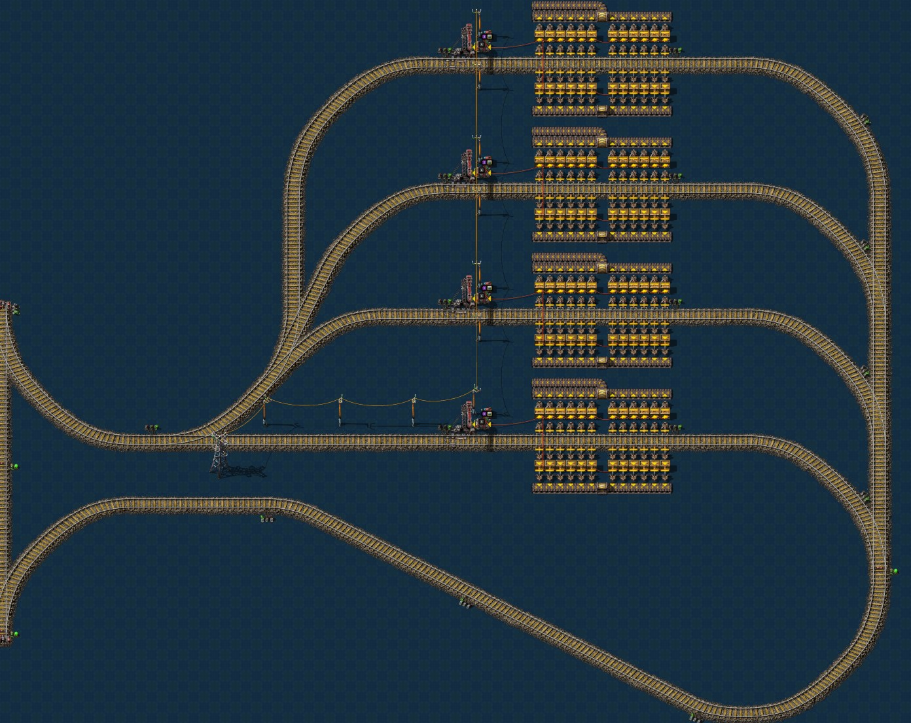
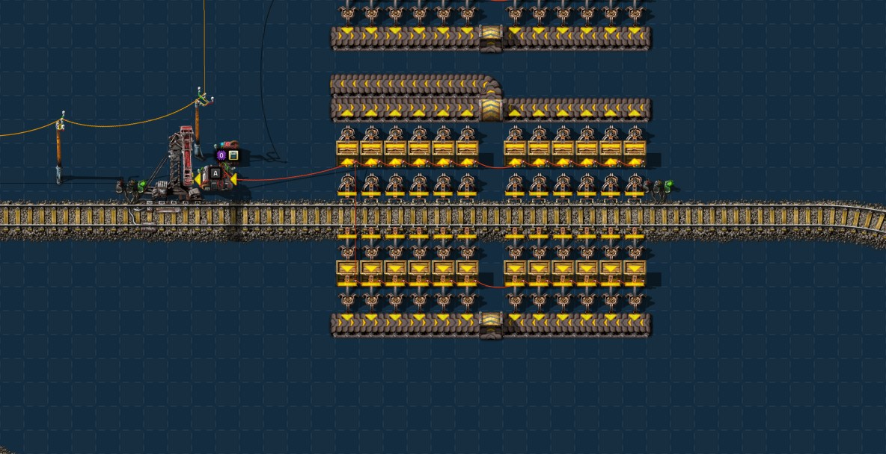

# 第十八章 火车准备2

[English](18-train-preparation-2.md) · [目录](../README.zh-CN.md) · 上一章：
[第十七章](17-batteries.zh-CN.md)

本章接着同一局录像，从 45:52 的存档讲到 49:46 的存档。主题是作者定的：**火车准备2**。这四个小时基地几乎没动，研究自己在跑，作者先在
铁路网东端、后在蓝图沙盒里试做车站，把第十五章开始的铁路设计做完：加油站、车库、物品站和流体站都成了放下就能用的蓝图。大部分设计是边测边改的：
作者画一张蓝图，在引擎里实测，作者再修改。时间都是游戏时间。数字来自游戏数据、记录器、49:46 的存档（`tools/inspect-save.ps1`、`tools/trains-probe`）、
Cybersyn 模组的源码，以及在引擎里让 Cybersyn 调度作者蓝图的实测（`tools/junction-bench` 的 `network` 模式）；完整结果见
[Py 下的铁路](../research/py-railway.zh-CN.md)。

结论：

- **整套车站蓝图完成了，但都还没放到地图上。** 每张都自带一段干线，按 240 格对齐放到网格边上就接好了。第十五章的接口蓝图不再需要。
- **物品站每个站台 24 个工业机械臂加 24 个木箱**，一列 1+2 装或卸 4,000 块约 210 秒。有 1 到 4 个站台的版本，4 站台版还能接扩展模块。
- **需求量由蓝图公式按堆叠算**：勾选堆叠阈值，阈值 40 格（整车），需求量 80 格。放蓝图时只选物品。堆叠 10 的物品每车 400 个，堆叠 1000 的每车 40,000 个，
  都是满载，存量降到一半就下单。
- **流体站每车 50,000，装卸各约 3 秒**：每个站台两台管道泵、两个互通的储液罐 100k，流体需求阈值 50,000。液罐车和货车可以共用一个车库。
- **地图上**：十个双线路口（x 到 1979），第十五章的加油站、车库和固体供货站还在，一列 1+2 停在加油站旁，没有时刻表。背包里有 2 台内燃机车、4 节货运车厢、
  11 个车站、11 个 Cybersyn运算器、10 个常量运算器和 90 个电池。铁路还没有连到基地。

## 过程一览

| 游戏时间 | 发生了什么 |
|---|---|
| 45:44–45:50 | 机器人把双线路网向东延伸两个路口：(1920, −240) 和 (1920, 0) |
| 45:52 | 第十七章最后的存档 |
| 45:55–46:06 | 在 (1713, −81) 试做第一个站台：车站、Cybersyn运算器、工业机械臂、木箱（手搓 135 个）和传送带；46:00 放下第一个常量运算器；一列 1+2 放下又拆掉 |
| 46:17–46:39 | 改到 (1739 至 1741, −81 至 −117)，做成多个站台，反复拆建；46:31 放下 3 台内燃机车和 4 节货运车厢试车，又拆掉 |
| 46:19 | 白白鼠：阶段 1；46:35 模组更新：Cybersyn 2.1.3，新增 factorio-charts |
| 46:39–49:42 | **之后大部分时间在蓝图沙盒里**（到存档的 187 分钟里有 167 分钟） |
| 46:54 | 游戏更新到 2.1.24 |
| 47:05–47:49 | 固态肉菌、肥料：阶段 1、法沃加：阶段 1 |
| 47:19 | 机器人拆掉地图上的试验站：192 个工业机械臂、96 个木箱、124 条传送带和那段铁轨 |
| 48:06–48:24 | 钳尾刀虫：阶段 2、钳尾刀虫升级；48:09 模组更新：pypetroleumhandling 3.1.5 |
| 49:18–49:20 | 基地里 x −75 到 −73、y 29 到 48 的传送带和分流器改了两处 |
| 49:34 | 分子解聚：阶段 1；下一项燃油发电：阶段 1 |
| 49:46 | 存档（`Py-Exploration`） |

这段时间没有聊天留言。车站蓝图是作者在 2026-10-29 到 10-31（现实时间）分四版导出、拿去实测的，下面各节讲最后的结果，修过的问题放在第 6 节。

## 1. 科技

| 研究完成 | 科技 | 在这里给了什么 |
|---|---|---|
| 46:19 | 白白鼠：阶段 1 | 帕拉丁实验室 MK1 和白白鼠 |
| 47:05 | 固态肉菌 | 亚临界水 MK1、解聚有机液、固态肉菌 |
| 47:34 | 肥料：阶段 1 | 一个新的肥料配方 |
| 47:49 | 法沃加：阶段 1 | 法沃加种植园 MK1 |
| 48:06 | 钳尾刀虫：阶段 2 | 钳尾刀虫 MK2 |
| 48:24 | 钳尾刀虫升级 | T.U.R.D. 升级，存档里还没选；苔藓农场升级（第十五章）也还没选 |
| 49:34 | 分子解聚：阶段 1 | 原子化器 MK1，以及把血、肉、肠、骨等转化成金属和其他原料的配方 |

这七项都是 1 pY科技包1型 + 2 机自科技包，共 1,135 个单位，从 45:42 到 49:34 平均每秒 0.08 个。队列接下来是燃油发电：阶段 1、生物质发电：阶段 1、电能储存、风能：阶段 1
和潮汐能：阶段 1。

## 2. 每个车站自带一段干线

第十五章的车站接在「棋盘格-边-车站定位」的接口上，要先放接口，再对齐车站。现在每张车站蓝图都带着自己那段干线（240 格网格边上的外侧车道）和进出站的道岔，
并且设了 240 格绝对对齐：鼠标移到网格边上，蓝图会自己吸附到对应的位置。所以接口蓝图不再需要。

规则还是第十五章那条：**列车上限不能超过站内能停的列数**，否则多出来的车会停在干线上等。下面每种车站都按这条实测过。

「棋盘格-边-远程输电塔」是沿网格边布置的 16 座远程输电塔，两种网格边都能放。Py 的远程输电塔只给周围 2 格供电，所以每个车站都有自己的小型电线杆，运算器都在供电范围内。

## 3. 加油站-1-灰烬

和第十五章的加油站一样：单向环线，机车一侧加燃料，一侧取灰烬。现在自带干线，环线能停 4 列（站台 1 列，等待 3 列），所以列车上限 4。

- 每列 22.6 秒，原煤 70 → 150，灰烬 80 → 0，整列停在站台闭塞区内。
- 第 5 列会停在干线上：一列路过的列车要 60.5 秒，而不是 30.6 秒。

## 4. 车库-1

8 条股道，每条一个车站，上限 1；进口是联锁信号，出口是常规信号。列车行驶方向与第十五章的车库相反，集合轨一侧缩短了 4 格。

| 股道数 | 最后一列入库 | 一列路过的列车 |
|---|---|---|
| 8 | 36.4 秒 | 43.1 秒 |
| 9 | 39.0 秒 | 45.7 秒 |
| 10 | 41.7 秒 | 48.3 秒 |
| 12 | 47.2 秒 | 53.8 秒 |

每列都整列停在自己的闭塞区内。「车库-1-扩展模块」放在最上面一条股道上方 4 格，可以一直往上加。车库的股道数要不少于列车数：第十五章测过，多出来的列车没有地方回。

## 5. 物品站

「物品卸货站」（需求站）和「物品供货站」形状相同，只有传送带方向不同。下面的数字都是 1+2 列车（21 格，40 个货格）。

每个站台是一条直线站台，轨道两侧对称：车厢旁一排工业机械臂，一排木箱，再一排工业机械臂，最外面是传送带，两侧合计 24 个木箱和 48 个工业机械臂。
卸货站把货从车厢搬进箱子，再搬到传送带上，两侧的带穿过轨道汇成一条；供货站反过来，一条传送带经分流器分到两侧。所有箱子接到 Cybersyn运算器，所以它读到的是箱子里的库存。

- **24 个木箱，每个 16 格，一个站台 384 格**：铁板能存 38,400 块。箱子把列车和工厂隔开：列车一次卸下，工厂慢慢用。
- **装 4,000 块 211 秒，卸 210 秒**：24 个工业机械臂约每秒 19 个。
- **列车上限 2**：去同一站台的第二列车整列停在站台前 21.3 格长的弯道闭塞区里，入口不被挡住。所有实测里都没有列车在干线上等过。
- **每个站台有自己的车站和运算器**，车站名是 `[物品图标]卸货站` 或 `[物品图标]供货站`，所以一个站台只管一种物品。放蓝图时在参数窗口里选物品。
- **运算器模式**：卸货站设为“仅需求”，供货站设为“仅供应”。设成“供应和请求”的需求站会把超出需求的部分提供出去。

## 6. 初稿里测出来的问题

每一条作者都修好了，留在这里是因为自己画车站时同样会遇到：

- **运算器没接线**：Cybersyn 什么都读不到，这个站台永远不会请求。初稿最上面的站台和扩展模块就是这样。
- **需求量低于阈值**：默认需求 −1200 低于默认阈值 2,000，10 分钟一单都没有。扩展模块的需求量一度是 +4000，正数不是请求，也没有单。
- **箱子限了 1 格**：每个站台最多 24 格，一列车只能装 2,400 块铁板，堆叠小于 84 的物品永远凑不到 2,000，永远不会被派车。
- **列车上限是 0**：一版导出里 4 个站台的上限变成了 0。Cybersyn 不给这样的车站派车，实测 9 分钟 0 单。
- **扩展模块只能接在 4 站台版上**。接在 1 到 3 站台版上时能建出来，但模块的短轨接不到出口，列车装完货后停在供货站，状态 `no_path`。

## 7. 要多少：阈值和需求量

Cybersyn 下的列车没有固定线路，车站报告缺多少，模组再派车（第十五章）。常量运算器里的负数就是需求量，箱子里的库存和在途的货都算进去，剩下的才是缺口。

派车要同时满足三件事：缺口至少等于阈值，供货站库存至少等于阈值，列车装得下阈值。每车装的是缺口、库存和列车容量三者中最小的。默认阈值是 2,000 个。
1+2 只有 40 格，所以堆叠小于 50 的物品 2,000 个超过了列车容量，默认设置下永远不会被派车。

**堆叠阈值**是 Cybersyn运算器上的勾选项。勾选后阈值的单位从个数变成格数，需求量仍然是个数。所以它的意思是“最少运几格”，而不是“要几格”。
必须同时在常量运算器里加“需求阈值”信号，否则默认的 2,000 会被当成 2,000 格，永远不派车。

作者起初用阈值 40、需求 −4000。下表是 4 个站台运堆叠 100 的板材，车站从空开始，工厂从箱子取货，跑 30 分钟：

| 设置 | 工厂每秒用 | 每站台单数 | 每车 | 箱子空着的秒数 |
|---|---|---|---|---|
| −4,000，阈值 40 格 | 5 | 2 | 4,000 | 526–538 |
| −8,000，阈值 40 格 | 5 | 3 | 4,000 | 279–298 |
| −8,000，阈值 40 格 | 8 | 5 | 4,000 | 280–295 |
| −4,000，阈值 20 格 | 5 | 4 | 2,000–4,000 | 279–291 |

279 到 298 秒是等第一列车的时间。需求量等于阈值时，缺口要到箱子全空才够下单：第二单在约 1,030 秒才发出，约 250 秒后才再有货，每一轮都这样断一次。
需求量是阈值的两倍时，存量降到一半就下单，箱子再也没有空过，而且每车都满载。所以**需求量要取阈值的两倍**，这里就是 80 格。

80 格的个数随物品变：数据里可见物品的堆叠大多是 10、50 和 100，但也有 200（沙子、砾石、小部件、电路板、科技包）和 1000（石砖、灰烬）。−4000 配阈值 40 时堆叠 200 的物品只有 20 格，不够 40 格，永远不派车。

**蓝图参数可以按堆叠算需求量。** 数字参数能写公式，公式里有“参数 N 的堆叠大小”这个变量。作者的写法：

- 一个数字参数“单列火车格数”= 40，变量 `p5`。需求阈值信号也用它，以后换编组只改这一个数。
- 每个站台的常量运算器原始值各不相同（0、−1、−2、−3），这样每一行公式只管自己的站台。
- 依赖参数写 `-2 * p5 * p0_s`，其中 `p0_s` 是参数 0 所选物品的堆叠，其他站台是 `p1_s`、`p2_s`、`p3_s`。

放蓝图时只选物品，需求量自动算好。按这个结果实测，5 个站台（4 站台版加一个模块），工厂每秒用 3 个，跑 60 分钟：

| 堆叠 | 物品 | 需求量 | 每车 | 单数 | 第一车到货前箱子空的秒数 |
|---|---|---|---|---|---|
| 10 | 伙食 | −800 | 400 | 28 | 150 |
| 50 | 工业机械臂 | −4,000 | 2,000 | 7 | 178 |
| 100 | 铁板 | −8,000 | 4,000 | 4 | 297 |
| 200 | 小部件 | −16,000 | 8,000 | 3 | 488 |
| 1000 | 石砖 | −80,000 | 40,000 | 2 | 2,260 |

全部满载，没有列车占干线，箱子也只在第一车到货前空过。最后一列主要是装满一车的时间，所以**堆叠 1000 的物品第一车要等约 37 分钟**，按每秒 19 个算，之后每趟上下货各约 35 分钟，这段时间一直占着一列车。

## 8. 流体站

「流体卸货站」和「流体供货站」的铁轨、信号和物品站逐格相同，可以放在同样的位置。每个站台有两台管道泵，各对一节液罐车厢，后面两个储液罐 100k 接到运算器；需求量 −200,000，正好两个罐。
列车是一台内燃机车加两节液罐车厢，每节 25,000。

- **每车 50,000，装约 3 秒，卸约 3 秒**（物品站是 211 秒和 210 秒）。
- **流体需求阈值 50,000**：流体的默认阈值也是 2,000，用得慢时列车几乎空跑。每个站台每秒用 100，15 分钟，不设时每个站台 33 到 34 单，几乎都是 2,000 到 6,000；设了之后 5 单，全部满载。
  堆叠阈值对流体不起作用。
- **两个罐要互通**：每台泵只对自己的罐，工厂只接一个罐时，另一个罐灌满，列车卸不空，就会一直等下去（Cybersyn 的卸货条件是空车）。初稿只有最下面的站台有这根管道：
  15 分钟里另外三个站台各 6 单后卡死，8 列车被占 6 列。现在每个站台的两个罐之间都有一根管道。
- **没有消耗时**，每个站台收到 4 车后灌满，不再派单，也没有列车留在站台。
- **货车和液罐车共用车库没有问题**：4 列货车加 4 列液罐车跑 15 分钟，货车只运物品，液罐车只运流体，液罐车两趟之间换流体也正常。

各种站台数的结果，全部 50,000，没有列车占干线，也没有列车找不到路：

| 站台数 | 工厂只接一个罐，每秒用 500，15 分钟 | 只给供货站一个罐供液，10 分钟 |
|---|---|---|
| 1 | 每站台 12 单 | 30 单 |
| 2 | 12 | 29 |
| 3 | 12 | 28 |
| 4 | 12 | 26 |
| 6（4 站台版加两个模块） | 11–12 | 14–21 |

作者做了 4 站台版；1 到 3 站台版和两个扩展模块是按作者裁物品站的方式做的，作者导入游戏确认过。液罐车厢要 5 个金属间化合物、10 硬铝、50 钛板、16 钢材、10 小部件和两个制动器 MK1 等，
储液罐 100k 要 2 个储液罐 40k、20 硬铝和 45 铅板。

## 9. 站台数

- 1 到 3 站台版是 4 站台版的严格子集，从最下面的站台开始保留。5 个以上站台用 4 站台版加扩展模块：模块放在最上面站台上方 12 格，可以重复，5 个和 6 个站台实测都有配送。
- 在途的货算进缺口，所以需求量决定同时有几列车。堆叠 100 的物品需求 −4,000 时每个站台只有一列车，两单相隔 455 秒，约每秒 8.8 块；需求 −10,000 时第二列车跟上来，
  15 分钟 16,000 块，对比 8,000 块。公式的 80 格同样允许两列车，每秒用 8 个时箱子没有空过。
- 需求 −10,000、8 列车、15 分钟，1 / 2 / 3 / 4 个站台分别是 4 / 8 / 11 / 15 单。

## 10. 蓝图

本章新增或更新的蓝图都在 [blueprints](../blueprints/README.zh-CN.md)，按第十五章的放法用：

- `rail-grid-edge-big-poles`：棋盘格-边-远程输电塔
- `rail-refuel-ash`：加油站-1-灰烬
- `rail-depot`、`rail-depot-module`：车库-1、车库-1-扩展模块（第十五章的第一版在 git 历史里）
- `rail-requester-1` 到 `-4`、`rail-requester-module`：物品卸货站-1-1 到 -4、物品卸货站-1-扩展模块
- `rail-provider-1` 到 `-4`、`rail-provider-module`：物品供货站-1-1 到 -4、物品供货站-1-扩展模块
- `rail-fluid-requester-1` 到 `-4`、`rail-fluid-requester-module`：流体卸货站-1-1 到 -4、流体卸货站-1-扩展模块
- `rail-fluid-provider-1` 到 `-4`、`rail-fluid-provider-module`：流体供货站-1-1 到 -4、流体供货站-1-扩展模块

## 11. 要点

1. 蓝图绝对对齐后，车站可以自带干线，不用先铺接口。
2. 列车上限不能超过站内能停的列数，也不能是 0。
3. 运算器要接到箱子或储液罐，否则 Cybersyn 什么都读不到。
4. 需求量至少是阈值的两倍。等于阈值时只有箱子全空才下单。
5. 堆叠阈值的意思是最少运几格，要配需求阈值信号，且不能超过列车格数。
6. 需求量可以用蓝图公式按物品堆叠算，放蓝图时只选物品。
7. 流体站的阈值设成整车，同一站台的储液罐要互通。

## 12. 这些事实是怎么核对的

- 45:52 和 49:46 的存档（`Py-Exploration`，复制到 `C:\tmp\ch17` 和 `C:\tmp\ch18`；一致性检查通过）：`tools/inspect-save.ps1`、`tools/summarize-save.js`；列车、车站和地图面用 `tools/save-probe.ps1 -Probe trains-probe`，
  T.U.R.D. 选择用 `-Probe turd-probe`。
- 记录器：`tools/recorder-phases.js`，按 1 分钟分段；玩家所在的地图面来自活动日志。
- 车站蓝图：作者 2026-10-29 到 10-31 的导出（`tools/bp-sync.js`）。`tools/junction-bench` 的 `build`、`station` 和 `network` 模式：`network` 把需求站、车库、供货站和加油站放在初期网格的四条内侧边上，
  由 Cybersyn 调度 8 列车。供货由脚本每 10 秒补充，消耗由脚本模拟（`restock`、`drain`），没有接真实的传送带和管道；传送带上的货不算在内。
- 蓝图公式只能在游戏里运行：Lua 接口不能填写蓝图参数。实测里需求量由脚本设成公式的结果（`request_stacks`），公式本身由作者在游戏里确认。导入导出用 `tools/check-companion.ps1` 检查。
- Cybersyn 的规则：`scripts/central-planning.lua`（版本 2.1.3）。
- 数据事实：`tools/q.js`，以及 2026-10-31 重建的数据导出。

下一章：第十九章（待续）。
