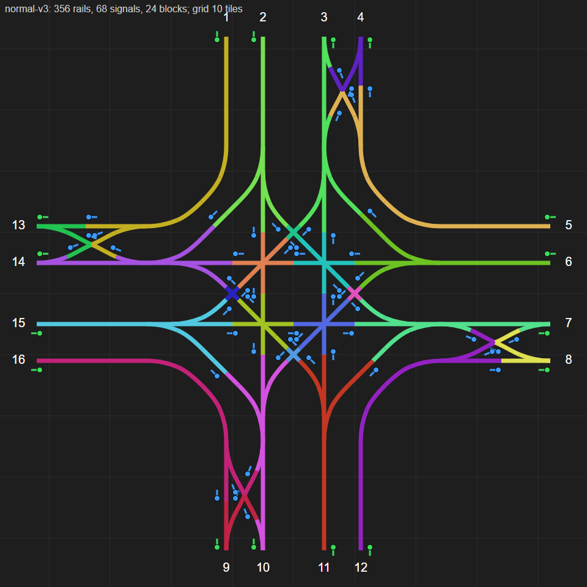

# Rail junctions at grade

[中文](rail-junctions.zh-CN.md)

On 2026-10-24 the author made three blueprints of a four-way rail junction (十字路口-普通, ordinary;
十字路口-苜蓿, cloverleaf; 十字路口-环岛, roundabout), said the signals might be wrong, and asked
which design is best overall, or for a better one, at grade only. This note answers with
measurements.

Sources: the blueprints of the author's export of 2026-10-24 15:24 (the companion's
`export.txt`; not yet pulled into `blueprints/`); rail costs from the data of the author's mods
(`straight-rail` takes 1 Rail, `half-diagonal-rail` 2, `curved-rail-a` and `curved-rail-b` 3
each); everything else measured in the engine with the new `tools/junction-bench`
(`junction-bench.ps1`, `junction-bench.js`), in the save-reading setup (the author's current mods,
so the trains are Py's).

## How the bench measures

- `-Mode map` builds the blueprint's rails and signals on an empty map and asks the engine for
  the rail blocks, the track ends and the path between every two track ends, with the signal met
  at every rail joint on the way (the engine's own signal places of each rail end, both sides of
  the joint).
- `-Mode traffic` adds 320 tiles of straight track to every track end, with rail signals every 30
  tiles, finds the entrances and exits with the pathfinder and puts a train stop "exit <leg>" at
  the far end of every exit track. Every entrance track always has a train waiting at its far
  end: one Locomotive and two Cargo wagons (21 tiles, the author's trains), coal, sent at
  200 km/h when 200 tiles ahead are clear (otherwise from standing). Each goes to the leg its
  scenario picks: **mix** (straight, left or right at random), **straight**, **left**, **right**.
  A train is removed once its last car is 60 tiles past the junction. After 3 minutes of warm-up it
  counts 15 minutes: trains through per movement, the time from the junction's edge until the
  train has left it, the speed at the edge, where trains stand, and a **deadlock** when no train
  has left for 120 s. Both lanes of every entrance are fed, each train with its own random
  destination, so trains often arrive on the lane that does not serve their turn: a stress test of
  the lane changes.
- `-Mode edit` changes the signals and writes the result as a blueprint string (see the fixed
  versions below).

## The three designs

All three are roads of four tracks: two lanes each way, right-hand traffic, lanes 6 tiles apart
(the inner lanes 5 tiles from the road's centre line, the outer ones 11). Every leg has the
author's lane change (换道结构, an X between the two lanes of one direction) where trains enter
and another where they leave.

| | Ordinary | Cloverleaf | Roundabout |
|---|---|---|---|
| Size (track ends) | 84 × 84 | 140 × 140 | 84 × 84 |
| Rails (pieces) | 388 | 532 | 320 |
| Rail items | 580 | 756 | 544 |
| Signals (rail + chain) | 36 + 36 | 36 + 24 | 44 + 32 |
| Right turn | outer lane, own ramp: 56–58 tiles | own ramp: 94–98 | outer ring: 56–58 |
| Straight | inner lanes cross in a 2 × 2 core: 84–86 | through the core: 138–142 | ring: 88–90 |
| Left turn | diagonal through the core: 81–84 | straight on, a loop, the core again: 235–240 | ring: 109–122 |

Path lengths are the engine's shortest paths from track end to track end.

## Faults in the signals

1. **The lane change can lock two trains (all three designs).** On the inner lane there is no
   signal before or after the X: that lane's block runs from the next signal outside the junction
   through the X's switches to the core, and holds the start of the inner-to-outer branch. The
   outer lane's block holds the X's two upper branches. A train on the inner lane that wants the
   outer lane waits at the chain signal on its branch, standing in the inner lane's block; a train
   on the outer lane that wants the inner lane waits at the chain signal in the X's middle,
   standing in the outer lane's block. Each needs the block the other stands in. Measured: the
   cloverleaf locked this way at its south entrance within the first minute of mixed traffic (train S→E
   at (5.2, 68.9) on the branch to the outer lane, train S→N at (9.7, 64.6) on the branch to the
   inner lane, everything behind them standing).
2. **Short blocks after rail signals (ordinary).** The core's exits are rail signals followed by
   about 19 tiles to the exit lane change's chain signal: a 21-tile train that waits there stands
   with its last car over the core's exit signal. The entrance lane change ends 13.5 tiles before
   the core's chain signals: a train waiting for the core stands on the X's merge.
3. **The roundabout's north entrance is signalled backwards.** The four signals of its lane change
   and the rail signal on the inner lane, (−8.5, −36.5), (−6.5, −32.5), (−6.5, −33.5), (−8.5,
   −29.5) and (−3.5, −33.5) in bench coordinates, face trains going north: the inner lane of that
   entrance can only be driven northwards, against its traffic (the pathfinder finds no way in
   from it). The west exit from the ring has its two signals the other way round from the other
   three exits (chain at the ring's far side, rail at the ring). `junction-bench.js symmetry`
   finds both: all other signals match on every side.
4. **The roundabout has rail signals on the ring.** A train may enter the ring and stop on it;
   with four trains each waiting for the next quarter the ring locks. Measured: with left turns only
   (three quarters of the ring each) it locked before the first train got through, four trains
   standing on the inner ring.
5. **The cloverleaf blueprint is cut short in the west.** Its four straight rails end 2 tiles
   before the lane change's curves: placed against track, the straight lanes of the west leg are
   not joined and every train there must change lanes. The bench fills the gap (and says so).

## Traffic measured

Trains a minute, 15 minutes after 3 of warm-up, trains arriving at 200 km/h when the track ahead
allows. **Lane feed**: both lanes of every entrance fed, every train with its own random
destination (a stress test of the lane changes).

| | Mix | Straight | Left | Right |
|---|---|---|---|---|
| Ordinary, as built | 32.1 | 37.5 | 36.9 | 59.5 |
| Cloverleaf, as built | locked in the first minute | 41.6 | locked at once | 75.2 |
| Roundabout, as built | 15.0 (only the east leg's trains got through) | 10.8 (none from the north) | locked at once | 59.4 |
| Ordinary, signals fixed (all chain inside) | 29.9 | 25.3 | 23.7 | 92.1 |
| Cloverleaf, signals fixed | 15.3 | 20.9 | 7.5 | 39.2 |
| Roundabout, signals fixed (east leg turned onto the others) | 26.1 | 23.9 | 15.2 | 66.4 |

Mixed traffic over 30 minutes, three more seeds (lane feed): ordinary as built 31.0, 31.4 and
27.9, no deadlock; ordinary fixed with buffers (below) 30.8, 31.3 and 30.5.

**Leg feed**: one queue per leg; the next train's movement is drawn first (a third each in mix),
then it waits for a free entrance track that leads there. This is what a network gives when a
lane change before the junction has already put trains on the lane they need, and the only fair
feed for junctions whose lanes serve different turns.

| Ordinary junction | Mix | Straight | Left | Rail items | Signals (rail + chain) |
|---|---|---|---|---|---|
| As built | 28.2 | 36.5 | 36.3 | 580 | 36 + 36 |
| Signals fixed, all chain inside | 30.9 | | | 580 | 8 + 80 |
| Signals fixed, with buffers | 32.5 | | | 580 | 16 + 80 |
| Lane change at the entrances only | 31.8 | 25.3 | 25.7 | 500 | 24 + 52 |
| **Lane change at the exits only** | **37.3** | 34.9 | 36.4 | **500** | 16 + 52 |
| No lane change | 39.4 | 34.9 | 36.4 | 420 | 24 + 32 |

Mixed traffic over 30 minutes with three more seeds (leg feed), and the mean of all four runs:

| Ordinary junction | Seed 2 | Seed 3 | Seed 4 | Mean of four |
|---|---|---|---|---|
| As built | 30.5 | 29.4 | 30.5 | 29.7 |
| Signals fixed, with buffers | 31.5 | 31.4 | 30.7 | 31.5 |
| Lane change at the exits only | 37.8 | 37.3 | 32.1 | 36.1 |
| No lane change | 40.3 | 38.6 | 32.2 | 37.6 |

None of the 16 runs locked. With seed 4 the last two fell to 32. A likely reason (not measured
apart): with one queue per leg, a train at the head that needs the busy outer lane (a right turn)
holds back trains behind it that could take the inner lane. A network feeds the two lanes
separately, so this feed probably undersells junctions whose lanes serve different turns.

Right turns alone mostly show how fast the bench feeds trains: they never meet another movement
in the ordinary design.

## Fixed versions

`-Mode edit` writes each as a blueprint string; the three for the ordinary junction and the lane
change are in [rail-junctions/](rail-junctions/) (import them in game with the blueprint
library's import button). Every one was built back from its string and measured as above.

- **Signals fixed, all chain inside** (`-Options '{"edit":{"chain_inside":true,"edges":true}}'`):
  every rail signal becomes a chain signal, a chain signal stands where each entrance track enters
  (before the lane change's first switch) and a rail signal where each exit track leaves. A train
  enters only when its whole way to the exit is free: it cannot stop inside, so nothing inside can
  lock. Slower in straight and left traffic: a train waiting at the edge needs some 30 tiles more
  to reach the core than one waiting inside, and its whole path must be free at once.
- **Signals fixed, with buffers** (`junction-ordinary-fixed.txt`, 十字路口-普通-信号修正): the same,
  plus two rail signals per leg where a waiting train stands wholly in a block nothing else uses:
  on the inner lane right after the lane change's first switch (a 27.5-tile block to the core)
  and at the start of the right-turn ramp. Keeps both lane changes: a drop-in replacement.
- **Lane change at the exits only** (`junction-ordinary-exit-lane-change.txt`,
  十字路口-普通-出口换道): the four entrance lane changes removed (32 rails). The outer entrance lane
  then serves the right turn only and the inner one every turn; the exit lane change sorts trains
  for the next junction. Rail signals at the entrances (the inner lane's block to the core is 31.5
  tiles, the ramp's longer), chain signals inside and through the exit lane change, rail signals
  at the exits.
- **No lane change** (`junction-ordinary-no-lane-change.txt`, 十字路口-普通-无换道): all eight lane
  changes removed (64 rails); the core's exits become rail signals too (31.5 tiles to the edge).
  Lanes are then changed between junctions, with `lane-change-fixed.txt` (换道结构-信号修正: chain
  signals before the X on both lanes and inside it, rail signals after it).

Why the lane change at the entrance is the expensive one: it ends 13.5 tiles before the core, so a
train that waits for the core stands on it, and a train coming over from the other lane must have
the whole core path free as well; at the exit the lane change only meets trains that have already
crossed.

## Verdict

- **Of the three, the ordinary junction is the best by every measure but rail count.** As built
  it is the only one that kept running in every test, it carries the most trains, its paths are
  the shortest (left turns 81–84 tiles against 109–122 on the ring and 235–240 on the cloverleaf),
  and it is as small as the roundabout (84 × 84) for 36 rail items more. Its signals still need
  fixing: its lane change can lock (fault 1), as the same lane change did on the cloverleaf.
- **The roundabout** is the cheapest (544 rail items) and as small, but as built it is broken
  (fault 3) and its ring can lock (fault 4); fixed, it carries 26 trains a minute in mixed
  traffic and only 15 in left turns.
- **The cloverleaf at grade has no advantage.** A cloverleaf's loops exist to avoid crossings on
  bridges; at grade every left turn crosses the core twice. It needs 2.8 times the area and 756
  rail items, locks as built, and fixed carries 15 trains a minute in mixed traffic, 7.5 in left
  turns.
- **Better, measured: the ordinary junction with the lane change at the exits only**: 36.1 trains
  a minute in mixed traffic on average over four runs (32.1–37.8) against 29.7 (28.2–30.5) for the
  original with the same feed, 80 rail items fewer, and no place inside where a stopped train
  blocks another. If lanes are changed between junctions instead, the junction with no lane change
  carries 37.6 (32.2–40.3) for 420 rail items. The drop-in fixed version (both lane changes kept)
  carries 31.5: it removes the risk of a lock, not the lane changes' cost.
- For the author's game now (one Locomotive, two Cargo wagons) any working junction is far above
  need: these numbers matter for the city-block network to come.

## The rule behind the fixes

1. **Chain in, chain inside, rail out.** Every signal a train meets from just before its path
   first shares track with another (a crossing, a merge, a lane change's first switch) until it is
   clear of the last one is a chain signal; the signal where it leaves is a rail signal, and the
   block after it (up to the network's next signal) holds a whole train (21 tiles for the author's
   trains). A lane that only its own trains use before that point may start with a rail signal, as
   in the two improved versions.
2. **A rail signal inside only where the waiting train fits and blocks nobody**: the block behind
   it must hold the whole train and must not be used by any other movement. Measured examples: the
   inner lane between the lane change and the core (27.5 tiles), a right-turn ramp, the core's
   exits once no lane change follows them (31.5 tiles).
3. **A lane change decides before its first switch**: a chain signal on both lanes before the X,
   only chain signals inside it, a rail signal after it only with a train's length before the next
   place a train may stop.
4. **No rail signals on a roundabout's ring.**
5. **Signals stand on the right of the track as trains run** (right-hand traffic). After copying or
   turning a leg, `junction-bench.js symmetry` shows every signal that differs between the four
   sides.

## Follow-up: stations, a lane change before the junction, X or `\/`

The author took the junction with the lane change at the exits only into their game, then noted
(2026-10-24, export of 17:33) that their stations branch off the outer lane: a train leaving a
station is on the outer lane and, at a junction whose outer entrance lane only turns right,
cannot reach the inner lane. Their answers: split the station's exit, or put a lane change before
the junction, as in their new layout (two such junctions about 120 tiles apart, each entrance
from the stretch between them with their lane change just outside the junction's edge). They
also asked whether a `\/` lane change (the two crossovers one after the other) would be faster
than the X. Measured:

**The lane change before the junction works, once it has its two entrance chain signals.** Their
new lane change (换道结构, also used in the layout) keeps the five chain signals inside and the
two rail signals after the X of `lane-change-fixed.txt`, but not the two chain signals before it.
The two branches meet in the middle, so the first half of the inner-to-outer branch belongs to
the outer lane's block; a train waiting on that branch stands in the inner lane's block, and one
waiting in the middle stands in the outer lane's block: each needs the other's block (fault 1
again). The junction of the layout, with that lane change turned onto all four entrances (548
entities, 652 rail items):

| Mixed traffic, trains a minute | Seed 1 | Seed 2 | Seed 3 | Leg feed |
|---|---|---|---|---|
| As exported | 22.9 (south and west entrances locked) | 33.3 | 25.7 (north and west locked) | 31.1 (north locked) |
| With the two entrance chain signals | 36.9 | 37.8 | 38.2 | 36.1 |

For comparison, the original junction (both lane changes inside) carried 30.6 on average with
the lane feed, and the junction with the exit lane changes only 36.1 with the leg feed. The
lane change outside costs nothing measurable and gives every entrance lane every turn.

The lane change alone, both lanes fed, each train sent to a random exit lane (half of them
change lanes), two seeds of 15 minutes:

| Lane change | Trains a minute |
|---|---|
| The author's new one, as exported | locked within the first 20 seconds, both seeds |
| The same with the two entrance chain signals (`lane-change-fixed.txt`) | 21.4, 19.9 |
| X, a chain signal at every joint of both branches and in the middle of both lanes | 19.6, 18.7 |
| `\/`: the second crossover moved one crossover's length (18 tiles) on | 16.7, 17.9 |
| `\` and `/` 24 tiles apart, a rail signal on each lane between them | 15.6, 15.3 |

**The X is the fastest.** In the `\/` a train needs 36 tiles of switches free instead of 18 (2.5 s
through against 1.6 s); taking the two apart with a waiting place between makes it longer still.
More signals inside the X did not help either.

The stretch between the two junctions of the layout has no signal: each lane from one junction's
exit to the next junction's entrance (about 150 tiles) is one block and holds one train; signals
every 30 tiles or so (more than a train's 21) let trains follow each other. A station's exit
split onto both lanes was not measured; its branch to the inner lane would cross the outer lane,
where through trains run.

The exit lane change has a chain signal in the middle of its outer lane and none on its inner
lane (inherited from the author's original, where that signal was a rail signal). Asked why: it
is not needed on either side. Every signal from the core's entrance to the exit edge is a chain
signal, so a train enters the exit lane change only with its way to the edge reserved and never
stands inside it; the lock of fault 1 needs trains standing inside. Measured on the layout above
(both lanes fed), with a chain signal added on the inner lane of all four exit lane changes:
36.8, 38.2 and 38.1 trains a minute against 36.9, 37.8 and 38.2 without, no lock either way.

## Signals that can go (the author's latest junction, export of 19:05)

The author fixed the four core chain signals that stood a tile off between sides and asked
which signals of the junction could still go. Each group was removed on all four sides at once
and measured on their layout (the junction plus their lane change, with its entrance chain
signals, outside each entrance; both lanes fed, mixed traffic, the same three seeds; with all
signals 36.9, 37.8 and 38.2 trains a minute):

| Removed (on every side) | Trains a minute | |
|---|---|---|
| Exit lane change: the chain signal in the middle of the outer lane | 37.5, 38.4, 37.9 | can go |
| Exit lane change: the two chain signals at the crossing | 37.5, 38.5, 37.4 | can go |
| Both of the above (12 signals) | 37.5, 38.5, 37.4 | can go |
| Exit lane change: the two branch signals next to the inner lane | 31.9, 33.7, 32.9 | keep |
| All five of the exit lane change | 31.9, 33.7, 32.9 | keep |
| Core: the three inside the crossings | 27.3, 28.6, 27.5 | keep |
| Core: the two exits | 30.7, 32.1, 33.1 | keep |
| The chain signal on the inner lane's right-turn curve | locked at once, all three seeds | keep |

The last one carries no shortest path, but it parts the entrance approach of one leg from the
exit lane of the next: without it the two are one block, and the four legs wait on each other.
The entrance and exit rail signals and the core's entrance chain signals were not removed: they
are where trains wait, outside the crossings (rule 1).

The same three signals of the lane change itself (the middle of the outer lane, the two at the
crossing) can go too: 21.4 and 19.9 trains a minute with and without them, two seeds. Without
the two branch signals as well (entrance and exit signals only) it fell to 15.3 and 15.1. Both
cut together on the layout (24 chain signals fewer):
37.1, 38.4 and 39.5. Strings: `junction-ordinary-exit-lane-change-lean.txt` (十字路口-精简信号,
the author's latest junction without the 12) and `lane-change-lean.txt` (换道结构-精简信号);
which ones go: `removable-exit-lane-change.png`, `removable-lane-change.png`.

The early two-track version (十字路口-初期: one track each way, using the outer lane positions of
the four-track road, the same core; each entrance splits after a chain signal onto the right-turn
ramp and the inner approach, each starting with a rail signal; each exit merges its two branches
after a chain signal on each): signals right, symmetric but for the four core chain signals the
four-track version had a tile off (harmless). Mixed traffic 33.5, 34.7 and 35.5 trains a minute
(the four-track layout 36.9 to 38.2), straight 35.0, left 51.3, right 60.0 (the bench's feed).
Its two chain signals before each exit merge stay: without them 30.9, 32.2 and 31.1.
